<div align="center">

<h1>CLAM — CL Agent Mesh</h1>

<p><strong>Distributed AI Agents. One Shared Workspace.</strong></p>

<p><strong>English</strong> · <a href="README.vi.md">Tiếng Việt</a></p>

<p>
  <a href="LICENSE"></a>
  
  
  
  
  
  
  <a href="#contributing"></a>
</p>

<p>
  <a href="#quick-start">Quick start</a> ·
  <a href="#screenshots">Screenshots</a> ·
  <a href="#architecture">Architecture</a> ·
  <a href="#configuration">Configuration</a> ·
  <a href="#documentation">Docs</a> ·
  <a href="#contributing">Contributing</a>
</p>

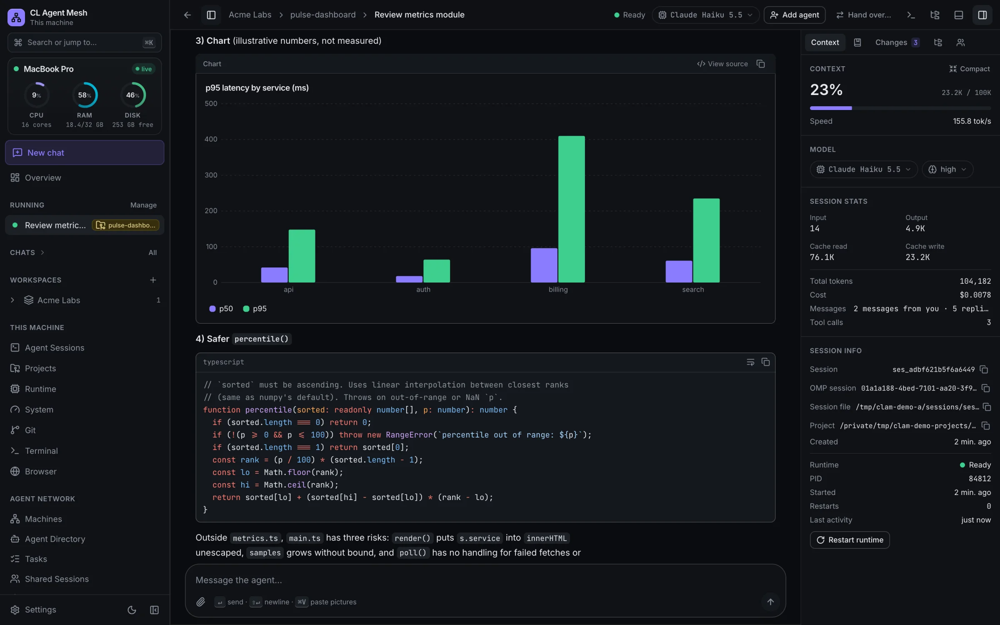

</div>

## Table of contents

- [What is CLAM](#what-is-clam)
- [Highlights](#highlights)
- [Screenshots](#screenshots)
- [How CLAM compares](#how-clam-compares)
- [Architecture](#architecture)
- [Quick start](#quick-start)
- [Installation](#installation)
- [First-time setup](#first-time-setup)
- [Connect a second machine](#connect-a-second-machine)
- [Use it from your phone](#use-it-from-your-phone)
- [Preview a local web app](#preview-a-local-web-app)
- [Everyday workflows](#everyday-workflows)
- [Updating, backup and uninstall](#updating-backup-and-uninstall)
- [Troubleshooting](#troubleshooting)
- [Development](#development)
- [Configuration](#configuration)
- [Project structure](#project-structure)
- [Documentation](#documentation)
- [Security](#security)
- [Contributing](#contributing)
- [Acknowledgements](#acknowledgements)
- [License](#license)

## What is CLAM

CLAM turns the computers of one person (or a small team) into an AI team. Each computer — a **machine**, called a *node* in the protocol docs — runs AI agents behind a local web UI. The agent runtime is [OMP](https://github.com/can1357/oh-my-pi) (`omp`), driven through its RPC mode; the runtime interface is pluggable.

Machines pair with each other through **your own Cloudflare Tunnel** — no ports opened, no central server. They chat in one group, delegate work to each other's agents, share sessions and memory, and hand unfinished work from one machine to another. A machine going offline never interrupts work running on another machine.

**Why.** Your laptop, workstation and home server each have their own files, tools, logins and compute. CLAM lets an agent on each of them work where the work lives, while you follow and steer everything from one UI — including from your phone.

**Platform support.** macOS (Apple Silicon) is the platform CLAM is developed and tested on. Linux runs in the Docker test bench (Debian, Node 24); a native Linux install uses the same commands but was not run by the maintainer. **Windows is not tested**: the code has Windows paths (scheduled-task autostart, `netstat` port scan, `cloudflared` via winget), but nothing marked *Windows* below has been verified on a real Windows machine.

## Highlights

### Agents and chats

- **Chats without a repository** — talk to an agent about anything (research, writing, images, video). It gets its own folder; files you attach are uploaded to the project's `attachments/` folder.
- **Rich output** — Markdown with highlighted code (Shiki), math (KaTeX), Mermaid diagrams and `chart` blocks; image, video, audio, PDF and text previews.
- **Readable agent activity** — subagent results render as a report card (agent, status, duration, first sentence; full Markdown on demand); background-job results as a compact card (what ran, outcome, duration, output tail).
- **Context control** — the **Context** panel shows context-window usage and **Compact** shrinks it on demand, with an optional focus.
- **Composer** — while the agent works, a switch chooses between steering it and queuing a follow-up; a stop button, model and thinking-level pickers.
- **Right panel** — Context, Memory, Changes (the folder's uncommitted git changes, with a count), Files (folder tree), Subagents and Team tabs.
- **Running sessions** in the sidebar, each with a coloured project badge (or a Chat badge).

### Multi-machine mesh

- **Pairing** — one-time code plus fingerprint comparison, per-direction capability presets, immediate revocation.
- **Group chat across machines** — you and one agent per machine in one thread; `@mention` an agent, a machine or everyone. Compact layout with a group summary in the view bar and a one-box composer; a reply carries the files its Markdown points at.
- **Delegation** — send a task to an agent on another machine, follow it, discuss it, get the result and the files back.
- **Shared sessions and takeover** — a session on machine A is mirrored live on B; if A goes offline, B continues from the last checkpoint, or A hands it over while online. Git-mode shared sessions work in **their own git worktree** of the shared branch, so a project folder's branch is never switched.
- **Handoff with dependency setup** — move a running task to another machine; the target restores the work, installs dependencies (after your approval) and continues. Nothing is released until the target acknowledged.
- **Shared memory** — notes, decisions and plans that sync between machines and are given to new agent sessions.

### Machine tools

- **Terminal** — a real shell on that machine (xterm.js + node-pty), with Nerd Font icons from a bundled symbols font.
- **Browser** — a headless Chromium on that machine, streamed to the UI, with iPhone viewport emulation.
- **Preview** — open a dev server running on a machine in *your own* browser through the machine's domain.
- **Git** — branches, changes, history and pull requests per project.
- **OMP management** — provider logins, model roles, model catalog, and **check for / install OMP updates** (`omp update --check` / `omp update`) from **Settings → OMP Providers**.

### Remote and mobile

- **Remote access through your own domain** — open any machine's UI behind an owner password; off by default and switched on only at the machine itself.
- **Phone layout** — bottom navigation with a **Runtime** tab and live process count, a compact composer, home-screen install.
- **English and Vietnamese**, light, dark and system themes.

### Observability

- **System monitor** — the sidebar machine card shows live CPU, RAM and disk as ring gauges and raises alerts (memory low or under pressure, CPU high on a ~30 s average, disk getting full).
- **System page** — CPU load, memory, swap and pressure, every volume, top apps by CPU and by memory, and an on-demand *Largest folders in your home* scan that changes and uploads nothing.
- **Runtime page** — the OMP processes behind your sessions, with stop and restart; **LLM Usage** for tokens, cost and provider quota; a runtime log per session.

## Screenshots

<table>
  <tr>
    <td width="50%"><br><sub><b>Agent session</b> — rich output and the right panel (dark)</sub></td>
    <td width="50%">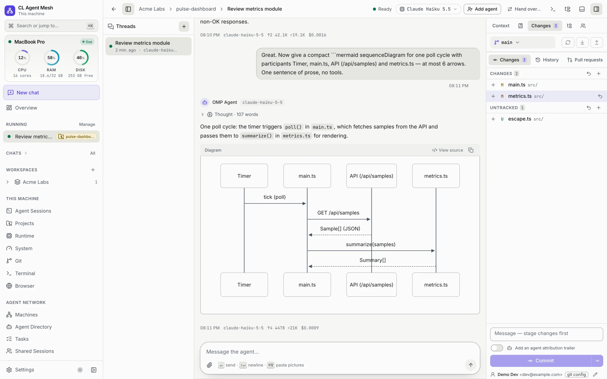<br><sub><b>Light theme</b> — Mermaid diagram and uncommitted git changes</sub></td>
  </tr>
  <tr>
    <td>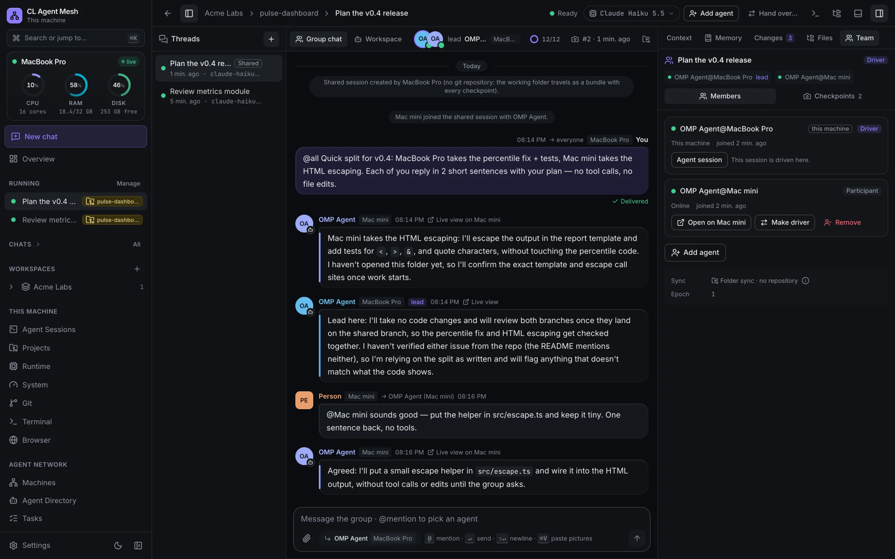<br><sub><b>Group chat</b> — one thread, an agent per machine</sub></td>
    <td>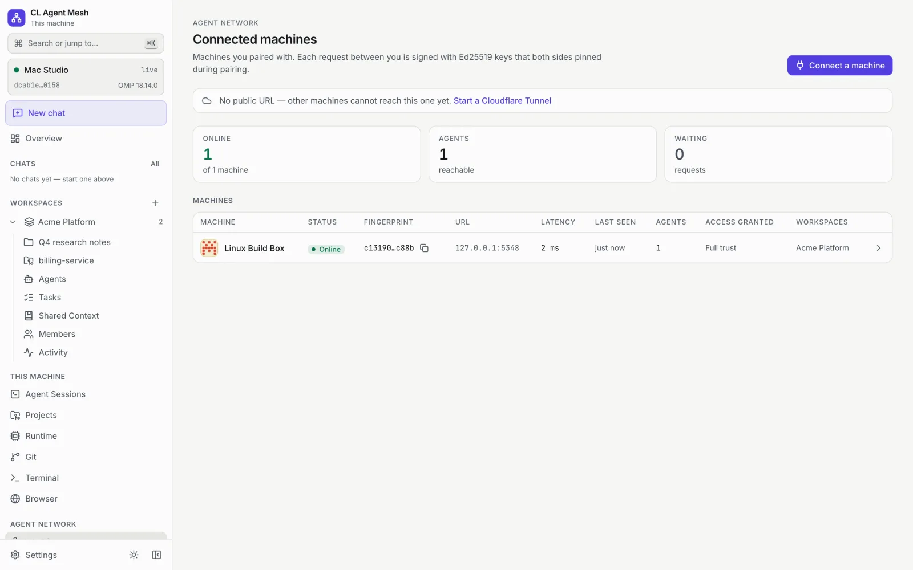<br><sub><b>Machines</b> — a paired second machine</sub></td>
  </tr>
  <tr>
    <td>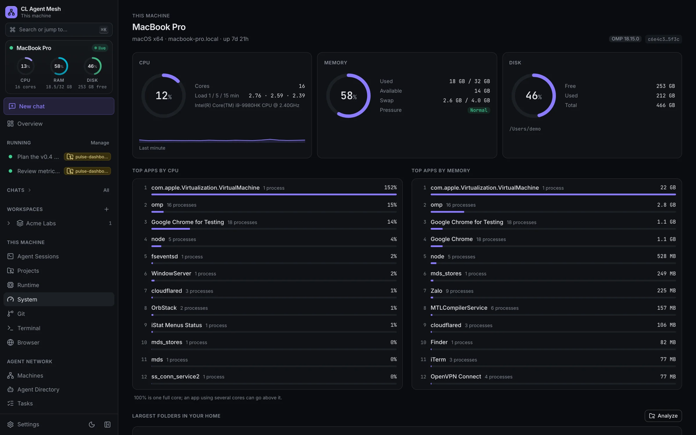<br><sub><b>System monitor</b> — gauges and top apps</sub></td>
    <td>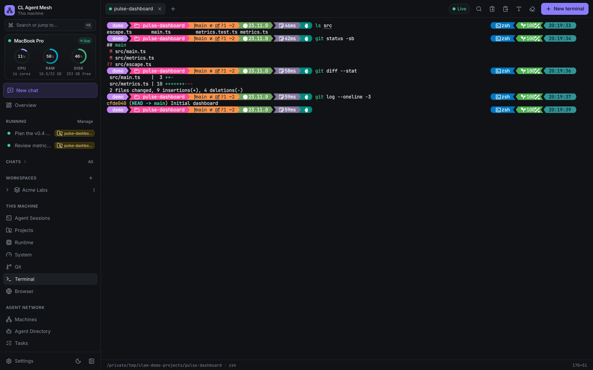<br><sub><b>Terminal</b> — a real shell on the machine</sub></td>
  </tr>
</table>

<table>
  <tr>
    <td align="center" width="33%">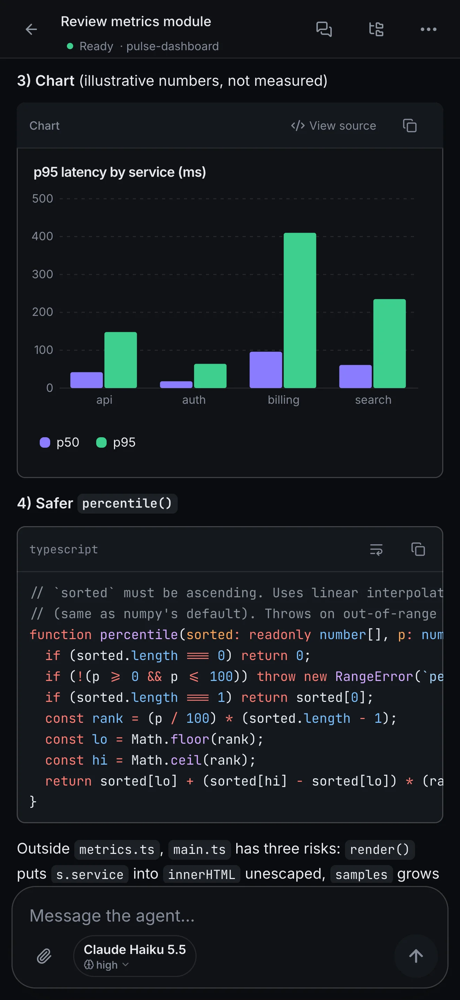<br><sub><b>Phone</b> — chat (dark)</sub></td>
    <td align="center" width="33%">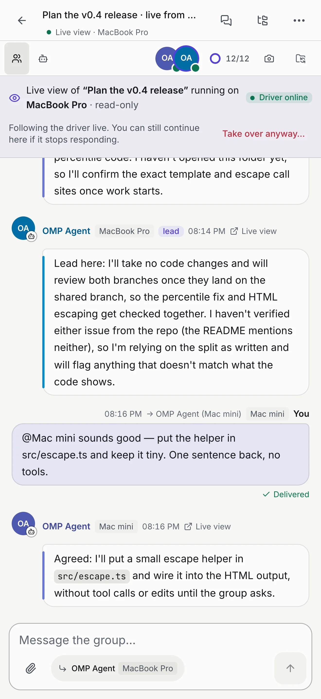<br><sub><b>Phone</b> — group chat (light)</sub></td>
    <td align="center" width="33%">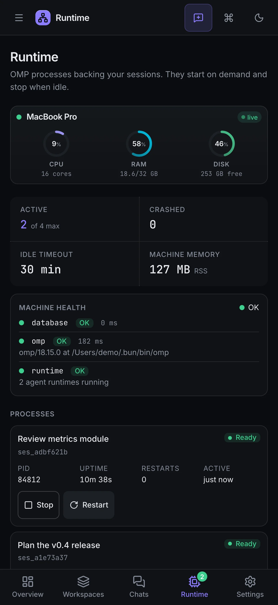<br><sub><b>Phone</b> — Runtime tab (dark)</sub></td>
  </tr>
</table>

## How CLAM compares

Most AI coding agents in 2026 either run in a vendor's cloud sandbox or run on one computer and send remote access through the vendor's relay. CLAM is self-hosted and MIT-licensed. It turns *several* of your own machines into one agent team that talks machine-to-machine over your own Cloudflare Tunnels, with no CLAM server in between. Agents work where your files, tools and logins already are, and you can move live work from one machine to another.

| | Runs on yours | Self-hosted path | Multi-machine | Handoff / takeover | Phone | Any model | License | Price |
| --- | :-: | :-: | :-: | :-: | :-: | :-: | --- | --- |
| **CLAM** | ✅ | ✅¹ | ✅ | ✅ | ✅ | ✅ | MIT | Free² |
| Claude Code | ✅ | ⚠️ | ⚠️ | ⚠️ | ✅ | ❌ | Proprietary | Sub / API |
| OpenAI Codex | ✅ | ⚠️ | — | ✅ | ✅ | ⚠️ | Apache-2.0 (CLI) | Sub / API |
| Cursor | ⚠️ | ❌ | — | ⚠️ | ⚠️ | ⚠️ | Proprietary | $0–200/mo |
| GitHub Copilot | ⚠️ | ❌ | — | ⚠️ | ✅ | ⚠️ | Proprietary | $0–100/mo + credits |
| Devin | ⚠️ | ❌ | — | — | — | ⚠️ | Proprietary | $0–200/mo |
| OpenHands | ✅ | ✅ | — | — | — | ✅ | MIT | Free · Teams $500/mo |
| Conductor | ✅ | ⚠️ | ⚠️ | — | ⚠️ | ✅ | Proprietary | $0–60/mo |
| Vibe Kanban · Claude Squad | ✅ | ✅ | — | — | — | ✅ | Apache-2.0 · AGPL-3.0 | Free |
| Goose | ✅ | ✅ | — | — | — | ✅ | Apache-2.0 | Free |
| SSH + tmux + Tailscale | ✅ | ⚠️ | ❌ | ❌ | ⚠️ | ✅ | mixed | Free |

✅ yes · ⚠️ partial · ❌ no · — not found in public docs.
**Runs on yours**: the agent's tools run on hardware you own. **Self-hosted path**: sessions don't go through, and aren't stored by, the tool vendor's cloud (model API calls not counted). **Multi-machine**: agents on different machines work together. **Handoff / takeover**: running work moves to another machine. **Phone**: you can reach your own machine's agent from a phone. **Any model**: you choose the provider or use your own key or subscription.
¹ Traffic between machines and from your phone goes through *your own* Cloudflare account. Cloudflare terminates TLS. Requests are Ed25519-signed for integrity but not end-to-end encrypted ([docs/security.md](docs/security.md)). ² You pay your model provider. A Cloudflare account and your own domain are optional (you need them for a stable address).

<details>
<summary>Why the ⚠️ cells</summary>

- **Claude Code**: Remote Control keeps execution local, but it relays the session through Anthropic and stores the transcript there. Cross-session messaging sends text (not history or files) to your sessions on other machines. `/teleport` pulls cloud sessions into the terminal. Only Claude models (Anthropic API, Bedrock, Vertex, Foundry).
- **Codex**: the CLI can call your own provider directly. Mobile access and multi-device control go through OpenAI's relay, and the mobile host must run the ChatGPT desktop app on macOS or Windows. Handoff moves a chat and its Git state between hosts, but it interrupts a running response first. Custom providers work in the CLI config; the cloud and app use OpenAI.
- **Cursor**: Self-Hosted Machines run tool calls on your hardware, but the agent loop, inference and transcripts stay in Cursor's cloud. Requests go through Cursor's servers, even with your own key (BYOK covers 5 providers). Background agents move a task from your machine to the cloud. Mobile reaches cloud agents.
- **GitHub Copilot**: sessions run in GitHub cloud sandboxes by default. `--environment-host` registers your own machine, and GitHub Mobile can steer it. "One session, every surface" means switching devices, not moving work between machines. BYOK is available in the Copilot CLI and app.
- **Devin**: Devin Desktop runs locally, but the "brain" always runs in Cognition's cloud. Enterprise customers can get a dedicated deployment or VPC. Models come from several vendors through Cognition.
- **Conductor**: local workspaces send messages straight to your model provider. Cloud workspaces (Vercel sandboxes) store sessions on Conductor's servers. Multiplayer and the mobile app need the Pro plan. Runs on macOS only.
- **SSH + tmux + Tailscale / VS Code Remote Tunnels**: Tailscale's coordination server or Microsoft dev tunnels set up the connection. Phone access works only in a terminal app, and you coordinate and hand off work by hand.

</details>

### What makes CLAM different

- **One agent team across all your machines.** You and one agent per machine share a group chat with `@mentions`. You can delegate a task to another machine's agent, follow it, and get the result and files back with a preview before anything is applied. Work runs on the machine that has the repo, GPU, logins or OS it needs, without copying it to a cloud sandbox.
- **Work survives a machine going away.** A session on machine A is mirrored live on B. If A goes offline, B continues from the last checkpoint; if A is online, it can hand over. Running tasks hand off with dependency setup (approved by you), and A keeps ownership until B sends a durable acknowledgement. Epoch fencing makes sure the work never runs twice.
- **No CLAM server, ever.** Each machine has its own server and SQLite database, binds only to loopback, and talks to peers through Ed25519-signed requests with pinned keys and capabilities granted per direction. Provider credentials stay in OMP's own store, and secrets stay in the OS keychain.
- **Your machines, from your phone.** Each machine serves its own UI on your domain behind an owner password. Remote access is off by default and can only be switched on at the machine itself, with no open ports. From the phone you also get that machine's Terminal, headless Browser and dev-server Preview.
- **Bring your own model and subscription.** Any provider OMP supports, logged in with your own accounts. CLAM is free and MIT-licensed.
- **More than code.** Chats without a repository, shared memory synced between machines, file and media previews, Git and GitHub pull requests, and a live system monitor for each machine.

### When another tool is the better fit

- **You want agents to keep working while every computer you own is off**, or to run many tasks in parallel on managed compute. Codex cloud, Cursor Cloud Agents, GitHub Copilot cloud sandboxes and Devin offer managed sandboxes. CLAM runs only on machines you keep powered on.
- **You need enterprise controls** such as SSO/SAML, RBAC, audit logs, SOC 2 or vendor support. Copilot, Cursor, Devin, Conductor and OpenHands Teams offer them. CLAM has one owner password per machine.
- **You need a mature, cross-platform product today.** CLAM is early-stage. It is developed and tested on macOS (Apple Silicon), Linux is tested only in the Docker bench, and Windows is untested.
- **You work on one machine and just want parallel agents in git worktrees.** Conductor, Vibe Kanban or Claude Squad are lighter, as are the built-in worktree modes of Claude Code and Codex.
- **You can't use Cloudflare, or you want a specific agent CLI.** Pairing machines in CLAM requires Cloudflare Tunnel, and the only agent runtime today is OMP (the runtime interface is pluggable). Claude Code Remote Control, the Codex app's remote connections or Tailscale may fit better.

<sub>Comparison as of November 2026, based on public docs. Products change fast. Corrections are welcome as a PR.</sub>

<details>
<summary>Sources</summary>

- CLAM: [README](#what-is-clam), [docs/architecture.md](docs/architecture.md), [docs/shared-sessions.md](docs/shared-sessions.md), [docs/handoff-protocol.md](docs/handoff-protocol.md), [docs/security.md](docs/security.md), [LICENSE](LICENSE)
- Claude Code: [Remote Control](https://code.claude.com/docs/en/remote-control), [Cross-session messaging](https://code.claude.com/docs/en/cross-session-messaging), [Cloud sessions](https://code.claude.com/docs/en/claude-code-on-the-web), [Self-hosted environments](https://code.claude.com/docs/en/self-hosted-environments), [Overview](https://code.claude.com/docs/en/overview), [License](https://github.com/anthropics/claude-code/blob/main/LICENSE.md)
- OpenAI Codex: [Remote connections](https://learn.chatgpt.com/docs/remote-connections), [Pricing](https://developers.openai.com/codex/pricing), [Advanced config (providers)](https://developers.openai.com/codex/config-advanced), [openai/codex](https://github.com/openai/codex)
- Cursor: [Self-hosted machines](https://cursor.com/blog/self-hosted-machines), [Cloud Agents](https://cursor.com/docs/cloud-agents), [Background agents](https://cursor.com/help/ai-features/background-agents), [Pricing](https://cursor.com/help/account-and-billing/pricing), [BYOK](https://cursor.com/help/models-and-usage/api-keys)
- GitHub Copilot: [Connected cloud experience (2026-10-28)](https://github.blog/changelog/2026-10-28-work-from-anywhere-with-a-new-connected-copilot-cloud-experience/), [Plans](https://github.com/features/copilot/plans), [BYOK](https://docs.github.com/en/copilot/concepts/models/bring-your-own-key)
- Devin: [Pricing](https://devin.ai/pricing), [Enterprise deployment](https://docs.devin.ai/enterprise/vpc/overview)
- OpenHands: [Pricing](https://www.openhands.dev/pricing), [GitHub](https://github.com/OpenHands/OpenHands)
- Conductor: [Docs](https://www.conductor.build/docs), [Pricing](https://www.conductor.build/pricing)
- Vibe Kanban: [GitHub](https://github.com/BloopAI/vibe-kanban), [Shutdown notice](https://www.vibekanban.com/blog/shutdown) · Claude Squad: [GitHub](https://github.com/smtg-ai/claude-squad)
- Goose: [GitHub](https://github.com/aaif-goose/goose)
- DIY: [Tailscale pricing](https://tailscale.com/pricing), [VS Code Remote Tunnels](https://code.visualstudio.com/docs/remote/tunnels)

</details>

## Architecture

<a href="docs/architecture.html">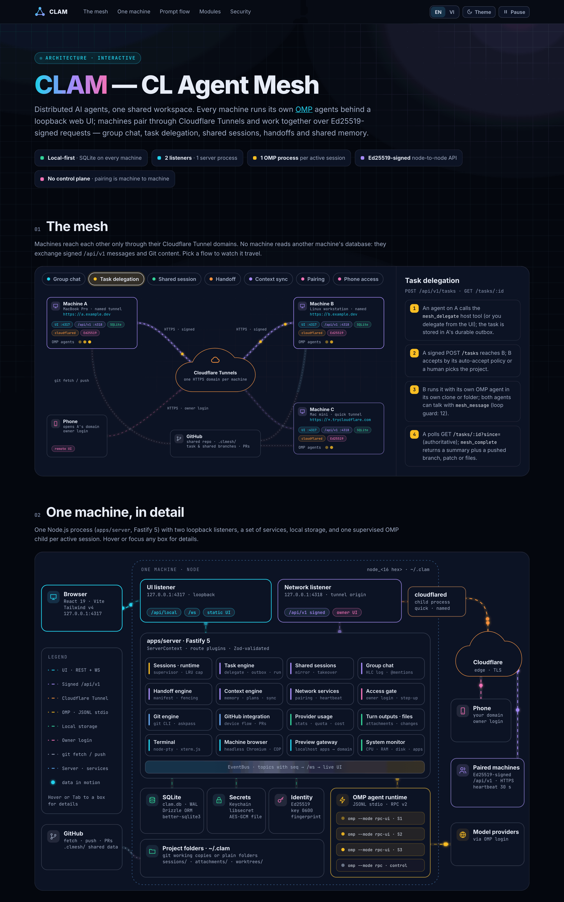</a>

The interactive, animated version of this diagram is [docs/architecture.html](docs/architecture.html) — a standalone file: open it locally in a browser (GitHub shows HTML as source), or through any raw-HTML viewer.

- **Every machine is self-contained.** One Fastify server, one SQLite database, its own OMP processes and git working copies. There is no central server: pairing, delegation and sharing are machine-to-machine, and a machine keeps running from local state when its peers are gone.
- **Two loopback listeners.** The **UI listener** (`127.0.0.1:4317`) serves the web app, `/api/local` and the `/ws` WebSocket and is never exposed. The **network listener** (`127.0.0.1:4318`) serves only the signed `/api/v1` machine-to-machine API — plus, once you switch it on, the owner-login UI — and is the origin your Cloudflare tunnel points at.
- **The mesh.** Machines call each other's `/api/v1` over HTTPS through their tunnels with signed requests and pinned Ed25519 keys; capabilities are granted per direction. Your phone reaches a machine's UI through the same tunnel hostname.

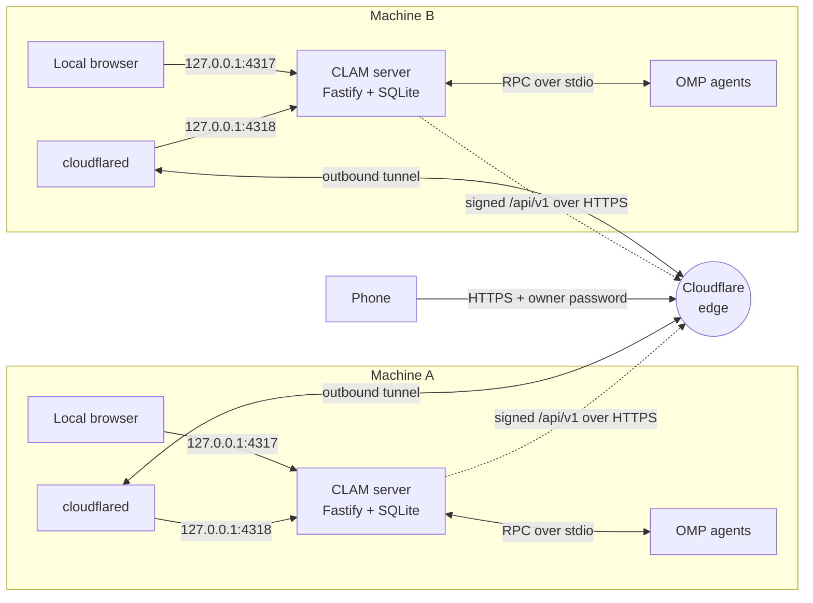

More: [docs/architecture.md](docs/architecture.md) (components, OMP process model, data flow, failure model) and [docs/agent-network-protocol.md](docs/agent-network-protocol.md).

## Quick start

```bash
curl -fsSL https://omp.sh/install | sh               # the agent runtime; then `omp login`
git clone https://github.com/CongLe-FinX/clam.git
cd clam
pnpm install
pnpm build
pnpm start                                           # → http://127.0.0.1:4317
```

Needs Node ≥ 22.12, pnpm 11 and git ≥ 2.38 — see [Installation](#installation) for per-OS steps, then [First-time setup](#first-time-setup).

## Installation

### Requirements

| Needed | Version | Why |
| --- | --- | --- |
| Node.js | **≥ 22.12** (tested with 24 and 25) | runs the server and the build |
| pnpm | **11** (pinned in `package.json`) | installs the monorepo |
| Git | **≥ 2.38** | the server uses the system `git`; conflict checks need `merge-tree --write-tree` |
| OMP (`omp`) | any recent version; verified with 18.14.0 | the agent runtime; must be on `PATH` or at `~/.bun/bin/omp` (or set `CLAM_OMP_BIN`) |
| A model provider login | — | OMP needs at least one provider (OpenAI, Anthropic, …) to answer |
| `cloudflared` | optional | only to pair machines and for remote access |
| GitHub CLI `gh` | optional | shortcut to import a GitHub login |
| Docker | optional | only for the two-machine test bench in `deploy/docker/` |
| C/C++ toolchain, Python 3, make | only if a prebuilt binary is missing | native addons `better-sqlite3` and `node-pty` |

<details open>
<summary><b>macOS</b></summary>

```bash
# Homebrew is assumed (https://brew.sh)
brew install node@24 git                    # or use fnm/nvm (see notes below)
brew link --overwrite node@24               # only if `node -v` does not show 24 afterwards
npm install -g pnpm@11                      # or `corepack enable` on Node 22/24
brew install cloudflared                    # optional, for pairing and remote access
brew install gh                             # optional
xcode-select --install                      # only if a native module fails to build
```

*Verified on macOS (Apple Silicon): Node 25.8, pnpm 11.20, git 2.50 (Apple Git), cloudflared and gh from Homebrew.*

</details>

<details>
<summary><b>Linux</b> (Debian / Ubuntu shown)</summary>

```bash
sudo apt update && sudo apt install -y git curl ca-certificates build-essential python3
# Node 22 or newer: use fnm (or nvm) so you are not tied to the distro's old Node
curl -fsSL https://fnm.vercel.app/install | bash && exec $SHELL
fnm install 24 && fnm default 24
corepack enable && corepack prepare pnpm@11 --activate     # or: npm install -g pnpm@11
```

- `node-pty` (the Terminal) ships no Linux prebuilds, so it is **compiled during `pnpm install`** — keep `build-essential` and `python3` installed.
- `cloudflared` (optional): follow [Cloudflare's package instructions](https://developers.cloudflare.com/cloudflare-one/connections/connect-networks/downloads/) (`sudo apt install cloudflared` after adding their apt repository).
- Secrets use the Secret Service (`secret-tool`, from `libsecret-tools`) when a desktop keyring is running; otherwise an encrypted file in the data directory is used automatically.
- The Docker bench proves the whole stack on Debian bookworm + Node 24; see [Docker two-node bench](#docker-two-node-bench).

</details>

<details>
<summary><b>Windows</b> — not verified</summary>

The steps below are the expected equivalents; **none of them have been run by the maintainer**.

```powershell
winget install OpenJS.NodeJS.LTS Git.Git Cloudflare.cloudflared
npm install -g pnpm@11
irm https://omp.sh/install.ps1 | iex          # OMP, from its own README
```

Secrets fall back to the encrypted-file store (no Windows Credential Manager backend). Autostart is implemented as a scheduled task named "CLAM" but has not been smoke-tested. WSL2 with the Linux instructions is the safer route today.

</details>

<details>
<summary><b>Node.js and pnpm notes</b></summary>

- **fnm / nvm**: `fnm install 24 && fnm default 24`, or `nvm install 24 && nvm alias default 24`.
- **pnpm via corepack**: Node 22 and 24 ship `corepack`; run `corepack enable` once and the pinned `pnpm@11.20.0` is used automatically. **Node 25 no longer bundles corepack** (`corepack: command not found`) — use `npm install -g pnpm@11`.
- The lockfile is committed; `pnpm install --frozen-lockfile` passes on a fresh clone.

</details>

### OMP, the agent runtime

Install OMP using a method from its [README](https://github.com/can1357/oh-my-pi#install):

```bash
curl -fsSL https://omp.sh/install | sh          # macOS / Linux
brew install can1357/tap/omp                    # Homebrew alternative
bun install -g @oh-my-pi/pi-coding-agent        # Bun alternative (puts omp in ~/.bun/bin)
```

Then log in to at least one model provider — in a terminal (`omp login`) or later in the app (**Settings → OMP Providers**). CLAM never sees your provider credentials; they stay in OMP's own store. Check with `omp --version`. Later OMP updates can be installed from **Settings → OMP Providers** (see [First-time setup](#first-time-setup)).

### Build and run

```bash
git clone https://github.com/CongLe-FinX/clam.git     # or git@github.com:CongLe-FinX/clam.git
cd clam
pnpm install          # ~15 s with a warm cache; compiles native addons if no prebuilt binary exists
pnpm build            # builds the web app and bundles the server to apps/server/dist/main.js (~40 s)
pnpm start            # production mode: the server also serves the built UI
```

Open **http://127.0.0.1:4317**. *(Verified on a fresh clone with a custom port and data directory: install, build, start, `GET /` → 200, `GET /api/local/node` → the node's identity JSON.)*

### Ports and exposure

| Port | Listener | Exposure |
| --- | --- | --- |
| **4317** (`CLAM_PORT`) | web UI + `/api/local` + `/ws` | loopback only — never reachable from another computer |
| **4318** (`CLAM_NETWORK_PORT`, default `CLAM_PORT` + 1) | `/api/v1` machine-to-machine API (plus the owner-login UI once remote access is on) | loopback only; **the origin your Cloudflare tunnel points at** |
| 5317 (`WEB_PORT`) | Vite dev server (`pnpm dev` only) | loopback |

The server refuses to bind anything but `127.0.0.1`, `::1` or `localhost`; remote access exists only through the Cloudflare Tunnel. To use other ports: `CLAM_PORT=4400 pnpm start` (the network port becomes 4401 unless you set `CLAM_NETWORK_PORT`). If you change the network port, change the tunnel origin to match.

### Development vs production mode

| | `pnpm start` (production) | `pnpm dev` |
| --- | --- | --- |
| Needs `pnpm build` first | yes | no |
| UI | http://127.0.0.1:**4317** | http://127.0.0.1:**5317** (Vite, hot reload; proxies `/api` and `/ws` to 4317) |
| Data directory | `~/.clam` | `<repo>/.data/core` (separate, so dev never touches your real data) |
| Use it for | daily use, autostart | working on the code |

Both default to server port 4317 — do not run them at the same time (or give one another `CLAM_PORT`).

### Where your data lives

The default data directory is **`~/.clam`** on macOS and Linux (`%USERPROFILE%\.clam` on Windows, unverified). Change it with `CLAM_DATA_DIR`:

```bash
CLAM_DATA_DIR=/Volumes/Data/clam pnpm start
```

It holds the SQLite database (`clam.db`), the machine's identity keypair (`identity/`), per-session OMP folders, chat and project folders created by the app (`projects/`), shared-session worktrees (`worktrees/`), browser profile and downloads, and — only if no OS keychain is used — the encrypted secret file. Full list: [What lives where](#what-lives-where).

### Start at login

1. Run `pnpm build` once (autostart points at `apps/server/dist/main.js`; without a build it fails with `autostart_not_built`).
2. In the UI: **Settings → General → Start automatically** → on.

This writes only the OS login entry and takes effect **at your next login** (it never starts a second server now):

| OS | What is written |
| --- | --- |
| macOS | LaunchAgent `~/Library/LaunchAgents/io.clam.agent-mesh.plist`; logs in `<dataDir>/logs/server.{out,err}.log` — *smoke-verified* |
| Linux | systemd *user* unit `~/.config/systemd/user/cl-agent-mesh.service` (`enable`, never `start`); without systemd user services the request fails with `autostart_unsupported` — *not smoke-tested* |
| Windows | scheduled task "CLAM" with a logon trigger — *not smoke-tested* |

The login entry records the `CLAM_PORT`, `CLAM_DATA_DIR` and `PATH` of the server you switched it on from. After moving the repository folder, switch it off and on again.

## First-time setup

1. **Connect a model provider** — **Settings → OMP Providers**. The page shows whether OMP is installed (if not: install it, then press **Refresh**). Choose **Connect** next to a provider (*Search providers* filters the list), authorize in your browser and, if asked, paste the code and press **Submit**. The provider shows **Signed in**.
2. **Pick default model roles** — same page, **Model roles**: set the *Default* role (and any other role OMP lists) with **Set** / **Change**; **Test** sends a real request. The **Model catalog** shows the models your logins give you and their prices.
3. **Keep OMP current** — same page: **Check for new version** runs `omp update --check`; when a newer version exists, **Update to &lt;version&gt;** installs it.
4. **Connect GitHub (optional)** — **Settings → GitHub Accounts**. Either **Import from gh CLI** (after `gh auth login`), or the device flow: create a GitHub OAuth App with *Device Flow* enabled, paste its client id under **GitHub OAuth App client id**, **Save**, then **Connect account** and follow the code. Tokens go to the OS secret store only. GitHub is needed only for repository projects, pull requests and branch-based sharing; chats and plain folders work without it.
5. **Name this machine** — **Settings → General → Machine name** (shown to your other machines).
6. **Create a workspace** — in the sidebar press **+** next to **Workspaces** (or *Create your first workspace*). A workspace is the unit you share with another machine.
7. **Start a chat** — **New chat** (top of the sidebar). Describe what the agent should do and press **Start chat**. No repository needed: the agent gets its own folder under `<dataDir>/projects/`. To work on code instead, add a project (a folder, or a clone of a GitHub repository) to a workspace and open a session in it.
8. **Language and theme** — **Settings → General → Appearance**: **Language** (English / Tiếng Việt) and **Theme** (light / dark / system). Both are stored in *this browser*, so phone and desktop can differ.

> [!IMPORTANT]
> **Settings → General → Tool approval mode** decides whether agents may run shell commands and edit files without asking. Leave it on asking until you trust your setup.

## Connect a second machine

Do the [installation](#installation) and [first-time setup](#first-time-setup) on machine **B** too (each machine has its own data directory, OMP login and GitHub account). Two machines can also be two data directories on one computer (distinct `CLAM_PORT`, `CLAM_NETWORK_PORT`, `CLAM_DATA_DIR`).

### 1. Give each machine a public address

Install `cloudflared` (see [Requirements](#requirements)), then on each machine open **Settings → Cloudflare Tunnel**. The page shows the `cloudflared` version (or an install hint) and **Tunnel mode**: *Off*, *Quick tunnel*, *Named tunnel*.

**Quick tunnel** (trying it out, no account): press **Start a quick tunnel** to get a random `https://<words>.trycloudflare.com` address. It **changes every time the tunnel starts** — paired machines are told automatically, but invitations must use the current address. Cloudflare gives no uptime guarantee, and a fresh hostname can take a few seconds to resolve.

**Named tunnel with your own domain** (stable; recommended for phone access). Requires a domain whose DNS is on Cloudflare and a free Cloudflare account. *These dashboard steps follow Cloudflare's current Zero Trust UI and were not re-run end-to-end with a real domain for this README; if a label differs, look for "Tunnels" under Networks.*

1. Cloudflare dashboard → **Zero Trust** → **Networks** → **Tunnels** → **Create a tunnel** → **Cloudflared** → name it (e.g. `node-a`) → **Save tunnel**.
2. On the "install connector" screen copy the **token** (the long string after `--token`). Do **not** run the install command — CLAM runs `cloudflared` itself.
3. **Public hostname**: add e.g. `node-a.example.com`; service **HTTP**, URL **`127.0.0.1:4318`** — this machine's *network* port, **not** the UI port 4317, and not `https`. (The app's **Origin to configure** field shows the exact value.)
4. In CLAM: **Settings → Cloudflare Tunnel** → **Tunnel mode: Named tunnel** → **Public hostname** `node-a.example.com` → **Tunnel token** → switch **Start automatically** on if you want the tunnel with the server → **Save configuration** → **Start tunnel**. The token goes to the OS secret store (write-only).
5. Repeat on machine B with **its own tunnel and hostname** (e.g. `node-b.example.com`).

Saved settings are not live until the tunnel runs: **Save configuration** with **Start automatically** on starts a stopped tunnel at once (and at every server start); otherwise press **Start tunnel**. If another `cloudflared` of yours already routes the hostname to `127.0.0.1:4318`, CLAM needs no connector of its own: once `https://<hostname>/api/v1/node/info` answers with this machine's identity, the page shows **Served by another cloudflared on this machine or network** and that hostname is used in invitations.

The tunnel exposes only the signed machine-to-machine API (and, if you turn it on, the owner-login UI). `https://<your domain>/api/local/*` always answers 404.

### 2. Pair: invite, join, verify, approve

Open **Machines** in the sidebar (also reachable from **Agent Network**).

1. **On A — Invite another machine → Create an invitation.** Choose the **workspace to share** and the **code lifetime**, then **Create invitation**. A shows a one-time code `XXXX-XXXX`, its address and its **fingerprint** (**Copy everything as a message** copies all three). The code works once, expires (≤ 10 minutes) and locks after 5 wrong attempts. Without a public address the dialog offers to start a quick tunnel.
2. **On B — Join another machine → Enter a code.** Paste A's `https://…` address and press **Look up machine**. **Compare the fingerprint B shows with the one on A** (read it out or use a channel you trust), tick *I compared this fingerprint…*, enter the code and join. B's own tunnel must be running so A can finish the handshake.
3. **On A — approve.** A shows *A machine wants to connect* (a banner anywhere in the app, and under **Machines → Pairing requests**). Compare B's fingerprint, choose the access (below) and press **Approve and pair**.

Both machines now pin each other's keys and list each other as **online**; B receives a copy of the shared workspace (same name and id — projects and files are never shared automatically), and each machine's agents appear in **Agent Directory**. **Revoke** on a machine's page cuts it off at once. A stopped machine shows *offline* after about two minutes and reconnects by itself.

### Access presets

Access is **per direction**: what you grant is what the *other* machine may do on *yours*. Change it any time on the machine's page (*Fine-tune individual permissions* for single capabilities).

| Preset | Capabilities | Lets the other machine… |
| --- | --- | --- |
| **Chat & collaborate** | `agents.read`, `events.read`, `sessions.share` | see your agents and live status; invite you into shared sessions and group chats |
| **Delegate tasks** | `tasks.send`, `tasks.receive`, `tasks.cancel`, `artifacts.read`, `artifacts.write` | send work to your agents, get results back, exchange produced files (your machine still decides whether to run it) |
| **Share memory** | `context.sync` | keep shared notes and decisions in sync |
| **Hand off work** | `handoff.send`, `handoff.receive` | move whole agent sessions and tasks between you |
| **Full trust** | all of the above and future capabilities | only for machines you own |

For two machines you own, grant all four presets in both directions. Group chat needs *Chat & collaborate* both ways, delegation *Delegate tasks*, shared memory *Share memory*, handoff *Hand off work* both ways.

## Use it from your phone

Every machine can serve its **own** web UI through its tunnel domain, behind an owner password. It is **off by default** and can only be switched on **at the machine itself** (`http://127.0.0.1:4317`).

1. Make sure the machine has a running tunnel; a named tunnel is best because the address stays the same.
2. **Settings → Security → Owner password → Set password** (at least 12 characters; the first one can only be set at the machine).
3. **Settings → Security → Remote access to this web UI** → on (confirm *Allow remote access to this UI?*). *Public UI address* shows the URL.
4. On the phone open `https://node-a.example.com/`, enter the owner password and add it to the home screen. The phone layout has a bottom bar with a **Runtime** tab (live count of OMP processes). Remote sessions cannot change the tunnel, the remote-access switch or set the first owner password; **Sign out** is in **Settings → Security**.
5. For another machine's UI, open **its** domain the same way; the *Open B's Terminal / Browser* buttons on a machine's page do exactly that.

**Terminal and Browser through the domain** (off by default): **Settings → Security → Terminal, Browser and Preview** → **Terminal through the domain** and/or **Browser through the domain**. Turning one on asks for the owner password; opening a terminal through the domain asks again (valid 10 minutes). Switching a tool off, logging out or **Sign out everywhere** closes its live connections at once. The Browser can emulate an iPhone viewport to test web apps an agent serves on that machine's `localhost`.

> [!WARNING]
> Anyone with the owner password controls the agents on that machine; with the Terminal on, they run commands as the user running CLAM and reach that machine's network. Use a long, unique password and keep Terminal and Browser off unless needed.

- Sign-in is throttled (5 wrong attempts → 30 s lockout doubling up to 15 min, plus a machine-wide lockout against distributed guessing). The session cookie is `HttpOnly`, `Secure`, `SameSite=Strict`; **Sign-in lasts** is configurable and renews while you use the UI.
- The UI port 4317 and the OMP RPC channel are never exposed. A Cloudflare Access policy on the whole hostname would also block paired machines, since the machine-to-machine API shares it (**[INFERENCE]** — not tested; use a path-scoped policy or skip it).

## Preview a local web app

Open a web app running on a machine (a Vite / Next / webpack dev server on `localhost:<port>`) in **your own browser**, with real DevTools, from anywhere. Each machine gets **one extra hostname**, by default the first label of its tunnel hostname plus `-preview` (`clamp-work.example.com` → `clamp-work-preview.example.com`).

1. **Needs a named tunnel** — a quick tunnel's address changes on every start. On the machine's own UI none of this is needed: preview buttons simply open `http://localhost:<port>`.
2. **Settings → Cloudflare Tunnel → Preview in your own browser** shows the *Preview address* (editable). In Cloudflare add it as a public hostname of the same tunnel: *Hostname* `clamp-work-preview.example.com`, *Service* `HTTP` · `127.0.0.1:4318`. No wildcard is needed, and a first-level name is covered by Cloudflare's free Universal SSL certificate. Never share one tunnel between machines.
3. Press **Check**: CLAM requests `https://<preview address>/__clam_preview/health` and expects *this* machine to answer.
4. **Settings → Security → Terminal, Browser and Preview → Preview through the domain** → on (needs *Remote access to this web UI*; off by default).
5. Use **Open preview ↗** next to a *Running on this machine* chip (Browser page), next to a `http://localhost:<port>` link in a chat, or **Open in my browser** in the Browser toolbar. CLAM mints a one-time ticket (60 s) and opens your app at its natural root, so client-side routes, absolute asset paths, API calls and the HMR WebSocket work.

- **One app at a time per browser**: `/port/5173/…` selects port 5173 (stored in a cookie); with nothing selected the address shows a picker of web apps listening on the machine.
- **Reachable**: only web apps on the machine's loopback — never CLAM's own ports, databases, SSH, debuggers (22, 3306, 5432, 6379, 27017, 9229, 9222, …) or ports below 1024 except 80. The app sees `Host: localhost:<port>`; redirects to `http://localhost:<port>/…` are rewritten; CLAM cookies are never forwarded.
- All ports of a machine share the preview origin: treat previewed apps as one trust domain. Logging out, changing the password or turning Preview or remote access off ends every preview session. Opens are audited (`preview.open`, `preview.signin`).

## Everyday workflows

All of these assume paired machines with the matching presets. Each has an API equivalent in the [API walkthrough](docs/api-walkthrough.md).

**Group chat with A's and B's agents.** On A, open a chat or session → **Add agent** → pick machine B (and optionally an agent) → **Add to session**. Accept the invitation on B (**Shared Sessions**, or the banner). Both machines keep a copy of the message log. A message without a mention goes to the lead agent; type `@` to address an agent, a machine or everyone; attach files with the paperclip. Finishing a pairing also offers **Start a group chat with its agents**.

**Delegate a task.** **Agent Directory** → an agent → **Delegate** (or **Tasks → Delegate a task**): title, description, optionally project files to send. Follow and discuss on the task page. If files come back, **Preview & apply files** shows each as new / unchanged / update / conflict with diffs; nothing is written before **Apply to project**.

**Hand over (A online) or take over (A offline) a shared session.** The driver presses **Hand over…** → **Hand over to** a machine → **Hand over**; everything including uncommitted files is saved, the other machine continues in a new session and A becomes a read-only participant. If A is offline, B opens the shared session and presses **Continue on this machine** (confirm **Take over anyway** if A still seems online); work A did after its last checkpoint stays on A as a rescue copy. In git mode each machine works in its own worktree of the shared branch (`<dataDir>/worktrees/<sharedId>`); a former driver's agent keeps working in its worktree as a participant and may push to the shared branch.

**Hand off a running task with dependency setup.** On the task page **Hand off…** → target machine, optional setup commands (e.g. `npm ci`) and a check command → **Hand off**. On the target accept it in **Handoffs** (or **Settings → General → Handoffs → Accept handoffs automatically**). **Dependency setup** decides the commands: **Ask me** (recommended), **Run automatically** (fully trusted peers only) or **Never run**. The source stays owner until the target's durable acknowledgement (30 min deadline, **Extend** or **Reclaim**).

**Shared memory.** Session → **Memory** panel (or **Shared Context** in the sidebar) → **Add memory** (memory, decision, plan, summary, note). Entries stay **private** until marked *shareable*; shareable ones sync to every machine in the workspace and new sessions start with a short "Project memory" preface. Concurrent edits become a conflict you resolve by hand.

**Files and context.** The right panel's **Files** tab browses the session folder (preview, download, upload) and **Changes** lists its uncommitted git changes. When a long session fills the context window, **Context → Compact** summarizes it (optionally with a focus) and reports usage before and after.

## Updating, backup and uninstall

**Update**

```bash
cd clam
git pull
pnpm install
pnpm build
# stop the running server (Ctrl-C), then
pnpm start
```

Database migrations run at startup after a snapshot `clam.db.pre-migrate-<timestamp>.bak` is written. Browser tabs still running the old build offer a **Reload**. With autostart on, log out and in again (or restart the service) after building. Update **all** paired machines to the same version when protocol docs change. OMP itself is updated from **Settings → OMP Providers**.

**Backup.** Stop the server and copy the data directory (`~/.clam` by default). Secrets in the OS keychain (GitHub tokens, tunnel token) are not in it — re-enter them on a new computer. Restoring the identity elsewhere makes it the *same* machine for peers; never run two copies at once.

**Uninstall**

1. **Settings → General → Start automatically** → off, and **Settings → Cloudflare Tunnel → Stop tunnel**; in Cloudflare delete the tunnel and DNS records you created.
2. Stop the server.
3. Note the node id (`curl -s http://127.0.0.1:4317/api/local/node` → `id`), then delete the data directory: `rm -rf ~/.clam`.
4. Remove keychain entries `cl-agent-mesh.<nodeId>`: macOS — *Keychain Access*, search `cl-agent-mesh` (or `security delete-generic-password -s cl-agent-mesh.<nodeId> -a <account>`); Linux — `secret-tool clear service cl-agent-mesh.<nodeId> account <account>`, or Seahorse/KWallet. The encrypted-file store lives inside the data directory.
5. Delete the repository folder.

## Troubleshooting

<details>
<summary><b>Port in use</b> (<code>EADDRINUSE</code> on 4317/4318)</summary>

Find the owner: `lsof -iTCP:4317 -sTCP:LISTEN` (Windows: `netstat -ano | findstr 4317`). Stop it, or use another port: `CLAM_PORT=4400 pnpm start`. `pnpm dev` and `pnpm start` both default to 4317 — run only one.

</details>

<details>
<summary><b><code>omp</code> not found</b> (Settings → OMP Providers says <i>Not installed</i>)</summary>

Install OMP ([above](#omp-the-agent-runtime)). The server looks on `PATH` and at `~/.bun/bin/omp`; a GUI-launched or autostarted server may have a shorter `PATH` — set `CLAM_OMP_BIN=/full/path/to/omp`, then press **Refresh**.

</details>

<details>
<summary><b>Provider not signed in</b> — agents answer with auth errors</summary>

**Settings → OMP Providers** → *Not signed in* → **Connect**, or `omp login` in a terminal. Check that **Model roles** has a default model from a signed-in provider (**Test**).

</details>

<details>
<summary><b><code>better-sqlite3</code> / <code>node-pty</code> fails to build</b></summary>

You need a prebuilt binary for your Node version or a toolchain: macOS `xcode-select --install`; Debian/Ubuntu `sudo apt install build-essential python3`. Prefer Node 22 or 24 if brand-new Node releases lack prebuilt binaries. Then `pnpm install` again.

</details>

<details>
<summary><b><code>corepack: command not found</code></b></summary>

Node 25+ no longer ships corepack: `npm install -g pnpm@11`.

</details>

<details>
<summary><b>Tunnel stays "reconnecting" / quick tunnel unreachable</b></summary>

Check that **Settings → Cloudflare Tunnel** shows `cloudflared` installed and that the **Network listener** port is the one your hostname routes to (named tunnel: service `http://127.0.0.1:4318`, the token of that tunnel, the hostname exactly as in Cloudflare). A fresh quick-tunnel hostname can take a few seconds to resolve. Proxies or firewalls that block outbound `cloudflared` traffic (outbound 7844/QUIC and HTTPS) also cause this. Press **Stop tunnel**, then **Start tunnel**.

</details>

<details>
<summary><b><code>403 forbidden_host</code></b> — "This machine only answers for …"</summary>

The network listener answers only for `localhost`, `127.0.0.1`, `[::1]` and the **named hostname saved in Settings → Cloudflare Tunnel**. Make sure the mode is **Named tunnel** and **Public hostname** is exactly the hostname routed in Cloudflare (CLAM lower-cases it). Saved settings are not live until the tunnel runs: press **Start tunnel**, or switch **Start automatically** on and save. If you run **your own** `cloudflared` for that hostname, the saved hostname alone passes the Host check, and the page shows **Served by another cloudflared on this machine or network** once `https://<hostname>/api/v1/node/info` answers with this machine's identity (**Check hostname** re-tests; CLAM re-checks every 60 s). Quick mode knows its random hostname only while its own tunnel runs.

</details>

<details>
<summary><b>Pairing: code expired, locked or used</b></summary>

Codes are one-time, valid ≤ 10 min and locked after 5 wrong tries. On A, **Revoke** the old invitation and create a new one. If A's quick-tunnel address changed since you copied it, copy the new one.

</details>

<details>
<summary><b>Pairing: "no public address" or B cannot be reached</b></summary>

Both machines need a running tunnel (B so A can finish the handshake). Without Cloudflare, for development only: `CLAM_ALLOW_LOOPBACK_PEERS=1` on both and `http://127.0.0.1:<network port>` as the address (insecure).

</details>

<details>
<summary><b>Remote login is locked</b> / too many attempts</summary>

Wait for the lockout (30 s doubling to 15 min). Counters are in memory, so **restarting the server clears them**. Even the right password is refused while locked.

</details>

<details>
<summary><b>Forgot the owner password</b></summary>

The UI changes it only with the current one. **[Based on the code, not exercised live]**: stop the server, delete the setting (`sqlite3 ~/.clam/clam.db "delete from settings where key='access.password';"`), start the server and set a new password at the machine in **Settings → Security**. Then use **Sign out everywhere**.

</details>

<details>
<summary><b>macOS keeps asking for Keychain access</b></summary>

Secrets live in your login keychain under service `cl-agent-mesh.<nodeId>`. Choose **Always Allow** when prompted; after upgrading Node or moving the repo the prompt can return once. To avoid the keychain, start with `CLAM_SECRET_BACKEND=encrypted-file` — only on a fresh data directory: the first backend is pinned in `<dataDir>/secrets/backend` and secrets do not migrate between backends.

</details>

<details>
<summary><b>Autostart: <code>autostart_not_built</code> / <code>autostart_unsupported</code></b></summary>

Run `pnpm build` first; on Linux you need `systemd --user`.

</details>

<details>
<summary><b>UI blank or old after an update</b></summary>

`pnpm build` again, restart the server and hard-reload the browser. If a screen says its code could not load, **Try again** reloads the page.

</details>

## Development

```bash
pnpm install
pnpm dev                       # server (4317, tsx watch) + Vite UI (5317), data in <repo>/.data/core
pnpm typecheck                 # tsc in every package
pnpm test                      # vitest in every package that has tests
pnpm build                     # i18n check + vite build + bundle budget check (web) + tsup (server)
```

| Script | Purpose |
| --- | --- |
| `pnpm --filter @clam/server dev \| build \| start \| test \| typecheck` | server only (`build` bundles `dist/main.js` and copies migrations to `dist/migrations`) |
| `pnpm --filter @clam/web dev \| build \| preview \| analyze \| typecheck` | web only (`analyze` writes `apps/web/dist/stats.html`) |
| `pnpm --filter @clam/web i18n:check` | every UI string has a Vietnamese translation; also runs inside `pnpm build` and fails it on a miss |
| bundle budget | the web build fails when initial JS exceeds **`SHELL_BUDGET_KB`** (default 180 KB gzip; `apps/web/scripts/check-budget.mjs`) |

UI strings are written in English in the source (`t("…")`) with Vietnamese catalogs under `apps/web/src/i18n` and each feature's `i18n/`; see [CONVENTIONS.md](apps/web/src/i18n/CONVENTIONS.md) and [GLOSSARY.md](apps/web/src/i18n/GLOSSARY.md).

### Docker two-node bench

`deploy/docker/` runs two isolated Linux machines (A and B), each with its own OMP, git, gh, `cloudflared`, data volume and a real quick tunnel as its domain; you drive both from your browser through their `https://*.trycloudflare.com` URLs. Needs Docker with Compose v2.

```bash
deploy/docker/clam-nodes.sh build      # image
deploy/docker/clam-nodes.sh up         # two containers
deploy/docker/clam-nodes.sh creds      # streams your OMP + gh logins into both
printf '%s' "$PW" | deploy/docker/clam-nodes.sh init a "Node A"   # name, owner password, remote UI, quick tunnel
deploy/docker/clam-nodes.sh down       # deletes containers AND volumes (all credentials)
```

Other subcommands: `init b`, `url`, `status`, `logs`, `stop a`, `start a`, `exec`. Full scenario: [deploy/docker/README.md](deploy/docker/README.md).

## Configuration

### Environment variables

| Variable | Default | Purpose |
| --- | --- | --- |
| `CLAM_HOST` | `127.0.0.1` | UI listener bind address; only `127.0.0.1`, `::1`, `localhost` — anything else refuses to boot |
| `CLAM_PORT` | `4317` | UI listener port (`0` = ephemeral) |
| `CLAM_NETWORK_HOST` | `127.0.0.1` | `/api/v1` network listener bind address; loopback only |
| `CLAM_NETWORK_PORT` | `CLAM_PORT` + 1 (`4318`) | network listener port — the tunnel origin; must differ from `CLAM_PORT` |
| `CLAM_ALLOW_LOOPBACK_PEERS` | unset | `1` allows `http://127.0.0.1`, `http://localhost`, `http://[::1]` peer URLs (development/tests; **insecure**); otherwise peers must be `https://` |
| `CLAM_DATA_DIR` | `~/.clam` | database, identity key, secret-store fallback, sessions, projects, worktrees, usage cache (`pnpm dev`: `<repo>/.data/core`) |
| `CLAM_WEB_DIST` | `apps/web/dist` (when it has `index.html`) | built web app to serve |
| `CLAM_OMP_BIN` | auto-detected | path to the `omp` binary |
| `CLAM_OMP_PROFILE` | unset | passed as `--profile` to every `omp` invocation (isolated OMP profile) |
| `CLAM_CLOUDFLARED_BIN` | auto-detected | path to the `cloudflared` binary |
| `CLAM_BROWSER_PATH` | auto-detected | Chrome / Chromium / Edge / Brave executable for the machine's Browser |
| `CLAM_BROWSER_IDLE_MS` | `900000` | close the Browser after this long with no viewer and no activity |
| `CLAM_BROWSER_NO_SANDBOX` | unset | `1` starts Chromium with `--no-sandbox` (containers without user namespaces; set in the Docker image; automatic for root on Linux) |
| `CLAM_SECRET_BACKEND` | `auto` | `auto`, `macos-keychain`, `libsecret` or `encrypted-file`; a forced OS backend that is unusable fails instead of falling back |
| `CLAM_LOG_LEVEL` | `info` | pino log level |
| `CLAM_LOG_PRETTY` | on under `pnpm dev` | `1` forces human-readable logs (`pino-pretty`); any other value disables them |
| `CLAM_FAULT` | unset | crash-test fault injection: `handoff:<role>:<state>[,…]` (`*` wildcards) exits (code 86) right after that handoff state is saved |
| `CLAM_API_URL` | `http://127.0.0.1:4317` | Vite dev proxy target (web dev server only) |
| `WEB_PORT` | `5317` | Vite dev server port (web dev server only) |
| `SHELL_BUDGET_KB` | `180` | gzip budget for initial JS in the web build |
| `ANALYZE` | unset | `1` makes `pnpm --filter @clam/web analyze` write `apps/web/dist/stats.html` (`json` → `stats.json`) |

### What lives where

- **Node data**: `<dataDir>/clam.db` (+ `.pre-migrate-<ts>.bak` snapshots), `identity/` (Ed25519 keypair, `0600` PEM), `sessions/<sessionId>/` (one OMP session directory per session), `projects/` (app-managed chat and project folders), `worktrees/<sharedId>/` (git worktrees of shared sessions), `run/` (`0700`: git askpass helper and socket; `tunnel-token`, `0600`, only while a named tunnel runs), `secrets/` (only for the encrypted-file store), `cache/` (usage snapshots). Logs go to stdout (macOS autostart: `<dataDir>/logs/`).
- **Secrets**: GitHub tokens, the named-tunnel token and pending invitation keys go to the OS secret store (macOS Keychain, Linux Secret Service, otherwise an AES-256-GCM encrypted file). LLM provider credentials stay in OMP's own store; CLAM never reads or writes them.
- **OMP** is driven only through its RPC modes (`omp --mode rpc-ui` per session, `omp --mode rpc` for the control process) and documented CLI JSON commands.

## Project structure

```text
apps/
  server/             Fastify 5: UI listener (/api/local, /ws, static UI) + network listener (/api/v1)
  web/                React 19 + Vite + Tailwind CSS v4 + TanStack Router/Query
packages/
  contracts/          Zod schemas + TS types shared by server and web
  database/           SQLite (better-sqlite3) + Drizzle schema and migrations
  node-identity/      node id, Ed25519 keypair, fingerprint, sign/verify
  agent-network/      /api/v1 protocol: request signing, pairing crypto, HTTPS client, SSE, wire schemas
  cloudflare-tunnel/  cloudflared lifecycle: quick and named tunnels, readiness, restart with backoff
  secret-store/       macOS Keychain / libsecret / encrypted-file secret store
  agent-runtime/      runtime adapter interface + OMP RPC adapter (process supervision)
  github-integration/ OAuth device flow, gh import, repos, permissions, pull requests
  git-engine/         git CLI wrapper: status, diff, branches, commit, clone/fetch/pull/push, askpass broker
  provider-usage/     normalized `omp stats` / `omp usage` / `omp models` data
  task-engine/        task rules: state machine, budgets, briefs, host-tool schemas, shared-session rules
  handoff-engine/     handoff rules: manifest, state tables, recovery, fencing, setup runner
  workspace-files/    folder bundles for files-mode sharing: scan, tar, diff, preview/apply
  context-engine/     shared-memory rules: versions, conflicts, .clmesh/ mapping, FTS5 queries, sync schemas
deploy/docker/        two-node Docker test bench
docs/                 architecture, protocol and design documents; screenshots and images
```

Packages are scoped `@clam/*`. Versioned project metadata that may live in a repository is stored under `.clmesh/`.

## Documentation

| Document | Contents |
| --- | --- |
| [docs/architecture.html](docs/architecture.html) | Interactive, animated architecture diagram (open in a browser) |
| [docs/architecture.md](docs/architecture.md) | Planes, components, module diagram, OMP process model, prompt data flow, deployment, failure model |
| [docs/agent-network-protocol.md](docs/agent-network-protocol.md) | `/api/v1` machine-to-machine protocol: signing, Host binding, idempotency, ordering, fencing, pairing, tasks, shared sessions, context sync, handoffs |
| [docs/api-walkthrough.md](docs/api-walkthrough.md) | Per-feature walkthrough with the equivalent `curl`/HTTP calls |
| [docs/shared-sessions.md](docs/shared-sessions.md) | Shared sessions: model, flows, checkpoints, worktrees, takeover, transfer, limits |
| [docs/handoff-protocol.md](docs/handoff-protocol.md) | Handoff manifest, state machines, recovery, duplicate-execution prevention |
| [docs/database-schema.md](docs/database-schema.md) | All tables and the migration plan |
| [docs/omp-rpc-compatibility.md](docs/omp-rpc-compatibility.md) | Verified OMP capabilities mapped to requirements, with explicit gaps |
| [docs/github-integration.md](docs/github-integration.md) | Device flow, multiple accounts, credential storage, git operations, askpass, `.clmesh/` layout |
| [docs/security.md](docs/security.md) | Threat model and controls |
| [docs/ui-sitemap.md](docs/ui-sitemap.md) | Sitemap, responsive layout, wireframes |
| [docs/roadmap.md](docs/roadmap.md) | Milestones M1–M10 and acceptance criteria |
| [deploy/docker/README.md](deploy/docker/README.md) | Two-node Docker bench |

## Security

CLAM binds only to loopback, exposes nothing but the signed `/api/v1` API (and, when you enable it, the password-protected UI) through your own tunnel, pins peer keys after a fingerprint-verified pairing, and stores secrets in the OS keychain. The threat model and every control are described in [docs/security.md](docs/security.md).

**Reporting a vulnerability:** please do not open a public issue. Open a [private security advisory](https://github.com/CongLe-FinX/clam/security/advisories/new) on GitHub with the steps to reproduce and the affected version.

## Contributing

Contributions are welcome.

1. Fork the repository and create a branch from `main`.
2. Make your change; add or update tests next to the code you touch.
3. Run `pnpm typecheck && pnpm test` (and `pnpm build` for UI changes — it checks translations and the bundle budget).
4. Use [Conventional Commits](https://www.conventionalcommits.org/) as in the history: `feat(web): …`, `fix(server): …`, `fix(shared): …`, `perf: …`, `chore: …`.
5. Every UI string needs a Vietnamese translation (`pnpm --filter @clam/web i18n:check`), and **`README.md` and `README.vi.md` must stay in sync**.
6. Open a pull request describing what changed and how you verified it.

## Acknowledgements

- [OMP (oh-my-pi)](https://github.com/can1357/oh-my-pi) — the agent runtime CLAM drives.
- [Cloudflare Tunnel](https://developers.cloudflare.com/cloudflare-one/connections/connect-networks/) (`cloudflared`) — the network path between machines and to your phone.
- [Fastify](https://fastify.dev/), [React](https://react.dev/), [Vite](https://vite.dev/), [Tailwind CSS](https://tailwindcss.com/), [TanStack](https://tanstack.com/), [Zod](https://zod.dev/), [Drizzle ORM](https://orm.drizzle.team/) and [better-sqlite3](https://github.com/WiseLibs/better-sqlite3).
- [xterm.js](https://xtermjs.org/), [node-pty](https://github.com/microsoft/node-pty) and the [Nerd Fonts](https://www.nerdfonts.com/) symbols font for the Terminal.
- [Shiki](https://shiki.style/), [Mermaid](https://mermaid.js.org/) and [KaTeX](https://katex.org/) for rich agent output.

## License

Released under the [MIT License](LICENSE). Copyright (c) 2026 Cong Le.
