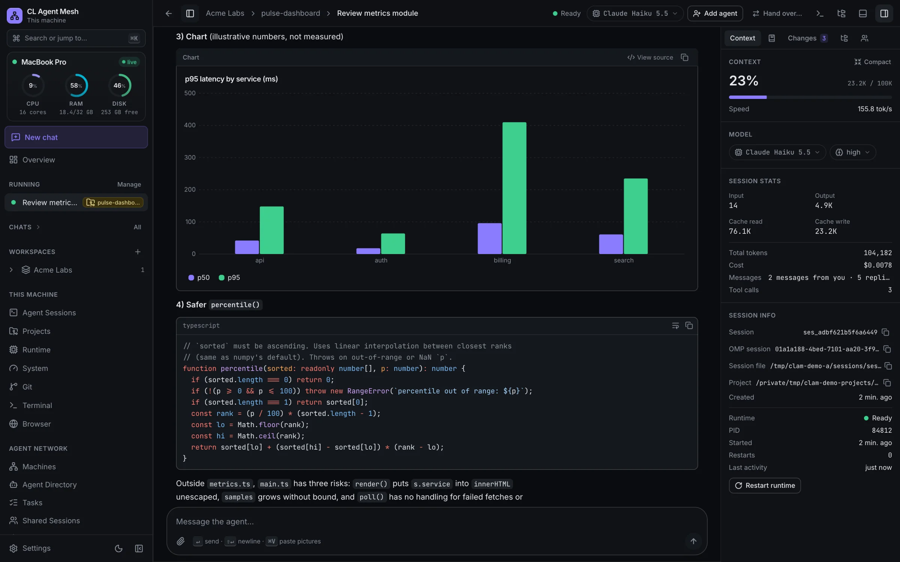
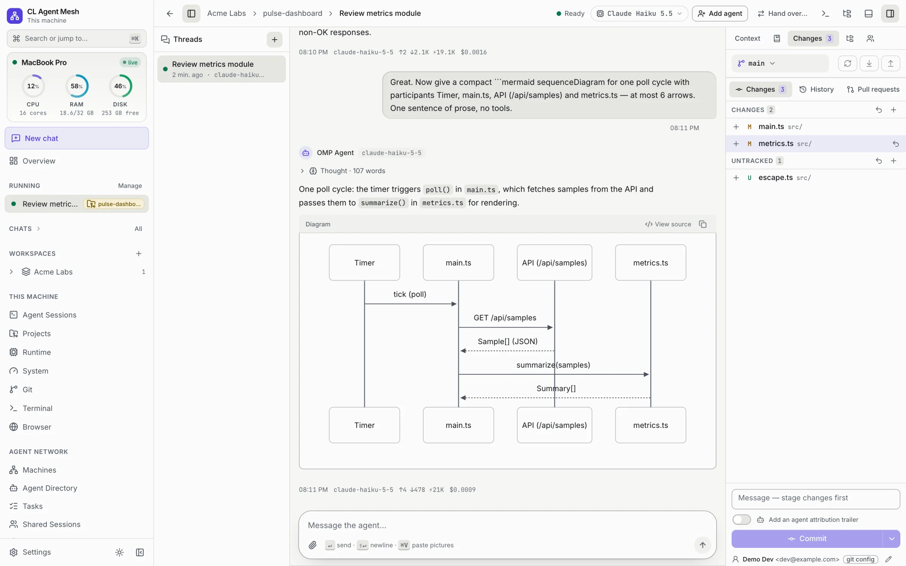
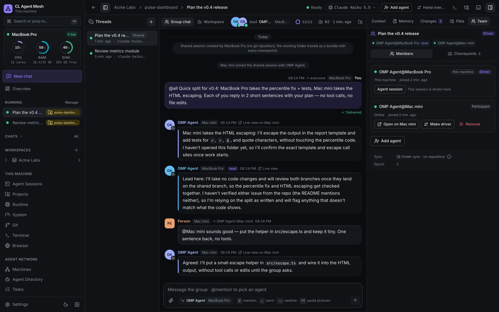
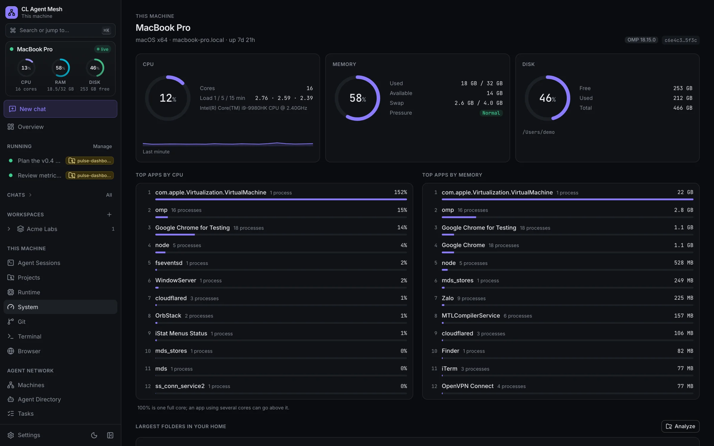
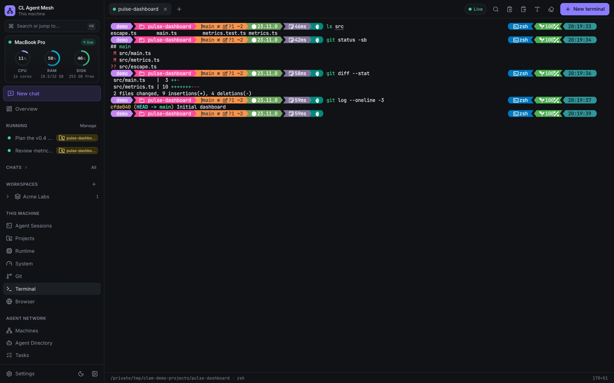
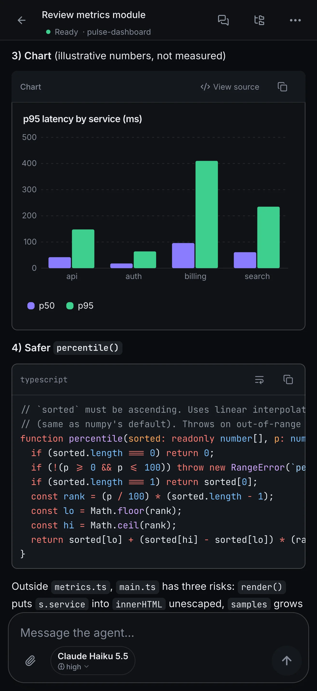
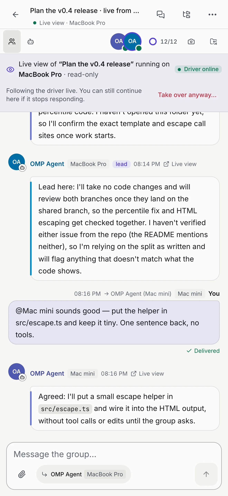
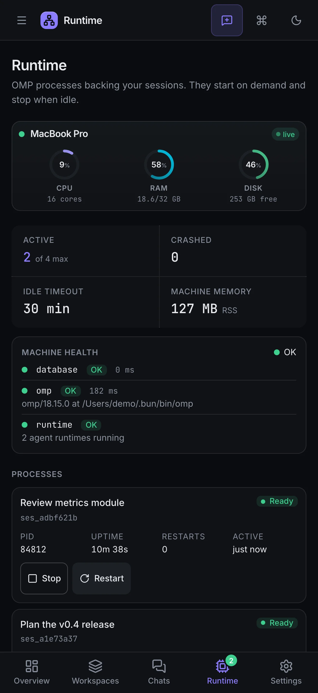
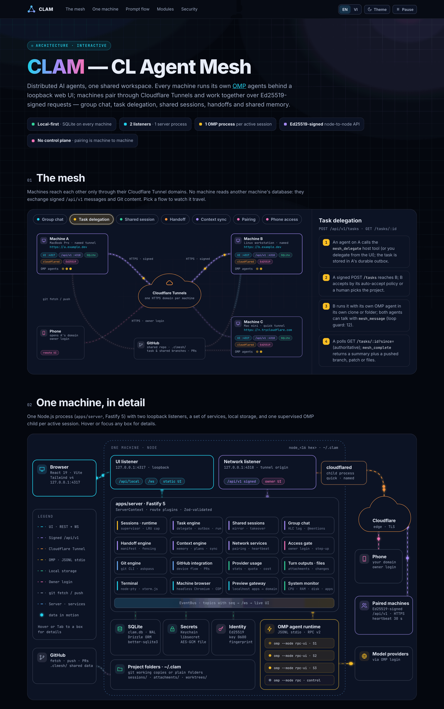
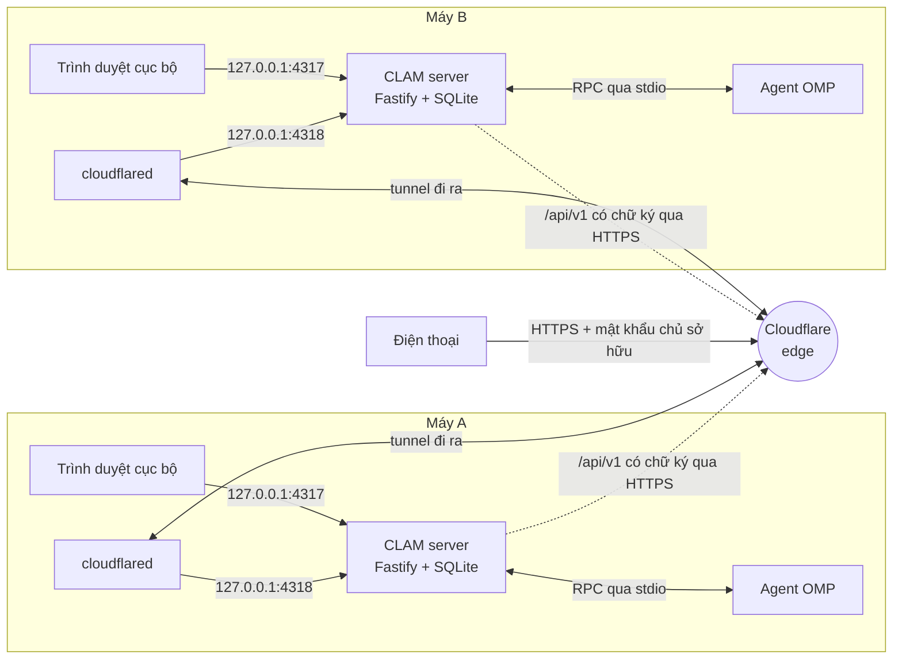

<div align="center">

<h1>CLAM — CL Agent Mesh</h1>

<p><strong>Distributed AI Agents. One Shared Workspace.</strong><br><sub>Các agent AI phân tán. Một workspace chung.</sub></p>

<p><a href="README.md">English</a> · <strong>Tiếng Việt</strong></p>

<p>
  <a href="LICENSE"></a>
  
  
  
  
  
  
  <a href="#đóng-góp"></a>
</p>

<p>
  <a href="#bắt-đầu-nhanh">Bắt đầu nhanh</a> ·
  <a href="#ảnh-chụp-màn-hình">Ảnh chụp màn hình</a> ·
  <a href="#kiến-trúc">Kiến trúc</a> ·
  <a href="#cấu-hình">Cấu hình</a> ·
  <a href="#tài-liệu">Tài liệu</a> ·
  <a href="#đóng-góp">Đóng góp</a>
</p>



</div>

## Mục lục

- [CLAM là gì](#clam-là-gì)
- [Điểm nổi bật](#điểm-nổi-bật)
- [Ảnh chụp màn hình](#ảnh-chụp-màn-hình)
- [So sánh CLAM với các công cụ khác](#so-sánh-clam-với-các-công-cụ-khác)
- [Kiến trúc](#kiến-trúc)
- [Bắt đầu nhanh](#bắt-đầu-nhanh)
- [Cài đặt](#cài-đặt)
- [Thiết lập lần đầu](#thiết-lập-lần-đầu)
- [Kết nối máy thứ hai](#kết-nối-máy-thứ-hai)
- [Dùng từ điện thoại](#dùng-từ-điện-thoại)
- [Xem trước một ứng dụng web cục bộ](#xem-trước-một-ứng-dụng-web-cục-bộ)
- [Quy trình hằng ngày](#quy-trình-hằng-ngày)
- [Cập nhật, sao lưu và gỡ cài đặt](#cập-nhật-sao-lưu-và-gỡ-cài-đặt)
- [Xử lý sự cố](#xử-lý-sự-cố)
- [Phát triển](#phát-triển)
- [Cấu hình](#cấu-hình)
- [Cấu trúc dự án](#cấu-trúc-dự-án)
- [Tài liệu](#tài-liệu)
- [Bảo mật](#bảo-mật)
- [Đóng góp](#đóng-góp)
- [Lời cảm ơn](#lời-cảm-ơn)
- [Giấy phép](#giấy-phép)

## CLAM là gì

CLAM biến các máy tính của một người (hoặc một nhóm nhỏ) thành một đội AI. Mỗi máy tính — một **máy**, trong tài liệu giao thức gọi là *node* — chạy các agent AI phía sau một giao diện web cục bộ. Runtime agent là [OMP](https://github.com/can1357/oh-my-pi) (`omp`), được điều khiển qua chế độ RPC; interface runtime có thể thay thế.

Các máy ghép nối với nhau qua **Cloudflare Tunnel của chính bạn** — không mở cổng, không có server trung tâm. Chúng chat chung trong một nhóm, giao việc cho agent của nhau, chia sẻ phiên và bộ nhớ, và bàn giao công việc dang dở từ máy này sang máy khác. Một máy ngoại tuyến không bao giờ làm gián đoạn công việc đang chạy trên máy khác.

**Vì sao.** Laptop, máy trạm và server ở nhà của bạn đều có tệp, công cụ, tài khoản và sức tính toán riêng. CLAM cho agent trên mỗi máy làm việc ngay tại nơi dữ liệu nằm, còn bạn theo dõi và điều hướng tất cả từ một giao diện — kể cả từ điện thoại.

**Mức độ hỗ trợ nền tảng.** macOS (Apple Silicon) là nền tảng CLAM được phát triển và kiểm thử. Linux chạy trong bộ test Docker (Debian, Node 24); cài trực tiếp trên Linux dùng cùng các lệnh nhưng người duy trì chưa chạy thử. **Windows chưa được kiểm thử**: code có sẵn đường cho Windows (tự khởi động bằng scheduled task, quét cổng bằng `netstat`, `cloudflared` qua winget), nhưng mục nào ghi *Windows* bên dưới đều chưa được xác minh trên máy Windows thật.

**Cách đọc tên trong giao diện.** Tên trang/nút viết theo giao diện tiếng Việt, lần đầu kèm tên tiếng Anh trong ngoặc, ví dụ **Cài đặt → Bảo mật** (Settings → Security), vì bạn có thể dùng ứng dụng bằng ngôn ngữ nào cũng được.

## Điểm nổi bật

### Agent và chat

- **Chat không cần repository** — nói chuyện với agent về bất cứ việc gì (nghiên cứu, viết lách, ảnh, video). Agent có thư mục riêng; tệp bạn đính kèm được tải lên thư mục `attachments/` của dự án.
- **Đầu ra phong phú** — Markdown với code được tô màu (Shiki), công thức toán (KaTeX), sơ đồ Mermaid và khối `chart`; xem trước ảnh, video, âm thanh, PDF và văn bản. Tệp Markdown (README) hiển thị như trên GitHub, kể cả HTML thô (`<div align>`, `<details>`, ``, bảng bố cục, đã được sanitize) và mục lục bấm được; tệp HTML có chế độ xem trang chạy thật trong sandbox.
- **Hoạt động của agent dễ đọc** — kết quả subagent hiện thành thẻ báo cáo (agent, trạng thái, thời lượng, câu đầu tiên; Markdown đầy đủ khi cần); kết quả background job thành thẻ gọn (lệnh đã chạy, kết quả, thời lượng, phần cuối output).
- **Kiểm soát ngữ cảnh** — bảng **Ngữ cảnh** (Context) cho biết mức dùng context window, và **Thu gọn** (Compact) nén nó theo yêu cầu, có thể kèm trọng tâm.
- **Composer** — khi agent đang chạy, một công tắc chọn giữa điều hướng (steer) agent và xếp hàng (queue) yêu cầu tiếp theo; nút dừng, bộ chọn model và mức suy nghĩ.
- **Bảng bên phải** — các tab Ngữ cảnh, Bộ nhớ, Thay đổi (các thay đổi git chưa commit của thư mục, kèm số lượng), Tệp (cây thư mục), Subagent và Nhóm.
- **Phiên đang chạy** ở thanh bên, mỗi phiên có badge màu theo dự án (hoặc badge Chat).

### Mạng nhiều máy

- **Ghép nối** — mã dùng một lần cộng so sánh dấu vân tay (fingerprint), bộ quyền theo từng chiều, thu hồi tức thì.
- **Chat nhóm xuyên nhiều máy** — bạn và mỗi máy một agent trong cùng một luồng; `@mention` một agent, một máy hoặc mọi người. Bố cục gọn với tóm tắt nhóm trên thanh view và composer một ô; câu trả lời mang theo các tệp mà Markdown của nó trỏ tới.
- **Giao việc** — gửi tác vụ cho agent ở máy khác, theo dõi, trao đổi, nhận lại kết quả và tệp.
- **Phiên chia sẻ và tiếp quản** — phiên trên máy A được sao chép trực tiếp sang B; nếu A ngoại tuyến, B tiếp tục từ checkpoint gần nhất, hoặc A bàn giao khi vẫn trực tuyến. Phiên chia sẻ chế độ git làm việc trong **git worktree riêng** của branch chung, nên branch của thư mục dự án không bao giờ bị đổi.
- **Bàn giao kèm cài đặt dependency** — chuyển một tác vụ đang chạy sang máy khác; máy đích khôi phục công việc, cài dependency (sau khi bạn duyệt) và chạy tiếp. Không có gì được giải phóng cho đến khi máy đích xác nhận.
- **Bộ nhớ chung** — ghi chú, quyết định và kế hoạch được đồng bộ giữa các máy và được đưa vào các phiên agent mới.

### Công cụ trên máy

- **Terminal** — một shell thật trên máy đó (xterm.js + node-pty), hiện được icon Nerd Font nhờ font ký hiệu đóng gói sẵn.
- **Trình duyệt** (Browser) — Chromium headless trên máy đó, truyền hình về giao diện, giả lập được viewport iPhone.
- **Xem trước** (Preview) — mở dev server đang chạy trên một máy trong *trình duyệt của chính bạn* qua tên miền của máy.
- **Git** — branch, thay đổi, lịch sử và pull request cho từng dự án.
- **Quản lý OMP** — đăng nhập nhà cung cấp, vai trò model, danh mục model, và **kiểm tra / cài bản cập nhật OMP** (`omp update --check` / `omp update`) từ **Cài đặt → Nhà cung cấp OMP** (Settings → OMP Providers).

### Truy cập từ xa và di động

- **Truy cập từ xa qua tên miền của bạn** — mở giao diện của bất kỳ máy nào sau mật khẩu chủ sở hữu; mặc định tắt và chỉ bật được ngay tại máy đó.
- **Bố cục điện thoại** — thanh điều hướng dưới với tab **Runtime** hiện số tiến trình trực tiếp, composer gọn, cài lên màn hình chính.
- **Tiếng Anh và tiếng Việt**, giao diện sáng, tối và theo hệ thống.

### Giám sát

- **System monitor** — thẻ máy ở thanh bên hiện CPU, RAM và ổ đĩa dạng vòng đo trực tiếp và đưa ra cảnh báo (bộ nhớ sắp hết hoặc bị áp lực, CPU cao theo trung bình ~30 giây, ổ đĩa sắp đầy).
- **Trang Hệ thống** (System) — tải CPU, bộ nhớ, swap và áp lực bộ nhớ, mọi volume, ứng dụng dùng nhiều CPU và nhiều bộ nhớ nhất, và lượt quét *Thư mục lớn nhất trong thư mục home* chạy theo yêu cầu, không thay đổi hay tải lên gì.
- **Trang Runtime** — các tiến trình OMP đứng sau phiên của bạn, có dừng và khởi động lại; **Mức dùng LLM** (LLM Usage) cho token, chi phí và hạn mức nhà cung cấp; runtime log cho từng phiên.

## Ảnh chụp màn hình

<table>
  <tr>
    <td width="50%"><br><sub><b>Phiên agent</b> — đầu ra phong phú và bảng bên phải (tối)</sub></td>
    <td width="50%"><br><sub><b>Giao diện sáng</b> — sơ đồ Mermaid và thay đổi git chưa commit</sub></td>
  </tr>
  <tr>
    <td><br><sub><b>Chat nhóm</b> — một luồng, mỗi máy một agent</sub></td>
    <td><br><sub><b>Máy</b> — một máy thứ hai đã ghép nối</sub></td>
  </tr>
  <tr>
    <td><br><sub><b>System monitor</b> — vòng đo và ứng dụng hàng đầu</sub></td>
    <td><br><sub><b>Terminal</b> — một shell thật trên máy</sub></td>
  </tr>
</table>

<table>
  <tr>
    <td align="center" width="33%"><br><sub><b>Điện thoại</b> — chat (tối)</sub></td>
    <td align="center" width="33%"><br><sub><b>Điện thoại</b> — chat nhóm (sáng)</sub></td>
    <td align="center" width="33%"><br><sub><b>Điện thoại</b> — tab Runtime (tối)</sub></td>
  </tr>
</table>

## So sánh CLAM với các công cụ khác

Năm 2026, phần lớn AI coding agent hoặc chạy trong cloud sandbox của nhà cung cấp, hoặc chạy trên một máy duy nhất và cho truy cập từ xa qua relay của nhà cung cấp. CLAM tự host và dùng giấy phép MIT. CLAM biến *nhiều* máy của chính bạn thành một nhóm agent. Các máy nói chuyện trực tiếp với nhau qua Cloudflare Tunnel của bạn, không có server CLAM nào ở giữa. Agent làm việc ngay nơi đã có file, công cụ và tài khoản đăng nhập của bạn, và bạn có thể chuyển công việc đang chạy từ máy này sang máy khác.

| | Chạy trên máy bạn | Không qua cloud NCC | Nhiều máy | Handoff / takeover | Điện thoại | Mọi model | License | Giá |
| --- | :-: | :-: | :-: | :-: | :-: | :-: | --- | --- |
| **CLAM** | ✅ | ✅¹ | ✅ | ✅ | ✅ | ✅ | MIT | Miễn phí² |
| Claude Code | ✅ | ⚠️ | ⚠️ | ⚠️ | ✅ | ❌ | Proprietary | Gói / API |
| OpenAI Codex | ✅ | ⚠️ | — | ✅ | ✅ | ⚠️ | Apache-2.0 (CLI) | Gói / API |
| Cursor | ⚠️ | ❌ | — | ⚠️ | ⚠️ | ⚠️ | Proprietary | $0–200/tháng |
| GitHub Copilot | ⚠️ | ❌ | — | ⚠️ | ✅ | ⚠️ | Proprietary | $0–100/tháng + credits |
| Devin | ⚠️ | ❌ | — | — | — | ⚠️ | Proprietary | $0–200/tháng |
| OpenHands | ✅ | ✅ | — | — | — | ✅ | MIT | Miễn phí · Teams $500/tháng |
| Conductor | ✅ | ⚠️ | ⚠️ | — | ⚠️ | ✅ | Proprietary | $0–60/tháng |
| Vibe Kanban · Claude Squad | ✅ | ✅ | — | — | — | ✅ | Apache-2.0 · AGPL-3.0 | Miễn phí |
| Goose | ✅ | ✅ | — | — | — | ✅ | Apache-2.0 | Miễn phí |
| SSH + tmux + Tailscale | ✅ | ⚠️ | ❌ | ❌ | ⚠️ | ✅ | Hỗn hợp | Miễn phí |

✅ có · ⚠️ một phần · ❌ không · — không thấy trong tài liệu công khai.
**Chạy trên máy bạn**: công cụ của agent chạy trên phần cứng của bạn. **Không qua cloud NCC**: session không đi qua và không được lưu trên cloud của nhà cung cấp công cụ (không tính các lệnh gọi model API). **Nhiều máy**: agent trên các máy khác nhau phối hợp với nhau. **Handoff / takeover**: chuyển công việc đang chạy sang máy khác. **Điện thoại**: mở agent trên máy của chính bạn từ điện thoại. **Mọi model**: tự chọn provider hoặc dùng key, gói đăng ký của bạn.
¹ Lưu lượng giữa các máy và từ điện thoại đi qua tài khoản Cloudflare *của bạn*. Cloudflare terminate TLS. Request được ký Ed25519 để bảo đảm toàn vẹn nhưng không mã hoá end-to-end ([docs/security.md](docs/security.md)). ² Bạn chỉ trả tiền cho nhà cung cấp model. Tài khoản Cloudflare và tên miền riêng là tuỳ chọn (cần nếu muốn địa chỉ cố định).

<details>
<summary>Vì sao có các ô ⚠️</summary>

- **Claude Code**: Remote Control vẫn chạy trên máy bạn, nhưng session được relay qua Anthropic và transcript được lưu ở đó. Cross-session messaging chỉ gửi tin nhắn văn bản (không kèm lịch sử hay file) tới session của bạn trên máy khác. `/teleport` kéo session từ cloud về terminal. Chỉ dùng được model Claude (qua Anthropic API, Bedrock, Vertex, Foundry).
- **Codex**: CLI gọi thẳng provider của bạn được. Truy cập từ điện thoại và điều khiển nhiều thiết bị đi qua relay của OpenAI, và máy được điều khiển phải chạy ứng dụng ChatGPT desktop trên macOS hoặc Windows. Handoff chuyển một chat cùng trạng thái Git giữa các host, nhưng sẽ ngắt câu trả lời đang chạy trước. CLI hỗ trợ provider tuỳ chỉnh qua config; bản cloud và app dùng OpenAI.
- **Cursor**: Self-Hosted Machines chạy các tool call trên phần cứng của bạn, nhưng vòng lặp agent, inference và transcript vẫn nằm trên cloud của Cursor. Mọi request đều qua server Cursor, kể cả khi dùng key riêng (BYOK hỗ trợ 5 provider). Background agent chuyển task từ máy bạn lên cloud. Ứng dụng di động truy cập cloud agent.
- **GitHub Copilot**: mặc định chạy trong cloud sandbox của GitHub. `--environment-host` đăng ký máy của bạn, và GitHub Mobile có thể điều khiển máy đó. "One session, every surface" là chuyển qua lại giữa các thiết bị, không phải chuyển công việc giữa các máy. Copilot CLI và app hỗ trợ BYOK.
- **Devin**: Devin Desktop chạy trên máy bạn, nhưng phần "brain" luôn nằm trên cloud của Cognition. Khách hàng Enterprise có thể dùng bản triển khai riêng hoặc VPC. Model của nhiều hãng được cung cấp qua Cognition.
- **Conductor**: workspace cục bộ gửi tin nhắn thẳng tới nhà cung cấp model. Workspace trên cloud (Vercel sandbox) lưu session trên server của Conductor. Multiplayer và ứng dụng di động cần gói Pro. Chỉ chạy trên macOS.
- **SSH + tmux + Tailscale / VS Code Remote Tunnels**: kết nối được thiết lập qua coordination server của Tailscale hoặc Microsoft dev tunnels. Trên điện thoại chỉ dùng được qua ứng dụng terminal, còn việc phối hợp và chuyển giao công việc đều làm thủ công.

</details>

### Điểm khác biệt của CLAM

- **Một nhóm agent trên tất cả các máy của bạn.** Bạn và mỗi máy một agent cùng ở trong một group chat, gọi nhau bằng `@mention`. Bạn có thể giao task cho agent trên máy khác, theo dõi tiến độ, rồi nhận lại kết quả và file, có xem trước trước khi áp dụng. Công việc chạy trên máy có sẵn repo, GPU, tài khoản hoặc hệ điều hành cần thiết, không phải sao chép lên cloud sandbox.
- **Công việc vẫn tiếp tục khi một máy ngừng hoạt động.** Session trên máy A được mirror trực tiếp sang B. Nếu A offline, B làm tiếp từ checkpoint cuối; nếu A còn online, A có thể bàn giao cho B. Task đang chạy được handoff kèm bước cài dependency (bạn duyệt trước), và A vẫn giữ quyền sở hữu cho tới khi B gửi xác nhận bền vững. Cơ chế epoch fencing bảo đảm công việc không bao giờ chạy hai lần.
- **Không bao giờ có server CLAM.** Mỗi máy có server và cơ sở dữ liệu SQLite riêng, chỉ bind vào loopback, và nói chuyện với máy khác bằng request ký Ed25519, key được pin và capability cấp theo từng chiều. Thông tin đăng nhập provider nằm trong kho riêng của OMP, còn secret nằm trong keychain của hệ điều hành.
- **Dùng các máy của bạn ngay trên điện thoại.** Mỗi máy phục vụ UI riêng trên tên miền của bạn, có owner password bảo vệ. Truy cập từ xa mặc định tắt, chỉ bật được ngay tại máy đó, và không mở port nào. Trên điện thoại bạn cũng dùng được Terminal, Browser headless và Preview dev server của máy đó.
- **Dùng model và gói đăng ký của chính bạn.** Mọi provider mà OMP hỗ trợ, đăng nhập bằng tài khoản của bạn. CLAM miễn phí và dùng giấy phép MIT.
- **Không chỉ để viết code.** Chat không cần repository, bộ nhớ dùng chung đồng bộ giữa các máy, xem trước file và media, Git và pull request trên GitHub, cùng system monitor theo thời gian thực cho từng máy.

### Khi nào nên chọn công cụ khác

- **Bạn cần agent vẫn chạy khi mọi máy của bạn đều tắt**, hoặc muốn chạy rất nhiều task song song trên hạ tầng có sẵn. Codex cloud, Cursor Cloud Agents, cloud sandbox của GitHub Copilot và Devin đều có sandbox được quản lý sẵn. CLAM chỉ chạy trên những máy bạn để bật.
- **Bạn cần các tính năng cho doanh nghiệp** như SSO/SAML, RBAC, audit log, SOC 2 hay hỗ trợ từ nhà cung cấp. Copilot, Cursor, Devin, Conductor và OpenHands Teams có các tính năng này. CLAM chỉ có một owner password cho mỗi máy.
- **Bạn cần một sản phẩm đã ổn định và chạy trên mọi nền tảng ngay bây giờ.** CLAM còn ở giai đoạn đầu. CLAM được phát triển và kiểm thử trên macOS (Apple Silicon), Linux mới chỉ chạy trong Docker bench, còn Windows chưa được kiểm thử.
- **Bạn chỉ làm việc trên một máy và muốn chạy nhiều agent song song trong git worktree.** Conductor, Vibe Kanban hoặc Claude Squad nhẹ hơn, và Claude Code, Codex cũng có sẵn chế độ worktree.
- **Bạn không dùng được Cloudflare, hoặc muốn dùng một agent CLI cụ thể.** Ghép các máy trong CLAM bắt buộc phải có Cloudflare Tunnel, và hiện CLAM chỉ có runtime OMP (runtime interface có thể thay thế). Claude Code Remote Control, remote connections của ứng dụng Codex hoặc Tailscale có thể hợp hơn.

<sub>So sánh tại thời điểm tháng 11/2026, dựa trên tài liệu công khai. Các sản phẩm thay đổi rất nhanh. Nếu thấy chỗ nào sai, hãy gửi PR.</sub>

<details>
<summary>Nguồn</summary>

- CLAM: [README](#clam-là-gì), [docs/architecture.md](docs/architecture.md), [docs/shared-sessions.md](docs/shared-sessions.md), [docs/handoff-protocol.md](docs/handoff-protocol.md), [docs/security.md](docs/security.md), [LICENSE](LICENSE)
- Claude Code: [Remote Control](https://code.claude.com/docs/en/remote-control), [Cross-session messaging](https://code.claude.com/docs/en/cross-session-messaging), [Cloud sessions](https://code.claude.com/docs/en/claude-code-on-the-web), [Self-hosted environments](https://code.claude.com/docs/en/self-hosted-environments), [Overview](https://code.claude.com/docs/en/overview), [License](https://github.com/anthropics/claude-code/blob/main/LICENSE.md)
- OpenAI Codex: [Remote connections](https://learn.chatgpt.com/docs/remote-connections), [Pricing](https://developers.openai.com/codex/pricing), [Advanced config (providers)](https://developers.openai.com/codex/config-advanced), [openai/codex](https://github.com/openai/codex)
- Cursor: [Self-hosted machines](https://cursor.com/blog/self-hosted-machines), [Cloud Agents](https://cursor.com/docs/cloud-agents), [Background agents](https://cursor.com/help/ai-features/background-agents), [Pricing](https://cursor.com/help/account-and-billing/pricing), [BYOK](https://cursor.com/help/models-and-usage/api-keys)
- GitHub Copilot: [Connected cloud experience (2026-10-28)](https://github.blog/changelog/2026-10-28-work-from-anywhere-with-a-new-connected-copilot-cloud-experience/), [Plans](https://github.com/features/copilot/plans), [BYOK](https://docs.github.com/en/copilot/concepts/models/bring-your-own-key)
- Devin: [Pricing](https://devin.ai/pricing), [Enterprise deployment](https://docs.devin.ai/enterprise/vpc/overview)
- OpenHands: [Pricing](https://www.openhands.dev/pricing), [GitHub](https://github.com/OpenHands/OpenHands)
- Conductor: [Docs](https://www.conductor.build/docs), [Pricing](https://www.conductor.build/pricing)
- Vibe Kanban: [GitHub](https://github.com/BloopAI/vibe-kanban), [Thông báo ngừng dịch vụ](https://www.vibekanban.com/blog/shutdown) · Claude Squad: [GitHub](https://github.com/smtg-ai/claude-squad)
- Goose: [GitHub](https://github.com/aaif-goose/goose)
- DIY: [Tailscale pricing](https://tailscale.com/pricing), [VS Code Remote Tunnels](https://code.visualstudio.com/docs/remote/tunnels)

</details>

## Kiến trúc

<a href="docs/architecture.html"></a>

Phiên bản tương tác, có hiệu ứng của sơ đồ này là [docs/architecture.html](docs/architecture.html) — một tệp độc lập: mở trực tiếp trong trình duyệt trên máy (GitHub chỉ hiện mã nguồn HTML), hoặc qua một trình xem raw HTML bất kỳ.

- **Mỗi máy tự đủ.** Một server Fastify, một cơ sở dữ liệu SQLite, các tiến trình OMP và working copy git riêng. Không có server trung tâm: ghép nối, giao việc và chia sẻ đều là máy-tới-máy, và một máy vẫn chạy tiếp từ trạng thái cục bộ khi các máy kia vắng mặt.
- **Hai listener chỉ trên loopback.** **UI listener** (`127.0.0.1:4317`) phục vụ web app, `/api/local` và WebSocket `/ws`, không bao giờ lộ ra ngoài. **Network listener** (`127.0.0.1:4318`) chỉ phục vụ API máy-tới-máy `/api/v1` có chữ ký — cộng giao diện đăng nhập chủ sở hữu khi bạn bật — và là origin mà Cloudflare tunnel của bạn trỏ tới.
- **Mạng lưới.** Các máy gọi `/api/v1` của nhau qua HTTPS xuyên qua tunnel, bằng yêu cầu có chữ ký và khóa Ed25519 đã ghim; quyền được cấp theo từng chiều. Điện thoại vào giao diện của một máy qua cùng hostname tunnel đó.



Thêm: [docs/architecture.md](docs/architecture.md) (thành phần, mô hình tiến trình OMP, luồng dữ liệu, mô hình lỗi) và [docs/agent-network-protocol.md](docs/agent-network-protocol.md) (tiếng Anh).

## Bắt đầu nhanh

```bash
curl -fsSL https://omp.sh/install | sh               # runtime agent; sau đó `omp login`
git clone https://github.com/CongLe-FinX/clam.git
cd clam
pnpm install
pnpm build
pnpm start                                           # → http://127.0.0.1:4317
```

Cần Node ≥ 22.12, pnpm 11 và git ≥ 2.38 — xem [Cài đặt](#cài-đặt) cho từng hệ điều hành, rồi [Thiết lập lần đầu](#thiết-lập-lần-đầu).

## Cài đặt

### Yêu cầu

| Cần | Phiên bản | Để làm gì |
| --- | --- | --- |
| Node.js | **≥ 22.12** (đã thử với 24 và 25) | chạy server và build |
| pnpm | **11** (cố định trong `package.json`) | cài monorepo |
| Git | **≥ 2.38** | server dùng `git` của hệ thống; kiểm tra xung đột cần `merge-tree --write-tree` |
| OMP (`omp`) | bản gần đây; đã xác minh với 18.14.0 | runtime agent; phải nằm trong `PATH` hoặc tại `~/.bun/bin/omp` (hoặc đặt `CLAM_OMP_BIN`) |
| Tài khoản nhà cung cấp model | — | OMP cần ít nhất một nhà cung cấp (OpenAI, Anthropic, …) để trả lời |
| `cloudflared` | tùy chọn | chỉ cần để ghép nối máy và truy cập từ xa |
| GitHub CLI `gh` | tùy chọn | cách nhanh để nhập đăng nhập GitHub |
| Docker | tùy chọn | chỉ cho bộ test hai máy trong `deploy/docker/` |
| Toolchain C/C++, Python 3, make | chỉ khi thiếu bản build sẵn | native addon `better-sqlite3` và `node-pty` |

<details open>
<summary><b>macOS</b></summary>

```bash
# Giả định đã có Homebrew (https://brew.sh)
brew install node@24 git                    # hoặc dùng fnm/nvm (xem ghi chú bên dưới)
brew link --overwrite node@24               # chỉ khi `node -v` chưa hiện 24
npm install -g pnpm@11                      # hoặc `corepack enable` với Node 22/24
brew install cloudflared                    # tùy chọn, để ghép nối và truy cập từ xa
brew install gh                             # tùy chọn
xcode-select --install                      # chỉ khi một native module build lỗi
```

*Đã xác minh trên macOS (Apple Silicon): Node 25.8, pnpm 11.20, git 2.50 (Apple Git), cloudflared và gh từ Homebrew.*

</details>

<details>
<summary><b>Linux</b> (ví dụ Debian / Ubuntu)</summary>

```bash
sudo apt update && sudo apt install -y git curl ca-certificates build-essential python3
# Node 22 trở lên: dùng fnm (hoặc nvm) để không phụ thuộc Node cũ của distro
curl -fsSL https://fnm.vercel.app/install | bash && exec $SHELL
fnm install 24 && fnm default 24
corepack enable && corepack prepare pnpm@11 --activate     # hoặc: npm install -g pnpm@11
```

- `node-pty` (Terminal) không có bản build sẵn cho Linux nên **được biên dịch khi chạy `pnpm install`** — hãy giữ `build-essential` và `python3`.
- `cloudflared` (tùy chọn): làm theo [hướng dẫn gói của Cloudflare](https://developers.cloudflare.com/cloudflare-one/connections/connect-networks/downloads/) (`sudo apt install cloudflared` sau khi thêm apt repository của họ).
- Bí mật dùng Secret Service (`secret-tool`, gói `libsecret-tools`) khi có keyring desktop đang chạy; nếu không sẽ tự dùng tệp mã hóa trong thư mục dữ liệu.
- Bộ test Docker chứng minh toàn bộ stack chạy trên Debian bookworm + Node 24; xem [Bộ test hai máy bằng Docker](#bộ-test-hai-máy-bằng-docker).

</details>

<details>
<summary><b>Windows</b> — chưa xác minh</summary>

Các bước dưới đây là bản tương đương dự kiến; **người duy trì chưa chạy bước nào**.

```powershell
winget install OpenJS.NodeJS.LTS Git.Git Cloudflare.cloudflared
npm install -g pnpm@11
irm https://omp.sh/install.ps1 | iex          # OMP, theo README của OMP
```

Bí mật dùng kho tệp mã hóa (không có backend Windows Credential Manager). Tự khởi động được cài dưới dạng scheduled task tên "CLAM" nhưng chưa được smoke test. Hiện tại WSL2 với hướng dẫn Linux là lựa chọn an toàn hơn.

</details>

<details>
<summary><b>Ghi chú về Node.js và pnpm</b></summary>

- **fnm / nvm**: `fnm install 24 && fnm default 24`, hoặc `nvm install 24 && nvm alias default 24`.
- **pnpm qua corepack**: Node 22 và 24 có sẵn `corepack`; chạy `corepack enable` một lần là dùng đúng `pnpm@11.20.0` đã cố định. **Node 25 không còn kèm corepack** (`corepack: command not found`) — hãy dùng `npm install -g pnpm@11`.
- Lockfile được commit; `pnpm install --frozen-lockfile` chạy qua trên bản clone mới.

</details>

### OMP, runtime agent

Cài OMP theo một cách trong [README của OMP](https://github.com/can1357/oh-my-pi#install):

```bash
curl -fsSL https://omp.sh/install | sh          # macOS / Linux
brew install can1357/tap/omp                    # thay thế bằng Homebrew
bun install -g @oh-my-pi/pi-coding-agent        # thay thế bằng Bun (đặt omp vào ~/.bun/bin)
```

Sau đó đăng nhập ít nhất một nhà cung cấp model — trong terminal (`omp login`) hoặc sau này trong ứng dụng (**Cài đặt → Nhà cung cấp OMP**). CLAM không bao giờ thấy thông tin đăng nhập nhà cung cấp; chúng nằm trong kho riêng của OMP. Kiểm tra bằng `omp --version`. Các bản cập nhật OMP sau này cài được từ **Cài đặt → Nhà cung cấp OMP** (xem [Thiết lập lần đầu](#thiết-lập-lần-đầu)).

### Build và chạy

```bash
git clone https://github.com/CongLe-FinX/clam.git     # hoặc git@github.com:CongLe-FinX/clam.git
cd clam
pnpm install          # ~15 giây khi cache đã ấm; biên dịch native addon nếu không có bản build sẵn
pnpm build            # build web và đóng gói server thành apps/server/dist/main.js (~40 giây)
pnpm start            # chế độ production: server phục vụ luôn giao diện đã build
```

Mở **http://127.0.0.1:4317**. *(Đã xác minh trên bản clone mới với cổng và thư mục dữ liệu tùy chỉnh: install, build, start, `GET /` → 200, `GET /api/local/node` → JSON định danh của máy.)*

### Cổng và phạm vi lộ ra

| Cổng | Listener | Phạm vi |
| --- | --- | --- |
| **4317** (`CLAM_PORT`) | giao diện web + `/api/local` + `/ws` | chỉ loopback — không bao giờ truy cập được từ máy khác |
| **4318** (`CLAM_NETWORK_PORT`, mặc định `CLAM_PORT` + 1) | API máy-tới-máy `/api/v1` (cộng giao diện đăng nhập chủ sở hữu khi bật truy cập từ xa) | chỉ loopback; **origin mà Cloudflare tunnel trỏ tới** |
| 5317 (`WEB_PORT`) | Vite dev server (chỉ `pnpm dev`) | loopback |

Server từ chối bind bất kỳ địa chỉ nào ngoài `127.0.0.1`, `::1` hoặc `localhost`; truy cập từ xa chỉ tồn tại qua Cloudflare Tunnel. Muốn dùng cổng khác: `CLAM_PORT=4400 pnpm start` (cổng mạng thành 4401 trừ khi đặt `CLAM_NETWORK_PORT`). Nếu đổi cổng mạng, hãy đổi origin của tunnel cho khớp.

### Chế độ phát triển và production

| | `pnpm start` (production) | `pnpm dev` |
| --- | --- | --- |
| Cần `pnpm build` trước | có | không |
| Giao diện | http://127.0.0.1:**4317** | http://127.0.0.1:**5317** (Vite, hot reload; proxy `/api` và `/ws` sang 4317) |
| Thư mục dữ liệu | `~/.clam` | `<repo>/.data/core` (tách riêng, nên dev không đụng dữ liệu thật) |
| Dùng cho | dùng hằng ngày, tự khởi động | sửa code |

Cả hai đều mặc định server ở cổng 4317 — đừng chạy cùng lúc (hoặc cho một bên `CLAM_PORT` khác).

### Dữ liệu của bạn nằm ở đâu

Thư mục dữ liệu mặc định là **`~/.clam`** trên macOS và Linux (`%USERPROFILE%\.clam` trên Windows, chưa xác minh). Đổi bằng `CLAM_DATA_DIR`:

```bash
CLAM_DATA_DIR=/Volumes/Data/clam pnpm start
```

Thư mục này chứa cơ sở dữ liệu SQLite (`clam.db`), cặp khóa định danh của máy (`identity/`), thư mục OMP của từng phiên, thư mục chat và dự án do ứng dụng tạo (`projects/`), worktree của phiên chia sẻ (`worktrees/`), profile và tệp tải về của trình duyệt, và — chỉ khi không dùng keychain của hệ điều hành — tệp bí mật đã mã hóa. Danh sách đầy đủ: [Cái gì nằm ở đâu](#cái-gì-nằm-ở-đâu).

### Tự khởi động khi đăng nhập

1. Chạy `pnpm build` một lần (tự khởi động trỏ tới `apps/server/dist/main.js`; chưa build thì lỗi `autostart_not_built`).
2. Trong giao diện: **Cài đặt → Chung → Tự khởi động** (Settings → General → Start automatically) → bật.

Thao tác này chỉ ghi mục đăng nhập của hệ điều hành và có hiệu lực **từ lần đăng nhập kế tiếp** (không khởi động thêm server ngay lúc đó):

| Hệ điều hành | Cái được ghi |
| --- | --- |
| macOS | LaunchAgent `~/Library/LaunchAgents/io.clam.agent-mesh.plist`; log ở `<dataDir>/logs/server.{out,err}.log` — *đã smoke test* |
| Linux | unit systemd *user* `~/.config/systemd/user/cl-agent-mesh.service` (`enable`, không bao giờ `start`); không có systemd user services thì lỗi `autostart_unsupported` — *chưa smoke test* |
| Windows | scheduled task "CLAM" với trigger khi đăng nhập — *chưa smoke test* |

Mục đăng nhập ghi lại `CLAM_PORT`, `CLAM_DATA_DIR` và `PATH` của server mà bạn bật tùy chọn này từ đó. Sau khi di chuyển thư mục repo, hãy tắt rồi bật lại.

## Thiết lập lần đầu

1. **Kết nối nhà cung cấp model** — **Cài đặt → Nhà cung cấp OMP** (Settings → OMP Providers). Trang cho biết OMP đã cài chưa (nếu chưa: cài, rồi bấm **Làm mới** (Refresh)). Bấm **Kết nối** (Connect) cạnh một nhà cung cấp (*Tìm nhà cung cấp* lọc danh sách), cấp quyền trong trình duyệt và, nếu được hỏi, dán mã rồi bấm **Gửi** (Submit). Nhà cung cấp hiện **Đã đăng nhập** (Signed in).
2. **Chọn vai trò model mặc định** — cùng trang, **Vai trò model** (Model roles): đặt vai trò *Mặc định* (Default) (và các vai trò khác OMP liệt kê) bằng **Đặt** / **Đổi**; **Kiểm tra** (Test) gửi một yêu cầu thật. **Danh mục model** (Model catalog) cho biết các model có được từ tài khoản đã đăng nhập và giá của chúng.
3. **Giữ OMP luôn mới** — cùng trang: **Kiểm tra bản mới** (Check for new version) chạy `omp update --check`; khi có bản mới hơn, **Cập nhật lên &lt;phiên bản&gt;** (Update to …) sẽ cài nó.
4. **Kết nối GitHub (tùy chọn)** — **Cài đặt → Tài khoản GitHub** (Settings → GitHub Accounts). Hoặc **Nhập từ gh CLI** (Import from gh CLI) (sau khi chạy `gh auth login`), hoặc dùng device flow: tạo một GitHub OAuth App có bật *Device Flow*, dán client id vào **Client id của GitHub OAuth App**, **Lưu**, rồi **Kết nối tài khoản** (Connect account) và làm theo mã. Token chỉ được lưu vào kho bí mật của hệ điều hành. GitHub chỉ cần cho dự án repository, pull request và chia sẻ theo branch; chat và thư mục thường dùng được mà không cần GitHub.
5. **Đặt tên cho máy** — **Cài đặt → Chung → Tên máy** (Machine name) (hiển thị với các máy khác của bạn).
6. **Tạo workspace** — trong thanh bên bấm **+** cạnh **Workspace** (hoặc *Tạo workspace đầu tiên*). Workspace là đơn vị bạn chia sẻ với máy khác.
7. **Bắt đầu một chat** — **Chat mới** (New chat) (đầu thanh bên). Mô tả việc agent cần làm và bấm **Bắt đầu chat** (Start chat). Không cần repository: agent có thư mục riêng trong `<dataDir>/projects/`. Để làm việc với code, thêm một dự án (một thư mục, hoặc bản clone của repository GitHub) vào workspace rồi mở một phiên trong đó.
8. **Ngôn ngữ và giao diện** — **Cài đặt → Chung → Hiển thị** (Appearance): **Ngôn ngữ** (English / Tiếng Việt) và **Giao diện** (Sáng / Tối / Hệ thống). Cả hai được lưu trong *trình duyệt này*, nên điện thoại và máy tính có thể khác nhau.

> [!IMPORTANT]
> **Cài đặt → Chung → Chế độ duyệt công cụ** (Tool approval mode) quyết định agent có được chạy lệnh shell và sửa tệp mà không hỏi hay không. Hãy để chế độ hỏi cho đến khi bạn tin tưởng thiết lập của mình.

## Kết nối máy thứ hai

Hãy làm phần [cài đặt](#cài-đặt) và [thiết lập lần đầu](#thiết-lập-lần-đầu) cả trên máy **B** (mỗi máy có thư mục dữ liệu, đăng nhập OMP và tài khoản GitHub riêng). Hai máy cũng có thể là hai thư mục dữ liệu trên cùng một máy tính (`CLAM_PORT`, `CLAM_NETWORK_PORT`, `CLAM_DATA_DIR` khác nhau).

### 1. Cho mỗi máy một địa chỉ công khai

Cài `cloudflared` (xem [Yêu cầu](#yêu-cầu)), rồi trên từng máy mở **Cài đặt → Cloudflare Tunnel**. Trang hiện phiên bản `cloudflared` (hoặc gợi ý cài) và **Chế độ tunnel** (Tunnel mode): *Tắt*, *Tunnel nhanh* (Quick tunnel), *Tunnel có tên* (Named tunnel).

**Tunnel nhanh** (dùng thử, không cần tài khoản): bấm **Bật tunnel nhanh** (Start a quick tunnel) để nhận địa chỉ ngẫu nhiên `https://<từ-ngẫu-nhiên>.trycloudflare.com`. Địa chỉ này **đổi mỗi lần tunnel khởi động** — các máy đã ghép nối được báo tự động, nhưng lời mời phải dùng địa chỉ hiện tại. Cloudflare không cam kết uptime, và hostname mới có thể mất vài giây mới phân giải được.

**Tunnel có tên với tên miền riêng** (ổn định; khuyến nghị cho điện thoại). Cần một tên miền có DNS trên Cloudflare và một tài khoản Cloudflare miễn phí. *Các bước trên dashboard theo giao diện Zero Trust hiện tại của Cloudflare và chưa được chạy lại từ đầu đến cuối với tên miền thật cho README này; nếu nhãn khác, hãy tìm "Tunnels" trong Networks.*

1. Cloudflare dashboard → **Zero Trust** → **Networks** → **Tunnels** → **Create a tunnel** → **Cloudflared** → đặt tên (ví dụ `node-a`) → **Save tunnel**.
2. Ở màn hình "install connector", sao chép **token** (chuỗi dài sau `--token`). **Đừng** chạy lệnh cài đặt — CLAM tự chạy `cloudflared`.
3. **Public hostname**: thêm ví dụ `node-a.example.com`; dịch vụ **HTTP**, URL **`127.0.0.1:4318`** — cổng *mạng* của máy này, **không phải** cổng giao diện 4317, và không phải `https`. (Trường **Origin cần cấu hình** (Origin to configure) trong ứng dụng hiện đúng giá trị.)
4. Trong CLAM: **Cài đặt → Cloudflare Tunnel** → **Chế độ tunnel: Tunnel có tên** → **Public hostname** `node-a.example.com` → **Token tunnel** → bật **Tự khởi động** nếu muốn tunnel chạy cùng server → **Lưu cấu hình** (Save configuration) → **Bật tunnel** (Start tunnel). Token đi vào kho bí mật của hệ điều hành (chỉ ghi).
5. Lặp lại trên máy B với **tunnel và hostname riêng** (ví dụ `node-b.example.com`).

Cài đặt đã lưu chưa có hiệu lực cho tới khi tunnel chạy: **Lưu cấu hình** khi **Tự khởi động** đang bật sẽ bật ngay tunnel đang dừng (và mỗi lần server khởi động); nếu không, bấm **Bật tunnel**. Nếu một `cloudflared` khác của bạn đã route hostname tới `127.0.0.1:4318`, CLAM không cần connector riêng: khi `https://<hostname>/api/v1/node/info` trả lời bằng danh tính của máy này, trang hiện **Được phục vụ bởi một cloudflared khác trên máy hoặc mạng này** và hostname đó được dùng trong lời mời.

Tunnel chỉ lộ ra API máy-tới-máy có chữ ký (và, nếu bạn bật, giao diện đăng nhập chủ sở hữu). `https://<tên miền của bạn>/api/local/*` luôn trả 404.

### 2. Ghép nối: mời, tham gia, xác minh, duyệt

Mở **Máy** (Machines) ở thanh bên (cũng vào được từ **Mạng agent** (Agent Network)).

1. **Trên A — Mời máy khác → Tạo lời mời** (Invite another machine → Create an invitation). Chọn **workspace để chia sẻ** và **thời hạn của mã**, rồi **Tạo lời mời**. A hiện mã dùng một lần `XXXX-XXXX`, địa chỉ và **dấu vân tay** của nó (**Sao chép tất cả thành tin nhắn** sao chép cả ba). Mã chỉ dùng một lần, hết hạn (≤ 10 phút) và khóa sau 5 lần nhập sai. Nếu chưa có địa chỉ công khai, hộp thoại đề nghị bật tunnel nhanh.
2. **Trên B — Tham gia máy khác → Nhập mã** (Join another machine → Enter a code). Dán địa chỉ `https://…` của A và bấm **Tra cứu máy** (Look up machine). **So dấu vân tay B hiện với dấu vân tay trên A** (đọc to hoặc qua kênh bạn tin cậy), đánh dấu *I compared this fingerprint…*, nhập mã rồi tham gia. Tunnel của B phải đang chạy để A hoàn tất bắt tay.
3. **Trên A — duyệt.** A hiện *Một máy muốn kết nối* (một banner ở bất kỳ đâu trong ứng dụng, và trong **Máy → Yêu cầu ghép nối**). So dấu vân tay của B, chọn quyền (bên dưới) và bấm **Duyệt và ghép nối** (Approve and pair).

Từ giờ hai máy ghim khóa của nhau và thấy nhau là **trực tuyến**; B nhận bản sao của workspace chung (cùng tên và id — dự án và tệp không bao giờ được chia sẻ tự động), và agent của mỗi máy xuất hiện trong **Danh bạ agent** (Agent Directory). **Thu hồi** (Revoke) trên trang của một máy sẽ cắt nó ngay lập tức. Máy đã dừng hiện *ngoại tuyến* sau khoảng hai phút và tự kết nối lại.

### Bộ quyền truy cập

Quyền được cấp **theo từng chiều**: bạn cấp gì là máy *kia* được làm gì trên máy *của bạn*. Đổi bất cứ lúc nào trên trang của máy (*Tinh chỉnh từng quyền* cho từng capability riêng).

| Bộ quyền | Capability | Cho phép máy kia… |
| --- | --- | --- |
| **Chat và cộng tác** (Chat & collaborate) | `agents.read`, `events.read`, `sessions.share` | xem agent và trạng thái trực tiếp của bạn; mời bạn vào phiên chia sẻ và chat nhóm |
| **Giao tác vụ** (Delegate tasks) | `tasks.send`, `tasks.receive`, `tasks.cancel`, `artifacts.read`, `artifacts.write` | gửi việc cho agent của bạn, nhận kết quả, trao đổi tệp tạo ra (máy bạn vẫn quyết định có chạy hay không) |
| **Chia sẻ bộ nhớ** (Share memory) | `context.sync` | giữ ghi chú và quyết định chung đồng bộ |
| **Bàn giao công việc** (Hand off work) | `handoff.send`, `handoff.receive` | chuyển cả phiên và tác vụ agent giữa hai máy |
| **Tin cậy hoàn toàn** (Full trust) | tất cả mục trên và các capability trong tương lai | chỉ cho máy của chính bạn |

Với hai máy của chính bạn, hãy cấp cả bốn bộ quyền ở cả hai chiều. Chat nhóm cần *Chat và cộng tác* cả hai chiều, giao việc cần *Giao tác vụ*, bộ nhớ chung cần *Chia sẻ bộ nhớ*, bàn giao cần *Bàn giao công việc* cả hai chiều.

## Dùng từ điện thoại

Mỗi máy có thể phục vụ giao diện web **riêng của nó** qua tên miền tunnel, sau một mật khẩu chủ sở hữu. Tính năng này **mặc định tắt** và chỉ bật được **ngay tại máy đó** (`http://127.0.0.1:4317`).

1. Bảo đảm máy đang chạy tunnel; tunnel có tên là tốt nhất vì địa chỉ không đổi.
2. **Cài đặt → Bảo mật → Mật khẩu chủ sở hữu → Đặt mật khẩu** (Settings → Security → Owner password → Set password) (ít nhất 12 ký tự; mật khẩu đầu tiên chỉ đặt được tại máy).
3. **Cài đặt → Bảo mật → Truy cập từ xa vào giao diện web này** (Remote access to this web UI) → bật (xác nhận *Cho phép truy cập từ xa vào giao diện này?*). *Địa chỉ giao diện công khai* hiện URL.
4. Trên điện thoại mở `https://node-a.example.com/`, nhập mật khẩu chủ sở hữu và thêm vào màn hình chính. Bố cục điện thoại có thanh dưới với tab **Runtime** (số tiến trình OMP trực tiếp). Phiên từ xa không thể đổi tunnel, công tắc truy cập từ xa hay đặt mật khẩu chủ sở hữu lần đầu; **Đăng xuất** (Sign out) nằm trong **Cài đặt → Bảo mật**.
5. Với giao diện của máy khác, mở tên miền của **máy đó** theo cách tương tự; nút *Mở Terminal / Trình duyệt của B* trên trang một máy làm đúng việc đó.

**Terminal và Trình duyệt qua tên miền** (mặc định tắt): **Cài đặt → Bảo mật → Terminal, Trình duyệt và Xem trước** → **Terminal qua tên miền** và/hoặc **Trình duyệt qua tên miền**. Bật một mục sẽ hỏi mật khẩu chủ sở hữu; mở terminal qua tên miền hỏi lại (hiệu lực 10 phút). Tắt một công cụ, đăng xuất hoặc **Đăng xuất mọi nơi** (Sign out everywhere) đóng ngay các kết nối trực tiếp của nó. Trình duyệt có thể giả lập viewport iPhone để thử các web app mà agent chạy trên `localhost` của máy đó.

> [!WARNING]
> Ai có mật khẩu chủ sở hữu đều điều khiển được agent trên máy đó; khi bật Terminal, họ chạy lệnh với quyền của user đang chạy CLAM và với tới mạng của máy đó. Dùng mật khẩu dài, duy nhất và giữ Terminal, Trình duyệt tắt trừ khi cần.

- Đăng nhập bị giới hạn tốc độ (sai 5 lần → khóa 30 giây, tăng gấp đôi đến 15 phút, cộng khóa toàn máy chống đoán phân tán). Cookie phiên là `HttpOnly`, `Secure`, `SameSite=Strict`; **Thời hạn đăng nhập** (Sign-in lasts) chỉnh được và được gia hạn khi bạn còn dùng giao diện.
- Cổng giao diện 4317 và kênh OMP RPC không bao giờ lộ ra. Một chính sách Cloudflare Access cho cả hostname cũng sẽ chặn các máy đã ghép nối, vì API máy-tới-máy dùng chung hostname (**[SUY ĐOÁN]** — chưa thử; hãy dùng chính sách theo đường dẫn hoặc bỏ qua).

## Xem trước một ứng dụng web cục bộ

Mở một ứng dụng web chạy trên máy (dev server Vite / Next / webpack ở `localhost:<port>`) trong **trình duyệt của chính bạn**, với DevTools thật, từ bất cứ đâu. Mỗi máy có **thêm một hostname**, mặc định là nhãn đầu của hostname tunnel cộng `-preview` (`clamp-work.example.com` → `clamp-work-preview.example.com`).

1. **Cần tunnel có tên** — địa chỉ tunnel nhanh đổi mỗi lần khởi động. Trên giao diện của chính máy thì không cần gì: nút xem trước chỉ mở `http://localhost:<port>`.
2. **Cài đặt → Cloudflare Tunnel → Xem trước trong trình duyệt của bạn** hiện *Địa chỉ xem trước* (sửa được). Trên Cloudflare, thêm nó thành public hostname của cùng tunnel: *Hostname* `clamp-work-preview.example.com`, *Service* `HTTP` · `127.0.0.1:4318`. Không cần wildcard, và tên cấp một được chứng chỉ Universal SSL miễn phí của Cloudflare phủ tới. Không bao giờ dùng chung một tunnel giữa các máy.
3. Bấm **Kiểm tra**: CLAM gọi `https://<địa chỉ xem trước>/__clam_preview/health` và mong chính máy *này* trả lời.
4. **Cài đặt → Bảo mật → Terminal, Trình duyệt và Xem trước → Xem trước qua tên miền** → bật (cần *Truy cập từ xa vào giao diện web*; mặc định tắt).
5. Dùng **Mở bản xem trước ↗** cạnh chip *Đang chạy trên máy này* (trang Trình duyệt), cạnh liên kết `http://localhost:<port>` trong chat, hoặc **Mở trong trình duyệt của tôi** trên thanh công cụ Trình duyệt. CLAM tạo vé dùng một lần (60 giây) và mở ứng dụng ở gốc tự nhiên của nó, nên route phía client, đường dẫn asset tuyệt đối, lời gọi API và WebSocket HMR đều chạy.

- **Mỗi trình duyệt một ứng dụng tại một thời điểm**: `/port/5173/…` chọn cổng 5173 (lưu trong cookie); khi chưa chọn gì, địa chỉ hiện bảng chọn các web app đang lắng nghe trên máy.
- **Truy cập được**: chỉ web app trên loopback của máy — không bao giờ là cổng của chính CLAM, cơ sở dữ liệu, SSH, debugger (22, 3306, 5432, 6379, 27017, 9229, 9222, …) hay cổng dưới 1024 trừ 80. Ứng dụng thấy `Host: localhost:<port>`; chuyển hướng tới `http://localhost:<port>/…` được viết lại; cookie của CLAM không bao giờ được chuyển tiếp.
- Mọi cổng của một máy dùng chung origin xem trước: hãy coi các ứng dụng xem trước là một vùng tin cậy. Đăng xuất, đổi mật khẩu, tắt Xem trước hoặc tắt truy cập từ xa sẽ kết thúc mọi phiên xem trước. Việc mở được ghi nhật ký (`preview.open`, `preview.signin`).

## Quy trình hằng ngày

Các quy trình dưới đây giả định các máy đã ghép nối với bộ quyền tương ứng. Mỗi quy trình có tương đương qua API trong [API walkthrough](docs/api-walkthrough.md) (tiếng Anh).

**Chat nhóm với agent của A và B.** Trên A, mở một chat hoặc phiên → **Thêm agent** (Add agent) → chọn máy B (và tùy chọn một agent) → **Thêm vào phiên**. Chấp nhận lời mời trên B (**Phiên chia sẻ** (Shared Sessions), hoặc banner). Cả hai máy giữ bản sao nhật ký tin nhắn. Tin nhắn không nhắc ai đi tới agent dẫn đầu; gõ `@` để gọi một agent, một máy hoặc mọi người; đính kèm tệp bằng biểu tượng kẹp giấy. Kết thúc ghép nối cũng đề nghị **Bắt đầu chat nhóm với các agent của nó**.

**Giao một tác vụ.** **Danh bạ agent** → một agent → **Giao việc** (Delegate) (hoặc **Tác vụ → Giao tác vụ**): tiêu đề, mô tả, tùy chọn tệp dự án cần gửi. Theo dõi và trao đổi trên trang tác vụ. Nếu có tệp trả về, **Xem trước & áp dụng tệp** hiện từng tệp là mới / không đổi / cập nhật / xung đột kèm diff; không có gì được ghi trước khi bấm **Áp dụng vào dự án**.

**Bàn giao (A trực tuyến) hoặc tiếp quản (A ngoại tuyến) một phiên chia sẻ.** Bên điều khiển (driver) bấm **Bàn giao…** (Hand over…) → **Bàn giao cho** một máy → **Bàn giao**; mọi thứ kể cả tệp chưa commit được lưu, máy kia tiếp tục trong một phiên mới và A thành thành viên chỉ đọc. Nếu A ngoại tuyến, B mở phiên chia sẻ và bấm **Tiếp tục trên máy này** (Continue on this machine) (xác nhận **Vẫn tiếp quản** nếu A có vẻ vẫn trực tuyến); việc A làm sau checkpoint cuối nằm lại trên A thành bản cứu hộ. Ở chế độ git, mỗi máy làm việc trong worktree riêng của branch chung (`<dataDir>/worktrees/<sharedId>`); agent của driver cũ tiếp tục làm việc trong worktree của nó với vai trò thành viên và được push lên branch chung.

**Bàn giao một tác vụ đang chạy kèm cài đặt dependency.** Trên trang tác vụ **Bàn giao…** (Hand off…) → máy đích, tùy chọn các lệnh thiết lập (ví dụ `npm ci`) và một lệnh kiểm tra → **Bàn giao**. Trên máy đích chấp nhận trong **Bàn giao** (Handoffs) (hoặc **Cài đặt → Chung → Bàn giao → Tự động chấp nhận bàn giao**). **Thiết lập dependency** quyết định các lệnh: **Hỏi trước** (khuyến nghị), **Chạy tự động** (chỉ cho máy hoàn toàn tin cậy) hoặc **Không bao giờ chạy**. Máy nguồn vẫn là chủ cho đến khi có xác nhận bền vững của máy đích (hạn 30 phút, **Gia hạn** hoặc **Lấy lại tác vụ**).

**Bộ nhớ chung.** Phiên → bảng **Bộ nhớ** (Memory) (hoặc **Ngữ cảnh chung** ở thanh bên) → **Thêm bộ nhớ** (memory, decision, plan, summary, note). Mục ở trạng thái **riêng tư** cho đến khi đánh dấu *shareable*; mục shareable được đồng bộ tới mọi máy trong workspace và phiên mới bắt đầu với phần mở đầu "Project memory" ngắn. Sửa đồng thời trở thành xung đột mà bạn giải quyết bằng tay.

**Tệp và ngữ cảnh.** Tab **Tệp** của bảng bên phải duyệt thư mục phiên (xem trước, tải xuống, tải lên) và **Thay đổi** liệt kê các thay đổi git chưa commit. Khi một phiên dài làm đầy context window, **Ngữ cảnh → Thu gọn** tóm tắt nó (có thể kèm trọng tâm) và báo mức dùng trước và sau.

## Cập nhật, sao lưu và gỡ cài đặt

**Cập nhật**

```bash
cd clam
git pull
pnpm install
pnpm build
# dừng server đang chạy (Ctrl-C), rồi
pnpm start
```

Migration cơ sở dữ liệu chạy khi khởi động sau khi ghi bản chụp `clam.db.pre-migrate-<timestamp>.bak`. Tab trình duyệt còn chạy bản build cũ sẽ đề nghị **Tải lại** (Reload). Nếu đang bật tự khởi động, hãy đăng xuất rồi đăng nhập lại (hoặc khởi động lại service) sau khi build. Cập nhật **tất cả** máy đã ghép nối lên cùng phiên bản khi tài liệu giao thức thay đổi. Bản thân OMP được cập nhật từ **Cài đặt → Nhà cung cấp OMP**.

**Sao lưu.** Dừng server và sao chép thư mục dữ liệu (mặc định `~/.clam`). Bí mật trong keychain của hệ điều hành (token GitHub, token tunnel) không nằm trong đó — hãy nhập lại trên máy mới. Khôi phục định danh ở máy khác khiến nó là *cùng một* máy đối với các máy kia; không bao giờ chạy hai bản cùng lúc.

**Gỡ cài đặt**

1. **Cài đặt → Chung → Tự khởi động** → tắt, và **Cài đặt → Cloudflare Tunnel → Dừng tunnel**; trên Cloudflare xóa tunnel và bản ghi DNS bạn đã tạo.
2. Dừng server.
3. Ghi lại node id (`curl -s http://127.0.0.1:4317/api/local/node` → `id`), rồi xóa thư mục dữ liệu: `rm -rf ~/.clam`.
4. Xóa các mục keychain `cl-agent-mesh.<nodeId>`: macOS — *Keychain Access*, tìm `cl-agent-mesh` (hoặc `security delete-generic-password -s cl-agent-mesh.<nodeId> -a <account>`); Linux — `secret-tool clear service cl-agent-mesh.<nodeId> account <account>`, hoặc Seahorse/KWallet. Kho tệp mã hóa nằm trong thư mục dữ liệu.
5. Xóa thư mục repository.

## Xử lý sự cố

<details>
<summary><b>Cổng đang bị dùng</b> (<code>EADDRINUSE</code> trên 4317/4318)</summary>

Tìm tiến trình đang giữ: `lsof -iTCP:4317 -sTCP:LISTEN` (Windows: `netstat -ano | findstr 4317`). Dừng nó, hoặc dùng cổng khác: `CLAM_PORT=4400 pnpm start`. `pnpm dev` và `pnpm start` đều mặc định 4317 — chỉ chạy một.

</details>

<details>
<summary><b>Không tìm thấy <code>omp</code></b> (Cài đặt → Nhà cung cấp OMP báo <i>Chưa cài</i>)</summary>

Cài OMP ([ở trên](#omp-runtime-agent)). Server tìm trong `PATH` và tại `~/.bun/bin/omp`; server khởi chạy từ GUI hoặc tự khởi động có thể có `PATH` ngắn hơn — đặt `CLAM_OMP_BIN=/đường/dẫn/đầy/đủ/tới/omp`, rồi bấm **Làm mới**.

</details>

<details>
<summary><b>Nhà cung cấp chưa đăng nhập</b> — agent trả lỗi xác thực</summary>

**Cài đặt → Nhà cung cấp OMP** → *Chưa đăng nhập* → **Kết nối**, hoặc `omp login` trong terminal. Kiểm tra **Vai trò model** có model mặc định từ nhà cung cấp đã đăng nhập (**Kiểm tra**).

</details>

<details>
<summary><b><code>better-sqlite3</code> / <code>node-pty</code> build lỗi</b></summary>

Cần bản build sẵn cho phiên bản Node của bạn hoặc một toolchain: macOS `xcode-select --install`; Debian/Ubuntu `sudo apt install build-essential python3`. Ưu tiên Node 22 hoặc 24 nếu Node mới tinh chưa có bản build sẵn. Rồi chạy lại `pnpm install`.

</details>

<details>
<summary><b><code>corepack: command not found</code></b></summary>

Node 25+ không còn kèm corepack: `npm install -g pnpm@11`.

</details>

<details>
<summary><b>Tunnel cứ "reconnecting" / tunnel nhanh không truy cập được</b></summary>

Kiểm tra **Cài đặt → Cloudflare Tunnel** hiện `cloudflared` đã cài và cổng **Network listener** đúng là cổng hostname trỏ tới (tunnel có tên: dịch vụ `http://127.0.0.1:4318`, token của đúng tunnel đó, hostname khớp chính xác với Cloudflare). Hostname tunnel nhanh mới có thể mất vài giây để phân giải. Proxy hoặc tường lửa chặn lưu lượng đi ra của `cloudflared` (7844/QUIC và HTTPS) cũng gây ra lỗi này. Bấm **Dừng tunnel**, rồi **Bật tunnel**.

</details>

<details>
<summary><b><code>403 forbidden_host</code></b> — "Máy này chỉ phản hồi cho …"</summary>

Network listener chỉ phản hồi cho `localhost`, `127.0.0.1`, `[::1]` và **hostname tunnel có tên đã lưu trong Cài đặt → Cloudflare Tunnel**. Kiểm tra chế độ là **Tunnel có tên** và **Public hostname** đúng hệt hostname đã route trên Cloudflare (CLAM tự chuyển về chữ thường). Cài đặt đã lưu chưa có hiệu lực cho tới khi tunnel chạy: bấm **Bật tunnel**, hoặc bật **Tự khởi động** rồi lưu. Nếu bạn chạy `cloudflared` **riêng của mình** cho hostname đó, chỉ hostname đã lưu là đủ để qua kiểm tra Host, và trang hiện **Được phục vụ bởi một cloudflared khác trên máy hoặc mạng này** khi `https://<hostname>/api/v1/node/info` trả lời đúng danh tính của máy này (**Kiểm tra hostname** thử lại ngay; CLAM tự kiểm tra lại mỗi 60 giây). Tunnel nhanh chỉ biết hostname ngẫu nhiên của nó khi tunnel của chính nó đang chạy.

</details>

<details>
<summary><b>Ghép nối: mã hết hạn, bị khóa hoặc đã dùng</b></summary>

Mã dùng một lần, hiệu lực ≤ 10 phút và khóa sau 5 lần sai. Trên A, **Thu hồi** lời mời cũ và tạo lời mời mới. Nếu địa chỉ tunnel nhanh của A đã đổi kể từ lúc bạn sao chép, hãy sao chép địa chỉ mới.

</details>

<details>
<summary><b>Ghép nối: "chưa có địa chỉ công khai" hoặc không tới được B</b></summary>

Cả hai máy cần tunnel đang chạy (B để A hoàn tất bắt tay). Không có Cloudflare thì chỉ để phát triển: `CLAM_ALLOW_LOOPBACK_PEERS=1` trên cả hai và `http://127.0.0.1:<cổng mạng>` làm địa chỉ (không an toàn).

</details>

<details>
<summary><b>Đăng nhập từ xa bị khóa</b> / quá nhiều lần thử</summary>

Chờ hết thời gian khóa (30 giây tăng gấp đôi đến 15 phút). Bộ đếm nằm trong bộ nhớ nên **khởi động lại server sẽ xóa chúng**. Đúng mật khẩu vẫn bị từ chối trong lúc bị khóa.

</details>

<details>
<summary><b>Quên mật khẩu chủ sở hữu</b></summary>

Giao diện chỉ đổi được khi biết mật khẩu hiện tại. **[Dựa trên code, chưa chạy thử thực tế]**: dừng server, xóa thiết lập (`sqlite3 ~/.clam/clam.db "delete from settings where key='access.password';"`), khởi động server và đặt mật khẩu mới tại máy trong **Cài đặt → Bảo mật**. Sau đó dùng **Đăng xuất mọi nơi**.

</details>

<details>
<summary><b>macOS liên tục hỏi quyền Keychain</b></summary>

Bí mật nằm trong login keychain của bạn dưới service `cl-agent-mesh.<nodeId>`. Chọn **Always Allow** khi được hỏi; sau khi nâng cấp Node hoặc di chuyển repo, lời nhắc có thể quay lại một lần. Để tránh keychain, khởi động với `CLAM_SECRET_BACKEND=encrypted-file` — chỉ trên thư mục dữ liệu mới: backend đầu tiên được ghim trong `<dataDir>/secrets/backend` và bí mật không tự chuyển giữa các backend.

</details>

<details>
<summary><b>Tự khởi động: <code>autostart_not_built</code> / <code>autostart_unsupported</code></b></summary>

Chạy `pnpm build` trước; trên Linux cần `systemd --user`.

</details>

<details>
<summary><b>Giao diện trống hoặc cũ sau khi cập nhật</b></summary>

`pnpm build` lại, khởi động lại server và tải lại cứng trình duyệt. Nếu một màn hình báo không tải được code của nó, **Thử lại** (Try again) sẽ tải lại trang.

</details>

## Phát triển

```bash
pnpm install
pnpm dev                       # server (4317, tsx watch) + Vite UI (5317), dữ liệu ở <repo>/.data/core
pnpm typecheck                 # tsc trong mọi package
pnpm test                      # vitest trong mọi package có test
pnpm build                     # kiểm tra i18n + vite build + kiểm tra budget bundle (web) + tsup (server)
```

| Script | Mục đích |
| --- | --- |
| `pnpm --filter @clam/server dev \| build \| start \| test \| typecheck` | chỉ server (`build` đóng gói `dist/main.js` và chép migration vào `dist/migrations`) |
| `pnpm --filter @clam/web dev \| build \| preview \| analyze \| typecheck` | chỉ web (`analyze` ghi `apps/web/dist/stats.html`) |
| `pnpm --filter @clam/web i18n:check` | mọi chuỗi UI đều có bản dịch tiếng Việt; cũng chạy trong `pnpm build` và làm build thất bại nếu thiếu |
| budget bundle | build web thất bại khi JS ban đầu vượt **`SHELL_BUDGET_KB`** (mặc định 180 KB gzip; `apps/web/scripts/check-budget.mjs`) |

Chuỗi UI được viết bằng tiếng Anh trong mã nguồn (`t("…")`), với catalog tiếng Việt trong `apps/web/src/i18n` và thư mục `i18n/` của từng feature; xem [CONVENTIONS.md](apps/web/src/i18n/CONVENTIONS.md) và [GLOSSARY.md](apps/web/src/i18n/GLOSSARY.md).

### Bộ test hai máy bằng Docker

`deploy/docker/` chạy hai máy Linux cô lập (A và B), mỗi máy có OMP, git, gh, `cloudflared`, volume dữ liệu riêng và một quick tunnel thật làm tên miền; bạn điều khiển cả hai từ trình duyệt qua các URL `https://*.trycloudflare.com`. Cần Docker với Compose v2.

```bash
deploy/docker/clam-nodes.sh build      # image
deploy/docker/clam-nodes.sh up         # hai container
deploy/docker/clam-nodes.sh creds      # chuyển đăng nhập OMP + gh của bạn vào cả hai
printf '%s' "$PW" | deploy/docker/clam-nodes.sh init a "Node A"   # tên, mật khẩu chủ sở hữu, giao diện từ xa, quick tunnel
deploy/docker/clam-nodes.sh down       # xóa container VÀ volume (mọi thông tin đăng nhập)
```

Các lệnh con khác: `init b`, `url`, `status`, `logs`, `stop a`, `start a`, `exec`. Kịch bản đầy đủ: [deploy/docker/README.md](deploy/docker/README.md) (tiếng Anh).

## Cấu hình

### Biến môi trường

| Biến | Mặc định | Công dụng |
| --- | --- | --- |
| `CLAM_HOST` | `127.0.0.1` | địa chỉ bind của UI listener; chỉ `127.0.0.1`, `::1`, `localhost` — giá trị khác thì từ chối khởi động |
| `CLAM_PORT` | `4317` | cổng UI listener (`0` = ngẫu nhiên) |
| `CLAM_NETWORK_HOST` | `127.0.0.1` | địa chỉ bind của network listener `/api/v1`; chỉ loopback |
| `CLAM_NETWORK_PORT` | `CLAM_PORT` + 1 (`4318`) | cổng network listener — origin của tunnel; phải khác `CLAM_PORT` |
| `CLAM_ALLOW_LOOPBACK_PEERS` | chưa đặt | `1` cho phép URL máy kia dạng `http://127.0.0.1`, `http://localhost`, `http://[::1]` (phát triển/test; **không an toàn**); nếu không, phải là `https://` |
| `CLAM_DATA_DIR` | `~/.clam` | cơ sở dữ liệu, khóa định danh, kho bí mật dự phòng, phiên, dự án, worktree, cache mức dùng (`pnpm dev`: `<repo>/.data/core`) |
| `CLAM_WEB_DIST` | `apps/web/dist` (khi có `index.html`) | web app đã build để phục vụ |
| `CLAM_OMP_BIN` | tự dò | đường dẫn tới binary `omp` |
| `CLAM_OMP_PROFILE` | chưa đặt | truyền làm `--profile` cho mọi lệnh `omp` (profile OMP tách biệt) |
| `CLAM_CLOUDFLARED_BIN` | tự dò | đường dẫn tới binary `cloudflared` |
| `CLAM_BROWSER_PATH` | tự dò | Chrome / Chromium / Edge / Brave cho Trình duyệt của máy |
| `CLAM_BROWSER_IDLE_MS` | `900000` | đóng Trình duyệt sau chừng này thời gian không có người xem và không hoạt động |
| `CLAM_BROWSER_NO_SANDBOX` | chưa đặt | `1` chạy Chromium với `--no-sandbox` (container không có user namespace; image Docker đặt sẵn; root trên Linux tự có) |
| `CLAM_SECRET_BACKEND` | `auto` | `auto`, `macos-keychain`, `libsecret` hoặc `encrypted-file`; backend OS bị ép mà không dùng được thì lỗi thay vì chuyển dự phòng |
| `CLAM_LOG_LEVEL` | `info` | mức log pino |
| `CLAM_LOG_PRETTY` | bật khi `pnpm dev` | `1` ép log dễ đọc (`pino-pretty`); giá trị khác thì tắt |
| `CLAM_FAULT` | chưa đặt | chèn lỗi để test crash: `handoff:<role>:<state>[,…]` (`*` là wildcard) thoát (mã 86) ngay sau khi trạng thái bàn giao đó được lưu |
| `CLAM_API_URL` | `http://127.0.0.1:4317` | đích proxy của Vite dev (chỉ web dev server) |
| `WEB_PORT` | `5317` | cổng Vite dev server (chỉ web dev server) |
| `SHELL_BUDGET_KB` | `180` | ngân sách gzip cho JS ban đầu trong build web |
| `ANALYZE` | chưa đặt | `1` làm `pnpm --filter @clam/web analyze` ghi `apps/web/dist/stats.html` (`json` → `stats.json`) |

### Cái gì nằm ở đâu

- **Dữ liệu của máy**: `<dataDir>/clam.db` (+ bản chụp `.pre-migrate-<ts>.bak`), `identity/` (cặp khóa Ed25519, tệp PEM `0600`), `sessions/<sessionId>/` (một thư mục phiên OMP cho mỗi phiên), `projects/` (thư mục chat và dự án do ứng dụng quản lý), `worktrees/<sharedId>/` (git worktree của phiên chia sẻ), `run/` (`0700`: helper askpass của git và socket; `tunnel-token`, `0600`, chỉ khi tunnel có tên đang chạy), `secrets/` (chỉ với kho tệp mã hóa), `cache/` (ảnh chụp mức dùng). Log ghi ra stdout (macOS autostart: `<dataDir>/logs/`).
- **Bí mật**: token GitHub, token tunnel có tên và khóa của lời mời đang chờ đi vào kho bí mật của hệ điều hành (macOS Keychain, Linux Secret Service, nếu không thì tệp mã hóa AES-256-GCM). Thông tin đăng nhập nhà cung cấp LLM nằm trong kho riêng của OMP; CLAM không bao giờ đọc hay ghi chúng.
- **OMP** chỉ được điều khiển qua các chế độ RPC (`omp --mode rpc-ui` cho mỗi phiên, `omp --mode rpc` cho tiến trình điều khiển) và các lệnh CLI JSON có tài liệu.

## Cấu trúc dự án

```text
apps/
  server/             Fastify 5: UI listener (/api/local, /ws, static UI) + network listener (/api/v1)
  web/                React 19 + Vite + Tailwind CSS v4 + TanStack Router/Query
packages/
  contracts/          Zod schemas + TS types shared by server and web
  database/           SQLite (better-sqlite3) + Drizzle schema and migrations
  node-identity/      node id, Ed25519 keypair, fingerprint, sign/verify
  agent-network/      /api/v1 protocol: request signing, pairing crypto, HTTPS client, SSE, wire schemas
  cloudflare-tunnel/  cloudflared lifecycle: quick and named tunnels, readiness, restart with backoff
  secret-store/       macOS Keychain / libsecret / encrypted-file secret store
  agent-runtime/      runtime adapter interface + OMP RPC adapter (process supervision)
  github-integration/ OAuth device flow, gh import, repos, permissions, pull requests
  git-engine/         git CLI wrapper: status, diff, branches, commit, clone/fetch/pull/push, askpass broker
  provider-usage/     normalized `omp stats` / `omp usage` / `omp models` data
  task-engine/        task rules: state machine, budgets, briefs, host-tool schemas, shared-session rules
  handoff-engine/     handoff rules: manifest, state tables, recovery, fencing, setup runner
  workspace-files/    folder bundles for files-mode sharing: scan, tar, diff, preview/apply
  context-engine/     shared-memory rules: versions, conflicts, .clmesh/ mapping, FTS5 queries, sync schemas
deploy/docker/        two-node Docker test bench
docs/                 architecture, protocol and design documents; screenshots and images
```

Package có scope `@clam/*`. Metadata dự án có version, có thể nằm trong repository, được lưu dưới `.clmesh/`.

## Tài liệu

Các tài liệu dưới đây bằng tiếng Anh.

| Tài liệu | Nội dung |
| --- | --- |
| [docs/architecture.html](docs/architecture.html) | Sơ đồ kiến trúc tương tác, có hiệu ứng (mở trong trình duyệt) |
| [docs/architecture.md](docs/architecture.md) | Các plane, thành phần, sơ đồ module, mô hình tiến trình OMP, luồng dữ liệu prompt, triển khai, mô hình lỗi |
| [docs/agent-network-protocol.md](docs/agent-network-protocol.md) | Giao thức máy-tới-máy `/api/v1`: ký, ràng buộc Host, idempotency, thứ tự, fencing, ghép nối, tác vụ, phiên chia sẻ, đồng bộ ngữ cảnh, bàn giao |
| [docs/api-walkthrough.md](docs/api-walkthrough.md) | Hướng dẫn theo từng tính năng kèm lệnh `curl`/HTTP tương đương |
| [docs/shared-sessions.md](docs/shared-sessions.md) | Phiên chia sẻ: mô hình, luồng, checkpoint, worktree, tiếp quản, chuyển giao, giới hạn |
| [docs/handoff-protocol.md](docs/handoff-protocol.md) | Manifest bàn giao, state machine, khôi phục, chống thực thi trùng |
| [docs/database-schema.md](docs/database-schema.md) | Toàn bộ bảng và kế hoạch migration |
| [docs/omp-rpc-compatibility.md](docs/omp-rpc-compatibility.md) | Năng lực OMP đã xác minh, ánh xạ tới yêu cầu, kèm các khoảng trống |
| [docs/github-integration.md](docs/github-integration.md) | Device flow, nhiều tài khoản, lưu thông tin đăng nhập, thao tác git, askpass, bố cục `.clmesh/` |
| [docs/security.md](docs/security.md) | Mô hình đe dọa và các biện pháp kiểm soát |
| [docs/ui-sitemap.md](docs/ui-sitemap.md) | Sitemap, bố cục responsive, wireframe |
| [docs/roadmap.md](docs/roadmap.md) | Các milestone M1–M10 và tiêu chí nghiệm thu |
| [deploy/docker/README.md](deploy/docker/README.md) | Bộ test hai máy bằng Docker |

## Bảo mật

CLAM chỉ bind vào loopback, chỉ lộ ra API `/api/v1` có chữ ký (và, khi bạn bật, giao diện có mật khẩu) qua tunnel của chính bạn, ghim khóa của máy kia sau khi ghép nối có xác minh dấu vân tay, và lưu bí mật trong keychain của hệ điều hành. Mô hình đe dọa và từng biện pháp kiểm soát được mô tả trong [docs/security.md](docs/security.md) (tiếng Anh).

**Báo cáo lỗ hổng:** xin đừng mở issue công khai. Hãy mở một [security advisory riêng tư](https://github.com/CongLe-FinX/clam/security/advisories/new) trên GitHub kèm các bước tái hiện và phiên bản bị ảnh hưởng.

## Đóng góp

Mọi đóng góp đều được hoan nghênh.

1. Fork repository và tạo branch từ `main`.
2. Thực hiện thay đổi; thêm hoặc cập nhật test cạnh phần code bạn sửa.
3. Chạy `pnpm typecheck && pnpm test` (và `pnpm build` với thay đổi giao diện — nó kiểm tra bản dịch và budget bundle).
4. Dùng [Conventional Commits](https://www.conventionalcommits.org/) như trong lịch sử: `feat(web): …`, `fix(server): …`, `fix(shared): …`, `perf: …`, `chore: …`.
5. Mọi chuỗi UI cần bản dịch tiếng Việt (`pnpm --filter @clam/web i18n:check`), và **`README.md` với `README.vi.md` phải luôn đồng bộ**.
6. Mở pull request mô tả những gì đã đổi và cách bạn đã kiểm chứng.

## Lời cảm ơn

- [OMP (oh-my-pi)](https://github.com/can1357/oh-my-pi) — runtime agent mà CLAM điều khiển.
- [Cloudflare Tunnel](https://developers.cloudflare.com/cloudflare-one/connections/connect-networks/) (`cloudflared`) — đường mạng giữa các máy và tới điện thoại của bạn.
- [Fastify](https://fastify.dev/), [React](https://react.dev/), [Vite](https://vite.dev/), [Tailwind CSS](https://tailwindcss.com/), [TanStack](https://tanstack.com/), [Zod](https://zod.dev/), [Drizzle ORM](https://orm.drizzle.team/) và [better-sqlite3](https://github.com/WiseLibs/better-sqlite3).
- [xterm.js](https://xtermjs.org/), [node-pty](https://github.com/microsoft/node-pty) và font ký hiệu [Nerd Fonts](https://www.nerdfonts.com/) cho Terminal.
- [Shiki](https://shiki.style/), [Mermaid](https://mermaid.js.org/) và [KaTeX](https://katex.org/) cho đầu ra phong phú của agent.

## Giấy phép

Phát hành theo [Giấy phép MIT](LICENSE). Copyright (c) 2026 Cong Le.
