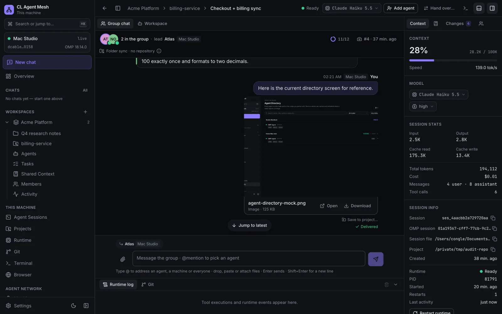
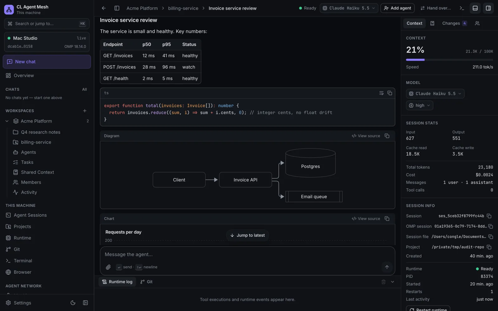
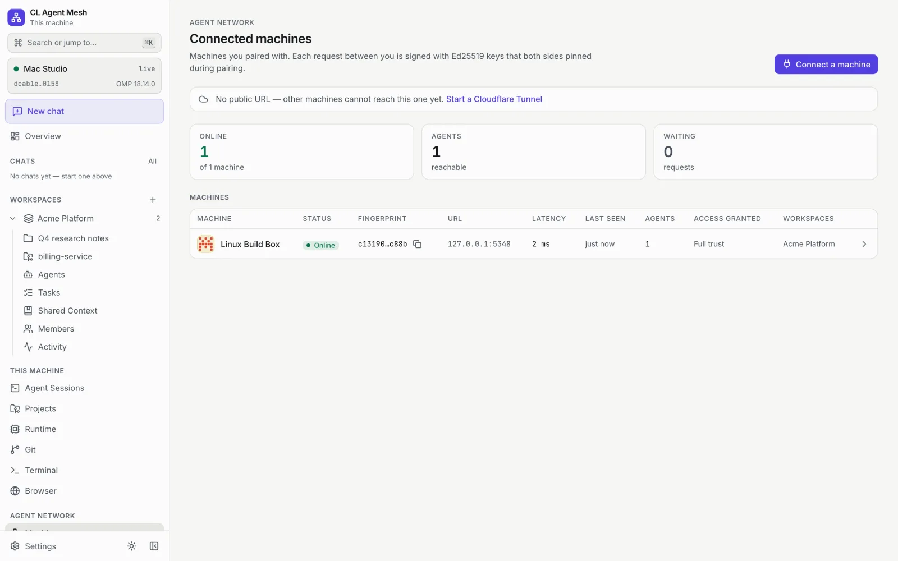
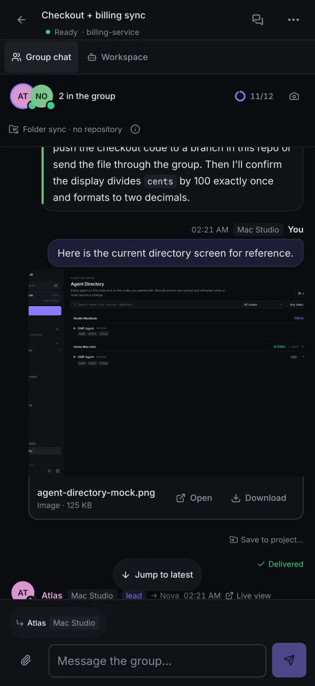

[English](README.md) | Tiếng Việt

# CLAM — CL Agent Mesh

> **Distributed AI Agents. One Shared Workspace.**
> (Các agent AI phân tán. Một workspace chung.)

CLAM (CL Agent Mesh) biến các máy tính của một người (hoặc một nhóm nhỏ) thành một đội AI. Mỗi máy chạy các agent AI phía sau một giao diện web cục bộ (trong tài liệu giao thức, mỗi máy là một *node*). Runtime agent đầu tiên được hỗ trợ là [OMP](https://github.com/can1357/oh-my-pi) (`omp`). Các máy ghép nối với nhau qua Cloudflare Tunnel của chính bạn, chat chung trong một nhóm, giao tác vụ cho agent của nhau, chia sẻ phiên và bộ nhớ, và bàn giao công việc dang dở từ máy này sang máy khác. Một máy ngoại tuyến không bao giờ làm gián đoạn công việc đang chạy trên máy khác.



**Tính năng**

* **Chat không cần repository** — nói chuyện với agent về bất cứ việc gì (nghiên cứu, viết lách, ảnh, video); agent có thư mục riêng, bạn xem, xem trước và tải tệp của nó.
* **Chat nhóm xuyên nhiều máy** — bạn và mỗi máy một agent trong cùng một luồng chung; dùng `@` để gọi một agent, một máy hoặc mọi người.
* **Giao việc** — gửi tác vụ cho agent ở máy khác, theo dõi, nhận lại kết quả và tệp.
* **Phiên chia sẻ và tiếp quản** — phiên trên máy A được sao chép trực tiếp sang B; nếu A ngoại tuyến, B tiếp tục từ điểm khôi phục gần nhất. Hoặc bàn giao phiên khi A vẫn trực tuyến.
* **Bàn giao kèm cài đặt dependency** — chuyển một tác vụ đang chạy sang máy khác; máy đích khôi phục công việc, cài dependency (sau khi bạn duyệt) và chạy tiếp. Không có gì được giải phóng cho đến khi máy đích xác nhận.
* **Ngữ cảnh / bộ nhớ chung** — ghi chú, quyết định và kế hoạch được đồng bộ giữa các máy và được đưa vào các phiên agent mới.
* **Terminal và Trình duyệt riêng cho từng máy** — một shell thật và một trình duyệt headless thật *chạy trên máy đó*, dùng được từ mọi thiết bị.
* **Truy cập từ xa qua tên miền của bạn** — mở giao diện của bất kỳ máy nào từ điện thoại, sau mật khẩu chủ sở hữu; không phải mở cổng nào.
* **Tiếng Anh và tiếng Việt**, giao diện sáng/tối, hiển thị tốt đến cỡ điện thoại.

<table>
  <tr>
    <td></td>
    <td></td>
    <td></td>
  </tr>
</table>

**Mục lục** — [Yêu cầu](#yêu-cầu) · [Cài đặt và chạy lần đầu](#cài-đặt-và-chạy-lần-đầu) · [Thiết lập lần đầu trong ứng dụng](#thiết-lập-lần-đầu-trong-ứng-dụng) · [Kết nối máy thứ hai](#kết-nối-máy-thứ-hai) · [Dùng từ điện thoại](#dùng-từ-điện-thoại) · [Quy trình hằng ngày](#quy-trình-hằng-ngày) · [Cập nhật, sao lưu, gỡ cài đặt](#cập-nhật-sao-lưu-và-gỡ-cài-đặt) · [Xử lý sự cố](#xử-lý-sự-cố) · [Phát triển](#phát-triển) · [Tham chiếu](#tham-chiếu) · [API walkthrough (tiếng Anh)](docs/api-walkthrough.md)

**Cách đọc tên trong giao diện.** Tên trang/nút được viết theo giao diện tiếng Việt, lần đầu kèm tên tiếng Anh trong ngoặc, ví dụ **Cài đặt → Bảo mật** (Settings → Security), vì bạn có thể chạy ứng dụng bằng ngôn ngữ nào cũng được.

**Mức độ hỗ trợ nền tảng.** macOS (Apple Silicon) là nền tảng dự án được phát triển và kiểm thử. Linux chạy trong bộ test Docker (Debian, Node 24) — cài trực tiếp trên Linux dùng cùng các lệnh nhưng người duy trì chưa chạy thử. **Windows chưa được kiểm thử**: code có sẵn đường dẫn cho Windows (tự khởi động bằng scheduled task, quét cổng bằng `netstat`, `cloudflared` qua winget) nhưng mục nào ghi *Windows* bên dưới đều chưa được xác minh trên máy Windows thật.

---

## Yêu cầu

| Cần | Phiên bản | Để làm gì |
| --- | --- | --- |
| Node.js | **≥ 22.12** (đã thử với 24 và 25) | chạy server và build |
| pnpm | **11** (cố định trong `package.json`) | cài monorepo |
| Git | **≥ 2.38** | server dùng `git` của hệ thống; kiểm tra xung đột cần `merge-tree --write-tree` |
| OMP (`omp`) | bản gần đây; đã xác minh với 18.14.0 | runtime agent. Phải nằm trong `PATH` hoặc tại `~/.bun/bin/omp` (hoặc đặt `CLAM_OMP_BIN`) |
| Tài khoản nhà cung cấp model | — | OMP cần ít nhất một nhà cung cấp (OpenAI, Anthropic, …) để trả lời |
| `cloudflared` | tùy chọn | chỉ cần để ghép nối máy và truy cập từ xa |
| GitHub CLI `gh` | tùy chọn | cách nhanh để nhập đăng nhập GitHub |
| Docker | tùy chọn | chỉ cho bộ test hai máy trong `deploy/docker/` |
| Toolchain C/C++, Python 3, make | chỉ khi thiếu bản build sẵn | native addon `better-sqlite3` và `node-pty` |

### macOS

```bash
# Giả định đã có Homebrew (https://brew.sh)
brew install node@24 git                    # hoặc dùng fnm/nvm bên dưới
brew link --overwrite node@24               # chỉ khi `node -v` chưa hiện 24
npm install -g pnpm@11                      # hoặc `corepack enable` với Node 22/24 (xem ghi chú)
brew install cloudflared                    # tùy chọn, để ghép nối và truy cập từ xa
brew install gh                             # tùy chọn
xcode-select --install                      # chỉ khi một native module build lỗi
```

*Đã xác minh trên macOS (Apple Silicon): Node 25.8, pnpm 11.20, git 2.50 (Apple Git), cloudflared và gh từ Homebrew.*

### Linux (ví dụ Debian / Ubuntu)

```bash
sudo apt update && sudo apt install -y git curl ca-certificates build-essential python3
# Node 22 trở lên: dùng fnm (hoặc nvm) để không phụ thuộc Node cũ của distro
curl -fsSL https://fnm.vercel.app/install | bash && exec $SHELL
fnm install 24 && fnm default 24
corepack enable && corepack prepare pnpm@11 --activate     # hoặc: npm install -g pnpm@11
```

* `node-pty` (Terminal) không có bản build sẵn cho Linux nên **được biên dịch khi chạy `pnpm install`** — hãy giữ `build-essential` và `python3`.
* `cloudflared` (tùy chọn): làm theo [hướng dẫn gói của Cloudflare](https://developers.cloudflare.com/cloudflare-one/connections/connect-networks/downloads/) (`sudo apt install cloudflared` sau khi thêm apt repository của họ).
* Bí mật dùng Secret Service (`secret-tool`, gói `libsecret-tools`) khi có keyring desktop đang chạy; nếu không sẽ tự dùng tệp mã hóa trong thư mục dữ liệu.
* Bộ test Docker chứng minh toàn bộ stack chạy trên Debian bookworm + Node 24; xem [Bộ test hai máy bằng Docker](#bộ-test-hai-máy-bằng-docker).

### Windows — chưa xác minh

Các bước dưới đây là bản tương đương dự kiến; **người duy trì chưa chạy bước nào**.

```powershell
winget install OpenJS.NodeJS.LTS Git.Git Cloudflare.cloudflared
npm install -g pnpm@11
irm https://omp.sh/install.ps1 | iex          # OMP, theo README của OMP
```

Bí mật dùng kho tệp mã hóa (không có backend Windows Credential Manager). Tự khởi động được cài đặt dưới dạng scheduled task tên "CLAM" nhưng chưa được smoke test. Hiện tại WSL2 với hướng dẫn Linux là lựa chọn an toàn hơn.

### Ghi chú về Node.js và pnpm

* **fnm / nvm**: `fnm install 24 && fnm default 24`, hoặc `nvm install 24 && nvm alias default 24`.
* **pnpm qua corepack**: Node 22 và 24 có sẵn `corepack`; chạy `corepack enable` một lần là dùng đúng phiên bản repo cố định (`pnpm@11.20.0`). **Node 25 không còn kèm corepack** (`corepack: command not found`) — hãy cài pnpm bằng `npm install -g pnpm@11`.
* Lockfile được commit trong repo; `pnpm install` tái lập được (`--frozen-lockfile` đã được xác minh chạy qua trên một bản clone mới).

### OMP (runtime agent)

Cài OMP theo cách trong [README của OMP](https://github.com/can1357/oh-my-pi#install):

```bash
curl -fsSL https://omp.sh/install | sh          # macOS / Linux
brew install can1357/tap/omp                    # thay thế bằng Homebrew
bun install -g @oh-my-pi/pi-coding-agent        # thay thế bằng Bun (đặt omp vào ~/.bun/bin)
```

Sau đó đăng nhập ít nhất một nhà cung cấp model — trong terminal (`omp login`, chọn nhà cung cấp) hoặc sau này ngay trong ứng dụng (**Cài đặt → Nhà cung cấp OMP** (Settings → OMP Providers)). CLAM không bao giờ thấy thông tin đăng nhập nhà cung cấp của bạn; chúng nằm trong kho riêng của OMP.

Kiểm tra: `omp --version`.

---

## Cài đặt và chạy lần đầu

```bash
git clone git@github.com:CongLe-FinX/clam.git     # hoặc: git clone https://github.com/CongLe-FinX/clam.git
cd clam               # repo riêng tư: bạn cần quyền truy cập (SSH key, hoặc `gh auth login` cho https)
pnpm install          # ~15 giây khi cache đã ấm; biên dịch native addon nếu không có bản build sẵn
pnpm build            # build web và đóng gói server thành apps/server/dist/main.js (~40 giây)
pnpm start            # chế độ production: server phục vụ luôn giao diện đã build
```

Mở **http://127.0.0.1:4317**. Chỉ vậy là xong. *(Chuỗi lệnh này đã được chạy trên một bản clone mới với cổng và thư mục dữ liệu tùy chỉnh: install, build, start, `GET /` → 200, `GET /api/local/node` → JSON định danh của máy.)*

### Cổng và phạm vi lộ ra

| Cổng | Bộ lắng nghe | Phạm vi |
| --- | --- | --- |
| **4317** (`CLAM_PORT`) | giao diện web + `/api/local` + `/ws` | chỉ loopback — không bao giờ truy cập được từ máy khác |
| **4318** (`CLAM_NETWORK_PORT`, mặc định = `CLAM_PORT` + 1) | API máy-tới-máy `/api/v1` (cộng giao diện đăng nhập chủ sở hữu khi bật truy cập từ xa) | chỉ loopback; **đây là origin mà Cloudflare tunnel của bạn trỏ tới** |
| 5317 (`WEB_PORT`) | Vite dev server (chỉ `pnpm dev`) | loopback |

Server từ chối bind bất kỳ địa chỉ nào ngoài `127.0.0.1` / `::1` / `localhost`. Truy cập từ xa chỉ tồn tại qua Cloudflare Tunnel.

Muốn dùng cổng khác: `CLAM_PORT=4400 pnpm start` (cổng mạng thành 4401 trừ khi bạn đặt `CLAM_NETWORK_PORT`). Nếu đổi cổng mạng, hãy đổi origin của tunnel cho khớp.

### Chế độ phát triển và chế độ production

| | `pnpm start` (production) | `pnpm dev` |
| --- | --- | --- |
| Cần `pnpm build` trước | có | không |
| Giao diện | http://127.0.0.1:**4317** | http://127.0.0.1:**5317** (Vite, hot reload; proxy `/api` và `/ws` sang 4317) |
| Thư mục dữ liệu | `~/.clam` | `<repo>/.data/core` (tách riêng, nên dev không bao giờ đụng dữ liệu thật) |
| Dùng cho | dùng hằng ngày, tự khởi động | sửa code |

Cả hai đều mặc định server ở cổng 4317 — đừng chạy cùng lúc (hoặc cho một bên `CLAM_PORT` khác).

### Dữ liệu của bạn nằm ở đâu

Thư mục dữ liệu mặc định: **`~/.clam`** trên macOS và Linux, `%USERPROFILE%\.clam` trên Windows (chưa xác minh). Đổi bằng `CLAM_DATA_DIR`:

```bash
CLAM_DATA_DIR=/Volumes/Data/clam pnpm start
```

Thư mục này chứa cơ sở dữ liệu SQLite (`clam.db`), cặp khóa định danh của máy (`identity/`), thư mục OMP của từng phiên, thư mục chat/dự án do ứng dụng tạo (`projects/`), tệp đính kèm, profile và tệp tải về của trình duyệt, và (chỉ khi không dùng keychain của hệ điều hành) tệp bí mật đã mã hóa. Danh sách đầy đủ: [Cái gì nằm ở đâu](#cái-gì-nằm-ở-đâu).

### Tự khởi động khi đăng nhập

1. Chạy `pnpm build` một lần (tự khởi động trỏ tới `apps/server/dist/main.js`; chưa build thì lỗi `autostart_not_built`).
2. Trong giao diện: **Cài đặt → Chung → Tự khởi động** (Settings → General → Start automatically) → bật.

Thao tác này chỉ ghi mục đăng nhập của hệ điều hành và có hiệu lực **từ lần đăng nhập kế tiếp** (không bao giờ khởi động thêm server ngay lúc đó):

| Hệ điều hành | Cái được ghi |
| --- | --- |
| macOS | LaunchAgent `~/Library/LaunchAgents/io.clam.agent-mesh.plist`; log ở `<dataDir>/logs/server.{out,err}.log` — *đã smoke test* |
| Linux | unit systemd *user* `~/.config/systemd/user/cl-agent-mesh.service` (`enable`, không bao giờ `start`). Không có systemd user services thì lỗi `autostart_unsupported` — *chưa smoke test* |
| Windows | scheduled task "CLAM" với trigger khi đăng nhập — *chưa smoke test* |

Mục đăng nhập ghi lại `CLAM_PORT`, `CLAM_DATA_DIR` và `PATH` của server mà bạn bật tùy chọn này từ đó. Sau khi di chuyển thư mục repo, hãy tắt rồi bật lại.

---

## Thiết lập lần đầu trong ứng dụng

1. **Kết nối nhà cung cấp model** — **Cài đặt → Nhà cung cấp OMP** (Settings → OMP Providers). Trang cho biết OMP đã cài chưa (nếu chưa: cài, rồi bấm **Làm mới** (Refresh)). Trong danh sách nhà cung cấp bấm **Kết nối** (Connect) cạnh một nhà cung cấp (tìm bằng *Tìm nhà cung cấp* (Search providers)), cấp quyền trong trình duyệt và, nếu được hỏi, dán mã rồi bấm **Gửi** (Submit). Nhà cung cấp hiện **Đã đăng nhập** (Signed in).
2. **Chọn vai trò model mặc định** — cùng trang, **Vai trò model** (Model roles): đặt vai trò *Mặc định* (Default) (và các vai trò khác OMP liệt kê) bằng **Đặt** (Set) / **Đổi** (Change); **Kiểm tra** (Test) gửi một yêu cầu thật để thử. **Danh mục model** (Model catalog) cho biết các model có được từ các tài khoản đã đăng nhập và giá của chúng.
3. **Kết nối GitHub (tùy chọn)** — **Cài đặt → Tài khoản GitHub** (Settings → GitHub Accounts). Hoặc **Nhập từ gh CLI** (Import from gh CLI) (sau khi chạy `gh auth login` trong terminal), hoặc dùng device flow: device flow cần một *client id của GitHub OAuth App* — tạo một OAuth App trên GitHub, bật *Device Flow*, dán client id vào **Client id của GitHub OAuth App** (GitHub OAuth App client id), **Lưu**, rồi **Kết nối tài khoản** (Connect account) và làm theo mã. Token chỉ được lưu vào kho bí mật của hệ điều hành. GitHub chỉ cần cho dự án repository, pull request và chia sẻ theo branch; chat và thư mục thường dùng được mà không cần GitHub.
4. **Đặt tên cho máy** — **Cài đặt → Chung → Tên máy** (Settings → General → Machine name) (hiển thị với các máy khác của bạn).
5. **Tạo workspace** — trong thanh bên bấm **+** cạnh **Workspace** (hoặc *Tạo workspace đầu tiên* (Create your first workspace)). Workspace là đơn vị bạn chia sẻ với máy khác.
6. **Bắt đầu một chat** — **Chat mới** (New chat) (đầu thanh bên). Mô tả việc agent cần làm và bấm **Bắt đầu chat** (Start chat). Không cần repository: agent có thư mục riêng trong `<dataDir>/projects/` và bạn duyệt tệp của nó trong bảng **Tệp** (Files). Để làm việc với code, thêm một dự án (một thư mục, hoặc clone repository GitHub) vào workspace rồi mở một phiên trong đó.
7. **Ngôn ngữ và giao diện** — **Cài đặt → Chung → Hiển thị** (Settings → General → Appearance): **Ngôn ngữ** (Language) (English / Tiếng Việt) và **Giao diện** (Theme) (Sáng / Tối / Hệ thống). Chúng được lưu trong *trình duyệt này*, nên điện thoại và máy tính có thể khác nhau.

Lưu ý an toàn: **Cài đặt → Chung → Chế độ duyệt công cụ** (Tool approval mode) quyết định agent có được chạy lệnh shell và sửa tệp mà không hỏi hay không — hãy để chế độ hỏi cho đến khi bạn tin tưởng thiết lập của mình.

---

## Kết nối máy thứ hai

Hãy làm [cài đặt](#cài-đặt-và-chạy-lần-đầu) và [thiết lập lần đầu](#thiết-lập-lần-đầu-trong-ứng-dụng) cả trên máy **B** (mỗi máy có thư mục dữ liệu, đăng nhập OMP và tài khoản GitHub riêng). Hai máy cũng có thể là hai thư mục dữ liệu trên cùng một máy tính (`CLAM_PORT`, `CLAM_NETWORK_PORT`, `CLAM_DATA_DIR` khác nhau).

### 1. Cho mỗi máy một địa chỉ công khai

Cài `cloudflared` trước (xem [Yêu cầu](#yêu-cầu)). Rồi trên từng máy mở **Cài đặt → Cloudflare Tunnel** (Settings → Cloudflare Tunnel). Trang hiển thị phiên bản `cloudflared` (hoặc gợi ý cài theo hệ điều hành) và **Chế độ tunnel** (Tunnel mode): *Tắt* (Off), *Tunnel nhanh* (Quick tunnel), *Tunnel có tên* (Named tunnel).

**Tunnel nhanh** (dùng thử, không cần tài khoản): bấm **Bật tunnel nhanh** (Start a quick tunnel). Bạn nhận một địa chỉ ngẫu nhiên `https://<từ-ngẫu-nhiên>.trycloudflare.com`. Địa chỉ này **đổi mỗi lần tunnel khởi động** — các máy đã ghép nối được báo tự động, nhưng lời mời phải dùng địa chỉ hiện tại; Cloudflare không cam kết uptime và hostname mới có thể mất vài giây mới phân giải được.

**Tunnel có tên với tên miền riêng** (ổn định; khuyến nghị cho truy cập từ điện thoại). Cần một tên miền có DNS trên Cloudflare và một tài khoản Cloudflare miễn phí. *Các bước trên dashboard theo giao diện Zero Trust hiện tại của Cloudflare và các trường của ứng dụng; chúng chưa được chạy lại từ đầu đến cuối với một tên miền thật cho README này, và menu của Cloudflare hay thay đổi — nếu nhãn khác, hãy tìm "Tunnels" trong Networks.*

1. Cloudflare dashboard → **Zero Trust** → **Networks** → **Tunnels** → **Create a tunnel** → chọn **Cloudflared** → đặt tên (ví dụ `node-a`) → **Save tunnel**.
2. Ở màn hình "install connector", sao chép **token** (chuỗi dài sau `--token` / `cloudflared service install`). **Đừng** chạy lệnh cài đặt — CLAM tự chạy `cloudflared`. Bấm tiếp tục.
3. **Public hostname**: thêm ví dụ `node-a.example.com`; loại dịch vụ **HTTP**, URL **`127.0.0.1:4318`** (tức `http://127.0.0.1:4318` — cổng *mạng* của máy này, **không phải** cổng giao diện 4317, và không phải `https`). Lưu. (Trường **Origin cần cấu hình** (Origin to configure) trong ứng dụng hiện đúng giá trị cần sao chép.)
4. Trong CLAM: **Cài đặt → Cloudflare Tunnel** → **Chế độ tunnel: Tunnel có tên** → **Public hostname** `node-a.example.com` → **Token tunnel** (Tunnel token) dán token → bật **Tự khởi động** (Start automatically) nếu muốn tunnel chạy cùng server → **Lưu cấu hình** (Save configuration) → **Bật tunnel** (Start tunnel). Token đi vào kho bí mật của hệ điều hành (chỉ ghi, không bao giờ hiện lại).
5. Lặp lại trên máy B với tunnel và hostname riêng (ví dụ `node-b.example.com`). Mỗi máy cần **tunnel và hostname riêng**.

Cài đặt đã lưu chưa có hiệu lực cho tới khi tunnel đang chạy. **Lưu cấu hình** khi **Tự khởi động** đang bật sẽ bật ngay tunnel đang dừng (và mỗi lần server khởi động); nếu tắt, hãy bấm **Bật tunnel**. Nếu một `cloudflared` khác — của bạn, ngoài CLAM — đã route hostname tới `127.0.0.1:4318`, CLAM không cần connector riêng: hostname bạn lưu được chấp nhận làm header `Host`, và khi `https://<hostname>/api/v1/node/info` trả lời bằng id và dấu vân tay của máy này, trang hiện **Được phục vụ bởi một cloudflared khác trên máy hoặc mạng này** và hostname đó trở thành địa chỉ dùng trong lời mời.

Tunnel chỉ lộ ra API máy-tới-máy có chữ ký (và, nếu bạn bật, giao diện đăng nhập chủ sở hữu). `https://<tên miền của bạn>/api/local/*` luôn trả 404.

### 2. Ghép nối: Mời trên A → Tham gia trên B → xác minh → duyệt

Mở **Máy** (Machines) ở thanh bên (cũng vào được từ **Mạng agent** (Agent Network)). Có hai đường.

1. **Trên A — Mời máy khác → Tạo lời mời** (Invite another machine → Create an invitation). Chọn **workspace để chia sẻ** và **thời hạn của mã** (Code lifetime), rồi **Tạo lời mời** (Create invitation). A hiện mã dùng một lần `XXXX-XXXX`, địa chỉ của A và **dấu vân tay** (fingerprint) của A (**Sao chép tất cả thành tin nhắn** (Copy everything as a message) đưa cả ba vào clipboard). Mã chỉ dùng một lần, hết hạn (≤ 10 phút) và khóa sau 5 lần nhập sai. Nếu A chưa có địa chỉ công khai, hộp thoại đề nghị bật tunnel nhanh.
2. **Trên B — Tham gia máy khác → Nhập mã** (Join another machine → Enter a code). Dán địa chỉ `https://…` của A và bấm **Tra cứu máy** (Look up machine). B hiện dấu vân tay của máy đứng sau địa chỉ đó. **So sánh với dấu vân tay trên A** (đọc to hoặc gửi qua kênh bạn tin cậy), đánh dấu ô *I compared this fingerprint…* (tôi đã so sánh dấu vân tay này…), nhập mã rồi tham gia. Tunnel của B phải đang chạy để A hoàn tất bắt tay.
3. **Trên A — duyệt.** A hiện *Một máy muốn kết nối* (A machine wants to connect) (một banner ở bất kỳ đâu trong ứng dụng, và trong **Máy → Yêu cầu ghép nối** (Pairing requests)): so dấu vân tay của B với màn hình B, chọn quyền (bên dưới) và bấm **Duyệt và ghép nối** (Approve and pair).

Từ giờ hai máy ghim khóa của nhau, liệt kê nhau là **Trực tuyến** (Online) trong **Máy**, B nhận một bản sao của workspace chung (cùng tên và id; dự án và tệp không bao giờ được chia sẻ tự động), và agent của mỗi máy xuất hiện trong **Danh bạ agent** (Agent Directory). **Thu hồi** (Revoke) trên trang của một máy sẽ cắt nó ngay lập tức; máy bị thu hồi được ghép nối lại bằng lời mời mới. Máy đã dừng hiện *ngoại tuyến* sau khoảng hai phút và tự kết nối lại.

### Mỗi bộ quyền cấp những gì

Quyền được cấp **theo từng chiều**: bạn cấp gì là máy *kia* được làm gì trên máy *của bạn*. Các bộ quyền (**Bộ quyền có sẵn** (Access presets); chỉnh chi tiết hơn dưới *Tinh chỉnh từng quyền* (Fine-tune individual permissions); đổi bất cứ lúc nào trên trang của máy):

| Bộ quyền | Capability | Cho phép máy kia… |
| --- | --- | --- |
| **Chat và cộng tác** (Chat & collaborate) | `agents.read`, `events.read`, `sessions.share` | xem agent và trạng thái trực tiếp của bạn; mời bạn vào phiên chia sẻ và chat nhóm |
| **Giao tác vụ** (Delegate tasks) | `tasks.send`, `tasks.receive`, `tasks.cancel`, `artifacts.read`, `artifacts.write` | gửi việc cho agent của bạn, nhận kết quả, trao đổi tệp agent tạo ra (máy bạn vẫn quyết định có chạy hay không) |
| **Chia sẻ bộ nhớ** (Share memory) | `context.sync` | giữ ghi chú/quyết định chung đồng bộ |
| **Bàn giao công việc** (Hand off work) | `handoff.send`, `handoff.receive` | chuyển cả phiên/tác vụ agent giữa hai máy |
| **Tin cậy hoàn toàn** (Full trust) | tất cả mục trên và các capability trong tương lai | chỉ cho máy của chính bạn |

Với hai máy của chính bạn, hãy cấp cả bốn bộ quyền ở cả hai chiều (mỗi bên tự duyệt/chỉnh quyền mình cấp). Chat nhóm cần *Chat và cộng tác* cả hai chiều, giao việc cần *Giao tác vụ*, bộ nhớ chung cần *Chia sẻ bộ nhớ*, bàn giao cần *Bàn giao công việc* cả hai chiều.

---

## Dùng từ điện thoại

Mỗi máy có thể phục vụ giao diện web **riêng của nó** qua tên miền tunnel, sau một mật khẩu chủ sở hữu. Tính năng này **mặc định tắt** và chỉ bật được **ngay tại máy đó** (giao diện loopback, `http://127.0.0.1:4317`).

1. Bảo đảm máy đang chạy tunnel (**Cài đặt → Cloudflare Tunnel**); tunnel có tên với tên miền của bạn là tốt nhất vì địa chỉ không đổi.
2. Trên máy đó: **Cài đặt → Bảo mật → Mật khẩu chủ sở hữu → Đặt mật khẩu** (Settings → Security → Owner password → Set password) (ít nhất 12 ký tự; mật khẩu đầu tiên chỉ đặt được từ chính máy đó).
3. **Cài đặt → Bảo mật → Truy cập từ xa vào giao diện web này** (Remote access to this web UI) → **bật** (xác nhận *Cho phép truy cập từ xa vào giao diện này?*). *Địa chỉ giao diện công khai* (Public UI address) hiện URL.
4. Trên điện thoại mở `https://node-a.example.com/`, nhập mật khẩu chủ sở hữu. Thêm vào màn hình chính để có biểu tượng như ứng dụng. Bạn thấy giao diện của máy đó — chat, Máy, Cài đặt (phiên từ xa không thể đặt mật khẩu chủ sở hữu lần đầu, đổi tunnel hay công tắc truy cập từ xa; những thứ này chỉ làm được tại máy).
5. Để dùng giao diện của máy khác (B), mở tên miền của **B** theo cách tương tự; nút *Mở Terminal của B / Mở trình duyệt của B* (Open B's Terminal / Browser) trên trang một máy làm đúng việc đó.

**Terminal và Trình duyệt qua tên miền** (mặc định tắt): trong **Cài đặt → Bảo mật → Terminal và Trình duyệt** (Settings → Security → Terminal and Browser) bật **Terminal qua tên miền** (Terminal through the domain) và/hoặc **Trình duyệt qua tên miền** (Browser through the domain); bật một mục sẽ hỏi mật khẩu chủ sở hữu (từ chính máy đó, hoặc từ phiên từ xa đã đăng nhập). Mở terminal qua tên miền hỏi lại mật khẩu (hiệu lực 10 phút). Tắt một công cụ, đăng xuất hoặc **Đăng xuất mọi nơi** (Sign out everywhere) đóng các kết nối trực tiếp của nó ngay lập tức. Mục trên thanh bên là **Terminal** và **Trình duyệt** (Browser); Trình duyệt có thể giả lập viewport iPhone để bạn thử các web app mà agent đang chạy trên `localhost` của máy đó.

**Lưu ý bảo mật**

* Ai có mật khẩu chủ sở hữu đều điều khiển được agent trên máy đó; khi bật Terminal, họ chạy lệnh với quyền của user đang chạy CLAM và với tới toàn bộ mạng của máy đó. Dùng mật khẩu dài, duy nhất; giữ Terminal/Trình duyệt tắt trừ khi cần.
* Đăng nhập bị giới hạn tốc độ (sai 5 lần → khóa 30 giây, tăng gấp đôi đến 15 phút, cộng khóa toàn máy chống đoán phân tán). Cookie phiên là `HttpOnly`, `Secure`, `SameSite=Strict`; thời hạn phiên chỉnh được (**Thời hạn đăng nhập** (Sign-in lasts)) và được gia hạn khi bạn còn dùng giao diện.
* Cổng giao diện 4317 không bao giờ lộ ra; kênh OMP RPC không bao giờ lộ ra. Có thể thêm chính sách Cloudflare Access trước hostname để có lớp xác thực thứ hai — API máy-tới-máy sau cùng hostname dùng yêu cầu có chữ ký, nên một chính sách Access cho cả hostname cũng sẽ chặn các máy đã ghép nối (**[SUY ĐOÁN]** — chưa thử; hãy dùng chính sách theo đường dẫn hoặc bỏ qua).
* Thêm: [docs/security.md](docs/security.md) (tiếng Anh).

---

## Xem trước một ứng dụng web cục bộ

Mở một ứng dụng web chạy trên máy (dev server Vite / Next / webpack ở `localhost:<port>`) trong **trình duyệt của chính bạn** — sắc nét, mượt, có DevTools thật — từ bất cứ đâu. Công cụ Browser (Chromium headless truyền hình ảnh về giao diện) vẫn dùng cho trường hợp cần trình duyệt của chính máy đó.

Mỗi máy có **một địa chỉ riêng thêm**, mặc định là nhãn đầu của hostname tunnel cộng `-preview`: với `clamp-work.example.com` là `clamp-work-preview.example.com`. Bạn chỉ thêm đúng một hostname đó vào tunnel của máy, một lần.

1. **Cần tunnel có tên** (**Cài đặt → Cloudflare Tunnel → Named**). Địa chỉ quick tunnel đổi mỗi lần khởi động nên không hỗ trợ xem trước (phần cài đặt có giải thích). Trên giao diện của chính máy (`http://127.0.0.1:4317`) không cần các bước này: nút xem trước chỉ mở `http://localhost:<port>`.
2. **Cài đặt → Cloudflare Tunnel → Xem trước trong trình duyệt của bạn** hiện *Địa chỉ xem trước* (sửa được) và bước Cloudflare chính xác. Trong dashboard Cloudflare mở **Zero Trust → Networks → Tunnels → tunnel của bạn → Public hostname → Add**:
   * *Hostname*: `clamp-work-preview.example.com` (sao chép từ trang)
   * *Service*: `HTTP` · `127.0.0.1:4318` (cổng network listener trang đang hiện)

   Không cần wildcard, và tên cấp một nằm cạnh hostname tunnel được chứng chỉ Universal SSL miễn phí của Cloudflare phủ tới. Hai máy cùng một tên miền chỉ cần hai tên (`clamp-work-preview…`, `clamp-home-preview…`), mỗi tên trên tunnel riêng — không bao giờ dùng chung một tunnel giữa các máy.
3. Bấm **Kiểm tra**: CLAM gọi `https://<địa chỉ xem trước>/__clam_preview/health` và mong chính máy *này* (node id) trả lời.
4. **Cài đặt → Bảo mật → Terminal, Trình duyệt và Xem trước → Xem trước qua tên miền** → bật (từ máy, hoặc từ phiên từ xa đã đăng nhập kèm mật khẩu chủ sở hữu; cần bật *Truy cập từ xa vào giao diện web*). **Mặc định tắt.**
5. Dùng: nút **Mở bản xem trước ↗** cạnh chip *Đang chạy trên máy này* (trang Browser), cạnh liên kết `http://localhost:<port>` trong chat, hoặc **Mở trong trình duyệt của tôi** trên thanh công cụ Browser. CLAM tạo vé dùng một lần (hiệu lực 60 giây) và mở `https://<địa chỉ xem trước>/__clam_preview/auth?ticket=…` ở tab mới; nó đặt cookie riêng của bản xem trước và đưa bạn tới ứng dụng ở gốc tự nhiên (`/`), nên route phía client (`/about`), đường dẫn tuyệt đối của asset (`/assets/…`, `/@vite/client`), lời gọi API và WebSocket HMR đều chạy bình thường.

**Mỗi trình duyệt chỉ một ứng dụng tại một thời điểm.** `https://<địa chỉ xem trước>/port/5173/…` chọn cổng 5173 (lưu trong cookie) rồi chuyển hướng tới `/…`; mọi đường dẫn khác sau đó đi tới cổng đó. Mở ứng dụng khác từ CLAM (hoặc vào `/port/3000/`) sẽ đổi sang nó. Khi chưa chọn gì, địa chỉ hiện một bảng chọn nhỏ các ứng dụng web đang lắng nghe trên máy.

**Truy cập được gì và không được gì.** Chỉ ứng dụng web trên loopback của máy; không bao giờ là cổng UI/network của chính CLAM, cũng không phải cơ sở dữ liệu, SSH, debugger và các cổng tương tự (22, 3306, 5432, 6379, 27017, 9229, 9222, …) hay cổng dưới 1024 (trừ 80). Ứng dụng thấy `Host: localhost:<port>` (nên `allowedHosts` của Vite và các công cụ tương tự chấp nhận), chuyển hướng tới `http://localhost:<port>/…` được viết lại về địa chỉ xem trước, và cookie chỉ gắn với host. Cookie của CLAM không bao giờ được chuyển cho ứng dụng.

**Cần biết.** Mọi cổng của một máy dùng chung origin của địa chỉ xem trước (như chúng dùng chung cookie `localhost`): hãy coi các ứng dụng bạn xem trước là một vùng tin cậy. Đăng xuất, **Đăng xuất mọi nơi**, đổi mật khẩu, tắt Xem trước hoặc tắt truy cập từ xa sẽ kết thúc mọi phiên xem trước ngay. Việc mở được ghi nhật ký (`preview.open`, `preview.signin`).

---

## Quy trình hằng ngày

Các quy trình dưới đây giả định các máy đã ghép nối với bộ quyền tương ứng. Mỗi quy trình có tương đương qua API trong [API walkthrough](docs/api-walkthrough.md) (tiếng Anh).

**Chat chung với agent của A và B.** Trên A: mở một chat (hoặc phiên) → **Thêm agent** (Add agent) ở tiêu đề → chọn máy B và tùy chọn một agent trong danh bạ → **Thêm vào phiên** (Add to session). Lời mời xuất hiện trên B (**Phiên chia sẻ** (Shared Sessions), hoặc một banner); chấp nhận. Bạn có một chat nhóm: một nhật ký tin nhắn mà cả hai máy cùng giữ bản sao. Tin nhắn không nhắc ai gửi tới agent dẫn đầu; gõ `@` để gọi một agent, một máy hoặc mọi người; đính kèm tệp bằng biểu tượng kẹp giấy (tệp vào thư mục của agent nhận). Đường tắt: kết thúc ghép nối sẽ đề nghị **Bắt đầu chat nhóm với các agent của nó** (Start a group chat with its agents).

**Giao một tác vụ.** **Danh bạ agent** → chọn một agent → **Giao việc** (Delegate) (hoặc **Tác vụ → Giao tác vụ** (Tasks → Delegate a task)): tiêu đề, mô tả, tùy chọn các tệp dự án cần gửi. Theo dõi tiến độ trên trang tác vụ, trao đổi với agent tại đó, và nhận kết quả. Nếu có tệp trả về: **Xem trước & áp dụng tệp** (Preview & apply files) hiện từng tệp là mới / không đổi / cập nhật / xung đột kèm diff; **Áp dụng vào dự án** (Apply to project) ghi chúng — không có gì được ghi hoặc xóa trước khi bạn áp dụng.

**Bàn giao một phiên (A trực tuyến) / tiếp quản (A ngoại tuyến).** Trong phiên chia sẻ, bên đang điều khiển (driver) bấm **Bàn giao…** (Hand over…) ở tiêu đề → **Bàn giao cho** (Hand over to) một máy → **Bàn giao** (Hand over); mọi thứ (kể cả tệp chưa commit) được lưu và máy kia tiếp tục trong một phiên mới, A trở thành thành viên chỉ đọc. Nếu A ngoại tuyến, B mở phiên chia sẻ và bấm **Tiếp tục trên máy này** (Continue on this machine) (xác nhận **Vẫn tiếp quản** (Take over anyway) nếu A có vẻ vẫn trực tuyến). Việc A làm sau điểm khôi phục cuối không có trên B (nó được giữ thành bản cứu hộ trên A).

**Bàn giao một tác vụ đang chạy kèm thiết lập dependency.** Trên trang tác vụ bấm **Bàn giao…** (Hand off…) → chọn máy đích, tùy chọn liệt kê các lệnh thiết lập (ví dụ `npm ci`) và một lệnh kiểm tra → **Bàn giao** (Hand off). Trên máy đích mở **Bàn giao** (Handoffs) (Handoff Center) và chấp nhận (hoặc bật **Cài đặt → Chung → Bàn giao → Tự động chấp nhận bàn giao** (Settings → General → Handoffs → Accept handoffs automatically)). **Thiết lập dependency** (Dependency setup) trong cùng mục cài đặt điều khiển các lệnh: **Hỏi trước** (Ask me) (mỗi lệnh chờ bạn duyệt — khuyến nghị), **Chạy tự động** (Run automatically) (chỉ cho máy bạn hoàn toàn tin cậy), **Không bao giờ chạy** (Never run). Hai máy thấy cùng một dòng thời gian; máy nguồn vẫn là chủ cho đến khi xác nhận bền vững của máy đích đến (hạn 30 phút, **Gia hạn** (Extend) hoặc **Lấy lại tác vụ** (Reclaim task)).

**Bộ nhớ chung.** Mở một phiên → bảng **Bộ nhớ** (Memory) (hoặc **Ngữ cảnh chung** (Shared Context) ở thanh bên) → **Thêm bộ nhớ** (Add memory) (loại: memory, decision, plan, summary, note). Ngữ cảnh ở trạng thái **riêng tư** cho đến khi đánh dấu *shareable* (chia sẻ được); loại shareable được đồng bộ tới mọi máy trong workspace (cần *Chia sẻ bộ nhớ* cả hai chiều) và các phiên agent mới bắt đầu với phần mở đầu "Project memory" ngắn. Sửa trên hai máy cùng lúc thành xung đột mà bạn giải quyết bằng tay.

**Tệp.** Trong chat, bảng **Tệp** (Files) liệt kê thư mục của agent: xem trước ảnh, video, âm thanh, PDF và văn bản, tải xuống, tải lên. Với tác vụ được giao, dùng **Xem trước & áp dụng tệp** như trên.

---

## Cập nhật, sao lưu và gỡ cài đặt

**Cập nhật**

```bash
cd clam
git pull
pnpm install
pnpm build
# khởi động lại: dừng server đang chạy (Ctrl-C), rồi
pnpm start
```

Migration cơ sở dữ liệu chạy tự động khi khởi động và một bản chụp `clam.db.pre-migrate-<timestamp>.bak` được ghi trước. Nếu đang bật tự khởi động, hãy đăng xuất rồi đăng nhập lại (hoặc khởi động lại service) sau khi build. Cập nhật **tất cả** máy đã ghép nối lên cùng một phiên bản khi tài liệu giao thức thay đổi.

**Sao lưu.** Dừng server và sao chép thư mục dữ liệu (mặc định `~/.clam`): cơ sở dữ liệu, khóa định danh của máy, phiên, dự án và thư mục chat. Cũng hãy ghi chú các bí mật nằm trong keychain của hệ điều hành (token GitHub, token tunnel): trên máy mới hãy nhập lại (Cài đặt → Tài khoản GitHub, Cloudflare Tunnel). Khôi phục định danh trên máy khác khiến nó là *cùng một* máy đối với các máy kia; đừng chạy hai bản cùng lúc.

**Gỡ cài đặt**

1. **Cài đặt → Chung → Tự khởi động** → tắt (xóa LaunchAgent / unit systemd / scheduled task). Dừng cả tunnel (**Cài đặt → Cloudflare Tunnel → Dừng tunnel** (Stop tunnel)) và, trên Cloudflare, xóa tunnel và bản ghi DNS nếu bạn đã tạo.
2. Dừng server.
3. Ghi lại node id (`curl -s http://127.0.0.1:4317/api/local/node` → `id`) **trước** khi xóa dữ liệu, rồi xóa thư mục dữ liệu: `rm -rf ~/.clam`.
4. Xóa các mục keychain tên `cl-agent-mesh.<nodeId>`: macOS — mở *Keychain Access*, tìm `cl-agent-mesh`, xóa các mục (hoặc `security delete-generic-password -s cl-agent-mesh.<nodeId> -a <account>` cho từng mục); Linux — `secret-tool clear service cl-agent-mesh.<nodeId> account <account>` cho từng mục, hoặc dùng Seahorse/KWallet. Bản cài dùng kho tệp mã hóa không có gì thêm: nó nằm trong thư mục dữ liệu.
5. Xóa thư mục repository.

---

## Xử lý sự cố

| Triệu chứng | Cách xử lý |
| --- | --- |
| **Cổng đang bị dùng** (`EADDRINUSE` trên 4317/4318) | Tìm tiến trình đang giữ: `lsof -iTCP:4317 -sTCP:LISTEN` (Windows: `netstat -ano \| findstr 4317`). Dừng nó, hoặc chạy cổng khác: `CLAM_PORT=4400 pnpm start`. `pnpm dev` và `pnpm start` đều mặc định 4317 — chỉ chạy một. |
| **Không tìm thấy `omp`** (**Cài đặt → Nhà cung cấp OMP** báo *Chưa cài* (Not installed)) | Cài OMP ([ở trên](#omp-runtime-agent)). Server tìm trong `PATH` và `~/.bun/bin/omp`; server khởi chạy từ GUI hoặc tự khởi động có thể có `PATH` ngắn hơn — đặt `CLAM_OMP_BIN=/đường/dẫn/đầy/đủ/tới/omp`. Rồi bấm **Làm mới**. |
| **Nhà cung cấp chưa đăng nhập**; agent trả lỗi xác thực | **Cài đặt → Nhà cung cấp OMP** → *Chưa đăng nhập* → **Kết nối**; hoặc `omp login` trong terminal. Kiểm tra **Vai trò model** có model mặc định từ nhà cung cấp đã đăng nhập (**Kiểm tra**). |
| **`better-sqlite3` / `node-pty` build lỗi** | Cần bản build sẵn cho phiên bản Node của bạn hoặc một toolchain: macOS `xcode-select --install`; Debian/Ubuntu `sudo apt install build-essential python3`. Ưu tiên Node LTS/số chẵn (22 hoặc 24) nếu chưa có bản build sẵn cho Node mới tinh. Rồi chạy lại `pnpm install`. |
| **`corepack: command not found`** | Node 25+ không còn kèm corepack: `npm install -g pnpm@11`. |
| **Tunnel cứ "reconnecting" / tunnel nhanh không truy cập được** | Kiểm tra **Cài đặt → Cloudflare Tunnel** hiện `cloudflared` đã cài và cổng **Bộ lắng nghe mạng** (Network listener) đúng là cổng hostname trỏ tới (tunnel có tên: dịch vụ phải là `http://127.0.0.1:4318`, token của đúng tunnel đó, hostname khớp chính xác với Cloudflare). Hostname tunnel nhanh mới có thể mất vài giây để phân giải. Proxy/tường lửa doanh nghiệp chặn lưu lượng ra của `cloudflared` (dùng 7844/QUIC và HTTPS tới Cloudflare) cũng gây ra lỗi này. Bấm **Dừng tunnel** rồi **Bật tunnel**. |
| **`403 forbidden_host` — "Máy này chỉ phản hồi cho …" khi vào hostname của bạn** | Bộ lắng nghe mạng chỉ phản hồi cho `localhost`, `127.0.0.1`, `[::1]` và **hostname tunnel có tên đã lưu trong Cài đặt → Cloudflare Tunnel** (Settings → Cloudflare Tunnel). Mở trang đó, kiểm tra chế độ là **Tunnel có tên** và **Public hostname** đúng hệt hostname đã route trên Cloudflare (CLAM tự chuyển về chữ thường). Cài đặt đã lưu chưa có hiệu lực cho tới khi tunnel chạy: bấm **Bật tunnel** (Start tunnel), hoặc bật **Tự khởi động** (Start automatically) rồi lưu (lưu sẽ bật tunnel ngay). Nếu bạn chạy `cloudflared` **riêng của mình** cho hostname đó, chỉ cần hostname đã lưu là đủ để qua kiểm tra Host, và trang hiện **Được phục vụ bởi một cloudflared khác trên máy hoặc mạng này** khi `https://<hostname>/api/v1/node/info` trả lời đúng danh tính của máy này (**Kiểm tra hostname** (Check hostname) kiểm tra lại ngay; CLAM tự kiểm tra lại mỗi 60 giây). Khi đó connector riêng của CLAM là tùy chọn. Tunnel nhanh chỉ biết hostname ngẫu nhiên của nó khi tunnel của chính nó đang chạy. |
| **Ghép nối: mã hết hạn / bị khóa / đã dùng** | Mã dùng một lần, ≤ 10 phút, khóa sau 5 lần sai. Trên A: **Thu hồi** lời mời cũ và tạo lời mời mới. Nếu địa chỉ tunnel nhanh của A đã đổi kể từ lúc bạn sao chép, hãy sao chép địa chỉ mới. |
| **Ghép nối: "chưa có địa chỉ công khai" hoặc không tới được B** | Cả hai máy cần tunnel đang chạy (B để A hoàn tất bắt tay). Không có Cloudflare thì chỉ để phát triển: `CLAM_ALLOW_LOOPBACK_PEERS=1` trên cả hai và dùng `http://127.0.0.1:<cổng mạng>` làm địa chỉ (không an toàn). |
| **Đăng nhập từ xa báo bị khóa / quá nhiều lần thử** | Chờ hết thời gian khóa (30 giây tăng gấp đôi đến 15 phút); bộ đếm nằm trong bộ nhớ nên **khởi động lại server sẽ xóa chúng**. Đúng mật khẩu vẫn bị từ chối trong lúc bị khóa. |
| **Quên mật khẩu chủ sở hữu** | Giao diện chỉ đổi được khi biết mật khẩu hiện tại. **[Dựa trên code, chưa chạy thử thực tế]**: dừng server, xóa dòng `access.password` (`sqlite3 ~/.clam/clam.db "delete from settings where key='access.password';"`), khởi động server, rồi đặt mật khẩu mới tại máy trong **Cài đặt → Bảo mật**. Sau đó chạy **Đăng xuất mọi nơi**. |
| **macOS liên tục hỏi quyền Keychain** | Server lưu bí mật trong login keychain của bạn dưới service `cl-agent-mesh.<nodeId>`. Chọn **Luôn cho phép** (Always Allow) cho `security`/node khi được hỏi; sau khi nâng cấp Node hoặc di chuyển repo, lời nhắc có thể quay lại một lần. Để tránh keychain hoàn toàn, khởi động với `CLAM_SECRET_BACKEND=encrypted-file` — chỉ trên thư mục dữ liệu mới: backend được chọn đầu tiên sẽ được ghim trong `<dataDir>/secrets/backend`, và bí mật không tự chuyển giữa các backend. |
| **Tự khởi động: `autostart_not_built` / `autostart_unsupported`** | Chạy `pnpm build` trước; trên Linux cần `systemd --user`. |
| **Giao diện trống hoặc cũ sau khi cập nhật** | `pnpm build` lại, khởi động lại, tải lại cứng trình duyệt. |

---

## Phát triển

```bash
pnpm install
pnpm dev                       # server (4317, tsx watch) + Vite UI (5317), dữ liệu ở <repo>/.data/core
pnpm typecheck                 # tsc trong mọi package
pnpm test                      # vitest trong mọi package có test
pnpm build                     # = kiểm tra i18n + vite build + kiểm tra budget bundle (web) + tsup (server)
```

| Script | Mục đích |
| --- | --- |
| `pnpm --filter @clam/server dev \| build \| start \| test \| typecheck` | chỉ server (`build` đóng gói `dist/main.js`; migration được chép vào `dist/migrations`) |
| `pnpm --filter @clam/web dev \| build \| preview \| analyze \| typecheck` | chỉ web (`analyze` ghi `apps/web/dist/stats.html`) |
| `pnpm --filter @clam/web i18n:check` | kiểm tra mọi chuỗi UI đều có bản dịch tiếng Việt; cũng chạy trong `pnpm build` và làm build thất bại nếu thiếu |
| budget | `pnpm build` của web thất bại khi JS ban đầu vượt **`SHELL_BUDGET_KB`** (mặc định 180 KB gzip; `apps/web/scripts/check-budget.mjs`) |

Chuỗi UI được viết bằng tiếng Anh trong mã nguồn (`t("…")`), với catalog tiếng Việt trong `apps/web/src/i18n` và thư mục `i18n/` của từng feature; quy ước và thuật ngữ: [apps/web/src/i18n/CONVENTIONS.md](apps/web/src/i18n/CONVENTIONS.md), [apps/web/src/i18n/GLOSSARY.md](apps/web/src/i18n/GLOSSARY.md).

**Hãy giữ hai README đồng bộ:** `README.md` (tiếng Anh) và `README.vi.md` (tiếng Việt) có cùng các mục và phải được cập nhật cùng nhau.

### Bộ test hai máy bằng Docker

`deploy/docker/` chạy hai máy Linux cô lập (A và B) với OMP, git, gh, `cloudflared`, volume dữ liệu riêng và một quick tunnel thật làm tên miền; bạn điều khiển cả hai từ trình duyệt trên máy chủ qua các URL `https://*.trycloudflare.com`. Cần Docker với Compose v2.

```bash
deploy/docker/clam-nodes.sh build      # image
deploy/docker/clam-nodes.sh up         # hai container
deploy/docker/clam-nodes.sh creds      # chuyển đăng nhập OMP + gh của bạn vào cả hai
printf '%s' "$PW" | deploy/docker/clam-nodes.sh init a "Node A"   # tên, mật khẩu chủ sở hữu, giao diện từ xa, quick tunnel
deploy/docker/clam-nodes.sh down       # xóa container VÀ volume (mọi thông tin đăng nhập)
```

Các lệnh con khác: `init b`, `url`, `status`, `logs`, `stop a`, `start a`, `exec`. Kịch bản đầy đủ và ghi chú về thông tin đăng nhập: [deploy/docker/README.md](deploy/docker/README.md) (tiếng Anh).

---

## Tham chiếu

Phần này giữ nguyên thuật ngữ kỹ thuật tiếng Anh.

### Monorepo layout

```
apps/
  server/            Fastify 5 server: UI listener (/api/local REST, /ws WebSocket, static UI) + network listener (/api/v1 only)
  web/               React 19 + Vite + Tailwind v4 web app
packages/
  contracts/         Zod schemas + TS types shared by server and web (@clam/contracts)
  database/          SQLite (better-sqlite3) + Drizzle schema and migrations
  node-identity/     Node id, Ed25519 keypair, fingerprint, sign/verify primitives
  agent-network/     /api/v1 protocol library: request signing + verification, pairing cryptography, HTTPS client, SSE, wire schemas
  cloudflare-tunnel/ cloudflared lifecycle: quick and named tunnels, readiness, restart with backoff
  secret-store/      macOS Keychain / libsecret / encrypted-file secret store
  agent-runtime/     Runtime adapter interface + OMP RPC adapter (process supervision)
  github-integration/ GitHub OAuth device flow, gh import, repos, permission checks, pull requests
  git-engine/        Real `git` CLI wrapper: status, diff, branches, commit, clone/fetch/pull/push, askpass auth broker
  provider-usage/    Normalized `omp stats` / `omp usage` / `omp models` data
  task-engine/       Pure task rules (M4): state machine, epoch/budget rules, brief + injection texts, host-tool schemas, repo/branch helpers
  handoff-engine/    Pure handoff rules (M7): manifest, source/target state tables, recovery decisions, fencing tokens, environment detection, setup runner, resume prompt
  workspace-files/   Folder bundles for files-mode sharing: scan, tar, diff, preview/apply
  context-engine/    Pure context rules (M6): versions, conflict detection, `.clmesh/` mapping, FTS5 query builder, project-memory preface, sync wire schemas
docs/                Tài liệu kiến trúc và thiết kế
```

Package dự kiến (chưa có): `shared-ui` — xem [sơ đồ phụ thuộc module](docs/architecture.md#3-module-dependency-diagram).

Scope package là `@clam/*`. Metadata dự án có version, có thể nằm trong repository, được lưu dưới `.clmesh/`.

### Biến môi trường

| Biến | Mặc định | Công dụng |
| --- | --- | --- |
| `CLAM_HOST` | `127.0.0.1` | Địa chỉ bind; chỉ nhận `127.0.0.1`, `::1`, `localhost` — giá trị khác thì server từ chối khởi động |
| `CLAM_PORT` | `4317` | Cổng server giao diện (`0` = ngẫu nhiên) |
| `CLAM_NETWORK_HOST` | `127.0.0.1` | Địa chỉ bind của bộ lắng nghe mạng `/api/v1`; chỉ loopback, giá trị khác thì từ chối khởi động |
| `CLAM_NETWORK_PORT` | `CLAM_PORT` + 1 (`4318`) | Cổng bộ lắng nghe mạng — origin mà Cloudflare tunnel của bạn phải trỏ tới (`http://127.0.0.1:4318`); phải khác `CLAM_PORT` |
| `CLAM_ALLOW_LOOPBACK_PEERS` | chưa đặt | `1` cho phép URL máy kia dạng `http://127.0.0.1`, `http://localhost`, `http://[::1]` (chỉ để phát triển/test; **không an toàn**). Nếu không, URL phải là `https://` |
| `CLAM_CLOUDFLARED_BIN` | tự dò | Đường dẫn tường minh tới binary `cloudflared` |
| `CLAM_DATA_DIR` | `~/.clam` | Cơ sở dữ liệu SQLite, khóa định danh, kho bí mật dự phòng, thư mục phiên OMP, cache mức dùng (`pnpm dev` mặc định `<repo>/.data/core`) |
| `CLAM_WEB_DIST` | `apps/web/dist` (khi có `index.html`) | Web app đã build để phục vụ tĩnh |
| `CLAM_OMP_BIN` | tự dò | Đường dẫn tường minh tới binary `omp` |
| `CLAM_OMP_PROFILE` | chưa đặt | Truyền làm `--profile` cho mọi lệnh `omp` (profile OMP tách biệt) |
| `CLAM_BROWSER_PATH` | tự dò | Đường dẫn tường minh tới Chrome/Chromium/Edge/Brave cho Trình duyệt của máy |
| `CLAM_BROWSER_IDLE_MS` | `900000` | Đóng tiến trình trình duyệt sau chừng này thời gian không có người xem và không hoạt động |
| `CLAM_BROWSER_NO_SANDBOX` | chưa đặt | `1` chạy Chromium với `--no-sandbox` (container không có user namespace; image Docker đặt sẵn). Root trên Linux tự có |
| `CLAM_FAULT` | chưa đặt | Chèn lỗi để test crash: `handoff:<role>:<state>[,…]` (`*` là wildcard) làm tiến trình thoát (mã 86) ngay sau khi trạng thái bàn giao đó được lưu. Không có tác dụng khi chưa đặt |
| `CLAM_LOG_LEVEL` | `info` | mức log pino |
| `CLAM_LOG_PRETTY` | bật khi `pnpm dev`, tắt ở chế độ khác | `1` ép log dễ đọc (`pino-pretty`); giá trị khác thì tắt |
| `CLAM_SECRET_BACKEND` | auto | `auto`, `macos-keychain`, `libsecret` hoặc `encrypted-file`; backend OS bị ép mà không dùng được thì lỗi thay vì chuyển dự phòng |
| `CLAM_API_URL` | `http://127.0.0.1:4317` | Đích proxy của Vite dev (chỉ web dev server) |
| `WEB_PORT` | `5317` | Cổng Vite dev server (chỉ web dev server) |
| `SHELL_BUDGET_KB` | `180` | Ngân sách gzip cho JS ban đầu, kiểm tra bởi `pnpm --filter @clam/web build` (`scripts/check-budget.mjs`) |
| `ANALYZE` | chưa đặt | `1` làm `pnpm --filter @clam/web analyze` ghi treemap bundle vào `apps/web/dist/stats.html` (`json` → `stats.json`) |

### Cái gì nằm ở đâu

* **Dữ liệu của máy:** `<dataDir>/clam.db` (+ bản chụp `.pre-migrate-<ts>.bak`), `<dataDir>/run/` (`0700`: helper askpass của git và socket; tệp `tunnel-token`, `0600`, chỉ tồn tại khi tunnel có tên đang chạy), `<dataDir>/sessions/<sessionId>/` (một thư mục phiên OMP cho mỗi phiên), `<dataDir>/identity/` (cặp khóa của máy), `<dataDir>/secrets/` (chỉ khi dùng kho tệp mã hóa), `<dataDir>/cache/` (ảnh chụp mức dùng), `<dataDir>/projects/` (thư mục chat và dự án do ứng dụng quản lý). Log ghi ra stdout (macOS autostart: `<dataDir>/logs/`).
* **Bí mật:** token GitHub, token tunnel có tên đi vào kho bí mật của hệ điều hành (macOS Keychain, Linux Secret Service, nếu không thì tệp mã hóa AES-256-GCM — cũng dùng trên Windows). Khóa riêng Ed25519 của máy là tệp PEM `0600` dưới `<dataDir>/identity/`. Thông tin đăng nhập nhà cung cấp LLM nằm trong kho riêng của OMP; CLAM không bao giờ đọc hay ghi chúng.
* **OMP:** chỉ được điều khiển qua RPC (`omp --mode rpc`) và các lệnh CLI JSON có tài liệu.

### Tài liệu

Các tài liệu dưới đây bằng tiếng Anh.

| Tài liệu | Nội dung |
| --- | --- |
| [docs/api-walkthrough.md](docs/api-walkthrough.md) | Hướng dẫn cho developer theo từng tính năng, kèm lệnh `curl`/HTTP tương đương (git, ghép nối, tác vụ, phiên chia sẻ, bàn giao, giao diện từ xa, Terminal, Trình duyệt) |
| [docs/architecture.md](docs/architecture.md) | Mặt phẳng điều khiển và thực thi, sơ đồ module, mô hình tiến trình OMP, luồng dữ liệu prompt, triển khai, mô hình lỗi |
| [docs/database-schema.md](docs/database-schema.md) | Toàn bộ bảng, kế hoạch migration |
| [docs/agent-network-protocol.md](docs/agent-network-protocol.md) | Giao thức máy-tới-máy `/api/v1`: ký, ràng buộc Host, idempotency, thứ tự, fencing, ghép nối, tác vụ, phiên chia sẻ, đồng bộ ngữ cảnh, bàn giao |
| [docs/omp-rpc-compatibility.md](docs/omp-rpc-compatibility.md) | Năng lực OMP 18.14 đã xác minh, ánh xạ tới yêu cầu, kèm các khoảng trống |
| [docs/github-integration.md](docs/github-integration.md) | Device flow, nhiều tài khoản, lưu thông tin đăng nhập, thao tác Git, askpass, bố cục `.clmesh/`, export/import ngữ cảnh |
| [docs/shared-sessions.md](docs/shared-sessions.md) | Phiên chia sẻ: mô hình, luồng, điểm khôi phục, tiếp quản, chuyển giao, giới hạn |
| [docs/handoff-protocol.md](docs/handoff-protocol.md) | Manifest bàn giao, state machine, khôi phục, chống thực thi trùng |
| [docs/security.md](docs/security.md) | Mô hình đe dọa và các biện pháp kiểm soát |
| [docs/ui-sitemap.md](docs/ui-sitemap.md) | Sitemap, bố cục responsive, wireframe |
| [docs/roadmap.md](docs/roadmap.md) | Các milestone M1–M10, tiêu chí nghiệm thu |
