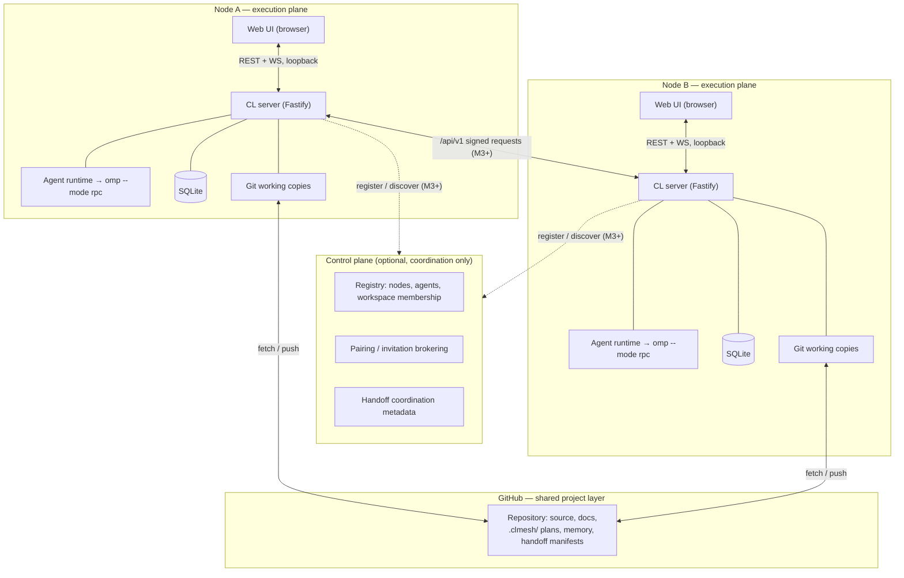
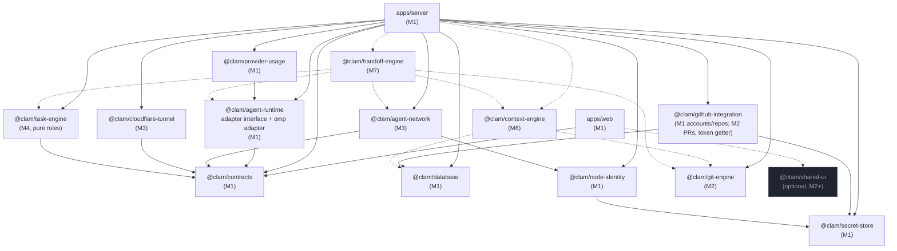
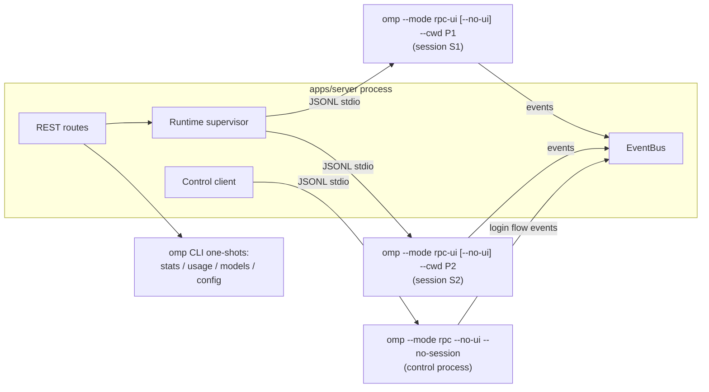
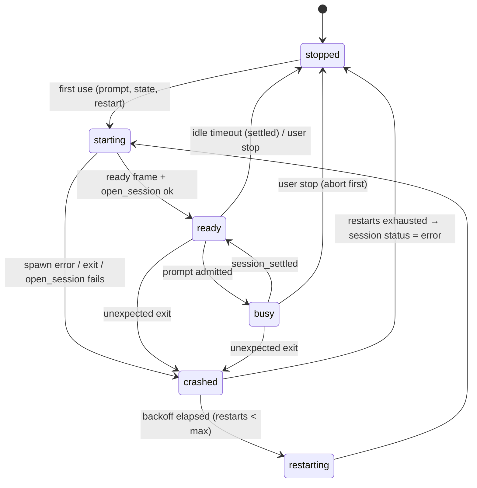
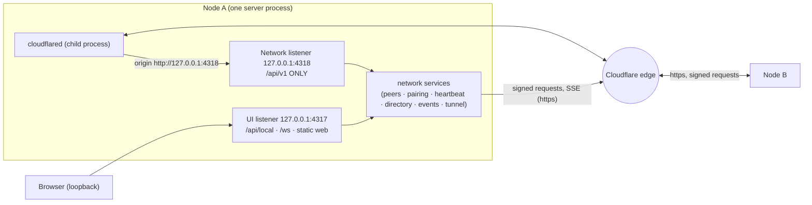
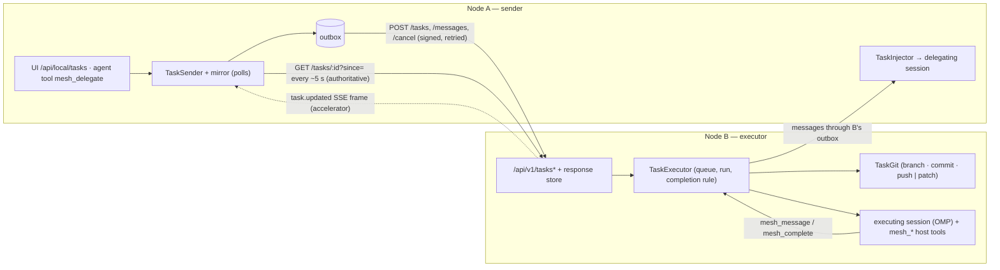
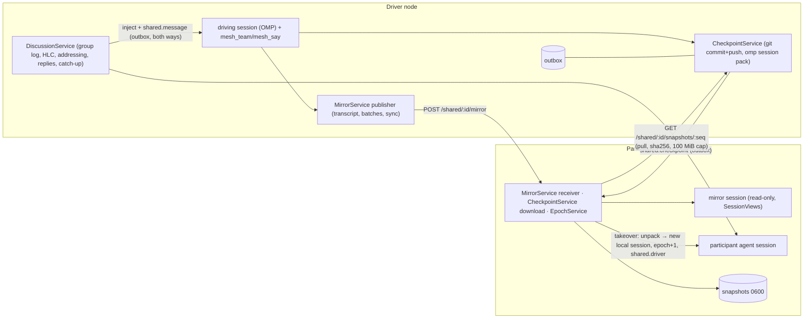
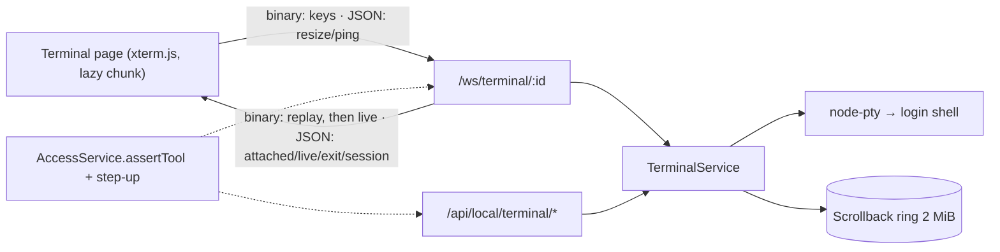
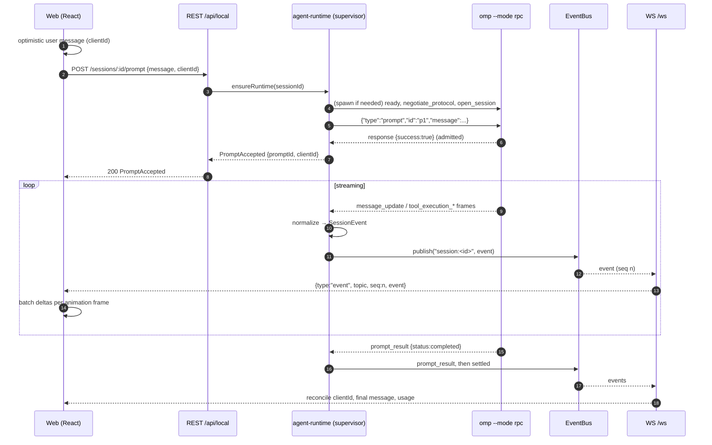

# CL Agent Mesh — Architecture

> **Distributed AI Agents. One Shared Workspace.**

CL Agent Mesh connects one person's computers into an AI team. Every computer (a **Node**) runs one or more AI agents (today: [OMP](https://github.com/can1357/oh-my-pi), the `omp` CLI) and exposes a local web UI. Nodes pair with each other, delegate tasks, share project context through GitHub, and hand unfinished work from one node to another. A node that goes offline never interrupts work executing on any other node.

This document is the system overview. Related documents:

| Topic | Document |
| --- | --- |
| Persistence | [database-schema.md](./database-schema.md) |
| Node ↔ node API | [agent-network-protocol.md](./agent-network-protocol.md) |
| OMP RPC facts and gaps | [omp-rpc-compatibility.md](./omp-rpc-compatibility.md) |
| GitHub layer | [github-integration.md](./github-integration.md) |
| Handoff | [handoff-protocol.md](./handoff-protocol.md) |
| Threat model | [security.md](./security.md) |
| UI | [ui-sitemap.md](./ui-sitemap.md) |
| Plan | [roadmap.md](./roadmap.md) |

Milestone tags used below: **M1**, **M2**, **M3**, **M4** and **M5** = shipped; **M6…M10** = later (see [roadmap.md](./roadmap.md)).

---

## 1. System overview

### 1.1 Planes



| Plane | Responsibility | Mandatory for a running agent? |
| --- | --- | --- |
| **Execution plane** (per node) | Local web UI + API, OMP runtime adapter, task engine, context engine, git integration, handoff manager, SQLite, tunnel | Yes — it *is* the agent |
| **Control plane** | Workspace registry, node discovery, pairing brokering, membership and permissions, handoff coordination metadata | **No.** Once a task is accepted, the node executes from local persistence. |
| **GitHub** | Source of truth for shared code and shareable project memory (`.clmesh/`) | Only for tasks that need a repo sync |

Rules that follow from this split (spec "Critical rules"):

1. **Local-first.** An agent runs on the node that owns it. State needed to continue (sessions, tasks, handoff manifests) is persisted in that node's SQLite database and `<dataDir>/sessions`.
2. **No node reads another node's database.** Nodes exchange only signed `/api/v1` messages and Git content.
3. **Control plane offline ⇒ nothing stops.** Running sessions continue; only discovery, new pairings and cross-node coordination degrade.
4. **GitHub is the source of truth for shared code.** Shared project data lives under `.clmesh/` (never credentials, plaintext secrets, private conversations, or temp runtime data — see [security.md](./security.md)).
5. **Runtime sessions are not assumed migratable.** A handoff creates a *new* runtime session on the target ([handoff-protocol.md](./handoff-protocol.md)).

### 1.2 What M1, M2, M3, M4, M5 and M7 deliver

(Since M5 none of it requires a git repository: managed project folders, task input/result files and files-mode shared sessions are described in §4.6e.)

M1 is the single-node, local-only slice: web UI ↔ local server ↔ OMP RPC, plus GitHub account settings, OMP provider/login settings and the usage dashboard. The pieces of the later planes that are needed to make M1 forward compatible already exist as real code: node identity (Ed25519 keypair, fingerprint shown in **Settings → Security**), the secret store, the SQLite migration framework, and the contracts for every local API payload. There is **no** `/api/v1` server, **no** pairing, **no** tunnel in M1 (they arrive in M3, below).

**M2** makes Git real on that single node: `@clam/git-engine` drives the system `git` CLI against real working copies, clone management creates linked projects from GitHub repositories, and the server exposes status/diff/log/branches/stage/commit/fetch/pull/push/conflicts/PRs to the web Git panel ([github-integration.md §7–9](./github-integration.md#7-clone-management-branches-commits-prs--implemented-in-m2)). Machine-to-machine sync is just two nodes pulling and pushing the same GitHub repository.

**M3** makes the nodes a network: a second, `/api/v1`-only listener (the *network listener*), a supervised Cloudflare Tunnel in front of it, signed node-to-node requests with pinned keys, invitation-code pairing with fingerprint verification, capability grants and immediate revocation, heartbeats with online/degraded/offline status, and an Agent Directory of every paired node's agents (§4.6b). 

**M4** lets those nodes work together: a task is delegated to an agent on a paired node (from the web UI, or by an agent through the `mesh_delegate` host tool), accepted by a human or by the receiver's auto-accept policy, run there by the receiver's own OMP agent in its own clone of the repository, and reported back (summary, pushed task branch or patch artifact). Both sides keep one **discussion thread** per task; messages are injected into the agents' sessions, so the executing agent can ask the delegating agent a question and get an answer (a real agent↔agent conversation, bounded by a loop guard). A node going offline never stops the other one: the executor keeps running and the sender reconciles when it returns (§4.6c).

**M5** shares a session: the work of one node (the *driver*) is mirrored live and read-only to other nodes, discussed in a shared thread, checkpointed to a shared git branch plus an OMP session snapshot, and can be continued on a participant node by a manual **takeover** (or a planned **transfer**), under an epoch that fences the former driver, which returns as a read-only *moved* copy with a rescue branch (§4.6d, [shared-sessions.md](./shared-sessions.md)). Each node's web UI is also reachable through its own domain ([security.md §5b](./security.md#5b-remote-ui-access-the-owner-logs-in-through-the-nodes-own-domain)).

---

## 2. Components

```
apps/web      React 19 + Vite SPA             talks only to /api/local (REST) and /ws
apps/server   Fastify 5 composition root      owns process lifecycle, route registration, event bus
packages/*    domain libraries (see §3)       no package imports apps/*
```

`apps/server` is the **integration owner**: it builds a `ServerContext` (`apps/server/src/context.ts`) holding `config`, `db`, `secrets`, `bus`, `log`, `omp`, `identity`, `runtime`, `git` (the git engine), `github` (the GitHub service), `network` (M3: peers, pairing, tunnel, heartbeat, directory) and passes it to every route plugin:

```ts
app.register(plugin, { prefix: LOCAL_API_PREFIX /* "/api/local" */, ctx });
```

* `EventBus` — topic fan-out (`publish(topic, event)`, `subscribe(topic, listener(event, seq))`). Topics: `session:<id>`, `sessions`, `runtime`, `login:<flowId>`, `github-device:<flowId>`, `node`, `git:<projectId>` (Git status/operation events), `git-op:<operationId>` (clone progress; retained like `login:*`), `network` (M3: `peer`, `invitation`, `pairing_request`, `join`, `directory_changed`), `tunnel` (M3: tunnel `state`; retained, so a late subscriber sees the current state). The bus also reports **demand** (`hasSubscribers`, `watchDemand(prefix, …)`) so a producer such as the working-tree watcher runs only while someone listens. `seq` is per-topic and monotonically increasing; the WS layer forwards it so clients detect gaps and refetch.
* `OmpLocator` — resolves the `omp` binary at boot (`binaryPath()` / `refresh()`); `null` means OMP is not installed and the UI shows install guidance instead of failing obscurely.

Typed payloads for every endpoint, the WebSocket protocol and the normalized `SessionEvent`/`UiMessage` stream live in `@clam/contracts` (Zod schemas + inferred types). The server validates every body and query with these schemas; the web app derives its hooks from the same types. This package is the only interface between `apps/server` and `apps/web`.

---

## 3. Module dependency diagram

Solid boxes exist (M1–M4); dashed boxes are planned (milestone in the label). Arrows mean "depends on / imports". `contracts` is a leaf that every package may use; edges to it are omitted from the diagram for readability except from the apps.



> Note on `usage → runtime`: `@clam/provider-usage` shells out to the `omp` CLI (`omp stats --json`, `omp usage --json`, `omp models --json`) and reads RPC `get_session_stats`; it consumes the OMP binary path from the runtime layer rather than duplicating discovery. It never touches OMP databases.

### Package responsibilities

| Package | Responsibility | State |
| --- | --- | --- |
| `@clam/contracts` | Zod schemas/types for local API, WS protocol, normalized session events | M1 |
| `@clam/database` | `openDatabase({ file })` → drizzle on better-sqlite3 (WAL, `foreign_keys`, `busy_timeout`), committed SQL migrations, table objects | M1 |
| `@clam/node-identity` | Node id (`node_` + 16 hex of the fingerprint), Ed25519 keypair in `<dataDir>/identity/`, fingerprint, `sign` / `verifySignature` primitives that `@clam/agent-network` builds signed requests on | M1 (keys); M3 (signing primitives used) |
| `@clam/secret-store` | `SecretStore`: macOS Keychain (`security -i`), libsecret (`secret-tool`), AES-256-GCM encrypted-file fallback (also Windows in M1) | M1 |
| `@clam/agent-runtime` | Runtime **adapter interface** (pluggable) + `omp` adapter: process management, JSONL framing, event normalization, supervisor | M1 |
| `@clam/github-integration` | OAuth device flow, `gh` import, multi-account, repo listing, permission checks; M2: repository metadata, pull-request create/list/get (mergeable + combined checks, error mapping), commit identity, server-internal `tokenFor` | M1; PRs/token getter in M2 |
| `@clam/provider-usage` | Normalizes `omp stats`/`omp usage`/`omp models`, caching, per-source provenance | M1 |
| `@clam/git-engine` | Real `git` CLI wrapper (argv only, no shell): status (porcelain v2), diff (parsed, capped), log, branches, stage/unstage/discard, commit (+trailers), clone/fetch, fast-forward-only pull, never-forced push, `merge-tree` conflict report, `.clmesh/` bootstrap + secret scanner, and the **askpass broker** (below). Depends only on `@clam/contracts` | M2 |
| `@clam/agent-network` | Protocol library: request signing and verification (`signRequest` / `verifyRequest`, pluggable nonce store and peer lookup), pairing cryptography (invitation code, HKDF code key, HMAC proofs, transcript signatures), the HTTPS client (`NetworkClient`: signed requests, retries with fresh nonces, signed SSE), SSE framing/cursors, URL policy, Zod wire schemas. No server code: the listener and the services are in `apps/server` | M3 |
| `@clam/cloudflare-tunnel` | `cloudflared` lifecycle: detection, quick and named tunnels (`--token-file`, `--metrics` readiness and connection count), restart with backoff, state events | M3 |
| `@clam/task-engine` | Pure task domain: the state machine and its allowed transitions, epoch checks, gap-free event mirroring, the agent-message budget (loop guard) and who may send which message kind, the executing agent's brief, the `[CL Agent Mesh]` injection and status-note texts, the five `mesh_*` host-tool definitions with argument validation, GitHub repo URL normalization, branch naming, approval strictness, outbox retry policy and idempotency hashing. No I/O: persistence and transport live in `apps/server/src/tasks` | M4 |
| `@clam/context-engine` | Project/workspace memory, snapshots, FTS5 index | M6 |
| `@clam/handoff-engine` | Manifest build/validate, ownership epochs, target steps, recovery, dependency setup/validation helpers | M7 (implemented) |
| `@clam/shared-ui` | Extracted UI primitives if/when a second web surface appears | optional |

Dependency rules: no cycles; `apps/web` imports only `@clam/contracts`; domain packages never import `apps/*`; orchestration code never branches on provider names or hard-coded agent role names (roles are free text); the runtime interface is the only place that knows OMP exists.

---

## 4. Runtime process model (OMP)

Decisions are derived from the verified behaviour in [omp-rpc-compatibility.md](./omp-rpc-compatibility.md).



* **One `omp --mode rpc-ui --cwd <projectPath>` child per *active* CL Agent Mesh session** (with `--no-ui` when the node's approval mode is `yolo`; see §4.4). Tool approvals are driven by `--approval-mode` from `NodeSettings.approvalMode` ([omp-rpc-compatibility.md](./omp-rpc-compatibility.md#5-tool-approvals)).
* **Binding.** Immediately after the `ready` frame (and `negotiate_protocol` to v2), the supervisor sends `open_session { sessionDir: "<dataDir>/sessions/<clamSessionId>" }`. This is equivalent to `--session-dir X --continue`: the first call starts a fresh OMP session in that directory; every later spawn resumes the newest session there. The returned `sessionId`/`sessionFile` are stored in `agent_sessions.runtime_session_id` / `runtime_session_file`. One CLAM session therefore equals one directory, and the process is disposable.
* **Control process.** One long-lived `omp --mode rpc --no-ui --no-session` serves provider/login/logout/model queries (`get_login_providers`, `login`, `get_logout_accounts`, `logout`, `get_available_models`). Login output is relayed on topic `login:<flowId>`.
* **CLI one-shots.** `omp stats --json` (~15 s cold), `omp usage --json --redact` (~2 s), `omp models --json`, `omp config get|set modelRoles` run as short child processes with timeouts. Results are cached server-side and refreshed in the background (`stale: true` is surfaced in the payload).
* **Never** read or write OMP's internal databases or credential stores. The only OMP files read directly are session JSONL files (documented format) for browsing, and only when the RPC `get_messages_page` cannot be used (it returns `session_busy` while streaming).

### 4.1 Runtime lifecycle (`RuntimeState`)

States from `@clam/contracts`: `stopped | starting | ready | busy | crashed | restarting`.



### 4.2 Supervisor, backoff, idle reaping

* **Concurrency cap:** `NodeSettings.maxConcurrentRuntimes` (default 4, range 1–64). Opening a session beyond the cap stops the least-recently-active idle (ready + settled, no pending approval) runtimes until a slot is free (**LRU eviction**); if none can go, the supervisor throws `capacity`, which the API maps to `503`.
* **Idle reaping:** only runtimes that are `ready` + settled with no pending approval are ever reaped or LRU-evicted. The reaper scans every 15 s; a runtime whose last activity is older than `runtimeIdleTimeoutMin` (default 30) **and** whose last `get_state` reports `isSettled: true` (nothing queued, no background jobs) is stopped by closing stdin (OMP shuts down gracefully with exit 0; stdout keeps being read until exit; SIGTERM/SIGKILL after a 5 s grace). The next request respawns it via `open_session` against the same directory.
* **Crash handling:** an exit without a requested stop marks `crashed`, publishes `RuntimeStatus` (with `lastError` from captured stderr tail) on topic `runtime`, and schedules a restart with exponential backoff (`delay = min(30 s, 0.5 s × 2^(attempt-1))`, ±20 % jitter; a runtime that stayed up ≥ 60 s resets the attempt count). After 8 failed attempts the runtime stays `crashed` until a manual **Restart** in the UI; `agent_sessions.status` is derived live from runtime state (`stopped` when no process). `POST /api/local/runtime/:sessionId/restart` resets the counter.
* **In-flight prompts at crash:** the prompt's `prompt_result` never arrives. The supervisor emits `prompt_result { status: "error", error: "runtime crashed" }` for each open ticket so the UI settles; the transcript up to the last durable OMP entry is preserved in the session directory and is replayed after restart. Prompts are **not** automatically re-sent (a tool may have already run) — the user decides.
* **Shutdown:** on SIGINT/SIGTERM the server stops accepting requests, closes stdin of every child, waits up to a grace period, then kills stragglers.

### 4.3 Frame handling

Per child: JSONL reader on stdout (never stop reading after closing stdin), negotiated protocol v2 with `rpc_chunk` reassembly and size/count validation, command `id` correlation with per-command timeouts (concurrent commands such as `bash` may answer out of order), unsolicited frames routed to the event normalizer. Malformed frames are logged and skipped; OMP itself replies with a `parse` error and continues. Details in [omp-rpc-compatibility.md](./omp-rpc-compatibility.md).

### 4.4 Approvals

`--approval-mode` is a process-level flag, so `NodeSettings.approvalMode` is applied at spawn time and changing it takes effect for runtimes started afterwards (running ones are restarted on request).

Per the OMP docs, tool approval prompts use the extension runner; under `--no-ui` any tool that needs approval **fails closed** with a no-interactive-UI error, and hosts without a dialog receive a `select` request with the choices Approve / Approve for session / Deny (and, in `always-ask-cached`, the grant variants). The runtime adapter therefore:

* spawns `--mode rpc-ui` in every mode — plain `--mode rpc` has no `ask` tool at all (the agent's clarifying questions would fail with `Tool ask not found`), see [omp-rpc-compatibility.md §10](./omp-rpc-compatibility.md#10-ask-subagents-and-the-todo-plan-verified-live-omp-18140);
* adds `--no-ui` **only** when the effective mode is `yolo` (nothing can prompt; extensions run headless, the `ask` tool UI stays on); and
* omits `--no-ui` for `always-ask`, `always-ask-cached` and `write`, so approval dialogs arrive as `extension_ui_request` frames, are normalized to `ui_request` events, and are answered through `POST /api/local/sessions/:id/ui-response` (translated to `extension_ui_response`). Questions from the agent's `ask` tool arrive the same way (`method:"ask"`, with every question) and are answered with `answers`; subagents (`subagent_upsert`, `GET /sessions/:id/subagents`) and the todo plan are surfaced from the same process.

**Verified live** (ServerCore, `always-ask`): approvals arrive as `extension_ui_request` with `method: "select"`, title `"Allow tool: bash\nCommand: ls"` and options `["Approve", "Approve bash for this session", "Deny"]`. Pending approvals are also listable via the non-contract route `GET /api/local/sessions/:id/ui-requests`. See [omp-rpc-compatibility.md](./omp-rpc-compatibility.md#5-tool-approvals).

### 4.5 Usage pipeline

Three independent sources, never blended (each payload carries its `DataSource`):

| Source | Produced by | Cache | Surface |
| --- | --- | --- | --- |
| **OMP-recorded** (`omp-recorded`) | `omp stats --json` (~15 s cold, 60 s timeout). It covers only the **last 24 h** with an hourly series | Stale-while-revalidate snapshot cache: TTL 60 s, single-flight refresh, last good snapshot persisted to `<dataDir>/cache/usage-recorded.json` (instant after restart), background refresh every 30 min | `GET /usage/recorded` → `RecordedUsage` (`stale` flag) |
| **History accumulation** | Each successful `omp stats` run upserts its hourly buckets into `usage_buckets` (buckets fully inside the window replace the stored row, so overlapping windows are idempotent; the oldest partial bucket never overwrites a fuller row) | SQLite | `RecordedUsage.daily` is built from `usage_buckets`; `coverageStart` (oldest bucket) tells the UI how far back accumulated history really goes — **not** all-time, only since the node first ran |
| **Provider-reported quota** (`provider-reported`) | `omp usage --json --redact` (`--redact` masks account identifiers at the source) | SWR cache, TTL 120 s, snapshot `<dataDir>/cache/usage-quota.json` | `GET /usage/quota` → `QuotaReport` ("Unavailable" when a provider reports no limits) |
| **CL per-session accounting** | Session service: on each assistant `message_end`, usage is attributed per model into `provider_usage`; after every `session_settled` a *residual* row reconciles the total against RPC `get_session_stats` | SQLite | `GET /usage/mesh` → cost by project / agent |

`?refresh=1` bypasses the TTL. All OMP CLI calls add `--profile <CLAM_OMP_PROFILE>` when configured.

### 4.6 Secret storage

`createSecretStore` selects, in order: macOS Keychain through `/usr/bin/security` (writes via `security -i` so the secret goes over stdin, not argv), Linux Secret Service through `secret-tool` (secret on stdin), then an AES-256-GCM encrypted file under `<dataDir>/secrets/` (per-entry IV, AAD binds ciphertext to service+key, `master.key` beside it at `0600`). The encrypted file is also what Windows uses in M1 (no Credential Manager backend yet). OS stores are probed with a write/read/delete round-trip; the first choice is pinned in `<dataDir>/secrets/backend` and later starts never switch stores silently (an unusable pinned store stops the node with an explanation). The server namespaces OS-store entries per node (service `cl-agent-mesh.<nodeId>`). `SecurityInfo.secretStore` reports the backend actually in use. `CLAM_SECRET_BACKEND` can force one. Details: [github-integration.md §4](./github-integration.md#4-secure-credential-storage).

### 4.6a Git engine and the askpass broker (M2)

`@clam/git-engine` is created once at boot (`createGitEngine({ runtimeDir: <dataDir>/run })`, `0700`) and lives in `ServerContext.git`; it is disposed on shutdown. Route code never spawns git itself. Network commands authenticate through a **local broker** instead of any stored credential: the engine writes a small `GIT_ASKPASS` helper into `runtimeDir`, listens on a Unix socket there, and gives each git command a one-time nonce (plus `-c credential.helper=` and `GIT_TERMINAL_PROMPT=0`). When git asks for the username/token, the helper trades the nonce for the value over the socket; the server's `GitAuth.token()` callback is called lazily and the token is never in argv, env, remote URLs, `.git/config` or any file ([github-integration.md §8](./github-integration.md#8-git-authentication-for-operations)).

`apps/server/src/services/git-service.ts` is the only consumer: per-project serialized mutation queue, auth selection (linked account, else default; github.com https remotes only), commit identity resolution, `GitEngineError` → `ApiError` mapping (`git_*` codes, git's stderr verbatim and credential-scrubbed), `git:<projectId>` status events (after mutations; debounced `fs.watch` + agent `tool_end` while subscribed), the `git_sync_states` cache, in-memory `GitOperation` registry for clone/fetch/pull/push, and clone-into-new-project.

### 4.6b Agent network, tunnel and the network listener (M3)



* **Two listeners, one process.** The UI listener (`CLAM_HOST:CLAM_PORT`) is exactly the M1 server. The *network listener* (`CLAM_NETWORK_HOST:CLAM_NETWORK_PORT`, default `127.0.0.1` and UI port + 1) is a second Fastify instance (`apps/server/src/network/listener.ts`) that serves only `/api/v1/*`: no static files, no WebSocket, no `/api/local`; every other path is a plain `404`. The tunnel's origin is the network listener, so nothing but `/api/v1` can be reached from outside. Its Host guard accepts loopback names and the node's own tunnel hostname. JSON bodies are captured as raw bytes (the `Content-Digest` covers them) and parsed only after authentication.
* **Request pipeline** (`authenticate` in `listener.ts`): per-source token bucket → `verifyRequest` (version, peer lookup, skew, replay via the SQLite-backed `SqliteNonceStore`, digest, signature, idempotency key) → per-peer token bucket → capability check → handler. Endpoints: `GET /node/info`, `GET /node/health`, `POST /node/pair`, `GET /agents`, `GET /events` (SSE), `POST /node/announce`, `POST /node/revoke` ([agent-network-protocol.md §5](./agent-network-protocol.md#5-endpoints)).
* **Services** (`apps/server/src/network/`, reached through `ctx.network` and used by `api/network.ts` and `api/node.ts`): `TunnelService` (config in `settings`, token in the secret store, wraps `createTunnelManager`, publishes `tunnel` events, auto-starts at boot, tells `node.public_url` and `SecurityInfo.remoteApiEnabled` the truth), `PeerService` (pins keys, grants, status, revocation), `InvitationService` + `PairingService` (inviter and joiner state machines, persisted so they resume after a restart), `PeerMonitor` (jittered 30 s signed health poll per peer + opportunistic SSE with cursor resume), `DirectoryService` (own agents + cached `peer_agents`), `NetworkEventLog` (`network_events`: gap-free `seq` per stream) and `LocalAgentsWatcher` (turns a change of this node's agent list or status into `agents_changed`). The monitor and the announcer react to `PeerService` changes (a peer was added, revoked or moved).
* **Tunnel modes.** *Quick* runs `cloudflared tunnel --url http://127.0.0.1:<networkPort>`: no account, a random `https://*.trycloudflare.com` that changes at every start, so the node announces its new address to every peer (after the hostname resolves; peers verify it by fingerprint). *Named* runs `cloudflared tunnel run --token-file <dataDir>/run/tunnel-token` with the dashboard token (secret store) and the public hostname the user routed to the origin; the address is stable. Mode, hostname and `autoStart` live in `settings` (`network.tunnel`); the server only ever signals the `cloudflared` process it spawned itself.
* **Heartbeat is authoritative.** Quick tunnels buffer event streams, so liveness, capability changes and agent-list changes are detected by the signed health poll (its answer carries `agentsRevision` and `grantedCapabilities`); the SSE stream only makes it faster where the path allows streaming.
* **Local API.** `GET/PATCH/POST …/network/peers[/:id[/revoke]]`, `…/network/invitations`, `…/network/pairing-requests/:id/approve|reject`, `…/network/join[/preview]`, `…/network/agents`, `…/tunnel[/config|/start|/stop]`, plus WebSocket topics `network` and `tunnel`. Everything is validated with the contracts' Zod schemas and never exposed through the tunnel.

### 4.6c Task engine, executor, host tools and recovery (M4)



Code: `apps/server/src/tasks/` (units, wired by `TaskService` = `ctx.tasks`) and `packages/task-engine` (pure rules).

* **One row per node, executor is the truth.** Both nodes store the task under the same `tsk_<ULID>`; `direction` is `outgoing` on the sender and `incoming` on the executor. The executor allocates the gap-free event `seq`, owns status/result and answers `GET /tasks/:id?since=`; the sender's `TaskMirror` copies events and applies the record **only once it is caught up** (so a terminal status never shows without its events) and ignores stale epochs. Polling is authoritative (quick tunnels buffer SSE); the `task.updated` frame on the node stream only makes it poll now.
* **Durable outbox** (`OutboxService`, table `outbox`): every mutating peer call (`task.create`, `task.message`, `task.cancel`) is a row with the exact body and an idempotency key, sent per peer oldest-first by a worker that only attempts while the peer is `online`/`degraded`, never lets a message overtake its task's create, backs off with full jitter, and drains the moment the peer comes back. Delivery state is visible (`Task.delivery`, `TaskMessage.delivery`). Item kinds are plain strings with a handler table (`OutboxService.register`); the task kinds are `taskOutboxHandlers`. The receiving side keeps the `(peer, Idempotency-Key)` **response store** (`network/idempotency.ts`, generic) plus the natural keys (`taskId`, `messageId`).
* **Executor** (`TaskExecutor`): `receive` stores `offered` and auto-accepts only when the peer's `autoAcceptTasks` is on **and exactly one** local project is linked to the task's repository; a human otherwise picks the project (or clones first) and accepts or rejects. **One running task per project working tree**; the rest wait as `accepted`. A run creates a normal agent session `Task: <title>` (so it is visible in the session UI), applies the stricter of the node's approval mode and the task's constraint plus `--max-cost` (`SessionService.setSpawnOverrides`, applied at spawn and again after every restart), and sends the CLAM-composed brief. `TaskGit` (`deliverAs: branch`): refuse to start on tracked uncommitted changes (task `blocked`, human fixes and re-accepts), fetch, create `clam/<node>/<task>-<id>` from the **sha** of `origin/<base>` (no upstream, so the push can never land on the base branch), and on success commit with `Task:`/`Agent:` trailers, push with the node's own GitHub account (never forced), else attach a `git format-patch` artifact; the original branch is restored when the tree is clean. Cancel and failure never destroy work.
* **Completion rule**: `mesh_complete` (succeeded/failed/blocked + summary) is authoritative and is recorded immediately, the task being finalised when the session next *settles*. A session that settles without it: a pending unanswered question → `blocked` (an answer resumes it); otherwise ONE reminder; settling again → `succeeded` with the final assistant text as summary and `autoCompleted: true`. A settle event that is stale because the other node's answer already started another turn (or is about to be injected) is ignored.
* **Host tools** (`MeshHostTools`, a `HostToolSet` in the `HostToolRegistry` that is the runtime's single provider — `ctx.hostTools`): `mesh_agents`, `mesh_delegate` (creates an outgoing task from the calling session's project; the session becomes `sender.sessionId`), `mesh_message` (only the task's delegating or executing session), `mesh_task`, `mesh_complete` (executing session only). Registered in **every** OMP runtime via `set_host_tools` after `open_session` and after every restart, with `loadMode: "essential"` so the model calls them directly. Results are short text an LLM can act on; refusals (loop guard, capability, finished task) are error results, never exceptions.
* **Message injection** (`TaskInjector`, `injectIntoSession`): a received message — and a human-authored message on this node — becomes a prompt in the local session of the task with the `[CL Agent Mesh] task <id> · "<title>" · from <agent>@<node> · kind <kind>` header: a plain prompt when the agent is idle (this wakes it), `steer` for an instruction while busy, `followUp` otherwise. Injection is per-session FIFO, idempotent (`injectedSessionId`, prompt `clientId`) and retried; the final status of a task is injected once into the sender's delegating session as a short note. **Loop guard**: at most 12 agent-authored messages per node and task without a human message in between (`AGENT_MESSAGE_LIMIT`; the UI shows the remaining budget).
* **Restart recovery**: on boot executor tasks that were `running` re-open their session with a "the node restarted; continue and finish with `mesh_complete`" prompt (or finalise at once if a completion was already recorded), `blocked` tasks keep waiting for their message, queued `accepted` tasks start, the outbox resumes, the mirror resumes polling and the injector re-injects what never reached a session. A sender that was down reconciles by polling; nothing is executed or created twice because every create is keyed by `taskId` and every message by `messageId`.
* **Artifacts**: stored on the executor (`<dataDir>/artifacts/<taskId>/`), sha256, 25 MiB cap, text artifacts secret-scanned with the git engine scanner before storing (a hit refuses the artifact); only the task's sender downloads them (`GET /api/v1/tasks/:id/artifacts/:artifactId`, proxied by the local `routes.taskArtifact`).
* **Local API and events**: `GET/POST /tasks`, `GET /tasks/:id` (detail with events and messages), `POST …/messages|decide|cancel|retry|read`, `GET …/artifacts/:id`, `GET /activity`; WebSocket topics `tasks` (list-level `{type:"task"}`) and `task:<id>` (`task`, `event`, `message`). `Peer.autoAcceptTasks` is persisted and editable with `PATCH /network/peers/:id`.

**Reusable seams** (written so the next feature does not copy task code): `injectIntoSession` (`tasks/session-injection.ts`) + `buildMeshMessage` (`@clam/task-engine`) frame and deliver text into any session; `OutboxService.register(kind, handler)` (`tasks/outbox.ts`); `TaskGit` takes explicit dependencies and a `GitSubject` (`tasks/task-git.ts`); `HostToolRegistry.register(set)` (`services/host-tool-registry.ts`); `IdempotencyStore` + `runIdempotent` (`network/idempotency.ts`).

### 4.6d Shared sessions, takeover and the node's own domain (M5)

Full reference: [shared-sessions.md](./shared-sessions.md) (flows, data model, errors, limits). Code: `apps/server/src/shared/` — one `SharedService` (`ctx.shared`, the composition root) and seven units that talk to each other only through the interfaces of `hub.ts`:



* **Units** — `sharing` (share, invitations, auto-accept, mirror/participant sessions, leave/remove), `discussion` (the **group chat**: a leaderless log replicated on every member node, ordered by a hybrid logical clock, caught up by a per-origin pull; @mention addressing, the buffer "Since your last turn in the group", automatic replies of every agent turn, system messages, loop budget, injection), `mirror` (live copy, also the `SessionViews` implementation), `checkpoints` (git + snapshot, pull delivery, acks), `epochs` (takeover, receiving a transfer, former driver, rescue, reconcile), `transfers` (the one-action **hand-over** job: invite → wait for acceptance → stop/wait → final checkpoint → delivery → ask the target; progress in `shared_sessions.meta.transfer`, prompt freeze with `transfer_in_progress`, boot recovery), `host-tools` (`mesh_team`, `mesh_say`), `outbox` (kinds and handlers), over a synchronous `store` that holds every SQL statement. The group chat needs **no host**: any online member node accepts a message and fans it out through the outbox; epoch fencing applies to the lead (driver) role only.
* **Seams with existing code** — **Task engine:** peer calls are rows of its durable outbox (`OutboxService.register` with the `shared.*` handlers; ordering key `<sharedId>:<peerId>`), responses go through the generic `runIdempotent` store, messages are framed with `buildMeshMessage` and delivered with `injectIntoSession` (the same FIFO/idempotent injector as tasks), pure rules and texts (`buildSharedBrief`, `buildSharedMessageInjection`, `buildContinuationNote`) live in `packages/task-engine/src/shared.ts`. `SharedService` starts and stops with `TaskService`. **Session service:** `agent_sessions.kind` (`local`/`mirror`) and `moved_to`; `adopt` binds a new local session to an unpacked OMP session file, `markMoved` makes the former driver's copy read-only, `withConversationFile` releases the runtime around `omp session pack`, and mirror/moved sessions answer `messages`, `state`, `status` from **`SessionViews`** (the stored transcripts) instead of a runtime — they refuse prompts and runtime access with `session_read_only` / `session_moved`. **Git service:** checkpoints and rescue commits use the normal `commit` (trailers `Session`, `Epoch`, `Agent`), `push` (never forced) and takeover uses `fetch`/`checkout`/`pull`; nothing is discarded. **Host tools:** `SharedHostTools` is a second `HostToolSet` next to `MeshHostTools`. **OMP CLI:** `omp session pack|unpack|moved` through `ompCli`.
* **Wire and local surfaces** — `network/shared-routes.ts` registers `/api/v1/shared*` on the network listener (capability `sessions.share`, [agent-network-protocol.md §5.9a](./agent-network-protocol.md#59a-shared-sessions--sessionsshare)); `api/shared.ts` serves the UI (`/api/local/shared*`, `/api/local/sessions/:id/participants`, `/api/local/sessions/:id/handover`, `POST|DELETE /api/local/shared/:id/transfer`) and the WebSocket topic `shared`.
* **Fencing** — one integer `epoch` per shared session; takeover and hand-over announce `epoch + 1` (`shared.driver`), every driver-only call is checked (`stale_epoch` / `epoch_unknown`), and a node that was the driver finishes its demotion from a journal (`shared_sessions.meta.pendingFormerDriver`) that is re-run at boot. Peers ask each other who drives (`GET /shared/:id`) at boot, on every `online` transition and every 30 s.
* **Each node's own domain** — M5 also lets the owner reach a node's web UI through that node's tunnel domain (opt-in, password + cookie session; `/api/v1` still takes signatures only). That is the access layer a participant uses to watch a takeover on its own domain: [security.md §5b](./security.md#5b-remote-ui-access-the-owner-logs-in-through-the-nodes-own-domain) documents it (surfaces, owner credential, session cookie, CSRF, throttling, headers) and `apps/server/src/auth/gate.ts` implements it; this document does not repeat it. Shared sessions use it in one place: when remote access is on, the node's public URL is announced as `uiUrl` in invitations and driver notices so a *moved* session can link to the new driver's UI.

### 4.6e Work without git: managed folders, task files, files-mode shared sessions

A git repository is **never required**. Three mechanisms make every feature of M4/M5 work on a plain folder; git mode is untouched and still chosen whenever a project is a git working tree with a linked GitHub repository.

* **Projects.** `POST /projects` without `path` creates an empty **managed** folder `<dataDir>/projects/<projectId>` (`projects.managed = 1`); with a path it points at the user's folder. `Project.vcs` (`git`/`none`) is **derived live** from the folder (a `.git` entry at its root) and never stored. Sessions and the file explorer need nothing from git. Deleting a project keeps its folder; `DELETE /projects/:id?deleteFiles=true` also removes it, but only for a managed project and only inside `<dataDir>/projects` (`services/project-folders.ts`). Auto-linking a GitHub repository only happens at a repository root.
* **Folder bundles** (`@clam/workspace-files`). One format moves a folder's files between nodes: a deterministic `tar.gz` (`manifest.json` with sha256 per file + `files/<path>`), built with default excludes (`.git`, `node_modules`, virtualenvs, build output, logs, `.env*`, runtime directories) and `.gitignore`, previewed (`new`/`unchanged`/`update`/`conflict` against an optional base manifest) and applied atomically (no symlinks, no `..`, sha256-verified before anything is written, only the executable bit kept, never deleting). The server side is `services/files-bundles.ts` (error mapping, credential scan of outgoing text files, preview with unified diffs, apply).
* **Tasks** (`tasks/files.ts`, `TaskFiles`). The sender bundles `inputPaths` into an artifact of the task (credential-scanned, ≤ 25 MiB); the executor downloads it with `GET /tasks/:id/inputs/:artifactId` (executor-only, needs `tasks.receive`), applies it into the folder it works in, records the folder's state, and for `deliverAs: files` returns only what is new or changed since then as `result.files`. A task without a repository runs in a managed folder created for it (or in a local project the human chose). The sender previews/applies the result against any local project; the task's input manifest is the base when it is the project the inputs came from.
* **Shared sessions** (`shared/files.ts`, `SharedFilesService`). `vcs: files` replaces branch + commit + push by "bundle the driver's folder"; the bundle travels with the snapshot (pull-based, digest-checked, acknowledged once both parts are held); a participant's folder receives the first bundle, later ones only at a takeover/hand-over (preview first; local edits refuse the takeover unless forced and are then saved as a rescue bundle; nothing is deleted); a former driver's work after its last bundle is kept as a rescue bundle. Group chat, mirror and epochs are shared code and unchanged ([shared-sessions.md §11](./shared-sessions.md#11-files-mode-shared-sessions-without-a-git-repository-migration-0006_nogit)).

Schema: migration `0006_nogit` ([database-schema.md §3.2b](./database-schema.md#32b-work-without-git--migration-0006_nogit-implemented)); wire additions: [agent-network-protocol.md §5.5, §5.8c, §5.9a](./agent-network-protocol.md#58c-get-tasksidinputsartifactid--the-tasks-executor-only).

### 4.6f Chats without a project, file serving and group-chat attachments (migration `0008_chats`)

* **Chat folders.** `POST /sessions` without `projectId` calls `createChatProject` (`services/project-folders.ts`): a managed folder with `projects.origin = 'chat'`, then `SessionService.create`; the folder is removed again when the session cannot be created. A files-mode shared invite accepted without a project does the same.
* **File routes** (`api/project-files.ts`, `http/file-response.ts`, `services/file-writes.ts`). `GET /projects/:id/raw` resolves the path with `realpath` inside the project root, refuses `.git`, and streams with content type from the extension, `Accept-Ranges`/206, `Content-Disposition` on `download=1`, no compression. `POST /projects/:id/upload` runs in its own Fastify scope whose content-type parser hands over the untouched request stream: bytes go through a size meter into a temp file next to the target (same filesystem) and are committed with an atomic `link` (409 when taken) or `rename` (`overwrite=1`); parent folders are created level by level with each existing level resolved by `realpath`.
* **Attachments** (`shared/attachments.ts`, `AttachmentService`): content-addressed store `<dataDir>/attachments/<sha256>`, replication of bytes by signed pull between members (`GET /api/v1/shared/:id/attachments/:attId`, reusing `downloadSnapshot`'s size/digest verification), eager scan (durable, backoff) and lazy stream-through, copy into agent folders and the `mesh_share_file` host tool. Protocol and rules: [shared-sessions.md §12](./shared-sessions.md#12-plain-chats-and-files-in-the-group-chat-migration-0008_chats).

### 4.6g Handoffs: the handoff engine, fencing and recovery (M7, migration `0009_handoff`)

`@clam/handoff-engine` holds the pure rules (manifest seal/verify, source and target state tables, `recoveryAction`/`bootFenceDecision`, fencing tokens, deadlines, environment detection, setup runner, resume prompt); `apps/server/src/handoff/` is the stateful side, composed by `HandoffService` (`ctx.handoffs`, started and stopped by the task engine like shared sessions and contexts: `prepare()` before any runtime is opened, `start()` after the executor and the outbox run). Protocol and decisions: [handoff-protocol.md §11](./handoff-protocol.md#11-implemented-as-m7).

* **Two sides, one table.** The source node and the target node each keep their own `handoffs` row (`role`), with steps, a gap-free timeline (`handoff_events`), setup commands and artifacts. `hub.transition` is the only way a state changes: compare-and-set against the engine's edge table, timeline event, and the outbox items the state announces **in one SQLite transaction**, then publication on `handoffs` / `handoff:<id>` and the fault-injection check. Every persisted step change (`hub.setStep`) and every timeline event is published too: a publish sends the row followed by all events persisted since the last publish of that handoff, so an open Handoff Center is live (the topics are in the `/ws` topic allow-list; polling is only the fallback). State is persisted before the side effect, so a crash at any state is recovered by re-running the decision table (`recovery.ts`) at boot and when a peer comes back.
* **Source** (`source.ts`): freeze the task (the executor ignores a frozen task: no events, no completion, no recovery prompt; the sender's messages get `503 handoff_in_progress` and are retried by its outbox) → settle or abort the turn → OMP `handoff` summary (secret-scanned) → git (commit WIP on the task branch + push, never forced, or a binary patch) / folder bundle / none → environment, contexts, thread → `sealManifest` → offer through the durable outbox → accept → `awaiting_ack` → on a valid ack (hash, epoch, pinned key, fencing token) persist `acked` first → stop the runtime, set `handed_off` + `fenced` (no task events, so the timeline stays as sealed), `omp session moved` → `released` → `completed`. Cancel/extend/reclaim per §3.1; reclaim needs a successful status query (or an explicit override) and burns the tombstone epoch.
* **Target** (`target.ts`, `restore.ts`, `setup.ts`): the ten steps, each re-entrant and recorded in `handoff_steps`: verify and (auto-)accept → persist (one transaction, with the frozen task row) → restore files (own work branch / bundle without overwriting) → context refs → dependency setup per `dependencySetup` (`ask` → per-command approval in the Handoff Center, `auto`, `skip`; denied = skipped with a warning in the prompt) → validation → NEW local session → durable ack (row + outbox item atomically) → ownership (epoch n+1, executor adopts the task) → resume prompt. The task then runs as an ordinary executor task; events continue the sealed timeline and the task's **sender** is told with `POST /tasks/:id/executor` so its Task follows the new executor.
* **Fencing** (`fence.ts`): freeze while a source handoff is in flight, `fenced` after release; the boot scan runs `bootFenceDecision` before any runtime spawns; the prompt guard refuses sessions of fenced/frozen tasks; `assertOwner` guards commit/push/PR/result; a fenced executor's late result becomes a `late_result` event.
* **Session handoffs** (`session-kind.ts`): the M5 hand-over/takeover is mirrored into `kind: session` rows so the Handoff Center shows it, and the node that continues runs dependency setup + validation (same `DependencySetup`) **before** the continuation prompt, which carries the setup report; a pending approval holds the prompt back until approved or denied.
* **Timers** (`recovery.ts`): offer expiry → `expired`; restore deadline → source `ack_timeout` (never a release on silence) / target `failed(timeout)`; an unanswered ack past the deadline → target acquires the epoch (§6.4(b)); completed grace.

### 4.6h The machine's Browser (`apps/server/src/browser/`)

A headless Chromium-family browser **on the machine**, controlled over the Chrome DevTools Protocol and streamed to the web UI. `ctx.browser` is a `BrowserService`; it is stopped with the server. Access is the routes' job (`AccessService.assertTool(…, "browser")`, see [security §5e](./security.md#5e-machine-tools-the-browser)); the service only drives the browser.

* **Process.** `executable.ts` finds the browser (`CLAM_BROWSER_PATH` → installed Chrome/Chromium/Edge/Brave → Playwright's cache → `<dataDir>/browsers`, injectable environment so the order is unit-tested); `installer.ts` is the one-click installer (`npx playwright install chromium` with `PLAYWRIGHT_BROWSERS_PATH=<dataDir>/browsers`, progress parsed from its output). `service.ts` starts **one** process lazily (`--headless=new --remote-debugging-pipe --user-data-dir=<dataDir>/browser-profile`, fds 3/4 as the CDP pipe), adopts its pages, and closes it after the idle window with no viewer. `cdp.ts` is the NUL-delimited pipe protocol with flattened target sessions.
* **Tabs** (`tab.ts`). One `Tab` per page target: it enables Page/Runtime/Log/Network/DOM, tracks title (announced by a page binding, because `Target.targetInfoChanged` does not report title changes of attached tabs), URL, loading progress, back/forward state, favicon (fetched inside the page, ≤ 32 KB `data:` image), the console (`consoleAPICalled`, exceptions, `Log.entryAdded`, failed/4xx–5xx requests), dialogs and file choosers (`Page.setInterceptFileChooserDialog`). Downloads are browser-level (`Browser.setDownloadBehavior allowAndName`, renamed to a unique safe name on completion).
* **Streaming.** While at least one *visible* viewer is attached, `Page.startScreencast` (JPEG, size = viewer size × DPR capped at 2) runs; each frame is sent as `u32 seq · u16 width · u16 height · JPEG` on `/ws/browser/:tabId` and acknowledged only when every viewer's socket has drained (back-pressure); JPEG quality steps 35–80 follow the socket back-log. A viewer that falls behind is skipped, never queued. Hidden viewers stop the screencast. Input arrives as typed JSON (`BrowserClientMessage`) and is turned into `Input.dispatchMouseEvent/TouchEvent/KeyEvent/insertText`. The viewport follows the latest visible viewer (`emulation.ts`): fit, Desktop 1440, or iPhone 16 Pro Max (440×956, DPR 2, touch, mobile UA; touch and UA are applied before the metrics so the page sees them on resize).
* **URL policy** (`url.ts`): bare `host:port` → http, other bare hosts → https, `file://` only inside project folders (symlink-resolved), `chrome:`/`devtools:`/`view-source:`/`javascript:`/`data:`/… refused; pages that land on a forbidden URL are bounced to `about:blank`.
* **Ports** (`ports.ts`): listening TCP sockets from `lsof -iTCP -sTCP:LISTEN -nP +c 0` (macOS/Linux), `ss -ltnpH`, or `netstat` (Windows), merged by port, minus this node's own ports/PIDs, known system daemons and databases. Each remaining port gets one short (≤ 300 ms) loopback `GET /`: only ports that answer HTML or JSON are listed, labelled with the page `<title>`; a port that answers `/api/v1/node/info` or `/api/local/node` is a CL Agent Mesh server and is dropped. The process is named by its executable from `ps` (`node`, `python3`: lsof's own column is the name of the thread holding the socket, e.g. `MainThrea`), the tool from the command line (`vite`, `next`, `http.server`, …), sorted by process start time (newest first), probes cached 20 s.
* **Web** (`apps/web/src/features/browser/`, one lazy route chunk): `viewer.tsx` decodes frames with `createImageBitmap` off the main thread and draws only the newest on a canvas; pointer, touch, keyboard, IME and paste are mapped to the protocol; an overlay (and `window.__clamBrowserStats`) reports FPS, KB/s, round-trip and input→frame latency. `open-in-browser.tsx` is the tiny piece the chat renderer uses to offer "Open in this machine's browser" for `http://localhost:*` links.

### 4.6i The machine's Terminal (`apps/server/src/terminal/`, `ws/terminal.ts`, `api/terminal.ts`)

One `TerminalService` (`ctx.terminals`) owns the machine's PTYs (`node-pty`, loaded lazily so a platform without the addon only loses the Terminal). A terminal is a spawned login shell plus a 2 MiB `Scrollback` byte ring (64 KiB blocks; once anything dropped, the replay starts at a clean boundary: after a UTF-8 character, at a line or an escape). The browser opens one at the size it estimates for its pane (`features/terminal/grid.ts`: columns × rows from the pane, font and padding) so the shell does not start at 80×24 and get resized under its first prompt, and repairs the GPU renderer's canvas when the device pixel ratio changes under it (the canvas would stay at its old size: text drawn small and offset from the top of the screen). Terminals outlive browsers: `attach()` sends `attached` (session + replay size), the replay as binary frames, `live`, and from then on the live bytes — all in one synchronous call, so nothing slips between replay and stream. Exited terminals stay read-only for `exitedTtlMs` (10 min) and are then removed; running ones live until killed or `stop()` (server shutdown). At most 12 exist (finished ones are evicted first). Backpressure: output pauses the PTY while any attached socket has > 1 MiB queued, resumes below 256 KiB, and drops a client stuck for 15 s.



* **Access.** The REST routes and the socket call `AccessService.assertTool(request.access, "terminal", { stepUp })` — loopback always passes; through the domain the tool toggle must be on and (for create/attach) the session must be elevated by a recent password re-entry. `AccessService` tracks remote sockets with their tool, so logout / logout-all / expiry / remote-UI off / toggle off close them (`4401`). Audit entries go to `node_events` through `services/audit.ts`. Rules and threats: [security.md §5d](./security.md#5d-machine-terminal-a-shell-on-the-node-and-the-gate-that-guards-the-machine-tools).
* **Wire.** Contracts in `packages/contracts/src/terminal.ts`; the public listener lets `/ws` and `/ws/<tool>/…` upgrades through to the UI surface (everything else is still dropped); the gate treats `/ws/*` as data paths (session + exact Origin).
* **Native addon.** `node-pty` ships macOS/Windows prebuilds and is compiled from source on Linux (the Docker builder has the toolchain and smoke-tests the production tree). pnpm unpacks its `spawn-helper` without the exec bit, so the service fixes the mode once before the first spawn.
* **Web.** `/terminal` is a lazy route; xterm.js and its addons (fit, web-links, search, unicode11; WebGL with a canvas fallback loaded on demand) are lazy chunks, so the initial-JS budget is untouched.

### 4.7 Web client performance (measured)

* Route-level code splitting with intent preloading; markdown and syntax highlighting are lazy chunks.
* **Initial JS: 177 KB gzip** against a 180 KB budget. `apps/web` `build` runs `scripts/check-budget.mjs` after `vite build`: it gzips every script/stylesheet referenced by `dist/index.html` and **fails the build** when initial JS exceeds `SHELL_BUDGET_KB` (default 180).
* `pnpm --filter @clam/web analyze` (`ANALYZE=1 vite build`) writes a gzip-aware treemap to `dist/stats.html` (`ANALYZE=json` writes `dist/stats.json`).
* The server compresses responses (brotli/gzip, threshold 1 KiB).

---

## 5. Data flow: sending a prompt



Key properties:

* When nothing is running, admission immediately adds a pending user message to the session transcript and publishes `message_start` + `message_end` (a prompt queued behind a running turn is shown only when it is delivered, to keep transcript order); when OMP later echoes the user message it is **folded into the same message id** (no duplicate bubble). If the prompt ends without ever reaching the agent (rejected, aborted or runtime crash before the echo), the server publishes `SessionEvent` **`message_removed {messageId}`** before `prompt_result`, so the clients withdraw the bubble.
* The REST call returns on **admission**, not completion (matches OMP: `prompt` is acked once admitted; completion is a later `prompt_result` frame).
* `clientId` makes the optimistic echo and retries idempotent: the server remembers recent `(sessionId, clientId)` pairs and returns the existing `PromptAccepted` for a duplicate.
* While the agent is streaming, a new prompt must carry `streamingBehavior: "steer" | "followUp"`; otherwise the server returns a conflict error rather than letting OMP reject it opaquely.
* Events carry a per-topic `seq`. The WS client detects gaps, refetches `GET /sessions/:id/state` and the newest `GET /sessions/:id/messages` page, then continues. `GET .../messages` is served from the per-runtime in-memory transcript (message ids are stable `m<n>`), which is reloaded from OMP `get_messages_page` whenever a runtime is (re)started; OMP answers `session_busy` for paging during streaming, so the server never pages while a turn is running.
* Usage and cost come from the assistant `message_end` usage and `get_session_stats` after settle; the persisted `agent_sessions` row keeps the latest `stats`.

Web-facing behaviours worth knowing when writing clients:

* `POST /sessions/:id/prompt` answers **202** and is idempotent per `(sessionId, clientId)`: a retry with the same `clientId` returns the original `PromptAccepted` instead of sending the prompt again.
* After the `subscribed` ack, the WebSocket replays the **latest** event of the stateful topics `node`, `login:<flowId>` and `github-device:<flowId>`, so a client subscribing late (or reconnecting) sees the current state without a refetch.
* `POST` routes accept an **empty JSON body** (no `Content-Type: application/json` payload required) where the contract's body schema has no required fields.
* `SessionLiveState.thinkingSelector` is the *configured* selector (for example `"auto"`); `thinkingLevel` is OMP's *effective* level, resolved per turn. Show the selector as the setting and the level as what is currently in use.

---

## 6. Deployment

| Aspect | M1–M4 |
| --- | --- |
| Form | One local Node.js service (`apps/server`) + the user's browser. No Docker. |
| Bind | `127.0.0.1:4317` (`CLAM_HOST`, `CLAM_PORT`; `CLAM_PORT=0` = ephemeral). `CLAM_HOST` accepts only `127.0.0.1`, `::1` or `localhost` — any other value **refuses to boot**. Non-loopback `Host` headers and foreign WS `Origin` are rejected ([security.md](./security.md)). |
| Data dir | `~/.clam` (`CLAM_DATA_DIR`). Dev script uses `<repo>/.data/<name>`. |
| Static UI | Built SPA from `CLAM_WEB_DIST` served by `@fastify/static`; in dev, Vite on `5317` proxies `/api` and `/ws` to `CLAM_API_URL` (default `http://127.0.0.1:4317`). |
| Autostart | `PATCH /api/local/settings {autoStart}` writes or removes **only the OS login entry** — it never starts a second server and takes effect at the next login. macOS: `~/Library/LaunchAgents/io.clam.agent-mesh.plist` (`RunAtLoad`, `KeepAlive {SuccessfulExit:false}`, `ThrottleInterval 15`, `plutil -lint` validated, logs `<dataDir>/logs/server.{out,err}.log`). Linux: `~/.config/systemd/user/cl-agent-mesh.service` (`Restart=on-failure`), `systemctl --user daemon-reload` + `enable`, never `start`; without systemd user services → `409 autostart_unsupported`. Windows: scheduled task "CL Agent Mesh" (UTF-16 task XML, logon trigger, least privilege, restart on failure, hidden) running `<dataDir>\autostart\start-server.cmd`. The entry runs `node <repo>/apps/server/dist/main.js` with `CLAM_HOST/PORT/DATA_DIR`, a `PATH` containing the `node` and `omp` directories, and any of `CLAM_OMP_BIN`, `CLAM_OMP_PROFILE`, `CLAM_LOG_LEVEL`, `CLAM_SECRET_BACKEND`, `CLAM_WEB_DIST` that were set; the `node` path is the PATH-resolved stable symlink, not a versioned Cellar path. Without a built server the PATCH answers `409 autostart_not_built` ("Build the server first: pnpm build"). `GET /settings` reports what the OS really has (`autoStart`, plus additive `autoStartDetail`); an entry belonging to another node (different `CLAM_DATA_DIR`) reads as off and is never deleted. Verification: smoke-verified on macOS; the Linux and Windows paths are unit-tested only. To enable it, run `pnpm build` first, then switch **Start automatically** on in Settings → General ("Start automatically", or `PATCH /settings {autoStart: true}`). |
| Network listener (M3) | `127.0.0.1:4318` (`CLAM_NETWORK_HOST`, `CLAM_NETWORK_PORT`; default UI port + 1, `0` = ephemeral when the UI port is). Serves only `/api/v1`; it is the tunnel's origin. Same loopback-only rule as `CLAM_HOST`. |
| Cloudflare Tunnel (M3) | `cloudflared` (must be installed; `CLAM_CLOUDFLARED_BIN` overrides discovery) started from **Settings → Cloudflare Tunnel** / `PUT /api/local/tunnel/config` + `POST /api/local/tunnel/start`; quick (random URL, no account) or named (your hostname + dashboard token); optional auto-start at boot. The local UI API and OMP RPC are never tunnelled. |

Data directory layout:

```
<dataDir>/
  clam.db                node database (+ -wal, -shm) and clam.db.pre-migrate-<ts>.bak snapshots (newest 3)
  identity/              ed25519.key (PEM, 0600) + ed25519.pub — the node keypair
  secrets/               encrypted-file secret store fallback (master.key, secrets.enc.json)
  logs/                  server.out.log / server.err.log (autostart on macOS only; otherwise logs go to stdout)
  autostart/             start-server.cmd (Windows autostart only)
  cache/                 usage-recorded.json, usage-quota.json (last good snapshots)
  run/                   0700: git askpass helper + socket, tunnel-token (0600, only while a named tunnel runs)
  sessions/<sessionId>/  OMP session directory (open_session target): <timestamp>_<id>.jsonl + artifacts
  artifacts/<taskId>/    M4: task artifacts the executor produced (patch of a refused push), by artifact id; sha256 and size in the artifacts table
```

Cross-platform notes: paths are always joined with `node:path`; child processes are spawned with an argv array (never through a shell); `omp` is located via `PATH` plus the well-known `~/.bun/bin`; Windows uses the `.cmd`/`.exe` shim resolved by the locator.

---

## 7. Failure model

| Failure | Detection | Behaviour | Recovery |
| --- | --- | --- | --- |
| **OMP not installed** | `OmpLocator.binaryPath() === null` | Settings → OMP Providers shows "not detected"; session creation returns `omp_not_installed` | Install OMP, click **Re-detect** (`refresh()`) |
| **OMP crash** (child exits unexpectedly) | `exit` event without requested stop | Runtime `crashed` → backoff restart → `open_session` on the same directory; in-flight prompts settled as `error` | Automatic up to N tries, then manual restart |
| **OMP hang** (no frames, command timeouts) | Per-command timeout; `get_state` heartbeat while `busy` | Runtime marked `crashed`, process killed (SIGTERM → SIGKILL) and restarted as above | Same as crash |
| **Oversized/invalid frame** | Chunk validation fails | Frame dropped, `notice` event `warning`, process kept | — |
| **Model/provider auth or quota error** | `prompt_result.status = "error"`, `assistantMessageEvent.error` | Surfaced as message error + `notice`; Settings shows provider status | Fix login/quota |
| **WS disconnect** | Client heartbeat (`ping`/`pong`) | Client reconnects with backoff, resubscribes, refetches on seq gap | Automatic |
| **Server restart** | — | Runtimes stop; session directories persist; sessions resume lazily on next use | Automatic |
| **Corrupt/migration failure** | Boot-time migration error | Boot aborts with a clear message; the `.pre-migrate-*.bak` snapshot is untouched | Restore the snapshot ([database-schema.md](./database-schema.md#5-migration-plan)) |
| **Node offline** (M3) | 3 consecutive missed signed health polls (≈ 90–120 s) or `401 unknown_peer` | Peers mark it `offline` with the error ("HTTP 530" when its quick tunnel is gone); nothing is deleted — its cached agents stay, listed as offline. M4: tasks it already *accepted* keep running there and stay visible on it; the other node keeps their last mirrored state and its outbox holds new tasks and messages (shown as `pending` delivery) until the node returns; a task never delivered can be cancelled locally | Node returns → next poll marks it `online`, directory refreshed, `/events` resumed from its cursor; the mirror polls `GET /tasks/:id?since=` for every active task at once and the outbox drains — status, result, events and queued messages arrive exactly once ([agent-network-protocol.md](./agent-network-protocol.md)) |
| **Quick tunnel restarted / new URL** (M3) | `TunnelService` sees a new public URL | The node waits for the hostname to resolve, then sends a signed `POST /node/announce` to every peer, which verify the address by fingerprint and update their stored URL (retried for minutes) | Peers show it `degraded` (HTTP 530 on the old URL) until the announcement lands, then `online` on the new URL |
| **cloudflared missing / tunnel error** (M3) | `detectCloudflared`, process exit, `/ready` poll | `409 cloudflared_not_installed` on start; a crashed tunnel restarts with backoff (`reconnecting`, then `error` with the reason); the node keeps working locally and its peers see it offline | Install/fix, **Start** again; auto-start retries at boot |
| **Peer revoked us** (M3) | `403 peer_revoked` on a signed request, or the `/node/revoke` notice | The peer is marked `revoked`, `revokedBy: "remote"`; no further requests are made to it | A new invitation from the other node's user re-pairs |
| **Clock skew with a peer** (M3) | `401 clock_skew` (`details.serverTime`) | The peer is shown `offline`/`degraded` with "Clock out of sync"; the clock is never adjusted automatically | Fix the system clock (NTP) |
| **Control plane offline** (later) | Registry calls fail | There is none in M3. When one exists: local execution and direct node↔node calls with cached peer keys continue; discovery and membership changes are unavailable | Retry with backoff; no data loss |
| **Executor node restarts mid-task** (M4) | Boot: incoming tasks `running` | The session is re-opened with a resume prompt and the node's limits re-applied; queued tasks start; outbox and mirror resume | Automatic; a completion recorded before the crash is finalised at once |
| **Push refused / base moved** (M4) | `git_push_rejected` or a push error after the agent finished | The task still succeeds: the work stays committed on the task branch and a `git format-patch` artifact is attached (`pushed: false`) for the sender to download; the original branch is restored | The sender applies the patch (`git am`) or the human resolves the push on the executor |
| **Dirty working tree on the executor** (M4) | `deliverAs: branch` task about to start | Task `blocked` with the paths named; nothing is touched | A human commits/stashes/discards and re-accepts |
| **Driver node dies** (M5) | peer status `offline`; a participant's user sees it in the shared session | The **group chat keeps working** on the nodes that are online (any member accepts messages; a message for the lead waits in the log and wakes it when it returns); mirror keeps the last transcript, the log and checkpoints stay readable; **work after the last checkpoint is lost to the others**. The user presses *Continue on this node* (`409 driver_online` while it is still online unless forced): checkout shared branch, `omp session unpack`, new local session, epoch + 1 | Manual takeover; the returning driver is fenced, becomes a read-only *moved* copy and rescues unpushed work to `clam/rescue/<id>-<node>`; it catches up with the group log by pull |
| **Node restarts mid shared session** (M5) | Boot | Outbox, pending snapshot downloads, mirror publisher/sync, group-chat wake-ups/buffer (marked per message) and catch-up pull, and the `pendingFormerDriver` journal resume; every peer is asked who drives | Automatic |
| **Source node offline / restarted during handoff** (M7) | Boot recovery, peer reconnect, deadline sweeper | The target keeps going; after its durable ack it owns epoch n+1. A source that restarts re-runs `recoveryAction` for every non-terminal handoff: it asks the target (`GET /handoffs/:id`), finishes the release if the target acked (never restarting the task's session: the boot fence scan came first), waits in `awaiting_ack` otherwise and moves to `ack_timeout` at the deadline (**never releases on silence**); reclaim needs proof the target did not ack, or an explicit override ([handoff-protocol.md §6](./handoff-protocol.md#6-recovery-after-a-crash-at-each-state)) | Automatic; fencing epochs prevent double execution when the source returns, the user extends or reclaims after `ack_timeout` |
| **Target crashes during handoff** (M7) | Boot recovery | Resumes at the first step that is not done (files/deps/validation check "already done"); an ack row that was written is re-sent; owner without a resume prompt re-sends it only if the new session has no turn yet | Automatic |
| **GitHub unreachable** | HTTP errors | Local work continues; push/PR queued or failed visibly; credentials never dropped on transient errors | Retry; re-verify account |

Cross-cutting principles: failures are surfaced as typed `ApiErrorBody` (`{ error: { code, message, details? } }`) and `notice` events, never swallowed; every long-running operation is recoverable from local persistence; side effects are idempotent or guarded (client ids, idempotency keys, fencing tokens).
