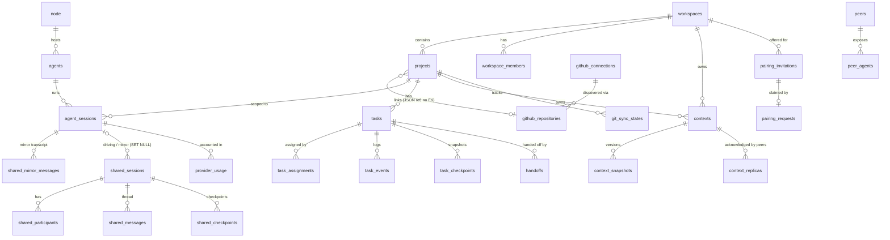

# CL Agent Mesh — Database Schema

Every node owns one SQLite database (`<dataDir>/clam.db`, opened by `@clam/database`: WAL, `foreign_keys=ON`, `busy_timeout`, `synchronous=NORMAL`, SQLite ≥ 3.53 with FTS5). ORM: Drizzle (`drizzle-orm/better-sqlite3`). **No node reads another node's database**; data crosses nodes only as signed `/api/v1` messages and Git content ([agent-network-protocol.md](./agent-network-protocol.md)).

Conventions:

* SQL names are `snake_case`; Drizzle properties are `camelCase`.
* Primary keys are `text` ids (ULID-style, sortable) unless noted; GitHub numeric ids are stored as text.
* Timestamps are ISO-8601 UTC `text` (`2026-10-31T05:52:42.212Z`). Booleans are `integer` 0/1. JSON columns are `text` holding validated JSON (validated with the Zod schemas in `@clam/contracts` on read/write).
* Money is USD `real`; token counts are `integer`.
* Foreign keys state their `ON DELETE` policy explicitly. Secrets are **never** stored in this database — only `credential_ref` keys that point into the `@clam/secret-store`.
* "Scope" column below: **M1** = created by the M1 migration; **Mn** = created by the migration of that milestone.

Ownership of data (spec): the node DB holds execution state; the control plane holds registry/coordination metadata (its own store, not specified here); GitHub holds shared project data.

---

## 1. Entity overview



---

## 2. Tables in M1

Migrations `0000_init.sql` and `0001_usage_buckets.sql` (drizzle-kit generated, committed under `packages/database/migrations/`) create the tables below. `packages/database/src/schema.ts` is the source of truth; this section mirrors it. Timestamp columns default to `strftime('%Y-%m-%dT%H:%M:%fZ','now')`; JSON columns are `text`. The three **shared-contract** tables (`settings`, `github_connections`, `github_repositories`) are depended on by `@clam/github-integration` and the GitHub routes.

### 2.1 `node`

Single-row table describing this node (spec: `node(id, name, public_url, status)`, plus identity fields from `NodeInfo`).

| Column | Type | Constraints |
| --- | --- | --- |
| `id` | text | **PK** |
| `name` | text | NOT NULL |
| `public_key` | text | NOT NULL — Ed25519 public key (base64url) |
| `fingerprint` | text | NOT NULL — SHA-256 of the public key, hex |
| `public_url` | text | NULL — mirrors the public URL of the running Cloudflare Tunnel (M3); NULL while no tunnel runs |
| `status` | text | NOT NULL, default `'online'` |
| `created_at`, `updated_at` | text | NOT NULL |

The private key is never here: it is the `0600` PEM `<dataDir>/identity/ed25519.key` (see [agent-network-protocol.md §2](./agent-network-protocol.md#2-node-identity)).

### 2.2 `settings` (shared contract)

| Column | Type | Constraints |
| --- | --- | --- |
| `key` | text | **PK** |
| `value` | text | NOT NULL — JSON |
| `updated_at` | text | NOT NULL |

Well-known keys: `github.clientId` (JSON string — OAuth App client id for device flow), `node.settings` (`NodeSettings`: `nodeName`, `runtimeIdleTimeoutMin`, `maxConcurrentRuntimes`, `approvalMode`, `autoStart`), `network.tunnel` (M3: `{ mode, hostname, autoStart }`; the token is in the secret store).

### 2.3 `workspaces`

| Column | Type | Constraints |
| --- | --- | --- |
| `id` | text | **PK** |
| `name` | text | NOT NULL |
| `description` | text | NOT NULL, default `''` |
| `owner_id` | text | NOT NULL, FK → `node(id)` (no action) — maps to contract `ownerNodeId` |
| `created_at`, `updated_at` | text | NOT NULL |

### 2.4 `workspace_members`

Created in M1 (membership of the local owner); remote members arrive with pairing in M3 (migration `0003_network` adds `permissions`, `granted_by`, `revoked_at`).

| Column | Type | Constraints |
| --- | --- | --- |
| `workspace_id` | text | NOT NULL, FK → `workspaces(id)` **ON DELETE CASCADE** |
| `member_id` | text | NOT NULL |
| `role` | text | NOT NULL |
| `created_at` | text | NOT NULL |
| `permissions` | text | NOT NULL, default `'[]'` — JSON `Capability[]` this node granted the member (M3) |
| `granted_by` | text | NULL — node id that granted the membership (M3) |
| `revoked_at` | text | NULL — set (and `permissions` emptied) when the peer is revoked (M3) |

PK `(workspace_id, member_id)`. `member_id` is the node id of the owner or of a paired peer; roles used so far: `owner` (this node on its own workspaces; the inviter on a workspace the joiner received through pairing) and `member` (a paired joiner).

### 2.5 `projects`

| Column | Type | Constraints |
| --- | --- | --- |
| `id` | text | **PK** |
| `workspace_id` | text | NOT NULL, FK → `workspaces(id)` **ON DELETE CASCADE** |
| `name` | text | NOT NULL |
| `path` | text | NOT NULL — absolute local working directory |
| `repository_id` | text | NULL — GitHub repo id (spec `repository_id`); deliberately **not** an FK so a project keeps its link when the cached repo row is evicted |
| `repository` | text | NULL — JSON `RepositoryRef` (owner, name, externalId, htmlUrl, defaultBranch, accountId) |
| `managed` | integer (boolean) | NOT NULL DEFAULT 0 — CL Agent Mesh created the folder under `<dataDir>/projects/<id>` (the user gave no path); only such a folder is ever deleted with the project, and only on request (`DELETE …?deleteFiles=true`) — *0006* |
| `created_at`, `updated_at` | text | NOT NULL |

Index `projects_workspace_idx(workspace_id)`. **`Project.vcs` (`git`/`none`) is not stored:** it is derived live from the folder (a `.git` entry at its root), so `git init` or removing the repository is reflected immediately.

### 2.6 `agents`

| Column | Type | Constraints |
| --- | --- | --- |
| `id` | text | **PK** |
| `node_id` | text | NOT NULL, FK → `node(id)` (no action) |
| `name` | text | NOT NULL |
| `role` | text | NOT NULL, default `''` — free text, never interpreted by orchestration |
| `runtime` | text | NOT NULL — `omp` in M1 (validated by the contracts, not a SQL CHECK, so a new runtime needs no table rebuild) |
| `capabilities` | text | NOT NULL, default `'[]'` — JSON string array |
| `created_at`, `updated_at` | text | NOT NULL |

`Agent.status` and `activeSessions` are derived at read time from live runtime state and `agent_sessions`.

### 2.7 `agent_sessions`

One CL Agent Mesh session = one conversation backed by one OMP session directory.

| Column | Type | Constraints |
| --- | --- | --- |
| `id` | text | **PK** |
| `agent_id` | text | NOT NULL, FK → `agents(id)` (no action) |
| `project_id` | text | NOT NULL, FK → `projects(id)` **ON DELETE CASCADE** |
| `title` | text | NOT NULL |
| `session_dir` | text | NOT NULL — `<dataDir>/sessions/<id>`, the `open_session` target |
| `runtime_session_id` | text | NULL — OMP `sessionId` once opened |
| `runtime_session_file` | text | NULL — OMP `sessionFile` |
| `model` | text | NULL — `provider/id` |
| `thinking_level` | text | NULL |
| `status` | text | NOT NULL, default `'stopped'` — `idle` \| `running` \| `error` \| `stopped` |
| `archived` | integer (bool) | NOT NULL, default false |
| `stats` | text | NULL — JSON `SessionStats` snapshot |
| `kind` | text | NOT NULL, default `'local'` — `local` \| `mirror` (M5, `0005_shared`: a mirror is a read-only live copy of a session that runs on another node) |
| `shared_session_id` | text | NULL — the shared session this session belongs to (M5) |
| `moved_to` | text (JSON) | NULL — `{nodeId, nodeName, url, sessionId, at}` once the work moved to another node; the session is then read-only (M5) |
| `created_at`, `updated_at` | text | NOT NULL |

Indexes `agent_sessions_project_idx(project_id)`, `agent_sessions_agent_idx(agent_id)`. Message content is **not** duplicated: the transcript is held in memory per active runtime and reloaded from RPC `get_messages_page` on (re)start; OMP's session JSONL is the durable store.

### 2.8 `provider_usage`

Per-model usage rows recorded by CL Agent Mesh from the sessions it runs. Rows come from assistant `message_end` usage (one per model) plus a *residual* row that reconciles the session total against RPC `get_session_stats` after every `session_settled`. Source is OMP's own accounting, so `source` defaults to `omp-recorded`.

| Column | Type | Constraints |
| --- | --- | --- |
| `id` | integer | **PK AUTOINCREMENT** |
| `session_id` | text | NULL, FK → `agent_sessions(id)` **ON DELETE SET NULL** |
| `project_id` | text | NULL, FK → `projects(id)` **ON DELETE SET NULL** |
| `agent_id` | text | NULL, FK → `agents(id)` **ON DELETE SET NULL** |
| `provider`, `model` | text | NOT NULL |
| `input_tokens`, `output_tokens`, `cache_read_tokens`, `cache_write_tokens` | integer | NOT NULL, default 0 |
| `cost` | real | NOT NULL, default 0 (USD) |
| `source` | text | NOT NULL, default `'omp-recorded'` (`DataSource`) |
| `recorded_at` | text | NOT NULL |

All three FKs are `SET NULL` so cost history survives deleting a session, project or agent. Indexes on `session_id`, `project_id`, `agent_id`, `recorded_at`. Backs `GET /usage/mesh` (cost by project/agent).

### 2.9 `usage_buckets`

Hourly aggregate of `omp stats --json` written by `@clam/provider-usage`, so OMP-recorded history accumulates beyond the 24 h window `omp stats` reports.

| Column | Type | Constraints |
| --- | --- | --- |
| `bucket_start` | integer | **PK** — epoch ms, UTC hour start |
| `requests`, `failed_requests`, `tokens_total` | integer | NOT NULL |
| `cost` | real | NOT NULL |
| `updated_at` | text | NOT NULL |

Only totals exist because `omp stats` provides no per-bucket input/output split; no zeros are fabricated.

### 2.10 `github_connections` (shared contract)

One row per GitHub account connected on **this node**.

| Column | Type | Constraints |
| --- | --- | --- |
| `id` | text | **PK** |
| `login` | text | NOT NULL, **UNIQUE** (`github_connections_login_unique`) |
| `name`, `email`, `avatar_url` | text | NULL |
| `scopes` | text | NOT NULL, default `'[]'` — JSON array |
| `source` | text | NOT NULL — `oauth-device` \| `gh-cli` |
| `is_default` | integer (bool) | NOT NULL, default false — single default enforced in the service layer inside a transaction |
| `status` | text | NOT NULL, default `'unknown'` — `connected` \| `invalid` \| `unknown` |
| `credential_ref` | text | NOT NULL — secret-store key; **never the token** |
| `last_verified_at` | text | NULL |
| `created_at` | text | NOT NULL |

### 2.11 `github_repositories` (shared contract)

Cache of repositories seen through an account (rebuildable from GitHub).

| Column | Type | Constraints |
| --- | --- | --- |
| `id` | text | **PK** — GitHub numeric repo id |
| `owner`, `name`, `html_url` | text | NOT NULL |
| `default_branch` | text | NULL |
| `account_id` | text | NULL, FK → `github_connections(id)` **ON DELETE SET NULL** |
| `updated_at` | text | NOT NULL |

Index `github_repositories_account_idx(account_id)`.

### 2.12 `node_events`

Append-only local audit/event log (runtime crashes, login events, settings changes…). Not synchronized to peers.

| Column | Type | Constraints |
| --- | --- | --- |
| `id` | integer | **PK AUTOINCREMENT** |
| `node_id` | text | NOT NULL, FK → `node(id)` (no action) |
| `type` | text | NOT NULL |
| `level` | text | NOT NULL, default `'info'` |
| `payload` | text | NULL — JSON |
| `created_at` | text | NOT NULL |

Indexes on `created_at` and `type`.

> **Authoritative definition:** `packages/database/src/schema.ts` and `packages/database/migrations/*.sql` win over this document; fix the document in the same change when they diverge.

`git_sync_states` (M2), the network tables (M3, §3.1), the task tables (M4, §3.2), the context tables with FTS5 (M6, §3.3) and the handoff tables (M7, §3.4) are implemented too.

---

## 3. Tables of milestones M3–M7

### 3.1 Peers, pairing and the network event log — M3 (migration `0003_network`, implemented)

`packages/database/src/schema.ts` is authoritative; this mirrors it. JSON columns are validated by the server with the contracts' Zod schemas. Timestamps default to `strftime('%Y-%m-%dT%H:%M:%fZ','now')`.

```
-- workspace_members: + permissions text NOT NULL DEFAULT '[]', granted_by text, revoked_at text   (see §2.4)

peers(                                    -- pinned identity, liveness and grants of every paired node
  id text PK,                             -- the peer's node id
  name text NOT NULL, fingerprint text NOT NULL,
  public_key text NOT NULL,               -- pinned raw Ed25519 key, base64 (a different key for this node id is a hard failure)
  key_id text NOT NULL,                   -- first 16 hex of the fingerprint (X-Clam-Key-Id)
  url text NOT NULL,                      -- https base URL of its network listener (announce updates it)
  status text NOT NULL DEFAULT 'offline', -- online | degraded | offline | revoked
  granted_capabilities text NOT NULL DEFAULT '[]',   -- JSON: what WE let the peer do (enforced); emptied on revoke
  received_capabilities text NOT NULL DEFAULT '[]',  -- JSON: what the peer lets US do (informational)
  protocol_version integer NOT NULL DEFAULT 1,
  latency_ms integer, last_seen_at text, last_error text,
  last_event_cursor text,                 -- resume cursor for the peer's GET /events
  paired_at text NOT NULL, revoked_at text,
  revoked_by text,                        -- local | remote
  updated_at text NOT NULL)
  INDEX peers_status_idx(status)

peer_agents(                              -- directory cache of a peer's agents (GET /agents); kept while the peer is offline
  peer_id text NOT NULL REFERENCES peers(id) ON DELETE CASCADE, agent_id text NOT NULL,
  name text NOT NULL, role text NOT NULL DEFAULT '', runtime text NOT NULL,
  capabilities text NOT NULL DEFAULT '[]', status text NOT NULL DEFAULT 'offline',   -- online | busy | offline
  active_sessions integer NOT NULL DEFAULT 0, fetched_at text NOT NULL,
  PRIMARY KEY (peer_id, agent_id))

pairing_invitations(                      -- inviter side; the code is never stored
  id text PK,                             -- derived from the code (invitationIdFromCode)
  workspace_id text NOT NULL REFERENCES workspaces(id) ON DELETE CASCADE,
  code_hash text NOT NULL,                -- domain-separated SHA-256 of the code, bound to the id
  capabilities text NOT NULL,             -- JSON: what the inviter offers; the user may narrow it at approval
  state text NOT NULL DEFAULT 'pending',  -- pending | consumed | revoked | locked   (`expired` is derived from expires_at)
  attempts integer NOT NULL DEFAULT 0, max_attempts integer NOT NULL DEFAULT 5,
  expires_at text NOT NULL, created_at text NOT NULL, consumed_at text, consumed_by text)
  INDEX pairing_invitations_state_idx(state)

pairing_requests(                         -- inviter side: a joiner that proved possession of the code
  id text PK, invitation_id text NOT NULL REFERENCES pairing_invitations(id) ON DELETE CASCADE,  -- UNIQUE: one joiner per invitation
  workspace_id text NOT NULL,
  remote_node_id, remote_name, remote_public_key, remote_fingerprint, remote_url text NOT NULL,
  nonce_inviter text NOT NULL, nonce_joiner text NOT NULL,
  hello_response text NOT NULL,           -- JSON reply, replayed verbatim for a retried hello
  capabilities text,                      -- JSON, set at approval
  state text NOT NULL DEFAULT 'awaiting_approval',   -- awaiting_approval | confirming | paired | rejected | expired | failed
  error text, correlation_id text NOT NULL, requested_at text NOT NULL, updated_at text NOT NULL)

pairing_joins(                            -- joiner side: resumable outgoing handshake
  id text PK, url text NOT NULL, invitation_id text NOT NULL,
  remote_node_id, remote_name, remote_public_key, remote_fingerprint text NOT NULL,
  remote_preview text NOT NULL,           -- JSON NodePreview
  nonce_joiner text NOT NULL, nonce_inviter text,
  workspace_id text, workspace_name text,
  granted_capabilities text NOT NULL,     -- JSON: what WE grant the inviter
  received_capabilities text,             -- JSON: what the inviter granted us (set at confirm)
  state text NOT NULL DEFAULT 'hello_sent',   -- hello_sent | awaiting_remote_approval | paired | rejected | expired | failed
  error text, correlation_id text NOT NULL, expires_at text NOT NULL, created_at text NOT NULL, updated_at text NOT NULL)

nonce_log(                                -- replay protection for signed requests
  peer_id text NOT NULL, nonce text NOT NULL,
  expires_at integer NOT NULL,            -- epoch ms: now + 2 × allowed skew
  PRIMARY KEY (peer_id, nonce))
  INDEX nonce_log_expires_idx(expires_at) -- pruned every minute; memory-first, warmed from here at boot

network_events(                           -- log behind GET /api/v1/events
  stream text NOT NULL, seq integer NOT NULL,   -- gap-free per stream; M3 has the single stream "node"
  type text NOT NULL, payload text NOT NULL,    -- JSON
  audience text,                          -- node id: only that peer sees the payload (others get {})
  created_at text NOT NULL,
  PRIMARY KEY (stream, seq))              -- pruned beyond 10 000 events AND 7 days, always keeping the newest rows
```

No secret is stored in any of these tables: the HKDF-derived invitation code key lives in the secret store (`pairing.codekey.<invitationId>`) until the hello is verified, and the named-tunnel token is `tunnel.token` there. Tunnel configuration is the `settings` key `network.tunnel` (JSON `{ mode: "off" | "quick" | "named", hostname, autoStart }`); the last public URL is mirrored in `node.public_url` (a `tunnel_hostname` column was not needed).

### 3.2 Tasks — M4 (migration `0004_tasks`, implemented)

Both nodes keep a `tasks` row with the **same id** (`tsk_<ULID>`, chosen by the sender): the **executor's** row is the source of truth for status, events and result, the **sender's** row mirrors it. `direction` says which side this node is; `peer_id` is the other node. `peer_id`, `workspace_id` and `retry_of` are deliberately **not** foreign keys (task history must survive re-pairing and workspace edits); `project_id` is `ON DELETE SET NULL`.

```
tasks(
  id text PK,                            -- tsk_<ULID>; also the idempotency natural key of POST /tasks
  direction text NOT NULL,               -- outgoing (this node is the SENDER) | incoming (this node is the EXECUTOR)
  peer_id text NOT NULL, workspace_id text NOT NULL,
  project_id text REFERENCES projects(id) ON DELETE SET NULL,   -- sender: origin project; executor: execution project (null until accepted)
  title text NOT NULL, description text NOT NULL DEFAULT '',
  status text NOT NULL DEFAULT 'offered',   -- offered | accepted | rejected | running | blocked | succeeded | failed | cancelled | handed_off
  epoch integer NOT NULL DEFAULT 0,         -- ownership epoch / fencing token (protocol §9; handoff increments it in M7)
  repo_url text NOT NULL, repo_branch text, repo_commit text,    -- canonical https://github.com/<owner>/<name>, base branch
  deliver_as text NOT NULL DEFAULT 'branch',                      -- summary | branch
  constraints json NOT NULL DEFAULT '{}',                         -- { maxCostUsd?, deadline?, approvalMode? }
  sender_node_id, sender_node_name, sender_agent_id, sender_agent_name, sender_session_id,       -- session = delegating agent session on the sender (null for UI-created tasks)
  executor_node_id, executor_node_name, executor_agent_id, executor_agent_name, executor_session_id,  -- session = executing session on the executor
  reason text, result json, cost real,                            -- result = contracts TaskResult
  retry_of text, correlation_id text NOT NULL,
  last_event_seq integer NOT NULL DEFAULT 0,                      -- executor: allocated; sender: highest mirrored seq
  exec_state json NOT NULL DEFAULT '{}',                          -- executor-private run state (branch names, completion bookkeeping); never leaves the node
  notified_status text,                                           -- sender: terminal status already injected into the delegating session
  created_at, updated_at, started_at, finished_at)
  INDEX(direction, status); INDEX(peer_id); INDEX(project_id, status); INDEX(executor_session_id); INDEX(sender_session_id)

task_events(                              -- append-only timeline; the EXECUTOR allocates seq, the sender stores the same seq
  task_id text NOT NULL REFERENCES tasks(id) ON DELETE CASCADE, seq integer NOT NULL,
  type text NOT NULL,                     -- status | progress | tool | message | result | note
  summary text NOT NULL, payload json, created_at text NOT NULL,
  PRIMARY KEY(task_id, seq))

task_messages(                            -- the discussion thread; id = sender-chosen message id, the same on both nodes
  id text PK, task_id text NOT NULL REFERENCES tasks(id) ON DELETE CASCADE,
  author_kind text NOT NULL,              -- human | agent | system
  author_node_id, author_node_name, author_agent_id, author_agent_name,
  kind text NOT NULL,                     -- instruction | question | answer | note
  text text NOT NULL, created_at text NOT NULL,
  delivery text NOT NULL DEFAULT 'local', -- local (authored on the other node) | pending | delivered | failed
  injected_session_id text,               -- local session the message was injected into
  read_at text, received_at text NOT NULL)
  INDEX(task_id, created_at)

outbox(                                   -- durable at-least-once delivery of mutating peer calls
  id text PK, peer_id text NOT NULL REFERENCES peers(id) ON DELETE CASCADE, task_id text,
  kind text NOT NULL,                     -- task.create | task.message | task.cancel | (M5) shared.invite | shared.decision | shared.message | shared.checkpoint | shared.snapshot_ack | shared.driver | shared.membership
  ref_id text,                            -- task_messages.id for task.message
  method text NOT NULL, path text NOT NULL, body json NOT NULL,
  idempotency_key text NOT NULL, correlation_id text NOT NULL,
  attempts integer NOT NULL DEFAULT 0, next_attempt_at text NOT NULL,
  state text NOT NULL DEFAULT 'pending',  -- pending | sent | dead | cancelled
  last_error text, last_status integer, created_at text NOT NULL, sent_at text)
  UNIQUE(peer_id, idempotency_key); INDEX(state, next_attempt_at); INDEX(task_id)

idempotency_records(                      -- receiver-side response store (protocol §6), kept 24 h
  peer_id text NOT NULL, key text NOT NULL, method text NOT NULL, path text NOT NULL,
  request_hash text NOT NULL, status integer NOT NULL, response_body text NOT NULL,
  created_at text NOT NULL, expires_at integer NOT NULL,
  PRIMARY KEY(peer_id, key)); INDEX(expires_at)

artifacts(                                -- executor side; files under <dataDir>/artifacts/<taskId>/<artifactId>
  id text PK, task_id text NOT NULL REFERENCES tasks(id) ON DELETE CASCADE,
  name text NOT NULL, media_type text NOT NULL, size integer NOT NULL, sha256 text NOT NULL,
  storage_path text NOT NULL, created_at text NOT NULL)

peers: + auto_accept_tasks integer NOT NULL DEFAULT 0     -- receiver policy: run this peer's tasks without a human accepting them
```

Deviations from the original plan: `task_assignments` is not a table — the executor's agent and project are columns of `tasks` (`executor_agent_id`, `project_id`) and nothing in M4 needs assignment history; it arrives with M7 together with `owner_epoch` handling for handoffs. `task_checkpoints` also arrives with M7 (nothing writes checkpoints before handoff exists). The outbox is keyed to the **peer** (cascade when a revoked peer is forgotten at re-pairing: nothing can be delivered to a node that is no longer paired), tasks are not.

### 3.2a Shared sessions — M5 (migration `0005_shared`, implemented)

Behaviour: [shared-sessions.md](./shared-sessions.md). Every table is **node-private**: each participating node has its own rows (the shared id `shs_<ULID>` and the invitation id `shi_<ULID>` are the only values both nodes know). The migration is additive (new tables plus three columns with defaults on `agent_sessions`).

```
shared_sessions(                          -- this node's view of one shared session
  id text PK,                             -- shs_<ULID>, chosen by the driver that created it
  workspace_id text NOT NULL, title text NOT NULL, goal text NOT NULL DEFAULT '',
  repo_url text NOT NULL, branch text NOT NULL,          -- shared branch clam/shared/<slug>-<6>
  base_branch text, base_commit text,
  epoch integer NOT NULL DEFAULT 1,                      -- fencing token, +1 per driver change
  driver_node_id text NOT NULL, driver_node_name text NOT NULL,
  local_role text NOT NULL,               -- driver | participant | former_driver
  state text NOT NULL DEFAULT 'active',   -- active | left
  local_session_id text REFERENCES agent_sessions(id) ON DELETE SET NULL,   -- driving session (or the moved copy)
  mirror_session_id text REFERENCES agent_sessions(id) ON DELETE SET NULL,  -- read-only mirror of the driver
  local_project_id text REFERENCES projects(id) ON DELETE SET NULL,         -- this node's clone
  agent_message_limit integer NOT NULL DEFAULT 12,       -- loop guard
  rescue_branch text,                     -- clam/rescue/<id>-<node> once work was rescued
  last_checkpoint_seq integer NOT NULL DEFAULT 0,
  meta json NOT NULL DEFAULT '{}',        -- node-private bookkeeping: pendingFormerDriver journal, transfer (the hand-over record), lastCheckpointCommit, turnsSinceCheckpoint
  created_at text NOT NULL, updated_at text NOT NULL)
  INDEX(local_session_id); INDEX(mirror_session_id); INDEX(state)

shared_participants(                      -- everybody, this node included
  shared_session_id text NOT NULL REFERENCES shared_sessions(id) ON DELETE CASCADE,
  node_id text NOT NULL,                  -- deliberately NOT a foreign key to peers: history survives re-pairing
  node_name text NOT NULL, agent_id text, agent_name text,
  role text NOT NULL,                     -- driver | participant
  state text NOT NULL,                    -- invited | active | declined | left | removed
  agent_session_id text,                  -- participant: its briefed agent session; driver: the driving session
  ui_url text,                            -- that node's UI base URL (remote access) for "watch there" links
  snapshot_seq integer NOT NULL DEFAULT 0,-- driver side: newest snapshot this participant acknowledged
  briefed integer NOT NULL DEFAULT 0, joined_at text, created_at text NOT NULL, updated_at text NOT NULL,
  PRIMARY KEY (shared_session_id, node_id))

shared_invites(                           -- invitations RECEIVED by this node
  id text PK,                             -- shi_<ULID>, chosen by the inviting driver (natural idempotency key)
  shared_session_id text NOT NULL, from_node_id text NOT NULL, from_node_name text NOT NULL,
  from_agent_id text, from_agent_name text,               -- the driving agent: the invited node needs its id to address it in the group chat
  title text NOT NULL, goal text NOT NULL DEFAULT '', repo_url text NOT NULL, repo_branch text NOT NULL,
  workspace_id text NOT NULL, agent_id text,             -- the agent the driver asked for (optional)
  epoch integer NOT NULL, driver_ui_url text,
  model text,                             -- the driving session's provider/id; the joining agent session starts with it when available
  state text NOT NULL DEFAULT 'pending',  -- pending | accepted | declined
  created_at text NOT NULL, decided_at text)
  INDEX(state); INDEX(shared_session_id)

shared_messages(                          -- the group log of a shared session: a replica on every member node, append-only
  id text PK,                             -- shm_<ULID>, chosen by the origin; natural idempotency key of POST /shared/:id/messages
  shared_session_id text NOT NULL REFERENCES shared_sessions(id) ON DELETE CASCADE,
  author_kind text NOT NULL,              -- human | agent | system
  author_node_id text NOT NULL,           -- the ORIGIN: the node that accepted the message first (author = origin, always)
  author_node_name text NOT NULL, author_agent_id text, author_agent_name text,
  kind text NOT NULL,                     -- chat | reply | system | instruction | question | answer | note
  to json NOT NULL DEFAULT '{"mode":"lead","agents":[]}',  -- {mode: all|lead|agents, agents: [{nodeId, agentId}]}: who it is for (resolved by the origin; `lead` by each receiver)
  text text NOT NULL, epoch integer NOT NULL DEFAULT 1,    -- epoch: informational, chat is never fenced
  created_at text NOT NULL,
  hlc text NOT NULL,                      -- hybrid logical clock '<15 digits ms>-<5 digits counter>' (compares as a string); the log order is (hlc, author_node_id, id)
  origin_seq integer,                     -- per-origin sequence 1, 2, 3 … assigned by the origin in the transaction that inserts it; NULL = a note of THIS node only (never replicated, never in a cursor)
  delivery text NOT NULL DEFAULT 'local', -- local (received, or local-only note) | pending | delivered | failed (own messages)
  injected_session_id text,               -- NULL = not yet handed to the local agent; a session id = handed over (as a prompt or inside a "since your last turn" block); 'history' / 'self' / 'system' = deliberately never
  read_at text, received_at text NOT NULL)
  INDEX(shared_session_id, hlc); UNIQUE(shared_session_id, author_node_id, origin_seq)
  -- catch-up cursor = per origin the highest N with origin_seq 1..N present: derived from this table (shared-sessions.md §4.3), so there is no separate cursor state
  -- the node's clock state after a restart = max(hlc) over the table

shared_checkpoints(                       -- driver: taken; participants: received notices (+ the snapshot when held)
  shared_session_id text NOT NULL REFERENCES shared_sessions(id) ON DELETE CASCADE,
  seq integer NOT NULL, epoch integer NOT NULL, node_id text NOT NULL,   -- node_id = the driver that took it
  branch text NOT NULL, "commit" text, pushed integer NOT NULL DEFAULT 0,
  snapshot_sha256 text, snapshot_size integer, snapshot_messages integer,
  snapshot_path text,                     -- relative to <dataDir>/shared; NULL = not held (pending download, or pruned)
  model text, delivered_to json NOT NULL DEFAULT '[]',   -- driver: node ids that acknowledged the snapshot
  note text, created_at text NOT NULL,
  PRIMARY KEY (shared_session_id, seq))

shared_mirror_messages(                   -- participant: the persisted transcript of a mirror session
  mirror_session_id text NOT NULL REFERENCES agent_sessions(id) ON DELETE CASCADE,
  message_id text NOT NULL, position integer NOT NULL, message json-as-text NOT NULL, updated_at text NOT NULL,
  PRIMARY KEY (mirror_session_id, message_id))
  INDEX(mirror_session_id, position)

shared_mirror_state(                      -- participant: where the mirror stream stands
  mirror_session_id text PK REFERENCES agent_sessions(id) ON DELETE CASCADE,
  shared_session_id text NOT NULL, epoch integer NOT NULL,
  stream_id text, last_seq integer NOT NULL DEFAULT 0,   -- (stream_id, last_seq) = idempotency of mirror frames
  syncing integer NOT NULL DEFAULT 0, state text, updated_at text NOT NULL)
```

* **`agent_sessions` gains three columns** (§2.7): `kind` text NOT NULL DEFAULT `'local'` (`local` | `mirror`), `shared_session_id` text NULL, `moved_to` text NULL (JSON `{nodeId, nodeName, url, sessionId, at}`: set on the former driver's copy, which then refuses prompts with `session_moved`). They are plain columns without foreign keys (the link is `shared_sessions.*_session_id`).
* **Deleting a project or session** never cascades into a shared session: `local_session_id`, `mirror_session_id` and `local_project_id` become NULL (`ON DELETE SET NULL`); the application refuses to delete a session that is part of an *active* shared session (`409 shared_session_active`). Deleting a shared session row (not exposed today) cascades to participants, messages and checkpoints; mirror tables cascade with their mirror session.
* **Outbox (M4) reuse**: no new outbox table. Shared kinds `shared.invite | decision | message | checkpoint | snapshot_ack | driver | membership` are rows of `outbox`; `task_id` carries the ordering key `<sharedId>:<peerId>` and `ref_id` the entity (invite id, message id, `<sharedId>:<seq>`).
* **Files** are not in the database: snapshots live at `<dataDir>/shared/<shared id>/snapshots/<seq>.tar` (0600, directories 0700), referenced by `shared_checkpoints.snapshot_path`.

### 3.2b Work without git — migration `0006_nogit` (implemented)

SQLite cannot relax a `NOT NULL`, so the migration rebuilds the four tables whose repository columns become nullable (see §5 for how the runner keeps child rows). Every existing row keeps its values (`vcs` defaults to `git`, the new JSON columns to NULL).

| Table | Change |
| --- | --- |
| `projects` | `managed` boolean (§2.5). `vcs` is **derived**, not stored. |
| `tasks` | `repo_url` is now NULL-able: a task without a git repository (`deliver_as` `summary` without a linked repo, or `files`) has no repo columns. `deliver_as` also takes `files`. New `input_files` (JSON `{artifactId, sha256, size, fileCount}`, NULL = none): on the **sender** the bundle is stored as one of the task's `artifacts` rows (`input-files.tar.gz`); on the **executor** it is the announcement the sender made, and the downloaded copy is an `artifacts` row under the same id. The result bundle of a `files` task is `result.files` inside the existing `result` JSON (an `artifacts` row on the executor, cached on the sender under the executor's artifact id). The executor-private base manifest lives in `<dataDir>/artifacts/<taskId>/.base-manifest.json`, not in the database. |
| `shared_sessions` | `vcs` (`git` default / `files`); `repo_url`, `branch` NULL-able (files mode has neither); `rescue_files` JSON `{path, sha256, size, fileCount, paths[≤200], epoch, at}` — the former driver's work after its last checkpoint (or the local versions a forced takeover replaced), bundled; the file is under `<dataDir>/shared/<id>/rescue/`; `meta.appliedFilesSeq` records the checkpoint whose bundle this node last made or applied. |
| `shared_invites` | `vcs`; `repo_url`, `repo_branch` NULL-able. |
| `shared_checkpoints` | `branch` NULL-able; `files` JSON `{sha256, size, fileCount}` (metadata on every node), `files_path` (relative to `<dataDir>/shared`, 0600; NULL = this node does not hold the bundle). Files mode: `commit` NULL and `pushed` false. |

Files outside the database: folder bundles `<dataDir>/shared/<id>/files/<seq>.tar.gz`, `synced-manifest.json` (the manifest of the folder as this node last made or applied a checkpoint bundle — the base that separates local edits from shared changes) and `rescue/<epoch>-<label>.tar.gz`.

### 3.3 Context and Git sync — M2 / M6

```
git_sync_states(                                   -- M2 (migration 0002_git, implemented)
  project_id text NOT NULL REFERENCES projects(id) ON DELETE CASCADE,
  branch text NOT NULL,
  commit_sha text NOT NULL,                        -- local HEAD of the branch
  remote_sha text,                                 -- upstream tip as last fetched; NULL without an upstream
  ahead integer, behind integer,                   -- vs upstream; NULL without an upstream
  dirty integer NOT NULL DEFAULT 0,                -- 1 when the working tree has changes
  last_fetched_at text, last_pushed_at text, last_pulled_at text,
  updated_at text NOT NULL DEFAULT (now),
  PRIMARY KEY (project_id, branch))
```

`git_sync_states` is a **cache of observed Git state**, never the source of truth. The server upserts the row of the project's *current branch* whenever it reads status or finishes a fetch / pull / push (`apps/server/src/services/git-service.ts`): `last_fetched_at` comes from `FETCH_HEAD`'s mtime, `last_pushed_at` / `last_pulled_at` are set only by a successful push / fast-forward pull. Rows disappear with their project (`ON DELETE CASCADE`). Per-project commit-identity overrides are stored in `settings` under `git.identity.<projectId>`, and the numeric GitHub user id (needed for the `<id>+<login>@users.noreply.github.com` address) under `github.userId.<connectionId>`.

#### Context — migration `0007_context` (M6, implemented)

```
contexts(                                          -- the HEAD of every context (title/body denormalised for FTS5)
  seq integer PRIMARY KEY AUTOINCREMENT,           -- the FTS5 rowid; an explicit INTEGER PRIMARY KEY because a plain rowid may change on VACUUM
  id text NOT NULL UNIQUE,                         -- ctx_<16 hex>
  workspace_id text NOT NULL REFERENCES workspaces(id) ON DELETE CASCADE,
  project_id text REFERENCES projects(id) ON DELETE CASCADE,   -- local project; NULL = workspace-wide, or a synced context whose project does not exist here (see project_key)
  project_key text,                                -- cross-node project identity: github:<owner>/<name> (linked repository, lowercase) | name:<project name> | NULL (workspace-wide)
  origin_node_id text NOT NULL,                    -- the node that created it (only it may stop sharing it)
  type text NOT NULL,                              -- memory | plan | decision | summary | note
  title text NOT NULL, body text NOT NULL,         -- head text; '' for a tombstone
  shareable integer NOT NULL DEFAULT 0,            -- only shareable contexts leave the node (peer sync, .clmesh/)
  deleted_at text,                                 -- tombstone of a deleted shareable context (hidden everywhere; kept so the deletion replicates)
  version integer NOT NULL, sha256 text NOT NULL,  -- the head version
  author text NOT NULL,                            -- JSON ContextAuthor of the head
  conflict text,                                   -- JSON: the competing version of another node while in conflict
  git_path text,                                   -- path under .clmesh/ of the last export/import
  created_at text NOT NULL, updated_at text NOT NULL)
  INDEX(workspace_id, project_id, type), INDEX(workspace_id, project_key), INDEX(workspace_id, shareable)

context_snapshots(                                 -- every immutable version (own, received from peers, competing versions of a conflict)
  id text PK, context_id text NOT NULL REFERENCES contexts(id) ON DELETE CASCADE,
  version integer NOT NULL, sha256 text NOT NULL,  -- (version, sha256) IS the version: the same text written as the same number is the same version
  title text NOT NULL, body text NOT NULL, deleted integer NOT NULL DEFAULT 0,   -- deleted = tombstone version
  base text,                                       -- JSON {version, sha256}: the version this was edited from (NULL for version 1)
  merged text NOT NULL DEFAULT '[]',               -- JSON [{version, sha256}]: versions this one resolves (conflict resolution)
  ancestors text NOT NULL DEFAULT '[]',            -- JSON ["<version>:<sha256>", …] nearest first, at most 256: decides fast-forward vs conflict without the history
  author text NOT NULL, origin_node_id text NOT NULL, git_path text, created_at text NOT NULL,
  UNIQUE(context_id, version, sha256), INDEX(context_id, sha256))

context_replicas(                                  -- the head a peer node last acknowledged for a context
  context_id text NOT NULL REFERENCES contexts(id) ON DELETE CASCADE,
  peer_id text NOT NULL REFERENCES peers(id) ON DELETE CASCADE,
  version integer NOT NULL, sha256 text NOT NULL,
  state text NOT NULL DEFAULT 'holds',             -- holds | behind | ahead | conflict (the peer's answer relative to OUR head; reset to 'behind' whenever our head moves)
  updated_at text NOT NULL, PRIMARY KEY (context_id, peer_id), INDEX(peer_id))

context_fts  -- FTS5 external-content table over contexts.title/body (content='contexts', content_rowid='seq', unicode61 remove_diacritics 2, prefix '2 3 4'); three triggers keep it in step
```

* **`context_fts` is custom SQL**, appended to the generated `migrations/0007_context.sql`: drizzle cannot express FTS5 tables, and because the snapshot (`meta/0007_snapshot.json`) never mentions them `drizzle-kit generate` neither drops nor recreates them. The triggers index only live contexts (`WHEN … deleted_at IS NULL`); an FTS5 external-content `'delete'` must receive exactly the values that were indexed, which is why `contexts_fts_au` deletes with the OLD values and re-inserts the NEW ones only for a live row. Only the HEAD of each context is indexed (searching old versions would return stale text); the earlier plan of indexing `context_snapshots.body` was dropped. Search is bm25 with the title weighing eight times the body.
* **Versions are immutable.** An edit inserts a snapshot and moves the head columns of `contexts` in one transaction. A deleted shareable context keeps its row (`deleted_at`) and a tombstone snapshot; the text of its older snapshots is blanked (hashes stay, lineage checks still work). A private context is hard-deleted (cascade).
* **Lineage, not clocks.** `base`/`merged`/`ancestors` let a receiver tell a fast-forward (its head is in the incoming ancestry) from concurrent work without holding the history; a resolution of a conflict lists both versions it resolves, so it fast-forwards everywhere ([agent-network-protocol.md §5.9](./agent-network-protocol.md#59-post-contextsync--contextsync)).
* **Project identity.** Local project ids differ per node, so a project-level context carries `project_key`; the receiving node binds it to its own project with the same key and keeps `project_id` NULL (shown as workspace-wide) while it has none.
* `context_replicas` is a cache of what peers acknowledged (so `Context.sync.syncedTo` and the next push are cheap); losing it only costs one have-index round per peer.

### 3.4 Handoffs — M7 (implemented, migration `0009_handoff`)

Defined in `packages/database/src/schema-handoff.ts`. Each node keeps its **own side** of a handoff: one `handoffs` row per `(handoff, role)`, `role = source | target`, with its own state machine from `@clam/handoff-engine` ([handoff-protocol.md §3](./handoff-protocol.md#3-state-machines)). `kind = session` rows record an M5 shared-session hand-over/takeover so the Handoff Center shows it.

```
handoffs(
  id text PK,                         -- hnd_<ULID>, chosen by the source; the wire idempotency key of the handoff
  kind text NOT NULL,                 -- task | session
  role text NOT NULL,                 -- source | target
  state text NOT NULL,                -- engine state of THIS side (handoff-protocol.md §3)
  peer_id text NOT NULL,              -- the other node of this side (target for a source row, source for a target row)
  subject_id text NOT NULL,           -- M4 task id (kind task) / shared session id (kind session)
  title text NOT NULL, workspace_id text NOT NULL, project_id text,   -- project_id: the task's project (source) / the restored or chosen project (target)
  source_node_id/_name, source_agent_id/_name, source_session_id,
  target_node_id/_name, target_agent_id/_name, target_session_id,
  from_epoch integer NOT NULL, to_epoch integer NOT NULL,             -- to_epoch = from_epoch + 1
  vcs text NOT NULL DEFAULT 'none',   -- git | files | none: how the files travel
  include_transcript integer NOT NULL DEFAULT 0,
  manifest text, manifest_sha256 text,        -- sealed manifest as built (source) / as received (target); JSON, no secrets
  conversation_summary text, environment text, setup_fingerprint text,
  failure_code text, failure_detail text, failure_step integer,
  expires_at text, deadline_at text, ack_at text,   -- offer lifetime, restore deadline (accept → ack, extendable), durable ack time
  fencing_token text,                 -- <taskId>:<epoch>:<sig> signed by the target
  correlation_id text NOT NULL, meta text NOT NULL DEFAULT '{}',   -- meta: node-private bookkeeping (work folder, restore branch, setup report, ...)
  created_at text NOT NULL, updated_at text NOT NULL)
  UNIQUE (subject_id, to_epoch, role) WHERE state NOT IN ('prepare_failed','rejected','expired','cancelled','failed')
  INDEX(role, state); INDEX(peer_id); INDEX(subject_id)

handoff_steps(                        -- the ten target steps (§4), durable: a restart resumes at the first step that is not done
  handoff_id → handoffs ON DELETE CASCADE, n integer, name text, state text,   -- pending | running | done | failed | skipped
  detail text, at text, PRIMARY KEY (handoff_id, n))

handoff_events(                       -- the timeline of this side; seq is gap-free per handoff
  handoff_id → handoffs ON DELETE CASCADE, seq integer, at text, node_id text, state text, summary text,
  PRIMARY KEY (handoff_id, seq))

handoff_setup(                        -- commands the target wants to run (step 5)
  id text PK, handoff_id → handoffs ON DELETE CASCADE, ord integer, command text, cwd text,
  purpose text,                       -- install | setup | check
  state text,                         -- pending_approval | approved | denied | running | succeeded | failed | skipped
  exit_code integer, output_tail text, started_at text, finished_at text)

handoff_artifacts(                    -- files of a handoff held on this node (folder bundle, working-tree patch, base manifest, opt-in transcript pack)
  handoff_id → handoffs ON DELETE CASCADE, artifact_id text, name text, kind text, sha256 text, size integer, path text, created_at text,
  PRIMARY KEY (handoff_id, artifact_id))

tasks + fenced integer NOT NULL DEFAULT 0          -- this node released the task (or saw a higher epoch): its sessions are never started/resumed/prompted again
tasks + highest_seen_epoch integer NOT NULL DEFAULT 0   -- boot fence scan (§8.1)
```

Deviations from the original plan: `UNIQUE(task_id, epoch)` is a **partial** unique index on `(subject_id, to_epoch, role)` — a handoff that ended without consuming the epoch (rejected, expired, cancelled, failed, prepare_failed) frees it for the next attempt, while `reclaimed` (the tombstone epoch) keeps it. `handoff_steps` carries `n/at` instead of `step/completed_at`. `task_assignments`/`task_checkpoints` are not tables: the executor's agent and project stay columns of `tasks`, and a checkpoint is the handoff's manifest + artifacts. Ownership is `tasks.epoch` (the epoch this node owns) + `tasks.highest_seen_epoch` + `tasks.fenced` instead of an `owner_epoch` column.

### 3.5 Usage — M1 (done) → M9 (analytics)

M1 already ships `provider_usage` (per-model rows with provenance `source`) and `usage_buckets` (hourly `omp stats` aggregates) — see §2.8–2.9. `GET /api/local/usage/mesh` aggregates `provider_usage` by project and agent. M9 extends these with quota snapshots, budgets and alert state; no separate `usage_records` table is planned.

---

## 4. Full spec table index

| Spec table | Physical table | Scope |
| --- | --- | --- |
| node | `node` | M1 |
| workspaces | `workspaces` | M1 |
| workspace_members | `workspace_members` | M1 (remote members/permissions M3, implemented) |
| projects | `projects` | M1 |
| agents | `agents` | M1 |
| agent_sessions | `agent_sessions` | M1 |
| tasks | `tasks` | M4 (implemented) |
| task_assignments | columns of `tasks` (`executor_agent_id`, `project_id`) | M4 (no table; see §3.4) |
| task_events | `task_events` | M4 (implemented) |
| task_checkpoints | not a table: the handoff manifest + `handoff_artifacts` | M7 (implemented) |
| handoffs | `handoffs` (+ `handoff_steps`, `handoff_events`, `handoff_setup`, `handoff_artifacts`) | M7 (implemented, §3.4) |
| contexts | `contexts` | M6 (implemented, §3.3) |
| context_snapshots | `context_snapshots` | M6 (implemented) |
| *(added, M6)* | `context_replicas`, `context_fts` (FTS5) | M6 (implemented) |
| github_connections | `github_connections` | M1 |
| github_repositories | `github_repositories` | M1 |
| git_sync_states | `git_sync_states` | M2 |
| *(added, M5)* | `shared_sessions`, `shared_participants`, `shared_invites`, `shared_messages`, `shared_checkpoints`, `shared_mirror_messages`, `shared_mirror_state` | M5 (implemented, §3.2a) |
| provider/usage tables (spec line truncated at "provide…") | `provider_usage`, `usage_buckets` | M1 |
| *(added)* | `settings`, `node_events` (M1), `peers`, `peer_agents`, `pairing_invitations`, `pairing_requests`, `pairing_joins`, `nonce_log`, `network_events` (M3), `task_messages`, `outbox`, `idempotency_records`, `artifacts` (M4), `handoff_steps`, `handoff_events`, `handoff_setup`, `handoff_artifacts` (M7) | as listed |

---

## 5. Migration plan

**Tooling.** `drizzle-kit generate` produces SQL migrations from `schema.ts`; the generated `.sql` files and the drizzle `meta/` journal are **committed**. Hand edits are allowed only to add data backfills and must be reviewed. `drizzle-kit push` is never used.

**At boot** (`openDatabase`, implemented in `packages/database/src/open.ts`):

1. Create the parent directory, open the file, set `journal_mode=WAL`, `foreign_keys=ON`, `busy_timeout` (5 s), `synchronous=NORMAL`.
2. Decide whether migrations are pending **on an existing non-empty database**: the journal (`migrations/meta/_journal.json`) has an entry newer than the last row of drizzle's `__drizzle_migrations` ledger (or there is no ledger yet). A brand-new file is never backed up.
3. If so, take a consistent snapshot with `VACUUM INTO '<file>.pre-migrate-<UTC timestamp>.bak'` (it includes WAL contents, never overwrites an existing file, keeps the newest 3). If the snapshot fails the migration is **not attempted**. Snapshots sit **next to the database file** (`<dataDir>/clam.db.pre-migrate-….bak`).
4. Apply pending migrations through drizzle's migrator (`migrate`) **with `foreign_keys` switched OFF** around it (SQLite ignores that pragma inside a transaction, which is where the migrator runs, so it is set by `openDatabase` itself): a table rebuild (`CREATE __new_x` → copy → `DROP x` → rename, how SQLite relaxes a `NOT NULL`) would otherwise cascade-delete every child row of the dropped table. Afterwards `PRAGMA foreign_key_check` must not report more violations than before (else boot aborts and the snapshot is the way back) and enforcement is switched back ON. On failure the connection is closed and boot aborts with the error; the snapshot is untouched. A generated `INSERT … SELECT` of a rebuild must only name columns the old table has (drizzle-kit gets this wrong when a rebuild also adds a column; `0006` was corrected by hand).

**Not implemented:** a downgrade guard (refusing to start when the database records a migration newer than the binary knows). Until it exists, running an older build against a newer database is unsupported.

**Rules.**

* **Forward-only.** No down migrations. A bad migration is fixed by restoring the `.pre-migrate-*.bak` snapshot and shipping a corrective migration.
* **Additive first.** Prefer new tables/columns (nullable or defaulted). Destructive changes (drop/rename) use the expand → migrate → contract pattern across two releases. SQLite table rebuilds (copy → drop → rename) run inside the migration transaction with `PRAGMA foreign_keys=OFF` handled by the runner and a `foreign_key_check` afterwards.
* **JSON column evolution** is versioned in the Zod schema (`version` field inside the JSON); readers accept the previous version.
* **Cache tables** (`github_repositories`, `usage_buckets`) may be emptied by a migration instead of being transformed (note `usage_buckets` is the only local copy of OMP history beyond its 24 h window, so prefer transforming it).
* **Tests:** a migration test applies the full chain to an empty DB and to a fixture DB from the previous release, then runs `PRAGMA integrity_check` and `foreign_key_check`.

**Per-milestone migrations.**

| Milestone | Migration tag | Adds |
| --- | --- | --- |
| M1 | `0000_init`, `0001_usage_buckets` | `node`, `settings`, `workspaces`, `workspace_members`, `projects`, `agents`, `agent_sessions`, `provider_usage`, `github_connections`, `github_repositories`, `node_events`, `usage_buckets` |
| M2 | `0002_git` | `git_sync_states`. `projects` did **not** need clone-state columns: the repository link (`projects.repository`, owner/name/externalId/htmlUrl/defaultBranch/accountId) and the live Git state (`git_sync_states`, `git remote`) already cover them; in-flight clones are tracked in memory (`GitOperation`) and a failed clone leaves no project |
| M3 | `0003_network` (implemented; the pre-migration backup still covers it, and `migrations.test.ts` upgrades a database made by the previous build) | `peers`, `peer_agents`, `pairing_invitations`, `pairing_requests`, `pairing_joins`, `nonce_log`, `network_events`; `workspace_members` gains `permissions`/`granted_by`/`revoked_at`; tunnel config in `settings` (`network.tunnel`) |
| M4 | `0004_tasks` (implemented; `migrations.test.ts` upgrades a database that stopped at `0003` and checks the pre-migrate snapshot) | `tasks`, `task_events`, `task_messages`, `outbox`, `idempotency_records`, `artifacts`; `peers.auto_accept_tasks`. `task_assignments`/`task_checkpoints` move to M7 |
| M5 | `0005_shared` (implemented; additive) | `shared_sessions`, `shared_participants`, `shared_invites`, `shared_messages`, `shared_checkpoints`, `shared_mirror_messages`, `shared_mirror_state`; `agent_sessions` gains `kind`, `shared_session_id`, `moved_to` |
| M5+ (no-git work) | `0006_nogit` (implemented; rebuilds `tasks`, `shared_sessions`, `shared_invites`, `shared_checkpoints`; `migrations.test.ts` upgrades a database that stopped at `0005` with task/shared child rows and proves none is lost) | `projects.managed`; `tasks.repo_url` nullable + `tasks.input_files`; `shared_sessions` / `shared_invites` `vcs` + nullable repo/branch; `shared_checkpoints.branch` nullable + `files`, `files_path`; `shared_sessions.rescue_files` |
| M6+ (chats) | `0008_chats` (implemented; plain `ALTER TABLE` + `CREATE TABLE`) | `projects.origin` (`user` default / `chat`); `shared_attachments` (`id`, `shared_session_id` → cascade, `message_id` NULL until posted, `name`, `mime_type`, `size`, `sha256`, `origin_node_id`, `stored` bool = this node holds the bytes in `<dataDir>/attachments/<sha256>`, `copied_path` = where this node's agent got a copy, `created_at`) |
| M6 | `0007_context` (implemented; plain `CREATE TABLE`s plus custom FTS5 SQL; `packages/database/test/context-migration.test.ts` upgrades a database that stopped at `0006` and checks the pre-migration backup) | `contexts`, `context_snapshots`, `context_replicas`, `context_fts` (+ 3 triggers) |
| M7 | `0009_handoff` (implemented; plain `CREATE TABLE`s + `ALTER TABLE tasks ADD`; `migrations.test.ts` upgrades a database that stopped at `0008`) | `handoffs` (partial unique `(subject_id, to_epoch, role)`), `handoff_steps`, `handoff_events`, `handoff_setup`, `handoff_artifacts`; `tasks.fenced`, `tasks.highest_seen_epoch` |
| Chat (rich output) | `0010_turn_outputs` (implemented; plain `CREATE TABLE`) | `turn_outputs` (`id`, `session_id` → `agent_sessions` cascade, `project_id`, `anchor_message_id` / `anchor_timestamp` = the turn's last assistant message, `started_at` / `ended_at` epoch ms, `files` JSON = the capped `TurnOutputFile[]` the turn created or modified in the project folder, `truncated`, `created_at`; index `(session_id, ended_at)`). Written by `TurnOutputService` (`apps/server/src/services/turn-outputs.ts`), served by `GET /sessions/:id/outputs`, pushed as the `turn_outputs` session event. |
| M8 | `0011_orchestration` (number moves up: `0010` is taken by `turn_outputs`) | plan/dependency edges between tasks (e.g. `task_dependencies`) |
| M9 | `0012_usage_history` | extends `provider_usage` / `usage_buckets` with quota snapshots and budgets as needed |
| M10 | — | none required: `agents.runtime` is validated by contracts, not a SQL CHECK |

(The exact tag numbers are assigned by drizzle-kit at generation time; the table shows the intended grouping.)
