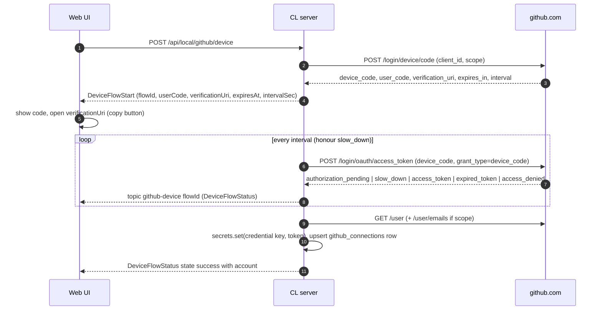

# CL Agent Mesh — GitHub Authentication and Repository Integration

GitHub is the **shared project layer**: source of truth for code, and for the shareable project data under `.clmesh/`. Each node holds **its own** GitHub credentials (different nodes may use different accounts); credentials never leave the node, never enter Git, handoff manifests, logs, or the SQLite database.

Packages: `@clam/github-integration` (M1: accounts, repos, permission checks; M2: pull-request REST, repository metadata, commit identity, server-internal `tokenFor`) and `@clam/git-engine` (M2: the real `git` CLI). Credential storage: `@clam/secret-store`. Routes: `apps/server/src/api/github.ts` under `/api/local/github/*` and `apps/server/src/api/git.ts` for everything Git (contracts: `packages/contracts/src/github.ts`, `git.ts`, `routes.ts`).

Scope by milestone: **M1** = connect accounts, list repos, check permissions, link repo to project (metadata). **M2 (implemented)** = clone management, branches, fetch/pull/push, commit, PR, conflict detection, `.clmesh/` bootstrap (§7–9). See [roadmap.md](./roadmap.md).

---

## 1. Authentication: OAuth device flow

### 1.1 Why the device flow

CL Agent Mesh is a **local app** with no public callback URL, possibly reached from a browser on another device. The Authorization Code flow would need a redirect URI and (for confidential clients) a client secret that cannot be shipped safely in an open-source local app. GitHub's **device flow** (RFC 8628) needs only a public **client id**: the server requests a device/user code, the user authorizes at `https://github.com/login/device` in any browser on any machine, and the server polls for the token. No secret, no redirect, no inbound port.

### 1.2 Client id configuration

* The user (or distributor) registers a **GitHub OAuth App** with *Device Flow enabled* (or a GitHub App with device flow) and enters its **client id** in **Settings → GitHub Accounts → OAuth configuration**. It is stored in `settings` key `github.clientId` (plain value; a client id is public). `GET/PUT /api/local/github/config` (`GithubConfig {clientId, ghCliAvailable, scopes}`, `UpdateGithubConfigBody {clientId}`).
* Without a client id the device flow is unavailable: the UI explains how to create the OAuth App (name, homepage `http://127.0.0.1:4317`, callback unused, "Enable Device Flow") and offers the `gh` import (§2).
* **Scopes:** the device flow currently requests a fixed set — `repo`, `read:user`, `user:email` (`DEVICE_SCOPES` in `@clam/github-integration`). A per-connection scope picker (e.g. `public_repo`, `workflow`) is not implemented.
* Fine-grained alternative: a GitHub App installation token model is a possible later upgrade (per-repo permissions); the credential abstraction (`credential_ref`) does not depend on token type.

### 1.3 Flow



* `device_code` is held in server memory only, bound to `flowId`, discarded on completion/expiry. Polling honours `interval` and `slow_down` (+5 s). States map to `DeviceFlowStatus.state`: `pending | success | expired | denied | error`. UI can also poll `GET /github/device/:flowId`; WS topic `github-device:<flowId>` pushes changes.
* Flows expire (`expiresAt`); at most one active flow per node (a new start cancels the old).
* On success the token goes to the secret store; the database stores only `credential_ref`.
* Re-connecting an existing `login` updates that row (new token, `status = connected`) rather than creating a duplicate (`UNIQUE(login)`).

---

## 2. Optional import from the `gh` CLI

* `GithubConfig.ghCliAvailable` is true when `gh` is installed and `gh auth status` succeeds.
* `POST /api/local/github/import-gh`: the server runs `gh auth token` (and `gh api user`) as a child process (argv array, no shell), **copies the token into the secret store** (`source = "gh-cli"`) and creates the connection. The token is never returned to the browser or logged.
* The imported credential is independent of `gh`'s own store afterwards; if the user later logs out of `gh`, CL's copy keeps working until verification fails (then `status = invalid`). Scopes are whatever `gh` granted; the UI shows them and warns when `repo` is missing.
* Import is explicit and user-triggered; CL never reads `gh`'s config files directly.

---

## 3. Multi-account model

* Table `github_connections` ([database-schema.md](./database-schema.md#22-github_connections--m1-shared-contract)): `login` unique, `source` (`oauth-device|gh-cli`), `scopes` (JSON), `status` (`connected|invalid|unknown`), `is_default`, `credential_ref`, `last_verified_at`.
* **Exactly one default** account (enforced transactionally + partial unique index); `POST /github/accounts/:id/default` swaps it and returns the list. The first connected account becomes default.
* A project links a repository **through** an account (`github_repositories.account_id`, `Project.repository.accountId`); operations on that project (clone, push, PR) use that account unless the user picks another.
* **Verify** (`POST /github/accounts/:id/verify`): `GET /user` with the stored token → updates `login/name/email/avatar/scopes` (from `X-OAuth-Scopes`) and `status`, `last_verified_at`. `401` ⇒ `invalid` (**credential retained** so the user can reconnect; never auto-deleted). Network errors ⇒ `status` unchanged, error surfaced.
* **Disconnect** (`DELETE /github/accounts/:id`): deletes the secret-store entry first, then the row; repositories keep rows with `account_id = NULL` (FK `ON DELETE SET NULL`); projects keep their repository link but show "no account". If the removed account was default, the oldest remaining becomes default. Tokens are **not revoked on GitHub** automatically (the UI links to the GitHub authorized-apps page and states this).
* **Reconnect**: same device flow for the same login.
* Different nodes may use different accounts; account identity is never synchronized between nodes. Collaborators on one repo each use their own credentials per node.

---

## 4. Secure credential storage

`@clam/secret-store`:

```ts
interface SecretStore {
  readonly backend: "macos-keychain" | "libsecret" | "windows-credential" | "encrypted-file";
  readonly location: string;            // shown in Settings → Security
  get(key: string): Promise<string | null>;
  set(key: string, value: string): Promise<void>;
  delete(key: string): Promise<void>;
}
createSecretStore({ dataDir, service?: "cl-agent-mesh", backend?, pinRetryDelaysMs? }): Promise<SecretStore>
// the server passes service `cl-agent-mesh.<nodeId>`
```

| Platform | Backend | Mechanism |
| --- | --- | --- |
| macOS | `macos-keychain` | `/usr/bin/security` generic password, service `cl-agent-mesh.<nodeId>` (per node, so several nodes on one machine never share secrets), account = key. Writes use `security -i` so the secret is delivered on **stdin**, never in argv |
| Linux (desktop session with `secret-tool`) | `libsecret` | Secret Service via `secret-tool` (GNOME Keyring / KWallet); `store` reads the secret from stdin |
| Windows, headless Linux, locked/absent keyring | `encrypted-file` | `<dataDir>/secrets/secrets.enc.json`: AES-256-GCM, per-entry random 96-bit IV, AAD binds ciphertext to (service, key). The 32-byte random `master.key` lives in the same `secrets/` directory (`0600`, dir `0700`) — this defends against casual disclosure (backups, screen shares, other users), **not** against someone who can read the whole directory, and Settings → Security says so |

In auto mode `createSecretStore` selects the first usable store **once** (OS stores are probed with a real write/read/delete round-trip under a per-process probe key) and pins that choice in `<dataDir>/secrets/backend` (`0600`). Every later start uses the pinned store only: if it is unusable (e.g. a locked keychain) it is re-probed after 1 s, 2 s and 4 s and then the node refuses to start with an explanation, because silently switching stores would make every stored secret look missing. `store.backend`/`store.location` always report what is really in use. `CLAM_SECRET_BACKEND` = `auto` (default) | `macos-keychain` | `libsecret` | `encrypted-file` forces a backend (it wins over the pin and does not rewrite it); a forced OS backend that is unusable fails instead of falling back. `windows-credential` exists in the `SecretBackend` type for forward compatibility, but **M1 has no Windows Credential Manager implementation** (Windows uses the encrypted file).

Key used by GitHub: `github.token.<connectionId>` (token), stored in the node's secret store (service `cl-agent-mesh.<nodeId>`). `GithubService.tokenFor(accountId)` is the only reader outside the REST client: it is **server-internal** (used to build the git `GitAuth`, §8), never exposed over HTTP, never logged. The node signing key is **not** in the secret store in M1: `@clam/node-identity` keeps it as a `0600` PEM under `<dataDir>/identity/`.

Rules: tokens are written once at connect, read only when making a GitHub call or injecting an authenticated git operation, never returned over the local API, never logged (log redaction patterns for `gho_`, `ghp_`, `github_pat_`), never passed on a command line (see §8 for git auth), never placed in environment of OMP children. The selected backend and location are visible in **Settings → Security** (`SecurityInfo.secretStore`).

---

## 5. Repository listing and linking

* `GET /api/local/github/accounts/:id/repos?q=&page=` → `{ items: GithubRepo[], nextPage }`. Backed by `GET /user/repos?affiliation=owner,collaborator,organization_member&sort=pushed` (30 per page, `nextPage` from the `Link` header). A text query `q` is applied **server-side over the account's full repo list** (fetched in 100-item pages, bounded page scan, short in-memory TTL cache) matching `fullName` or `description`; GitHub search is not used and ETag/conditional requests are not implemented.
* Each `GithubRepo` carries `permissions {pull, push, admin}` from the API. Results upsert into `github_repositories` as a cache (not authoritative).
* **Link to project**: the Project screen's *Link repository* action stores a `RepositoryRef {owner, name, externalId, htmlUrl, defaultBranch, accountId}` on the project (`PATCH /projects/:id` → `projects.repository_id`). A project links **one** repo; one repo may be linked by many projects (e.g. different workspaces). Linking is metadata; cloning (§7) creates a project that is already linked, and a project created for a directory whose `origin` is a github.com repository is **auto-linked** (§7, *Linking*).
* Repo identity is the **numeric id**, not the name, so renames/transfers do not break the link; `html_url`, `owner`, `name` refresh on verify.

---

## 6. Permission check semantics

`GET /api/local/github/accounts/:id/repos/:owner/:repo/check` → `RepoPermissionCheck {repo, accountId, clone, fetch, push, createPr, details?}`.

Checks are **read-only and non-destructive** — nothing is pushed or created to test:

| Field | Meaning | How determined |
| --- | --- | --- |
| `clone` | The account can read the repo contents | `GET /repos/{owner}/{repo}` succeeds (200) and `permissions.pull` is true (public repos: true). `404` = no access or doesn't exist (GitHub hides private repos) |
| `fetch` | Same as clone for an existing checkout | `permissions.pull` true (a real fetch with the account credential is the authoritative test: `POST …/git/fetch`) |
| `push` | Can write branches | `permissions.push` true (or `admin`). **Not proof** — branch protection, rulesets, SSO, or archived repos can still reject; `details` lists known blockers (`archived`, `disabled`, default-branch protection when readable) |
| `createPr` | Can open a pull request | `permissions.pull` true **and** the token scopes allow it (`repo`, or `public_repo` for public repos) **and** repo not archived; for forks, noted that PRs go via the user's fork (`details`) |

Additional checks: token scopes (from `X-OAuth-Scopes`) vs required; SAML SSO authorization header (`X-GitHub-SSO`) ⇒ `details: "SSO authorization required"` with the authorize URL; rate-limit remaining. A `false` always comes with a human-readable `details`. Results are advisory and are re-evaluated on error: a real push failure is the authoritative signal and is surfaced verbatim.

---

## 7. Clone management, branches, commits, PRs — implemented in M2

Everything below runs through `@clam/git-engine` (the system `git` binary, argv arrays, no shell, `GIT_TERMINAL_PROMPT=0`; a missing git answers `503 git_missing`) behind the routes in `apps/server/src/api/git.ts` (contracts: `routes` "Git" section). Route behaviour lives in `apps/server/src/services/git-service.ts`.

**Project paths.** Every route takes a `projectId`; the working directory is always the project's stored canonical directory (re-checked on each call: missing → `409 project_dir_missing`, resolves elsewhere → `409 project_dir_moved`). Client-supplied paths in bodies/queries (`stage`, `unstage`, `discard`, `diff?path=`) must be project-relative: absolute paths, `..`, NUL and anything inside `.git` are `400`; refs and branch names may not start with `-` or contain whitespace/control characters. The engine expects the project directory to be the **repository root**.

**Serialization.** All mutations of one project (stage, unstage, discard, commit, branch create, checkout, fetch, pull, push, `.clmesh` init) run through a per-project promise queue, so two requests never run git against the same repository concurrently (a failing job does not block the next). Reads (status, diff, log, branches, conflicts) are not queued. Different projects run in parallel.

* **Clone management** — `POST /projects/clone {workspaceId, accountId, owner, repo, path, name?, branch?}` → `202 GitOperation`. Validated up front (plain 4xx answers, no background job): owner/repo syntax, absolute `path`, workspace and account exist, destination absent or an **empty directory** (`409 git_dest_not_empty` — never a non-empty one, never overwritten), no project already at that path, and the repository readable by the account (`GET /repos/{owner}/{repo}`; 404/403/SSO come back verbatim). The clone then runs in the background with the credential-free URL `https://github.com/<owner>/<repo>.git` and the account token via the askpass broker (§8); progress is published on `git-op:<opId>` (also `GET /git/operations/:id`; the topic is retained so a late subscriber gets the latest state). On success a project is created and linked (`RepositoryRef` with owner, name, numeric `externalId`, `htmlUrl`, `defaultBranch`, `accountId`) and the final event carries it; on failure the operation records git's message verbatim, and the destination is removed **only if the clone created it** (a pre-existing empty directory is emptied, not deleted). The default location `~/clam/<owner>/<repo>` is a UI suggestion; the server requires an explicit absolute path. Shallow/partial clones are **not** implemented.
* **Linking.** `POST /projects` auto-links a directory whose `origin` is a github.com repository (https or ssh URL) and that has no repository yet: owner/name from the remote, `accountId` = the default account (if any), numeric id / default branch / canonical URL from the API when the account can read the repository (bounded to 5 s; otherwise owner/name only). It never fails project creation.
* **Branches** — `GET/POST …/git/branches` (local and remote branches with upstream, ahead/behind, last commit) and `POST …/git/checkout`. Names are validated with `git check-ref-format`; checkout **never forces**: if local changes would be overwritten git's refusal is surfaced as `409 git_would_overwrite`, and a remote-only branch becomes a local tracking branch. The `clam/<nodeName>/<taskSlug>-<shortId>` agent-branch convention is *not* automated in M2 (it belongs to the task engine, M4); users and agents create branches explicitly.
* **Fetch / pull** — `fetch` is always allowed. `pull` = fetch + `merge --ff-only`; it **never overwrites local changes**: a refusal leaves HEAD, index and working tree untouched and answers `409 git_pull_refused` whose `error.details` is the full `GitPullResult` (`reason`: `dirty-overlap` — uncommitted paths that the incoming commits also change, listed in `paths`; `diverged`; `no-upstream`; `operation-in-progress`; `detached`). Unrelated uncommitted edits do not block a fast-forward. Stash/merge/rebase are not offered; the user commits or discards (explicit `discard`) and pulls again.
* **Stage / unstage / discard / commit** — `discard` requires `{confirm: true}` (else `400`), touches only the given paths and removes given untracked paths; nothing else in orchestration code resets or cleans a tree. `commit` with `paths` commits exactly those paths. With `sessionId` the commit gets the trailer `Agent: <agentName>@<nodeName>` (the session must belong to the project).
* **Commit identity** — `GET/PUT …/git/identity`. Resolution order: (1) per-project override (`settings` key `git.identity.<projectId>`, `PUT` with a body; `PUT` with `null`/no body clears it), (2) the repository's own `user.name`/`user.email` when set, (3) derived from the linked (else default) GitHub account: display name or login, and the primary verified email when the token has the `user:email` scope, otherwise `<numericId>+<login>@users.noreply.github.com`. None available → `409 no_git_identity`. `GitIdentity.source` reports which one applied.
* **Push** — `git push` of the current branch to its upstream (`--set-upstream origin` for a branch without one when `setUpstream`); `--force`, `--force-with-lease` and `+refspecs` are **never** used. A rejection answers `409 git_push_rejected` (`403` for `permission`/`sso`, `401` for `auth`) with the full `GitPushResult` in `error.details` and the remote's own wording as `error.message` — non-fast-forward (`[rejected] (fetch first)` + git's hint), protected-branch (`GH006`/`GH013`), SSO and permission errors are never paraphrased.
* **Pull requests** — `POST/GET …/git/pulls`, `GET …/git/pulls/:number` via `POST/GET /repos/{owner}/{repo}/pulls` (`@clam/github-integration`: `createPullRequest`, `listPullRequests(state)`, `getPullRequest`). Creating needs a linked repository and an account; `head` defaults to the current branch and must already be on `origin` (`409 branch_not_pushed`). `getPullRequest` adds `mergeable` (null while GitHub computes it) and `checks` — the head commit's legacy statuses and check runs merged into `pending | success | failure | neutral`, or `null` when neither is readable. GitHub's refusals keep their wording: `422 no_commits` ("No commits between …"), `422 pull_request_exists` (with the existing PR's URL in `details.url`), `403 forbidden` (`details.kind` = `sso` with the authorization URL, `scope` with token vs accepted scopes, or `permission`), `404 not_found`. There is no background PR polling and PR bodies do not yet reference task ids (M4).
* **Conflict detection** — `GET …/git/conflicts?against=` (default: the upstream) returns ahead/behind, a dry-run `git merge-tree --write-tree` result (`clean`, conflicting `paths` with type) and `dirtyOverlap`; the working tree is never touched. Using it before a handoff restore is part of M7.
* **Status, events and the sync cache** — `GET …/git/status` (porcelain v2: branch, upstream, ahead/behind, per-file index/worktree state, in-progress operation, remotes, `lastFetchedAt` from `FETCH_HEAD`), `GET /git/overview` (every project on the node). The server publishes `git:<projectId>` `status` after every mutation, and — only while that topic has WebSocket subscribers — after debounced (300 ms) working-tree changes (recursive `fs.watch`, ignoring `.git/objects`, `.git/logs`, lock files and `node_modules`) and after an agent session in that project finishes a tool call (`tool_end`); watcher-driven refreshes publish only when the status actually changed. Fetch/pull/push also publish `operation` events (with fetch progress). `git_sync_states` is upserted on status/fetch/pull/push ([database-schema.md](./database-schema.md)).
* **Handoff checkpoint** (git commit + branch push, or a patch artifact when push is not allowed) is M7 ([handoff-protocol.md](./handoff-protocol.md)).

Safety invariants (covered by tests in `apps/server/test/git-routes.test.ts` and the engine's own suites): no force push; a dirty-overlap pull is refused and every file stays intact; a non-fast-forward push is refused and the remote is unchanged; `discard` without `confirm` is `400` and changes nothing; checkout never overwrites local changes; clone never touches a non-empty directory; no credential in `.git/config`, remote URLs or process arguments. The T2 smoke against a private GitHub repository exercised all of them with two independent nodes (see [roadmap.md](./roadmap.md) M2).

---

## 8. Git authentication for operations

Git operations authenticate with the account token **without writing it to disk, the remote URL, `.git/config`, the environment or the process list**. The engine's *askpass broker* (`packages/git-engine/src/askpass.ts`) does this:

1. At server boot `createGitEngine({ runtimeDir })` creates `<dataDir>/run/` (mode `0700`) and writes a tiny helper there (`askpass` + `askpass.mjs`, run with `process.execPath`) and listens on a Unix-domain socket in the same directory (named pipe on Windows; if the path would exceed the OS limit the engine falls back to a short private temp directory). Nothing secret is stored in these files.
2. Every network git command (`clone`, `fetch`, the fetch inside `pull`, `push`) runs with `-c credential.helper=` (so osxkeychain/manager helpers can never store or read the token), `GIT_TERMINAL_PROMPT=0`, `GIT_ASKPASS=<runtimeDir>/askpass`, and exactly two extra variables: the socket path and a **one-time nonce**. The token is not in argv, not in the environment, not in the URL.
3. When git asks for credentials the helper connects to the socket and sends the nonce; the broker answers with the username (`x-access-token`) or the token, calling `GitAuth.token()` lazily — only if git actually asks. Each nonce serves each prompt kind once and is invalidated when the command exits.
4. The server builds `GitAuth` from `GithubService.tokenFor(accountId)` and **only** for projects whose remote is `https://github.com/…` (SSH remotes are not managed; the user's own `ssh-agent` setup keeps working, unauthenticated otherwise). The account is the project's linked one if it still exists, else the node's default account. A missing/revoked token fails before git starts (`409 token_invalid`).
5. Remote URLs are always credential-free; any userinfo in a URL, and any token-shaped string in git's output, is scrubbed from error text, logs and API responses (`scrub()` in the engine).

Verified by the T2 smoke (process table sampled every 15 ms during clone and during every push/fetch/pull: `git` visible, the token never in `ps -axww -o args`; `grep -rF <token>` over both nodes' data directories and clones: no hit; `.git/config` of both clones: no `credential`/token/userinfo; the run directory is `drwx------`) and by tests asserting `.git/config` and remotes.

---

## 9. `.clmesh/` layout (versioned in the repo)

M2 implements the **bootstrap only**: `POST /projects/:id/clmesh/init` (`initClmesh` in `@clam/git-engine`) creates `.clmesh/README.md` and `.clmesh/config.json` (`{ "projectId", "schema": 1, "version": 1, "workspaceId" }`, recursively sorted keys, 2-space indent). Both contents pass `scanForSecrets` first (a hit writes nothing and answers `422 git_secret_detected`); existing files are never overwritten (`skipped`); the files are written but **not committed** — the user (or agent) reviews and commits them like any change, and the response carries the fresh `GitStatus`. The scanner combines provider-specific token rules (GitHub, AWS, Slack, Stripe, Anthropic/OpenAI/Google/npm/SendGrid keys, private-key blocks, URL credentials, bearer tokens, generic `password|secret|token = …` assignments with placeholder filtering) with a high-entropy detector; excerpts in findings are redacted. The remaining files below (memory, plans, tasks, handoffs, context) are written by M4–M7 through the same scanner.

`.clmesh/` is the only directory CL Agent Mesh writes into the shared repository. Everything there is reviewable text and **must be safe to publish**:

```
.clmesh/
  README.md                     explains the directory; created on first export
  config.json                   { "version": 1, "workspaceId": "...", "projectId": "...", "schema": 1 }
  memory/
    project.md                  approved project memory (shareable contexts only)
    decisions/<yyyy-mm-dd>-<slug>.md
  plans/
    <taskId>.md                 agent plans and remaining TODOs
  tasks/
    <taskId>.json               task snapshot: title, status, owner node/epoch, links (no conversations)
  handoffs/
    <handoffId>.json            handoff manifest (schema in handoff-protocol.md; no secrets)
  context/
    index.json                  { contextId, version, sha256, path } for context sync
```

Rules: no credentials, tokens, plaintext secrets, private conversation history, OMP session files, absolute local paths (paths are stored project-relative), hostnames of private tunnels beyond what the user opted to share, or temporary runtime data. Every file is written through a **secret scanner** (token/regex patterns + high-entropy detector) and refused on a hit. Writes are normal commits on the current branch (or a dedicated `clam/state` branch if configured) — never force-pushed. Merge conflicts in `.clmesh/` follow normal Git; JSON files are written with sorted keys and one entry per line to keep diffs mergeable. Add `.clmesh/` to `.gitattributes` with `merge=union` only for append-style indexes. The node-local state (sessions, outbox, secrets) lives in `<dataDir>`, never in the repo.

---

## 10. Errors and rate limits

* GitHub API errors are normalized to `ApiError` codes: `github_unauthorized` (401 → account `invalid`), `github_forbidden` (403 incl. SSO / scope), `github_not_found`, `github_rate_limited` (with `resetAt`), `github_unavailable` (5xx, network), `github_device_expired`, `github_device_denied`.
* Primary rate limit: respect `X-RateLimit-Remaining/Reset`; secondary limits: honour `Retry-After`; exponential backoff for reads. Caching (ETag) on repo listing.
* Transient failures never mark an account `invalid`; only an explicit `401` on a verification call does.
