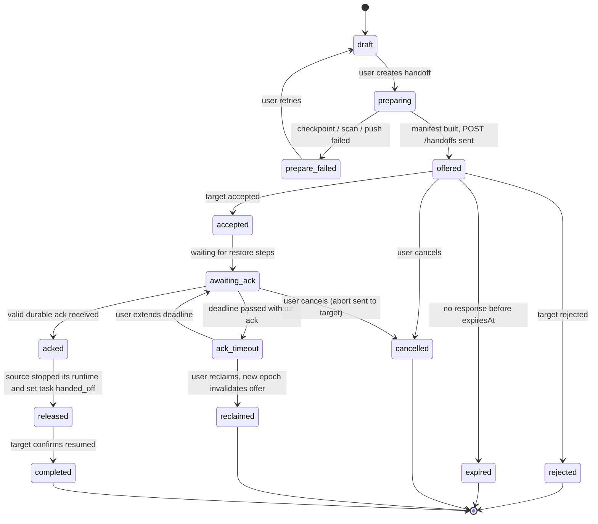
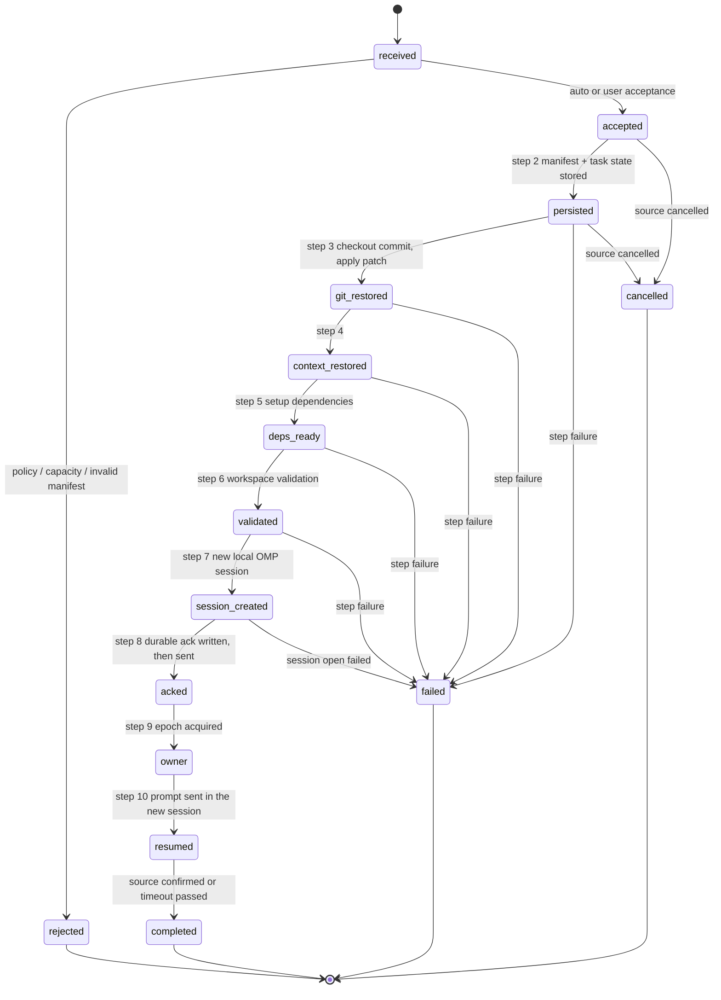

# CL Agent Mesh — Handoff State Machine and Recovery Design

> **Note (M5 shipped part of this).** [Shared sessions](./shared-sessions.md) (M5) already deliver a **manual takeover**: a participant node unpacks the driver's last OMP session snapshot (`omp session pack`/`unpack`), checks out the shared git branch checkpoint, becomes the driver under a new **epoch** (fencing), and the returning former driver becomes a read-only *moved* copy with a **rescue branch**; a driver that is online can **transfer** the role after a fresh checkpoint that the target acknowledged. What remains **planned for M7** and is specified below: the handoff package/manifest, the source/target state machines with the ten target steps, **dependency/environment setup and the durable target ack before the source may release**, `POST /handoffs*`, `task_assignments`/`handoffs` tables, recovery at every state, and **context sync** (`.clmesh/`, M6). The shared-session epoch is per shared session, not per task; M7 unifies the two.

Status: **design for M7** (handoff + checkpoint + recovery). Prerequisites: node identity/pairing (M3), task engine (M4), context + git sync (M2/M6). M1 contains none of this code; it only reserves the data model ([database-schema.md](./database-schema.md#34-handoffs--m7)) and the vocabulary.

A **handoff** moves ownership of an in-flight task from a **source** node to a **target** node so the target can continue while the source goes offline. Acceptance test **T4**: A codes to some state, A creates a handoff, B pulls code + context, B sets up deps, B acks, A goes offline, B continues, A returns but does **not** run the task twice.

Non-negotiable rules (spec):

1. **A handoff creates a NEW runtime session on the target.** Runtime sessions are not assumed migratable.
2. **A handoff completes only after a durable acknowledgement** written by the target.
3. **The source must not stop, release, or relinquish ownership before a valid ack.**
4. **Ownership epochs / fencing tokens** make duplicate execution impossible: at most one owner per epoch, and writes carrying an older epoch are rejected.
5. **Secrets never appear in the manifest or in anything pushed to Git.**
6. After the ack the target is independent of the source and of the control plane.

Transport: `POST /api/v1/handoffs`, `/handoffs/:id/accept`, `/handoffs/:id/ack`, `GET /events`, `POST /artifacts` ([agent-network-protocol.md](./agent-network-protocol.md)).

---

## 1. Handoff package (what the source assembles)

| Part | Content | Carried as |
| --- | --- | --- |
| Git checkpoint | commit sha + branch (pushed to GitHub) | manifest `git` |
| Working-tree snapshot | `git diff --binary` patch of uncommitted changes (+ list of untracked files) when the user/agent chooses not to commit | artifact (`working-tree.patch`, sha-256) |
| Execution checkpoint | task status, step in plan, last tool results summary, ownership epoch | manifest `execution` |
| Task summary | title, goal, acceptance criteria, remaining TODOs | manifest `task` / `plan` |
| Project context snapshot | refs to shareable `contexts` versions (`.clmesh/context/index.json`) | manifest `context` |
| Plan + remaining TODOs | from OMP `get_state.todoPhases` and `.clmesh/plans/<taskId>.md` | manifest `plan` |
| Conversation summary | OMP `handoff` command output (summary text), reviewed + secret-scanned | manifest `conversationSummary` (text) |
| Environment requirements | runtimes, package managers, lockfiles, required env **variable names** (never values), OS notes | manifest `environment` |
| Artifact refs | uploaded blobs (patches, logs, results) | manifest `artifacts[]` |
| Optional transcript pack | `omp session pack` tar (reference only, see §9) | artifact, `kind: "session-pack"` |

---

## 2. Manifest

JSON, UTF-8, canonicalized (sorted keys, no insignificant whitespace) before hashing. `manifestSha256` is the SHA-256 of the canonical bytes. **No secrets**: only references, names, hashes.

```ts
interface HandoffManifest {
  schemaVersion: 1;
  handoffId: string;
  correlationId: string;
  createdAt: string;                     // ISO
  expiresAt: string;                     // offer lifetime

  task: {
    taskId: string; title: string; description: string;
    acceptanceCriteria: string[];
    status: "running" | "blocked";
  };
  workspaceId: string; projectId: string;

  ownership: {
    fromEpoch: number; toEpoch: number;  // toEpoch = fromEpoch + 1
    sourceNode: { nodeId: string; name: string; fingerprint: string };
    targetNode: { nodeId: string; name: string; fingerprint: string };
    sourceAgentId: string; targetAgentId?: string;
  };

  git: {
    repoUrl: string;                     // https clone URL, no embedded credentials
    defaultBranch: string;
    branch: string;                      // handoff branch, e.g. clam/<node>/<task>-<id>
    commit: string;                      // full sha that the target MUST check out
    pushed: boolean;                     // commit reachable from remote
    patch?: { artifactId: string; sha256: string; baseCommit: string; files: string[] };
    untracked?: { path: string; artifactId: string; sha256: string }[];   // small files only
  };

  execution: {
    runtime: "omp";
    lastModel?: string;                  // "provider/id" — advisory, target may differ
    progress: { phase?: string; step?: string; percent?: number };
    todoPhases: { name: string; tasks: { content: string; status: string }[] }[];
    lastToolSummary?: string;
  };

  plan: { planPath?: string; remaining: string[] };
  conversationSummary: { text: string; generatedBy: "omp-handoff" | "clam"; scanned: true };

  context: { snapshots: { contextId: string; version: number; sha256: string; gitPath?: string }[] };

  environment: {
    os?: string; arch?: string;
    runtimes: { name: string; versionRange: string }[];     // e.g. node >=22.12
    packageManager?: { name: string; lockfile: string; installCommand: string };
    requiredEnvVars: string[];           // NAMES only
    setupCommands: string[];             // reviewed; run only after target approval policy allows
    systemRequirements: string[];
  };

  artifacts: { artifactId: string; name: string; kind: string; sha256: string; size: number }[];

  validation: {                          // what the target must verify at step 6
    expectCleanTreeAfterRestore: true;
    requiredFiles?: string[];
    checkCommand?: string;               // e.g. "pnpm typecheck"; optional
  };
}
```

Validation rules at the source before sending: schema valid (Zod); `git.commit` pushed or patch present; every artifact exists with matching hash; **secret scan** over the manifest, summary and every text artifact (known token patterns + entropy) — a hit blocks the handoff and tells the user what matched (never echoing the value); `requiredEnvVars` contains names only; `setupCommands` contain no URLs with credentials. The target re-validates schema, hashes, signature of the transport (§3.3 of the network protocol) and that `ownership.targetNode` is itself.

A copy of the manifest is committed to `.clmesh/handoffs/<handoffId>.json` **only** if the user enables Git-visible handoff history; it is still the same secret-free document.

---

## 3. State machines

Each node keeps its own side in `handoffs.status` with `role = source|target`. States are persisted **before** the corresponding side effect is attempted and are re-entrant (§6, recovery).

### 3.1 Source



* **Source keeps executing and owns epoch *n* through `draft … awaiting_ack … ack_timeout`.** Only `acked` allows `released`.
* While `offered`/`accepted`/`awaiting_ack`, the source may keep working but should pause **new** destructive steps; if the agent continues, any later changes after the manifest was built are not part of the handoff — the UI warns, and the default is to let the agent finish the current turn, then freeze (settled) before building the manifest.
* `reclaimed`: after `ack_timeout`, the user can take the task back: the source bumps the epoch **itself** to *n+1* ("tombstone epoch"), records the handoff as superseded, and rejects any ack that arrives later for the old handoff (`409 stale_epoch`). This is safe because no valid ack was ever written; if an ack **did** arrive but its response was lost, the source learns it when asking `GET /tasks/:id` / the `/events` handoff stream (target state `acked` at epoch *n+1*) **before** reclaiming — reclaim requires a successful status query or an explicit user override with a warning.

### 3.2 Target



Failure states carry `failure_code` (`git_unavailable`, `checkout_conflict`, `patch_failed`, `deps_failed`, `validation_failed`, `session_failed`, `disk_full`, `timeout`, `manifest_invalid`, `cancelled`) and a user-readable `failure_detail`. A target in `failed` never acks; it notifies the source (`handoff.state failed`), cleans up (§6.3), and the source remains owner.

Combined view (happy path): `draft → preparing → offered → accepted → awaiting_ack → (target: persisted → … → session_created → acked) → acked → released → (target: owner → resumed) → completed`.

---

## 4. The ten target steps

| # | Step | Detail | Failure → |
| --- | --- | --- | --- |
| 1 | **Receive** | Verify signed request, capability `handoff.receive`, schema, `toEpoch === knownEpoch + 1` (or task unknown), manifest hash, expiry, capacity (`maxConcurrentRuntimes`) | `rejected` |
| 2 | **Persist** | In one SQLite transaction: insert `handoffs` (status `persisted`, manifest, hash), create/attach the local `tasks` row in state `handoff_pending`, write step log `handoff_steps`. Artifacts are downloaded/verified by sha-256 and stored | `failed(manifest_invalid\|disk_full)` |
| 3 | **Git restore** | Locate/clone the project repo (account from `github_connections`, never from the source). `git fetch`; check out `git.branch` at `git.commit` into a **dedicated worktree/branch** so the user's own changes are never overwritten (never force, never discard local changes). Apply `patch` with `git apply --check` then `git apply`; restore untracked files. Refuse if the target checkout has conflicting local changes | `failed(checkout_conflict\|patch_failed\|git_unavailable)` |
| 4 | **Context restore** | Fetch referenced `contexts` versions from `.clmesh/` (via git) or `/context/sync`; verify sha-256; load plan and conversation summary into local task context | `failed(manifest_invalid)` if hashes mismatch |
| 5 | **Dependency setup** | Check `environment.runtimes` against local tools; run `packageManager.installCommand` and reviewed `setupCommands` per local approval policy (default: show to the user on the target node for approval unless the node has pre-authorized setup for this workspace). Timeouts per command | `failed(deps_failed)` |
| 6 | **Validate workspace** | HEAD equals `git.commit` (+ patch applied), tree matches manifest expectations, `requiredFiles` exist, optional `checkCommand` passes | `failed(validation_failed)` |
| 7 | **Create new local OMP session** | Create an `agent_sessions` row (new CL session, new session directory); start runtime; `open_session` on the new directory; seed it with the handoff context (see §9). **Never** resumes the source's OMP session | `failed(session_failed)` |
| 8 | **Durable ack** | In one transaction write `handoffs.status = acked`, `ack_at`, `target_session_id`, new `owner_epoch` candidate; **then** `POST /handoffs/:id/ack` (retried until deadline — safe because idempotent). The ack record is written to disk *before* it is sent | send failure: keep retrying; do not proceed past step 9 until the source's response arrives **or** the recovery rule in §6.4 applies |
| 9 | **Acquire ownership** | Set `tasks.owner_node_id = self`, `owner_epoch = toEpoch`, produce the **fencing token** (§5), publish `task.status` event on the task stream at the new epoch | — |
| 10 | **Resume** | Send the resume prompt (task, plan, remaining TODOs, summary) into the new OMP session; stream events; the task continues as an ordinary local task | runtime errors follow the normal crash policy |

Steps 3–6 are idempotent and resumable: each step records completion in `handoff_steps`; after a crash, the target restarts at the first non-`done` step (§6.2).

### Source side after the ack

On a valid ack (`manifestSha256` matches, `epoch === toEpoch`, node and key as pinned, `fencingToken` verifies):

1. Persist `acked` (+ the fencing token) **first**.
2. Stop the local runtime for this task: `abort`, wait for `session_settled`, close stdin; mark the task `handed_off` and **fenced at epoch n** (local write guard: all further execution/writes for the task are refused unless owner epoch ≥ n+1 — see §8).
3. Optionally run `omp session moved <sessionFile> --to <targetNodeName>` so a later resume of the old session forks instead of continuing ([omp-rpc-compatibility.md §8](./omp-rpc-compatibility.md#8-checkpoint-and-handoff-primitives)).
4. Set `released`; later `completed` when the target's `resumed` event arrives (or the grace period passes — the handoff is already effective at `acked`).

---

## 5. Ownership epochs and fencing tokens

* Each task has an integer **ownership epoch** (`tasks.owner_epoch`, starts at 0 when created). Exactly one node owns epoch *n*.
* A handoff proposes `fromEpoch = n`, `toEpoch = n + 1`. Both sides compare-and-set in a transaction: the source only commits `released` if `owner_epoch == n`; the target only acquires if its known epoch is `n` (or absent) and `handoffs.epoch` unique per `(task_id, epoch)` prevents two competing handoffs for the same epoch.
* **Fencing token** for epoch *n+1* = `"<taskId>:<n+1>:<sig>"`, `sig` = Ed25519 signature by the **target** over `taskId | n+1 | handoffId | manifestSha256`. It is returned in the ack response (countersigned by the source's acceptance in the event log) and attached (`X-Clam-Fencing-Token`) to every state-changing request and event about the task.
* Every receiver of task-affecting messages (task events, results, artifacts, cancel, messages) enforces `epoch >= currentEpoch`; lower → `409 stale_epoch` with `details.currentEpoch`. Local execution components check the same value before every step that changes state or external resources (commit, push, PR, tool run on behalf of the task).
* Epoch increments are **monotonic and never reused**, including after `reclaimed` (the tombstone epoch).
* A Git push is the one external side effect not protected by transport checks. Mitigation: pushes for a task go to its task branch; before pushing, the executor re-verifies its epoch locally **and** the branch name embeds the executing node (`clam/<node>/…`), so a stale writer cannot overwrite the new owner's branch (and never force-pushes).

---

## 6. Recovery after a crash at each state

All recovery runs at boot (and when a peer reconnects) by scanning `handoffs` rows whose status is not terminal. Rule of thumb: **state is persisted before the side effect; every side effect is idempotent; the epoch decides who owns the task.**

### 6.1 Source

| Crash/outage at | Persisted | On restart |
| --- | --- | --- |
| `draft` / `preparing` | partial artifacts maybe | Resume preparing or discard temp files; nothing was sent; source still owner |
| `offered` | manifest + hash + `Idempotency-Key` | Resend `POST /handoffs` (idempotent). If `expiresAt` passed → `expired` |
| `accepted` / `awaiting_ack` | same | Query target `GET /tasks/:id` and handoff stream. Target `acked` → run "source after ack" (§4). Target `failed` → mark `failed`, stay owner. Target unreachable → remain `awaiting_ack` until deadline → `ack_timeout`. **The source does not release on silence.** |
| `acked` (crash before stopping runtime) | `acked` + token | Complete steps 2–4 of "source after ack" idempotently; the runtime is not restarted for this task because the fence (§8) blocks execution |
| `released` / `completed` | terminal | Nothing |
| `ack_timeout` | deadline passed | Wait for user decision (extend / reclaim). Reclaim requires reachability proof or explicit override |

### 6.2 Target

| Crash at | On restart |
| --- | --- |
| `received` / `accepted` | Re-evaluate acceptance; re-fetch manifest if only metadata was stored; or report `failed(timeout)` after the deadline |
| `persisted` … `validated` | Resume at the first `handoff_steps.state != done`. Git/patch/deps steps check "already done" before acting (HEAD == commit and patch applied ⇒ skip) |
| `session_created` (before ack) | The new session directory exists. Re-open it (`open_session` resumes), confirm no prompt was sent, write the ack (step 8) |
| `acked` (ack row written, ack send unknown) | Resend ack (idempotent). If the source reports `stale_epoch` (source reclaimed) → mark `failed(superseded)`, stop and discard the new session's execution, never proceed to step 9 |
| `owner` (epoch acquired, resume not sent) | Re-send the resume prompt only if the new session has no user/assistant turn yet (check `get_messages_page` total); otherwise continue as normal local task |
| `resumed` / `completed` | Ordinary task recovery: runtime respawn → `open_session` on the same directory (task continues from OMP's persisted session) |

### 6.3 Cleanup on failure/cancel

The target removes only what the handoff created: its dedicated worktree/branch (only if untouched since creation), downloaded artifacts, the unused session directory. It **never** deletes anything pre-existing in the user's checkout and never discards local changes. Failure reports to the source carry `failure_code` so the user can decide.

### 6.4 Lost ack response

The most dangerous window: target wrote `acked` and sent the ack, response lost, source still thinks `awaiting_ack`. Resolution without double execution:

* The target proceeds to step 9 only after **either** (a) the ack response succeeds, **or** (b) it has retried until the **handoff deadline** and then publishes the owner event at epoch *n+1* on its own task stream. At epoch *n+1* the target is the legitimate owner (it holds a durable, valid, hash-bound ack and the source never wrote a reclaim).
* The source can only leave `awaiting_ack` by (i) receiving the ack, or (ii) the explicit `reclaim`, which needs a status check proving the target did **not** ack, or a user override. A user override after an unreachable target is exactly the case where duplicate execution is possible; the UI states this risk, and the epoch fence still protects every shared resource once the nodes can talk again (§8).

---

## 7. Timeouts

| Timer | Default | Effect |
| --- | --- | --- |
| Offer expiry (`expiresAt`) | 30 min | `offered → expired` |
| Restore deadline (accept → ack) | 30 min (extendable) | source `ack_timeout`; target `failed(timeout)` |
| Per-step timeout (deps, validation) | 10 min each | `failed(...)` |
| Ack retry window | until restore deadline, backoff per network protocol §7 | — |
| Completed grace | 24 h then records are archived | — |

Timeouts are wall-clock on the node enforcing them; skew is irrelevant because deadlines are carried as absolute ISO times and each side applies its own clock only to its own timers.

---

## 8. Duplicate-execution prevention when the source returns

Scenario: A handed off to B (epoch 1), went offline (maybe crashed before running its release step), and comes back.

1. **Boot fence scan.** On startup, before any runtime is spawned, A loads all tasks and handoffs: any task with a persisted `acked` handoff (source role) or with `owner_epoch` lower than the highest epoch it has seen is marked **fenced**. Fenced tasks are never started, resumed, or retried (the supervisor refuses to spawn/prompt a session bound to a fenced task; queued/auto-resume work for the session is cancelled).
2. **Reconcile.** A queries peers (`GET /tasks/:id`, `/events` from `peers.last_event_cursor`). The response carries `epoch` and owner; if `epoch > localEpoch` → A confirms fenced, updates `owner_node_id`/`owner_epoch`, marks the local session `stopped` (status `handed_off`), and shows "Task continues on node B".
3. **Unknown state.** If A cannot reach B and has no record of an ack (e.g. crashed in `awaiting_ack`), A treats the task as **still its own** (the rule: source relinquishes only after a valid ack), but resuming the **same OMP session** is blocked until reconciliation completes or the user explicitly overrides after being shown the risk (a pending handoff exists). Default behaviour on unreachable target with an in-doubt handoff: do not auto-resume.
4. **Write fences.** Even if an in-flight process of A resumes (e.g. A's node was suspended, not rebooted), every state-changing call carries `epoch = n`; peers reject with `stale_epoch`; A's local guard re-reads `tasks.owner_epoch` before each tool-affecting step and aborts the run when it changed.
5. **Git.** A's last push for the task is on its own branch; B continues on a distinct branch (the manifest names it) — a returning A cannot fast-forward B's branch because it never pushes without verifying its epoch.
6. **Result submission.** If A finishes work after being fenced, its result is stored as `late_result` (an event on the task at epoch *n*) and shown for human review; it is never merged into the task outcome automatically.

---

## 9. Relation to OMP `handoff` and `session pack`

| OMP feature | Relation to a CL Agent Mesh handoff |
| --- | --- |
| RPC `handoff {customInstructions?}` | Summarization step. Produces conversation summary text used in `manifest.conversationSummary` and in the target's resume prompt. Fails while streaming → the source waits for `session_settled` first. The text is secret-scanned; OMP's own prompt-level secret obfuscation ([omp-rpc-compatibility.md §3.4](./omp-rpc-compatibility.md#34-secrets--what-it-is-not)) is not trusted as the only guard |
| CLI `omp session pack` / `unpack` / `moved` | **Optional transport of the old transcript for reading.** `pack` tars the session file + artifacts + image blobs; `unpack --cwd` restores it on the target. This gives the target agent history it can inspect, but the target **always** creates a new runtime session (spec rule): `open_session` on a fresh directory, then seeds it with the summary/plan; the unpacked old session is referenced, never continued. `moved` marks the source copy stale after the ack |
| RPC `fork` / `branch` | Local branching only; not part of cross-machine handoff |
| `omp session pack` content risk | Includes full tool output and conversation, which may contain secrets: **off by default**, requires explicit user opt-in per handoff, secret-scanned, never committed to Git |

Why a new session is mandatory: a runtime session binds provider credentials, model availability, cwd, tool/extension set, and approval state of the source machine; none is guaranteed on the target. A fresh session on the target uses the target's own accounts, models and policies, and lets the ownership fence be crisp (a new session id = a new owner identity).

---

## 10. Observability

Each state transition emits a handoff event (`handoff:<id>` stream, `seq` gap-free) and a `task_events` row with `correlationId`; both nodes show identical timelines in **Handoff Center** ([ui-sitemap.md](./ui-sitemap.md)). Failures include `failure_code`, the last completed step, and the recommended action (retry, extend, reclaim, cancel). Tests required by the spec: process crash at each state (§6), network disconnect between offer/ack, duplicate events and replayed requests (idempotency + nonces), source returning after ack, concurrent competing handoffs for the same task (unique `(task_id, epoch)`).
