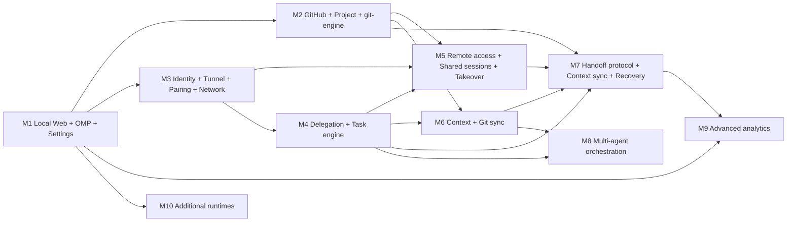

# CL Agent Mesh — Roadmap and MVP Implementation Plan

## 1. Reconciling the spec's milestone numbering

The product spec lists milestones twice with slightly different numbering (§10: *M1 Local Web + OMP RPC + Settings · M2 GitHub integration + Project · M3 Agent-to-agent + task engine + workspace context · M4 delegation/handoff · M5 …*; §11 moves *node identity + Cloudflare + pairing* into **M2**/**M3** and shifts later items). This document fixes **one** sequence, used by every other document and by the milestone badges in the UI:

| # | Name | Priority | Spec §10 / §11 origin |
| --- | --- | --- | --- |
| **M1** | Local Web + OMP RPC + Settings (GitHub/OMP settings, usage dashboard) | P0 | M1 |
| **M2** | GitHub integration + Project (clone, branches, commit/push/PR, linking) | P0 | M2 |
| **M3** | Node identity, Cloudflare Tunnel, Pairing, Agent Network (`/api/v1` foundation) | P0 | §11 M2/M3 "node identity + Cloudflare + pairing" |
| **M4** | Agent-to-agent delegation + Task engine (+ Task Board) | P0 | §10 M3 / §11 M4 "delegation" |
| **M5** | Remote access (each node's own domain) + Shared sessions + manual Takeover | P0 | added after M4 from the user's use case (A and B each with own workspace/domain/UI; share → participant → A offline → takeover on B); delivers the manual part of §10/§11 "handoff" early |
| **M6** | Workspace/project context + Git sync of shared context (`.clmesh/`) | P0 | §10 M3 "workspace context" / §11 M5 |
| **M7** | Handoff protocol + context sync + failure recovery (rest of "handoff"; see M5 for what is already shipped) | P0 | §10/§11 "handoff" |
| **M8** | Multi-agent orchestration | P1 | §10/§11 M7 |
| **M9** | Advanced analytics | P1 | §10/§11 M8 |
| **M10** | Additional runtimes (beyond OMP) | P2 | §10/§11 M9 |

Rules of the reconciled plan: node-identity **key generation** lands in M1 (cheap, needed for the Security screen and forward compatibility) but **signing/pairing** lands in M3; GitHub is M2 for clone/PR features but **account connection and repo linking metadata** are part of M1 because the Settings spec makes GitHub Accounts mandatory; delegation (M4) precedes shared sessions (M5) and handoff (M7) because both reuse the task engine, its outbox, the network protocol and the git engine; M5 was inserted before the context milestone because the user's first scenario (continue a session on another node while the first is offline) needs only git, OMP session snapshots and the outbox, and its remote-UI half is what lets the user watch the continuation on the second node's own domain. Numbers M6–M10 are the old M5–M9 shifted by one.

---

## 2. Dependencies

Parallelism: M2 and M3 are independent after M1 and can be developed concurrently. M9 analytics can start any time after M1 (it extends `provider-usage`) but is scheduled late. M10 only needs the runtime adapter interface from M1.

---

## 3. Acceptance tests ↔ milestones

| Test | Description | Delivered by |
| --- | --- | --- |
| **T1** Local Agent | Install on A; OMP detected; login provider; create project; chat with agent; see tool calls + usage | **M1** |
| **T5** Provider settings | Connect OMP provider; show models; choose default model; show token usage; show quota when supported; show "unsupported" when usage unavailable | **M1** |
| **T2** GitHub | Connect account; link repo; clone; commit/push; machine B pulls same repo | account + link + repo list **M1**; clone/commit/push/pull **M2** |
| **T3** Agent Network | A pairs B; A sees Agent Y; A delegates task to B; B runs it; A shuts down; B's domain still shows running task | **M3** (pair, see agents) + **M4** (delegate, execute, survive A offline) |
| **T4** Handoff | A codes to some state; A creates handoff; B pulls code+context; B sets up deps; B acks; A offline; B continues; A returns, does not run task twice | **M7** (needs M2, M3, M4, M6), **partly delivered by M5**: manual takeover on B after A's last checkpoint (git branch + OMP session snapshot), epoch fencing, A returns read-only with a rescue branch. Still M7: the explicit handoff created on A (package/manifest, dependency setup on B, durable ack before A releases, no duplicate task execution proven by fault injection) |
| **T6** Shared session | A creates a session in a project; adds B's agent; both discuss; A offline; the user takes over on B and watches B continue on **B's domain**; A returns and is read-only | **M5** (needs M2, M3, M4) |

---

## 4. Milestone scope and acceptance criteria

### M1 — Local Web + OMP RPC + Settings (P0)

**Scope:** local Fastify server (`127.0.0.1:4317`) + React web UI; OMP RPC runtime adapter (one child per active session, control process, supervisor/backoff/idle reaping); workspaces/projects/agents/sessions with SQLite + migrations; streaming chat with tool-call tracking, abort, steer/follow-up, model + thinking selection, context usage and cost; Settings: General, GitHub Accounts (device flow, `gh` import, multi-account, repo list, permission check, project repo linking), OMP Providers & Login (detect, providers, login/logout via RPC, model roles incl. extra roles, test model), LLM Usage (OMP-recorded vs provider-reported), Agent Runtime, Security (read-only), About; node identity key + fingerprint; secret store; responsive UI (desktop/tablet/mobile); the nine design documents.

**Acceptance:**

1. T1 and T5 pass on macOS (Linux/Windows build and start; platform-specific secret-store backends compile and degrade to the encrypted file).
2. Loopback-only bind; Host/Origin checks verified by tests (foreign Host → 403, foreign Origin WS → rejected).
3. Killing an `omp` child mid-prompt marks the runtime `crashed`, settles the prompt as `error`, restarts with backoff, and resumes the same session directory on next prompt.
4. Idle runtime stopped after `runtimeIdleTimeoutMin`; next prompt resumes it transparently.
5. No secret in SQLite/logs/responses; GitHub token only in the secret store.
6. Usage dashboard never shows a fabricated number; absent data shows "Unavailable"; provenance labelled.
7. WS reconnect + seq-gap recovery proven by test; duplicate `clientId` prompt does not double-send.
8. UI: initial JS ≤ ~180 KB gzip; route chunks lazy; virtualized transcript stays smooth on a 5 000-message session; works at 390 px width with the composer above the keyboard.
9. Documents 1–9 and `README.md` present and consistent with code (names, ports, tables, routes).

### M2 — GitHub integration + Project (P0)

**Scope:** `@clam/git-engine` (clone, fetch, fast-forward pull, branch, commit, push, status, diff, `merge-tree` conflict detection); clone management; branch/commit/PR flows via REST; Git panel and diff viewer; `git_sync_states`; `.clmesh/` bootstrap (`config.json`, README) with the secret scanner.
**Acceptance:** T2 end-to-end including machine B; never force-push and never overwrite local changes (tests: dirty tree pull refused, non-fast-forward push refused); GitHub token never appears in remotes/process args; protected-branch/SSO errors surfaced verbatim.

### M3 — Node identity, Cloudflare Tunnel, Pairing, Agent Network (P0)

**Scope:** `@clam/agent-network` (protocol library: signing and verification, nonce store interface, client with retries, pairing cryptography, SSE framing with cursors, wire schemas), `@clam/cloudflare-tunnel` (quick and named tunnels, lifecycle/status), the network listener with the `/api/v1` endpoints `/node/info`, `/node/health`, `/node/pair`, `/agents`, `/events` plus the additive `/node/announce` and `/node/revoke`, pairing UI and handshake, connected nodes + agent directory, heartbeat, capability grants/revocation. The **durable outbox** (at-least-once delivery that survives restarts) is **M4**: it exists to deliver tasks, and M3 has no non-idempotent message to deliver — its few mutating calls (pairing confirm, announce, revoke notice) use the client's in-process retry policy and the pairing state machine's own persistence.
**Acceptance:** two nodes pair with invitation code and verified fingerprints; tampered/replayed/skewed requests rejected (tests); revoked peer cut off immediately; control plane may be absent entirely (there is none: pairing is node to node); tunnel exposes only `/api/v1`. Detailed checklist: §5b.

### M4 — Delegation + Task engine (P0) — **implemented** (checklist §5c)

**Scope:** `@clam/task-engine` (lifecycle, assignments, events, remote tracking), `POST /tasks`, `/tasks/:id`, cancel, messages, artifacts; Task Board and Activity; accept/reject, retry; receiver-side execution through the OMP adapter under receiver policy; **durable outbox (`outbox` table, moved here from M3)** and the `(peer, idempotency key)` response store; event ordering and resume for the `task:<id>` streams.
**Acceptance:** T3 (A delegates to B, B runs, A shut down, B's task still running and visible on B; A reconciles on return); duplicate/out-of-order events are idempotent; node-offline and network-disconnect tests.

### M5 — Remote access + Shared sessions + Takeover (P0) — **implemented** (checklist §5d)

**Scope:** (1) *Remote access*: each node's own domain can serve that node's web UI to its owner (opt-in, password + cookie session, strict Origin/CSRF checks; `/api/v1` still signature-only) — documented in [security.md §5b](./security.md#5b-remote-ui-access-the-owner-logs-in-through-the-nodes-own-domain). (2) *Shared sessions* ([shared-sessions.md](./shared-sessions.md)): driver/participants with an epoch, invitations with auto-accept, a live read-only **mirror**, a shared **discussion thread** injected into agent sessions with a loop guard (`mesh_team`, `mesh_say`), **checkpoints** = commit + push to `clam/shared/<slug>-<id>` + `omp session pack` snapshot delivered by pull (sha256, 100 MiB cap, 0600), manual **takeover** on a participant (git alignment, `omp session unpack`, new local session, epoch + 1), **transfer** by an online driver, the returning **former driver** as a read-only *moved* copy with a rescue branch, leave/remove; capability `sessions.share`; migration `0005_shared`.
**Acceptance:** T6 (and the manual part of T4): A shares a session with B's agent, both discuss, B's mirror follows A live, A goes offline, takeover on B continues from the last checkpoint and B's domain shows it, A returns fenced and read-only without losing unpushed work; restarts at any point recover (outbox, pending downloads, `pendingFormerDriver` journal); stale-epoch calls are refused.

### M6 — Workspace/project context + Git sync (P0) — **implemented** (checklist §5e)

**Scope:** `@clam/context-engine` (memory, plans, decisions, summaries, notes; immutable versions, FTS5 search), shareable vs private contexts, node-to-node sync of shareable contexts to the members of a workspace (`POST /context/sync`, works with or without git), export to / import from `.clmesh/` for git projects through the secret scanner, conflict reporting without auto-merge, agent access (`mesh_memory`, `mesh_remember`, the project-memory section of a new session's first prompt), Shared Context UI, workspace membership UI.
**Also delivered in the same wave — work without git, everywhere:** plain-folder and managed (CL Agent Mesh-created) projects, tasks without a repository (`deliverAs: "files"`, optional input files), shared sessions and hand-over/takeover in **files mode** (the working folder travels as a bundle next to the OMP session snapshot). Git mode behaves exactly as before. Reference: [README → Work without a git repository](../README.md#work-without-a-git-repository), [architecture.md §4.6e](./architecture.md#46e-work-without-git-managed-folders-task-files-files-mode-shared-sessions), [shared-sessions.md §11](./shared-sessions.md#11-files-mode-shared-sessions-without-a-git-repository), [protocol §5.5/§5.9a](./agent-network-protocol.md). Contexts work in both worlds: peer sync needs no repository; only the `.clmesh/` export/import needs a git project.
**Acceptance:** only `shareable` contexts reach Git (and peers); secret scanner blocks leaks (tests); conflict reporting without auto-merge; context search returns results in < 100 ms on 10 000 snapshots (benchmarks in `packages/context-engine/test/search.test.ts` and `apps/server/test/context-crud.test.ts`).

### M7 — Handoff protocol + context sync + recovery (P0) — **implemented** (checklist §5f)

**Already delivered by M5** (do not rebuild): manual takeover on a participant (unpack of the last OMP session snapshot into a new local session, git alignment with the shared branch), checkpoints (commit + push + `omp session pack` snapshot, pull delivery with digest), ownership epoch per shared session with `stale_epoch` fencing, the former driver's return (read-only moved copy, rescue branch), the one-action **hand-over** by an online driver (invite if needed, wait for acceptance, stop or wait for the running turn, final checkpoint of everything, target ack, takeover, `SharedSession.transfer` progress, cancel). **Stays in M7:** the planned handoff protocol of [handoff-protocol.md](./handoff-protocol.md) (manifest, source/target state machines, *dependency and environment setup on the target*, durable target ack before the source releases, `/handoffs*` endpoints, `handoffs`/`task_assignments`/`task_checkpoints` tables, fencing tokens per task), recovery at every state with fault injection, the Handoff Center, and context sync (`.clmesh/`, from M6) carried in the package. M7 reuses M5's snapshot/checkpoint code instead of a second mechanism.

**Scope:** `@clam/handoff-engine`, manifest, source/target state machines, ten target steps, durable ack, ownership epochs/fencing, recovery at every state, Handoff Center, optional `omp session pack` attachment.
**Acceptance:** T4; fault-injection tests crash source and target at each state of [handoff-protocol.md](./handoff-protocol.md#6-recovery-after-a-crash-at-each-state) and prove no duplicate execution and no lost task; returning source is fenced; manifest never contains secrets (scanner tests).

### M8 — Multi-agent orchestration (P1)

Task dependency graphs, fan-out/fan-in, planner agents delegating through host tools, parallel agents per project with branch isolation. Acceptance: a task graph completes across ≥ 3 nodes with partial-failure recovery.

### M9 — Advanced analytics (P1)

extended history on top of `provider_usage`/`usage_buckets` (already accumulating in M1), cost by project/agent/time, budgets/alerts, quota trends, exports. Acceptance: history survives OMP stats window; every number source-tagged.

### M10 — Additional runtimes (P2)

Second `agent-runtime` adapter proving the interface; capability negotiation per runtime. Acceptance: same session UI drives both runtimes with no orchestration changes.

---

## 5. M1 detailed checklist

Legend: `[x]` implemented in the repo (code located; tests exist where named — the documentation author read the code and tests but did not execute them), `[ ]` open. The main agent holds the authoritative verification status.

**Foundation**
- [x] pnpm 11 monorepo, strict TS base config, workspace scripts (`dev`, `build`, `typecheck`, `test`, `start`)
- [x] `@clam/contracts`: all local API payloads, `routes`, WS protocol, `SessionEvent`/`UiMessage`
- [x] Shared server contracts (`ServerContext`, `EventBus`, `ApiError`)
- [x] `@clam/database`: 12-table schema, migrations `0000_init` + `0001_usage_buckets`, `openDatabase` (WAL, FKs, busy timeout, migrations at boot); tests: `packages/database/test/migrations.test.ts`
- [x] Pre-migration backup: `VACUUM INTO <file>.pre-migrate-<ts>.bak` (keep 3) before pending migrations on a non-empty DB
- [ ] Downgrade guard (refuse to start on a database newer than the binary) — specified in [database-schema.md §5](./database-schema.md#5-migration-plan), not implemented
- [x] `@clam/node-identity`: Ed25519 keypair (`<dataDir>/identity/`, `0600`), `node_<16 hex>` id, fingerprint; tests in `packages/node-identity/test`
- [x] `@clam/secret-store`: macOS Keychain (`security -i`), libsecret (`secret-tool`), AES-256-GCM encrypted-file fallback (also Windows); test: `encrypted-file.test.ts`. No Windows Credential Manager backend (type reserved only)

**Server (`apps/server`)**
- [x] Boot: config (`CLAM_HOST/PORT/DATA_DIR/WEB_DIST/OMP_BIN/OMP_PROFILE/LOG_*`), DB, identity, secret store, OMP locator, event bus, health, graceful shutdown
- [x] Security: loopback-only boot (other `CLAM_HOST` values refuse to start), Host guard, Origin guard (REST + WS), error envelope, log redaction, security headers; test: `security.test.ts`
- [x] Routes: node/health/settings/security/tunnel; workspaces/projects (+files, dir suggestions); agents; sessions (+messages, state, prompt, abort, model, thinking, ui-response, ui-requests); runtime stop/restart; OMP providers/login/logout/models/roles/test; usage (recorded/quota/mesh); GitHub (config, device flow, import-gh, accounts, repos, check)
- [x] WebSocket `/ws`: subscribe/unsubscribe, per-topic `seq`, ping/pong, latest-event replay for stateful topics; test: `ws-hub.test.ts`
- [x] Static serving of the built web app (`static-node.test.ts`)
- [x] OS autostart (FR-01): launchd LaunchAgent (macOS), systemd user unit (Linux), scheduled task (Windows) written/removed by `PATCH /settings {autoStart}`; **smoke-verified on macOS; Linux and Windows unit-tested only** — see [architecture.md §6](./architecture.md#6-deployment)
- [ ] Autostart smoke test on Linux and Windows

**Runtime (`@clam/agent-runtime`)**
- [x] Runtime adapter interface + OMP adapter: spawn, `ready`, `negotiate_protocol` v2, chunk reassembly, id correlation + timeouts (`frame-decoder.test.ts`, `transport.test.ts`)
- [x] `open_session` binding to `<dataDir>/sessions/<id>`; create/resume
- [x] Event normalization to `SessionEvent`; message mapping to `UiMessage` (`events.test.ts`, `messages.test.ts`)
- [x] Supervisor: concurrency cap with LRU eviction, idle reaping, crash backoff (0.5 s doubling to 30 s, 8 attempts), in-flight prompt settlement, graceful shutdown (`supervisor.test.ts`, run against a fake `omp`)
- [x] Control process: providers, login/logout flows (`control.test.ts`)
- [x] Approvals → `ui_request`; **verified live** with real OMP under `always-ask` (bash call produced a `select` request, answered via `/ui-response`, turn completed)
- [x] `--no-ui` only in `yolo` (`supervisor.test.ts`)

**Integrations**
- [x] `@clam/github-integration`: device flow, `gh` import, verify, repos, permission check, rate-limit handling (`device-flow.test.ts`, `service.test.ts`)
- [ ] GitHub device flow against real GitHub — tests inject `fetch`; needs a real OAuth App client id (Device Flow enabled) for an end-to-end check
- [x] `@clam/provider-usage`: `omp stats` / `omp usage` / `omp models` normalizers, SWR cache + disk snapshot, `usage_buckets` hourly accumulation with `coverageStart`, provenance (`normalize.test.ts`, `cache.test.ts`, `history.test.ts`)
- [x] Model roles: read-modify-write with whole-record `omp config set modelRoles '<json>'` (`cli.test.ts`)

**Web (`apps/web`)**
- [x] Shell: lazy routes + intent preload, design tokens, theme, primitives, self-hosted fonts
- [x] Fetch client + WS client (backoff, resubscribe, seq-gap detection)
- [x] Layout: sidebar/rail/drawer, panels, bottom tab bar, sheets, command palette
- [x] Screens: Overview, Workspaces, Project (files, repo link), Agent Session (stream, tools, approvals, abort, model), My Node → Sessions/Projects/Runtime, Agents
- [x] Settings: General, GitHub Accounts, OMP Providers, LLM Usage, Agent Runtime, Cloudflare Tunnel (status only), Security, About
- [x] Disabled navigation entries with milestone badges (`apps/web/src/lib/milestones.ts`, aligned with this roadmap: Git M2, Network M3, Tasks/Activity M4, Shared Context M6, Handoffs M7)
- [x] Initial JS 177 KB gzip, enforced by `apps/web/scripts/check-budget.mjs` in `pnpm --filter @clam/web build`; `ANALYZE=1` treemap
- [ ] Real-device mobile test: on-screen keyboard behaviour of the pinned composer (`visualViewport` hook exists in `use-keyboard-inset.ts`), safe-area insets

**Quality**
- [x] Unit/integration tests with a fake `omp` (crash, oversized/invalid frames, protocol fallback, login flow) — no real credentials (`packages/agent-runtime/test/fixtures`)
- [x] Host/Origin checks, usage accounting, sessions, files, workspaces/projects, OMP routes covered in `apps/server/test`
- [ ] Web component/e2e tests (no web test script exists)
- [ ] Manual smoke with `omp --profile clam-dev` across the whole UI (max two tiny prompts)

**Documentation**
- [x] `docs/architecture.md`, `database-schema.md`, `agent-network-protocol.md`, `omp-rpc-compatibility.md`, `github-integration.md`, `handoff-protocol.md`, `security.md`, `ui-sitemap.md`, `roadmap.md`, root `README.md`

---

## 5a. M2 detailed checklist

Legend as in §5. Git is exercised for real: tests use real `git` against local bare repositories (a fake GitHub transport only for the PR endpoints), and the T2 smoke ran against a private GitHub sandbox repository with two independent nodes (own data dir, own clone).

**`@clam/git-engine`** (`packages/git-engine`; tests in `packages/git-engine/test`)
- [x] status (porcelain v2 `-z`, `lastFetchedAt` from `FETCH_HEAD`), parsed diff with per-file/total caps (untracked included), log with opaque cursor, branches with upstream ahead/behind
- [x] stage / unstage / discard (only the given paths) / commit (`paths`, trailers, identity from the caller), branch create + checkout (never `-f`, remote-only → tracking branch)
- [x] clone (absent/empty dest, cleaned up on failure, progress), fetch, **fast-forward-only pull** (refusal never touches the work tree), **push never forced** (no `--force`, `--force-with-lease` or `+refspec`), `merge-tree --write-tree` conflict report with dirty-overlap
- [x] Askpass broker: `-c credential.helper=`, `GIT_TERMINAL_PROMPT=0`, one-time nonce over a Unix socket in a `0700` run dir; token never in argv/env/URL/`.git/config`/disk
- [x] `scanForSecrets` + `initClmesh` (`.clmesh/README.md`, `.clmesh/config.json`, sorted-key JSON, never committed)

**Server and integrations**
- [x] Migration `0002_git` (`git_sync_states`, PK `(project_id, branch)`, FK cascade); pre-migration backup still covers it; tests: `packages/database/test/migrations.test.ts`
- [x] `@clam/github-integration`: `createPullRequest`, `listPullRequests(state)`, `getPullRequest` (mergeable + combined statuses/check runs), error mapping (422 no commits / PR exists with URL, 403 SSO/scope/permission, 404), `getRepository`, `commitIdentity`, server-internal `tokenFor`; tests with injected `fetch`: `test/pull-requests.test.ts`
- [x] Git routes (`apps/server/src/api/git.ts` + `services/git-service.ts`): every route in `routes` "Git"; per-project serialized mutation queue; linked-account auth for github.com https remotes only; `GitEngineError` → `git_*` `ApiError` codes with verbatim messages; identity resolution (project override → repo config → account); `Agent:` trailer for session commits
- [x] Clone management: `POST /projects/clone` → `GitOperation`, progress/result on `git-op:<id>`, project created and linked on success, partial destination removed only if created by the clone; auto-link of existing directories whose `origin` is a github.com repo
- [x] `git:<projectId>` events: after every mutation, debounced `fs.watch` + agent `tool_end` while subscribed; `git_sync_states` upserted on status/fetch/pull/push
- [x] Route tests (`apps/server/test/git-routes.test.ts`): dirty-overlap pull refused with files intact, non-fast-forward push refused (remote unchanged), discard without confirm → 400, clone into non-empty dir → 409, serialization of concurrent mutations, status events, watcher/tool_end refresh, token absence in `.git/config`/remotes, identity sources, trailer, PR flow, clone success/failure cleanup, auto-link
- [x] **T2 smoke (real GitHub sandbox, two nodes):** A clones, `.clmesh` init, session-less and `sessionId` commits (`Agent: OMP Agent@<node>` trailer), branch push, draft PR create/duplicate/list/get; B clones, checks out A's branch, fast-forward pulls A's later commits, dirty-overlap pull refused, a commit on stale state rejected as non-fast-forward with git's verbatim message, conflict report shows `smoke-notes.txt`; `ps -axww` sampled during every network operation and `grep -rF <token>` over data dirs/clones found nothing; test branch deleted, PR left closed
- [x] Web Git panel + diff viewer (`apps/web/src/features/git`) — owned by the web workstream

**Not in M2 (open)**
- [ ] Shallow/partial clone options; SSH remotes (not managed by design)
- [ ] Stash / merge / rebase flows after a refused pull or push (the user commits or discards, then retries)
- [x] Agent branch naming `clam/<node>/<task>-<id>` (task engine, M4: `taskBranchName`); [ ] PR bodies linking task ids and background PR status polling (still open — the result carries a compare URL, the PR is opened by a human)
- [ ] Protected-branch, SAML-SSO and missing-permission rejections against real GitHub: mapping is implemented and unit-tested with GitHub's documented messages, but the sandbox repository has no branch protection or SSO org, so these were not reproduced live
- [ ] Windows: askpass broker uses a named pipe (not exercised); macOS verified, Linux unverified

---

## 5b. M3 detailed checklist

Legend as in §5. M3 was verified with route-level tests between two real in-process servers and a live run of two server processes paired over **real** Cloudflare quick tunnels (below).

**Protocol library (`@clam/agent-network`)**
- [x] Canonical string, `signRequest` / `verifyRequest` in the specified order (version → peer/key → skew → replay → digest → signature → idempotency key), constant-time checks, strict header syntax, duplicate-header detection
- [x] `NetworkClient`: signed and unsigned requests, fresh nonce/request id per attempt with stable idempotency key and correlation id, retry table of protocol §7, `Retry-After`, signed SSE with idle detection; HTTPS-only peer URLs (loopback `http` only with `CLAM_ALLOW_LOOPBACK_PEERS=1`)
- [x] Pairing cryptography: 40-bit Crockford code, derived invitation id, HKDF code key, HMAC proofs, domain-separated transcript signatures; SSE framing and opaque cursors; Zod wire schemas

**Tunnel (`@clam/cloudflare-tunnel`)**
- [x] Detection, quick tunnel (URL parsed from cloudflared output), named tunnel (`--token-file`, token never in argv/env/logs), `--metrics` `/ready` + connection count, restart with backoff, state events; measured: quick tunnels forward the public `Host` unchanged and buffer SSE

**Server (`apps/server`)**
- [x] Migration `0003_network` (`peers`, `peer_agents`, `pairing_invitations`, `pairing_requests`, `pairing_joins`, `nonce_log`, `network_events`; `workspace_members` gains `permissions`/`granted_by`/`revoked_at`); pre-migration backup verified against a database from the previous build
- [x] Network listener (second Fastify instance, only `/api/v1`, raw-body capture, Host guard, per-source and per-peer token buckets, capability checks); `CLAM_NETWORK_HOST` / `CLAM_NETWORK_PORT` / `CLAM_ALLOW_LOOPBACK_PEERS`
- [x] Endpoints `GET /node/info`, `GET /node/health` (minimal / signed full), `POST /node/pair`, `GET /agents`, `GET /events` (SSE, gap-free `seq` persisted, resume by cursor, `stream.reset`, keepalive, audience-scoped events), `POST /node/announce`, `POST /node/revoke`
- [x] SQLite-backed nonce store (memory-first; replay still refused after a restart — tested)
- [x] Invitations (code shown once, only a hash stored, TTL ≤ 10 min, 5 attempts then locked, uniform 404), inviter and joiner pairing state machines (approve with chosen capabilities / reject, signed confirm, resumable after restart on both sides, unreachable joiner retried), shared workspace created on the joiner, members recorded on both
- [x] Peers: rename, capability changes pushed to the peer, immediate revocation with best-effort notice, re-pairing a revoked peer
- [x] Heartbeat (30 s ±20 %, online/degraded/offline after 3 misses/revoked), opportunistic SSE with resume cursor, directory refresh on change / capability change / ≤ 5 min, offline never deletes anything
- [x] Tunnel service: persisted mode/hostname/autoStart (`settings`), token in the secret store, auto-start at boot, announce to peers on a new URL (after DNS resolves), `NodeInfo.publicUrl` / `SecurityInfo.remoteApiEnabled` reflect reality; `TunnelStatus` removed in favour of `TunnelState`
- [x] Local routes for every M3 entry in `routes` + WebSocket topics `network` and `tunnel`
- [x] Tests (`apps/server/test/network-pairing|network-wire|tunnel-service.test.ts`): full pairing; wrong code → 404 + attempts → lockout after 5; wrong fingerprint refused; expired/consumed/revoked/unknown uniform 404; reject; forged confirm/reject; restart mid-handshake (both sides) and unreachable-joiner retry; tampered body/path/query/host, replay (also after restart), skew, unknown peer, wrong key id, missing capability, rate limit; revoke → next request refused and `revokedBy: remote`; heartbeat offline → online; SSE resume without gaps or duplicates; UI listener has no `/api/v1`, network listener has no `/api/local`/static/`/ws`; announce verified by fingerprint; capability and directory propagation; tunnel config/state/auto-start
- [x] **Live acceptance (two server processes, real quick tunnels, local routes only):** paired over the HTTPS tunnel URLs; both showed each other `online`; A's directory listed B's OMP agent; `<A public URL>/api/local/node`, `/`, `/ws` → 404 while `/api/v1/node/info` → 200; B's tunnel restarted (new URL) → B announced → A kept B (`degraded` for ~6 s on the dead URL, then `online` on the new one); B stopped → A showed it `offline` after ≈ 70 s; B started → `online` again within ≈ 12 s of the process start; A revoked B → B showed A `revoked` / `remote` immediately

**Not in M3 (open)**
- [ ] Key rotation (`POST /node/rotate-key`), response signing, handoffs/context/upload-artifact endpoints (M6–M7). *(The response store, `outbox` and the task/artifact-download endpoints landed in M4, §5c.)*
- [ ] Named tunnels were implemented and unit-tested against a fake `cloudflared` but not run against a real Cloudflare account; SSE over a named tunnel is unmeasured (quick tunnels buffer SSE, so the node never depends on it)
- [ ] The code is only HKDF-protected: a captured hello/reply transcript is offline-guessable within the 10-minute TTL (mitigated by the fingerprint check); a PAKE would remove this
- [ ] Linux/Windows: macOS verified; the tunnel and listener use no platform-specific code

---

## 5c. M4 detailed checklist

Legend as in §5. M4 was verified by suites between two real in-process nodes (real server, real git against local bare repositories, the fake omp driving host tool calls) **and** by live runs of the built server with the real OMP and a real GitHub repository (below).

**Domain (`@clam/task-engine`)**
- [x] State machine with explicit allowed transitions (illegal and terminal transitions rejected), epoch checks, gap-free event mirroring, agent-message budget (12 per node per task, replenished by a human message) and who may send which kind, `buildBrief` / resume / reminder prompts, `[CL Agent Mesh]` injection and status-note texts (+ parser), `deliveryMode`, the five `mesh_*` host-tool definitions and strict argument validation, GitHub repo URL normalization, branch naming, `strictestApprovalMode`, outbox retry policy, idempotency hashing — 68 unit tests

**Persistence**
- [x] Migration `0004_tasks`: `tasks`, `task_events`, `task_messages`, `outbox`, `idempotency_records`, `artifacts`, `peers.auto_accept_tasks`; test applies the full chain and upgrades a database that stopped at `0003` after a pre-migrate snapshot ([database-schema.md §3.2](./database-schema.md#32-tasks--m4-migration-0004_tasks-implemented))

**Wire (`/api/v1`)**
- [x] `POST /tasks`, `GET /tasks/:id[?since=]`, `POST /tasks/:id/cancel`, `POST /tasks/:id/messages` (both directions), `GET /tasks/:id/artifacts/:artifactId`, `task.updated` frames on `/events`; capability matrix, epoch (`stale_epoch`), only-own-task visibility, `(peer, key)` response store with replay/conflict/in-flight, natural keys, real `activeTasks`/busy in `GET /agents` and task counts in the health answer ([protocol §5.5–5.8b, §6, §7, §10](./agent-network-protocol.md))

**Services (`apps/server/src/tasks`)**
- [x] Durable outbox (ordered per task, backoff, offline peers wait without consuming attempts, drains on `online`, visible delivery state, dead-letter handling) and sender mirror (polling is authoritative, ~5 s; idempotent apply)
- [x] Executor: project resolution, policy-based auto-accept (exactly one matching project), manual accept with project choice / reject, one running task per working tree, session `Task: <title>` with the CLAM brief, approval mode = stricter of node and task, `--max-cost`, completion rule (`mesh_complete`, one reminder, auto-complete), blocked on unanswered question / dirty tree, cancel without destroying work, restart recovery
- [x] `TaskGit`: dirty-tree refusal, branch from the sha of `origin/<base>` (never lands on the base branch), commit with `Task:`/`Agent:` trailers, never-forced push, patch artifact when the push is refused, original branch restored
- [x] Message injection (idle → prompt, busy → `steer`/`followUp`), per-session FIFO, retried, once-only across restarts; completion note injected into the delegating session; loop guard with remaining budget in `Task.agentMessageBudget`
- [x] Host tools registered in every runtime (`HostToolRegistry`, `loadMode: essential`): `mesh_agents`, `mesh_delegate`, `mesh_message`, `mesh_task`, `mesh_complete`
- [x] Artifacts: size cap, sha256, secret scan before storing, sender-only download, local proxy route
- [x] Local routes for every M4 entry of `routes` (tasks, task, messages, decide, cancel, retry, read, artifact, activity), WebSocket topics `tasks` / `task:<id>`, `Peer.autoAcceptTasks` editable with `PATCH /network/peers/:id`, activity feed

**Tests (`apps/server/test/tasks-*.test.ts`, 22 suites in the package)**
- [x] Delegate → auto-accept → run → `mesh_complete` → branch committed and pushed → sender mirror shows `succeeded` with the result (trailers, branch, compare URL, `main` untouched); manual accept with project choice; rejection with reason; dirty tree → `blocked` → clean → re-accept; cancel from the sender (and the missing `tasks.cancel` grant); question/answer through both sessions with the exact injected texts; loop guard at the 13th message and its reset by a human; **T3**: sender stopped mid-run, executor finishes and shows it, sender returns and reconciles (events gap-free, queued message delivered once, no duplicates); task queued while the executor is down survives the sender's restart and runs once it is back; never-delivered task cancelled locally; **network disconnect** between two live nodes; executor restart mid-run resumes with the resume prompt; refused push → patch artifact only the sender downloads (`git am` reproduces the work); duplicate `POST /tasks` (same key, different body, new key), out-of-order and duplicate messages, stale epoch → 409, capability matrix, third node gets 404

**Live acceptance (built server, real OMP, sandbox repository `CongLe-FinX/clam-sandbox`, two nodes `node-a` 4717/4718 and `node-b` 4727/4728, B auto-accepts A)**
- [x] (a) UI-route delegation over loopback: "create TASK_SMOKE.md" → B ran it in 12 s (cost $0.048) → branch `clam/node-b/create-task-smoke-md-…` pushed with `Task:`/`Agent:` trailers, `main` untouched → A showed `succeeded` with branch, commit, compare URL and the executor's gap-free timeline
- [x] (b) Agent discussion: an agent session on A used `mesh_delegate`, B's agent asked its single clarifying question with `mesh_message`, the question appeared in A's session as `[CL Agent Mesh] task … from OMP Agent@node-b · kind question`, A's agent answered with `mesh_message` (visible on B in the executing session as `kind answer`), B wrote the file, called `mesh_complete`, CLAM pushed the branch, and the completion note arrived in A's session (24 s, B cost $0.067; A's session used `claude-haiku-4-5`)
- [x] (c) T3: A stopped (graceful) while B was running a 45 s job; B finished, pushed and showed the task `succeeded` with its progress note queued (`delivery: pending`); A restarted with its data directory and reconciled immediately: same status/result/9 events, the note delivered once, one copy of the task on each node
- [x] Over **real quick tunnels** (cloudflared 2026.10.5, two fresh nodes paired through their `trycloudflare.com` URLs, no loopback peers): delegate → run → complete → pushed branch in 16 s, mirrored by polling (status steps every ~5 s, the tunnel buffers SSE)
- [x] Cleanup verified: all test branches deleted from the sandbox (`main` unchanged at `cfeff7f`), no PRs opened, data directories and clones removed, only the user's own `cloudflared` service left running

**Not in M4 (open)**
- [ ] Handoff (epoch increments, fencing tokens, `task_assignments`, `task_checkpoints`): M7 (a manual takeover of a *shared session* shipped in M5, see §5d); `handed_off` exists in the state machine but nothing produces it
- [ ] Approval-blocked flow (`ui_request` → task `blocked` → resolved → `running`) is implemented but has no dedicated test
- [ ] `constraints.deadline` is carried but not enforced; `maxCostUsd` relies on OMP `--max-cost`
- [ ] No artifact upload endpoint (`POST /artifacts`) and no resumable/large transfers: artifacts are ≤ 25 MiB and only produced by the executor
- [ ] A task whose peer is revoked while its create is still queued stays `offered` on the sender until the user cancels it
- [ ] The executor's model cannot be chosen by the sender (it uses the executor's default role); a `maxCostUsd` constraint is the cost control
- [ ] Observed once over the real tunnels during pairing (M3 code, not investigated): the inviter's pending pairing request listed by `GET /network/pairing-requests` had a different id one moment later and approving the first id answered 404; approving the new id worked

---

## 5d. M5 detailed checklist

Legend as in §5: `[x]` implemented in the repo (code located; tests named where they exist — the documentation author read the code and tests and did not execute them), `[ ]` open. Suites of shared sessions run two real in-process nodes (real server, real git against one local bare repository, the fake omp) in `apps/server/test`: `shared-flow.test.ts`, `shared-takeover.test.ts`, `shared-units.test.ts`, `shared-wire.test.ts`, with helpers in `shared-fixtures.ts`; remote access has `access-units.test.ts`.

**Remote access (each node's own domain)** — [security.md §5b](./security.md#5b-remote-ui-access-the-owner-logs-in-through-the-nodes-own-domain)
- [x] Opt-in UI surface on the network listener (`remoteUiEnabled`, off ⇒ plain 404), `/api/local/*` and `/ws` only with an owner session; `/api/v1` byte-for-byte unchanged and cookie-blind
- [x] Owner password (scrypt, first one set from loopback only), `__Host-clam_session` cookie (sliding 12 h, 7-day cap, epoch revocation), strict Origin check on writes and WebSocket upgrades, login throttling, loopback-only controls, response headers/CSP (`apps/server/src/auth/gate.ts`)
- [x] Settings → Security: password, remote access switch, sessions; `uiUrl` of a node (its public URL when enabled) travels in invitations and driver notices so a moved session links to the new driver's UI

**Contracts and persistence**
- [x] Capability `sessions.share` (not in the default grant), `wire.Shared*` schemas, `@clam/contracts` shared types, local routes (`routes.ts`), `AgentSession.kind/sharedSessionId/movedTo`
- [x] Migration `0005_shared`: `shared_sessions`, `shared_participants`, `shared_invites`, `shared_messages`, `shared_checkpoints`, `shared_mirror_messages`, `shared_mirror_state`; `agent_sessions.kind|shared_session_id|moved_to` ([database-schema.md §3.2a](./database-schema.md#32a-shared-sessions--m5-migration-0005_shared-implemented))

**Wire (`/api/v1`, capability `sessions.share`, [protocol §5.9a](./agent-network-protocol.md#59a-shared-sessions--sessionsshare))**
- [x] `POST /shared/invites`, `/shared/:id/decision|messages|mirror|checkpoints|driver|membership|transfer`, `POST /shared/:id/checkpoints/:seq/ack`, `GET /shared/:id`, `GET /shared/:id/snapshots/:seq` (streamed, `Content-Digest`, 0600 file)
- [x] Idempotency-Key on every mutating call except `/mirror` (idempotent by `(streamId, seq)`); epoch fencing (`stale_epoch`, `epoch_unknown`, `split_brain`); `mirror_resync` and full `sync` replay

**Services (`apps/server/src/shared`)**
- [x] Sharing: shared branch `clam/shared/<slug>-<6>` created from HEAD and pushed, invitation through the outbox, auto-accept (peer `autoAcceptTasks` and exactly one matching project), mirror + briefed participant agent session on accept, leave/remove, delete guard (`shared_session_active`)
- [x] Shared branch in its own git worktree: every git-mode shared session gets `<dataDir>/worktrees/<sharedId>` (driver at share time, participant at takeover, older shares on demand); the project folder's checkout is never switched, so other sessions of the project and their uncommitted files are untouched. Checkout ids (`<projectId>~<sharedId>`) address the worktree in the git/file/terminal routes, `AgentSession.checkoutId` for the UI; the worktree goes with the membership / the last bound session (never forced, branch kept); a branch held by a worktree cannot be switched to elsewhere (`409 git_branch_in_worktree`) ([shared-sessions.md §4.10](./shared-sessions.md#410-where-the-shared-branch-lives-one-git-worktree-per-shared-session))
- [x] Mirror: transcript rebuilt from runtime events, 500 ms batches, persisted per mirror, republished on `session:<id>`, `SessionViews` for mirror and moved sessions, `session_read_only` / `session_moved`
- [x] Group chat (replaces the one-way thread): a leaderless log replicated on every member node (hybrid logical clock, per-origin sequence, outbox fan-out from whichever node accepts, catch-up pull `POST /shared/:id/messages/sync`), @mention / `lead` / `all` addressing, the unaddressed buffer ("Since your last turn in the group"), automatic replies of every agent turn, replicated `system` messages, wake budget (12 waking agent messages per node without a human message), host tools `mesh_team` and `mesh_say` ([shared-sessions.md §4.3](./shared-sessions.md#43-the-group-chat))
- [x] Checkpoints: commit with trailers `Session`/`Epoch`/`Agent`, never-forced push, `omp session pack` with the runtime released and restarted in the background, 100 MiB cap, keep newest 3 snapshots; pull delivery with sha256/size verified while streaming, retries and acks
- [x] Takeover (`driver_online` unless forced, `no_snapshot`, git alignment without discarding local changes, `omp session unpack`, `SessionService.adopt`, epoch + 1, old mirror/participant session archived, continuation note), hand-over by an online driver as ONE action (`POST /sessions/:id/handover`, `POST|DELETE /shared/:id/transfer`; phases inviting → waiting_accept → stopping → checkpointing → delivering → handing_over → continuing | failed | cancelled; final checkpoint commits everything and a push/snapshot failure fails it; prompt freeze `transfer_in_progress`; `interrupted` recovery; `shared-handover.test.ts`), former driver (frozen transcript, `movedTo`, `omp session moved` best effort, rescue branch `clam/rescue/<sharedId>-<node>`, mirror + participant agent), reconcile at boot / on `online` / every 30 s
- [x] Restart recovery: outbox, pending snapshot downloads, `meta.pendingFormerDriver` journal, thread re-injection, mirror publishers

**Not in M5 (open)**
- [ ] Planned handoff protocol (manifest, dependency/environment setup on the target, durable ack before the source releases, `/handoffs*`, per-task fencing tokens): M7; M7 should reuse the M5 snapshot/checkpoint code
- [ ] Work on the driver after its last checkpoint is lost to the others if it dies abruptly (documented limit); no automatic failover, takeover is manual only
- [ ] `omp session moved` is refused by OMP's lease while another omp on the same machine holds the same session id (best effort); a never-prompted session cannot be snapshotted or resumed; the unpack cwd spelling must equal the runtime cwd
- [ ] No second factor / per-device sessions for remote access ([security.md](./security.md) §5b "not implemented")
- [ ] Not observed yet over **real Cloudflare tunnels** with two real OMP installations; the suites above use loopback peers and the fake omp

## 5e. M6 detailed checklist

Legend as in §5. Suites: `packages/context-engine/test` (pure rules, `.clmesh/` mapping, FTS5 query builder and the 10 000-snapshot benchmark, preface), `packages/database/test/context-migration.test.ts` (0007 chain, FTS triggers, pre-migration backup), and in `apps/server/test`: `context-crud.test.ts`, `context-sync.test.ts` (two real in-process nodes), `context-clmesh.test.ts` (real git, local bare origin), `context-agent.test.ts` (fake omp: preface + host tools) and `context-executor.test.ts` (a delegated task's executor session gets the preface), helpers in `context-fixtures.ts`.

**Engine (`@clam/context-engine`)**
- [x] Version model: sha-256 over the canonical title + body (LF, one final newline), versions identified by `(version, sha256)`, `base`/`merged`/`ancestors` lineage, tombstones
- [x] Rules for versions that meet: fast-forward (the head is in the incoming ancestry), duplicate, stale, **conflict** (concurrent, never merged), edit-beats-deletion, equal text with different history converges on the longer one; merge-free resolution (`local` / `remote` / `merged`) is a NEW version that descends from both, so it fast-forwards wherever it is delivered
- [x] `.clmesh/` mapping (paths per type, JSON-quoted front matter, `context/index.json` with sorted keys and one entry per line, strict parser, hand-edit detection), FTS5 query builder (prefix + phrase, every term double-quoted letters/digits only, `«»` snippets, bm25 with a title weight), preface builder (≈ 2 000 characters), wire schemas

**Persistence**
- [x] Migration `0007_context`: `contexts`, `context_snapshots`, `context_replicas`, plus the custom-SQL `context_fts` FTS5 external-content table and its three triggers ([database-schema.md §3.3](./database-schema.md#33-context-and-git-sync--m2--m6))

**Services (`apps/server/src/context`)**
- [x] CRUD with optimistic concurrency (`baseVersion` → `409 stale_version`), versions, search, tombstones (deleting a shareable context blanks its old text everywhere), conflict state + resolve, retraction (only the creating node may stop sharing; the members lose their copy, sharing again restores it)
- [x] Peer sync: outbox kinds `context.sync` / `context.member`, `POST /context/sync` (signed, `context.sync`, workspace membership enforced, `Idempotency-Key`), have-index → `want` → push, replicas per peer (`syncedTo`), a version applied from one peer is pushed on to the other members (relay: A reaches C through B in a three-node test), reconcile on peer online and on a timer, offline peers catch up; **private contexts are never read by the sync** (test)
- [x] Project-level contexts follow the project across nodes by project identity (linked GitHub repository, else project name)
- [x] `.clmesh/` export (git projects only; scanner refuses a context with a token and reports rule + line; working tree only, never stages or commits; removes the files of contexts that stopped being shareable) and import (created / updated / unchanged / conflicts / skipped; a file with a secret, a private or foreign context is skipped)
- [x] Workspace members: list, add (local row + signed `POST /context/membership` so the peer creates the workspace if missing), remove (revoked for that workspace only)
- [x] Agents: host tools `mesh_memory` (search/read/list) and `mesh_remember` (private, budgeted: 12 per session, 20 000 characters, 200 per project; shared items are edited by people only); the first prompt of a brand-new session carries a "Project memory" section (local sessions, task executors, shared participants — one hook in `SessionService`)
- [x] `contexts` WebSocket topic (`context`, `removed`, `members`)

**Web (`apps/web`, features/context)** — Shared Context page, project context tab, editor with versions, conflict resolution view, membership panel, export/import results (built by the web owner; not exercised by the suites above)

**Live acceptance (server started from source with `tsx`, real OMP `anthropic/claude-haiku-5-5`, two nodes `cx-a` 5037/5038 and `cx-b` 5047/5048 paired on loopback, sandbox repository `CongLe-FinX/clam-sandbox`)**
- [x] A creates a shareable memory "Coding style: tabs, no semicolons"; B shows it (`synced` on both); a session on B asks for the coding style and answers from the preface (tabs, no semicolons); another session uses `mesh_memory` and finds it
- [x] The agent on B saves a decision with `mesh_remember` (private, `author.kind = agent`): absent on A after 4 s; present on A once a person marks it shareable
- [x] Git: with node sync withdrawn, A exports project contexts to `.clmesh/` (token-bearing context refused, nothing committed), pushes a throw-away branch, B fetches it and imports (2 created, 1 unchanged, second import a no-op); node sync restored without conflicts; branch deleted, `main` still `cfeff7f`

**Not in M6 (open)**
- [ ] Contexts are plain markdown text: no attachments, no per-context permissions beyond private/shareable and workspace membership, no merge tool (a conflict is resolved by choosing a side or typing the merged text)
- [ ] A `.clmesh/` import attributes an untouched file to `system@<node>` (the front matter's author line is descriptive only)
- [ ] Deleting a project deletes its local contexts; peers keep theirs (and may push them back as workspace-level ones)
- [ ] Project identity for plain-folder projects is the project name: two different folders with one name in one workspace share their project-level contexts
- [x] ~~Handoff packages that carry context (M7) are not built~~ — M7 manifests reference context versions (`contexts[]`), restored at target step 4

## 5f. M7 detailed checklist (and the same wave's machine tools)

Legend as in §5. Suites: `packages/handoff-engine/test` (manifest hashing + secret scan, environment detection incl. nested projects, setup runner, state tables, recovery decisions, fencing tokens), and in `apps/server/test`: `handoff-flow`, `handoff-source`, `handoff-target`, `handoff-setup`, `handoff-fence`, `handoff-recovery`, `handoff-session-kind`, `handoff-crash-source` and `handoff-crash-target` (fault injection after every persisted state, `CLAM_FAULT=handoff:<role>:<state>`).

- [x] `@clam/handoff-engine`: secret-free manifest with canonical sha-256, source/target state machines (`files_restored` instead of `git_restored`: git, folder bundle or no files), ten target steps, recovery decision table (§6), boot fence scan (§8), Ed25519 fencing tokens
- [x] Migration `0009_handoff` (`handoffs`, `handoff_steps`, `handoff_events`, `handoff_setup`, `handoff_artifacts`, `tasks.fenced`, `tasks.highest_seen_epoch`); wire `POST /handoffs`, `/:id/accept`, `/:id/ack`, `/:id/state`, `GET /handoffs/:id`, artifacts, `POST /tasks/:id/executor` (the sender follows the new owner)
- [x] Dependency setup on the target (`NodeSettings.dependencySetup` ask/auto/skip, approval in Handoff Center, nested project roots), validation, new local OMP session, durable ack before the source releases, late results kept as `late_result`
- [x] M5 hand-overs/takeovers recorded as `kind: "session"` handoffs and run the same dependency step before the continuation prompt
- [x] Handoff Center (list, 10-step timeline, setup approval, failure actions, reclaim with the duplicate-execution warning) and "Hand off…" on running tasks
- [x] Live: 3-node loopback run (A→B→C mid-run, `npm ci` on C, B killed during `awaiting_ack` and recovered) and the 2-container Docker + quick-tunnel E2E (B→A handoff with approved `npm install`, B restarted on a new URL stays fenced)
- [x] Same wave: chats without a repository (managed chat folders, Files panel, group-chat attachments, `mesh_share_file`), rich chat output (turn outputs, images/video/PDF cards, mermaid, charts, math), OMP `ask` dialogs (answerable from any member machine), subagents (Team card, steer/stop), plan chip, per-machine Terminal and Browser (loopback always; over the domain opt-in with the owner password), Light/Dark/System theme

**Not in M7 (open)**
- [ ] `omp session pack` transcript attachment is opt-in and only tested with the fake omp
- [ ] Recovery-driven cleanup of a git work branch on the target has no test (files mode is tested)
- [ ] A target retry after a retryable failure only works while the source still waits in `awaiting_ack`
- [ ] Terminal/Browser: no per-device sessions or second factor beyond the step-up password; iOS keyboard behaviour verified only by viewport emulation

---

## 6. Risks and open items

| Risk / gap | Mitigation |
| --- | --- |
| Approval prompts over RPC | Verified live in `always-ask` (select dialog); keep re-verifying per OMP release; UI always shows the active mode |
| `omp stats` covers only 24 h and is slow (~15 s) | Cache + background refresh; label window; M9 history |
| No RPC for API-key entry / custom providers | Documented terminal/env workaround; read-only visibility |
| Whole-record `modelRoles` writes can race external edits | In-process write queue + validation of existing values; no CAS against OMP, so an external edit in the same instant can be lost |
| Remote UI access needs an authenticated UI session layer | **Built in M5** (opt-in, scrypt password, `__Host-` cookie session, Origin/CSRF checks, login throttling; loopback-only enabling) — [security.md §5b](./security.md#5b-remote-ui-access-the-owner-logs-in-through-the-nodes-own-domain). Residual risks T26–T31 there |
| Work on a driver after its last checkpoint is lost if it dies; OMP's lease can refuse `session moved` on a shared machine; a never-prompted session cannot be snapshotted | Stated limits of M5 ([shared-sessions.md §8](./shared-sessions.md#8-restart-recovery-and-honest-limits)); the continuation note says what may be missing; rescue branches keep local work; M7's planned handoff covers the online case with acks |
| OMP upgrades change RPC (`protocolVersion`, commands) | Adapter pins `supportedProtocolVersions`, feature-detects via `get_state`/errors; compatibility doc re-verified per OMP release |
