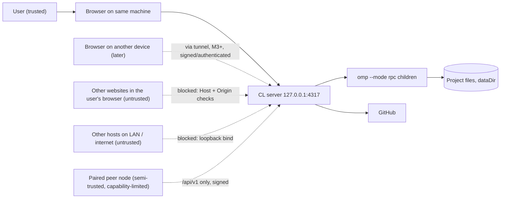

# CL Agent Mesh — Security Model

Scope: M1 (single node, local UI), M3 (remote exposure through a Cloudflare Tunnel, node-to-node requests, pairing), M4 (task delegation between nodes, §5a) and remote UI access with the owner login (§5b) as implemented; later milestones as design. Related: [architecture.md](./architecture.md), [agent-network-protocol.md](./agent-network-protocol.md), [github-integration.md](./github-integration.md), [handoff-protocol.md](./handoff-protocol.md).

## 1. What we protect

| Asset | Why it matters |
| --- | --- |
| Source code and working trees on each node | IP; an agent can edit/run anything in them |
| LLM provider credentials (owned by OMP) | Spend money, access accounts. CL **never** reads OMP's credential store |
| GitHub tokens (owned by CL, per node) | Read/write private repos |
| Node private key (Ed25519) | Impersonate the node to peers, sign fencing tokens |
| Conversation history and tool output | May contain secrets and private data |
| The ability to execute code on a node | The most powerful asset: OMP agents run shell commands |

**The core fact:** CL Agent Mesh fronts a coding agent that can execute arbitrary commands as the local user. Any unauthenticated or cross-origin path to the local API is therefore a remote-code-execution path. Defenses are built around that.

## 2. Actors and trust boundaries

Trust boundaries: browser ↔ server (loopback, M1); server ↔ OMP child (stdio, trusted but its output is untrusted data); server ↔ peer (M3+, signed, capability-limited); server ↔ GitHub (HTTPS, token).

## 3. Threat model (STRIDE-oriented)

| # | Threat | Vector | M1 mitigation | Later |
| --- | --- | --- | --- | --- |
| T1 | **Remote access to local API** | Server bound to `0.0.0.0` or LAN | Bind **`127.0.0.1` only** (`CLAM_HOST` default). `CLAM_HOST` accepts only `127.0.0.1`, `::1` or `localhost`; any other value makes the server **refuse to boot**. Host checks apply regardless | Remote exposure only via the tunnel + signed `/api/v1` (§5) |
| T2 | **DNS rebinding** (attacker domain re-points to 127.0.0.1, page in user's browser calls the API as same-origin) | Malicious website | Reject any request whose `Host` is not `localhost`, `127.0.0.1`, or `[::1]` (any port) → `403 forbidden_host`. `SecurityInfo.allowedHosts` lists them | — |
| T3 | **Cross-site request / WebSocket hijack** | A web page issues `fetch`/`new WebSocket("ws://127.0.0.1:4317/ws")` | Any request (REST or WS upgrade) carrying an `Origin` whose hostname is not `localhost`/`127.0.0.1`/`[::1]` (http/https, any port, so the Vite dev origin works) is rejected `403 forbidden_origin`; `Origin: null` and unparsable origins count as foreign. **No CORS headers** are emitted. Responses carry `X-Content-Type-Options: nosniff`, `Referrer-Policy: no-referrer` and `Content-Security-Policy: frame-ancestors 'none'` | On the public origin the check is stricter (exact public origin, mandatory on writes and upgrades) and sessions are `SameSite=Strict` — see T27 |
| T4 | **Malicious local process** (another user/process on the machine) | Port is reachable by any local process | Same-user trust assumed for M1 (documented limitation). Data dir `0700`, secret files `0600`. No terminal and no OMP RPC endpoint is exposed, so a local port scanner gains only the REST API | Optional local API token (random per run, in dataDir) for multi-user machines |
| T5 | **Exposure of OMP RPC / terminal** | Proxying stdio over the network | **Not exposed, ever.** There is no route that forwards raw RPC frames; the web client can only invoke the typed routes in `@clam/contracts`. No PTY/terminal endpoint in M1. OMP children are spawned with an argv array, never via a shell | Remote nodes interact only through typed `/api/v1` task/message endpoints |
| T6 | **Path traversal** via project/file APIs | `GET /projects/:id/file?path=../../.ssh/id_rsa` | Paths resolved against the project root; symlink-resolved realpath must stay inside the root; absolute paths and `..` segments rejected; size cap and binary detection; `fs/suggest` limited to directories, no file contents | — |
| T7 | **Command injection** | Project paths/branch names/user strings reaching a shell | No shell invocation anywhere: `spawn(file, argv)`; paths/branches validated; `--` separators before user-supplied arguments | — |
| T8 | **Prompt injection → agent misuse** | Malicious repo content or web content instructs the agent to exfiltrate/destroy | Approval modes (OMP): non-`yolo` modes prompt for `write`/`exec`; restricted folders (OMP `tools.restrictedFolders`); the UI surfaces tool calls and approval requests; **approval is not a sandbox** ([omp-rpc-compatibility.md §5](./omp-rpc-compatibility.md#5-tool-approvals)). Secrets are kept out of the agent's reach by design (CL passes no tokens into OMP children) | Delegated tasks run under the *receiver's* approval policy; sender can only request stricter |
| T9 | **Secret leakage via logs/API** | Tokens in logs, error bodies, WS events | Redaction layer for known token patterns (`gho_`, `ghp_`, `github_pat_`, `sk-…`, `Bearer …`); `omp usage` always called with `--redact`; GitHub token never returned by any route; error bodies exclude raw upstream payloads | Same |
| T10 | **Credential theft at rest** | Reading files | GitHub tokens in the OS secret store (macOS Keychain, Linux Secret Service) with an AES-256-GCM encrypted-file fallback (also used on Windows in M1) whose `master.key` sits beside it with mode `0600` — weaker, and shown as such in Settings → Security. The node private key is a `0600` PEM file in `<dataDir>/identity/`. SQLite stores only `credential_ref` | Optional passphrase for the encrypted-file backend |
| T11 | **Supply chain** (npm deps, OMP binary) | Compromised package/binary | Lockfile committed; `allowBuilds` restricts native build scripts to `better-sqlite3`, `esbuild`; OMP is taken from PATH — path shown in Settings so the user can verify it | Dependency audit in CI; signed releases |
| T12 | **Replay/forgery of node requests** (M3, implemented) | Captured `/api/v1` request resent or forged | Ed25519 signatures over method, path, query, **Host**, ids, timestamp, nonce and body digest; ±60 s skew; nonce replay window persisted in SQLite (survives restarts); mandatory idempotency keys on mutating calls; pinned peer keys; per-source and per-peer rate limits; all tested at the route level (replayed, body-tampered, path/query/host-tampered, skewed, unknown, key-mismatched, relayed to another node) ([agent-network-protocol.md §3](./agent-network-protocol.md#3-request-signing)) | Response signing (v2 candidate) |
| T13 | **Rogue/compromised peer node** (M3: capabilities + revocation) | Paired node abused | Capability grants per peer (default `agents.read`, `events.read`, `tasks.*` only), revocation that cuts a peer off before the call returns, an announced address is verified (`GET /node/info` must show the peer's fingerprint) before a signed request is ever sent to it; tasks run under receiver policy, artifact/secret scanning, fencing arrive with M4–M7 | — |
| T14 | **Duplicate execution / split brain** | Handoff races | Ownership epochs + fencing tokens ([handoff-protocol.md](./handoff-protocol.md)) | — |
| T15 | **Tunnel operator / TLS terminator sees traffic** | Cloudflare terminates TLS | Request signing gives integrity/authenticity independent of TLS; sensitive payloads (artifacts) can be end-to-end encrypted to the peer's key (design hook: sealed boxes with X25519 derived from node keys) — **not** implemented before M7 | Evaluate E2E encryption of artifact bodies |
| T16 | **Denial of service** | Request flood, huge bodies | Body size limits (UI JSON 2 MiB, `/api/v1` JSON 1 MiB; uploads capped later); **M3:** per-source token bucket before signature verification (also protects `nonce_log` from flooding), per-peer token bucket after it, a separate bucket on `/node/pair`; WS subscription cap (64 topics); runtime concurrency cap (`maxConcurrentRuntimes`) | Cloudflare WAF/rate limit on the tunnel hostname |
| T17 | **Guessing the invitation code** (M3, implemented) | Anyone who can reach the tunnel URL tries codes | 40-bit random code, ≤ 10-minute TTL, single use, **5 attempts per invitation** counted before the check and then locked, uniform `404` for unknown/expired/consumed/revoked/locked and wrong proofs, mutual HMAC proofs (the code is never sent), full-fingerprint verification by the user before any secret is used, the inviter's user must still approve. **Residual:** a captured hello/reply transcript allows offline guessing within the TTL (the code is only HKDF-protected); the fingerprint check is the mitigation, and a PAKE is the planned upgrade | PAKE (SPAKE2/OPAQUE) |
| T18 | **Tunnel exposes more than `/api/v1`, or a hostile `Host`** (M3, implemented) | Misrouted ingress, DNS rebinding of the network port | The tunnel's origin is a **separate** listener. With remote UI **off** (the default) it serves only `/api/v1` — everything else, including `/`, `/api/local`, `/ws`, static files and `/api/v1/` variants, is a plain 404, verified by test and over a real tunnel; with it **on** the additional surface is exactly the one of §5b (static SPA + owner-session-gated `/api/local` and `/ws`). The listener accepts only loopback names and its own tunnel hostname as `Host`; `cloudflared` is told the origin explicitly and the named-tunnel token travels in a `0600` file, never argv, env or logs | Cloudflare Access on the hostname |

Out of scope for M1: protection from a malicious user with full control of the same OS account; hardware attacks; compromise of OMP itself or the model provider.

## 4. M1 baseline controls (implemented in `apps/server`)

1. `listen({ host: CLAM_HOST ?? "127.0.0.1", port: CLAM_PORT ?? 4317 })`. `CLAM_HOST` is validated at boot: only `127.0.0.1`, `::1` and `localhost` are accepted; anything else aborts startup (no warning-and-continue path). `SecurityInfo.bindAddress` reports the bind. A refused WS upgrade (bad `Host`/`Origin`) gets `403` and the socket is closed.
2. **Host check** hook on every HTTP request: accept only `localhost`, `127.0.0.1`, `[::1]` (any port). Others → `ApiError` 403 `invalid_host`.
3. **Origin check:** every request (REST and WS upgrade) with an `Origin` header must be a local origin; `Origin` absent (non-browser local clients like curl) is allowed. A refused WS upgrade gets `403` and the socket is closed.
4. No CORS enabled (the dev Vite proxy makes the browser see a same-origin API). Request bodies are capped at 2 MiB.
5. Typed validation of every body/query with the contracts' Zod schemas; global error handler returns `ApiErrorBody` without stack traces; `ZodError` → 400. Logs redact `*.token`, `*.secret`, `*.password` and `authorization` headers.
6. Secret-bearing files (`identity/ed25519.key`, `secrets/`) are created `0600` in `0700` directories.
7. No route executes arbitrary commands; OMP interaction is only through typed commands built by the adapter. `bash` RPC command is **not** surfaced.
8. Secrets: only the `SecretStore` API; no secret ever in SQLite, logs or responses.
9. OMP isolation: the server never reads or writes OMP's `agent.db`, `models.db`, `approval-cache.db`, `secret-placeholder.key`, or the user's `config.yml` except through `omp config get|set` ([omp-rpc-compatibility.md](./omp-rpc-compatibility.md)).
10. Security UI: **Settings → Security** shows bind address, allowed hosts, remote API status (`remoteApiEnabled` is true only while a tunnel is up), secret-store backend + location, node fingerprint (`SecurityInfo`).
11. **Network listener (M3):** `CLAM_NETWORK_HOST` (loopback only, otherwise boot refuses) / `CLAM_NETWORK_PORT` (default UI port + 1; must differ from the UI port). It is a second Fastify instance that serves `/api/v1` and — only when the owner enables remote UI (§5b) — the owner web UI surface behind a login; with remote UI off it has no static files, no WebSocket and no `/api/local`. The UI listener never serves `/api/v1`. Peer URLs must be `https://`; `CLAM_ALLOW_LOOPBACK_PEERS=1` additionally allows `http` to `127.0.0.1`/`localhost`/`[::1]` for development and tests and is **insecure** (no TLS, host binding degenerates to the port; the listener's own loopback origin also counts as its public origin for the CSRF check, §5b): never set it on a node that is exposed through a tunnel you do not control.

## 5. Remote exposure (M3): Cloudflare Tunnel + signed node requests

* Remote access is **never** achieved by binding a public interface. `cloudflared` (started and supervised by the server, `@clam/cloudflare-tunnel`) connects the **network listener** (`127.0.0.1:<networkPort>`, `/api/v1`, plus the login-gated owner UI of §5b when enabled) to Cloudflare. Two modes: **quick** (no account; random `https://*.trycloudflare.com`, new on every start, announced to peers) and **named** (the user's own hostname routed to `http://127.0.0.1:<networkPort>` in the Cloudflare dashboard; the token from the dashboard is stored in the secret store, written to `<dataDir>/run/tunnel-token` (`0600`, directory `0700`) for `cloudflared --token-file` while the tunnel runs and removed when it stops, and never appears in argv, environment, logs, API responses or SQLite). The loopback UI listener (`/api/local`, `/ws` without login) is a different listener and is never reachable through the tunnel.
* Every `/api/v1` request (except the three public endpoints) is authenticated by an Ed25519 signature over a canonical string (method, path, query, host, timestamp, nonce, request id, correlation id, idempotency key, body digest), checked against the **pinned** public key of a **paired** peer, then authorized by capability ([agent-network-protocol.md §3, §10](./agent-network-protocol.md#3-request-signing)). The signed `Host` is the receiver's public hostname exactly as cloudflared forwards it (measured: the public hostname, no `X-Forwarded-Host`). Tunnel-level access policies (Cloudflare Access) may be added on top but are never a substitute.
* **Cloudflare sees the traffic.** TLS terminates at Cloudflare, so metadata and bodies are visible to it; signatures give authenticity and integrity independent of TLS, not confidentiality (T15). Do not put secrets into task payloads or messages: M3 carries only identities, agent lists, health and events, and M4 adds the task payloads of §5a, which Cloudflare can read.
* **Quick tunnels are for trying things out:** the URL is random but public, changes at every start (peers follow through `POST /node/announce`, verified by fingerprint), and Cloudflare documents no uptime guarantee; they also buffer event streams, so the node relies on polling. Use a named tunnel for anything permanent.
* Browsing a node's UI from a different device goes through the node's own domain and the owner login of §5b (password, `__Host-` session cookie, strict Origin check, throttled login, session expiry). It is **off by default** and can only be switched on from the machine itself.
* Pairing uses a short-lived single-use invitation code plus user-verified fingerprints ([agent-network-protocol.md §11](./agent-network-protocol.md#11-pairing-handshake)); the inviter's user approves each joiner and chooses its capabilities. Revocation is immediate.
* **No control plane exists**: pairing is node to node. If one is added later it may see metadata (node ids, names, public keys, URLs) but never private keys, tokens, or task content, and never has authority to issue requests to a node on behalf of another.

---

## 5a. Task delegation (M4): what crosses nodes, and what can go wrong

**What crosses the network** (all inside signed `/api/v1` requests): the task (id, title, description, GitHub repository URL, base branch, `deliverAs`, advisory constraints, the delegating agent's display name), discussion messages (kind, text, author display name), status/events/result (summary text, branch name, commit sha, compare URL, artifact names/sizes/hashes), the cost of the run, and — on request of the task's sender only — task artifacts. **What never crosses:** credentials of any kind (GitHub tokens, OMP provider credentials, keys), OMP session files or transcripts, absolute local paths, the contents of the executor's working tree (code travels through Git, not through the mesh), OMP RPC frames, and `tasks.exec_state` (executor-private run state). The local project id of the other node is never sent either: the executor maps the repository URL to **its own** project.

| # | Threat | Mitigation (M4) |
| --- | --- | --- |
| T19 | **A paired peer makes this node run arbitrary work** (a task is a prompt to an agent that can execute commands) | `tasks.send` is a capability the executor's user grants (default pairing grant includes it); **a human accepts each task unless the executor's per-peer `autoAcceptTasks` is on AND exactly one local project is linked to the task's repository** — a task for an unknown repository never runs by itself. The agent runs under the **receiving** node's approval mode; the sender's constraint can only make it stricter (`strictestApprovalMode`), never looser, and `maxCostUsd` is enforced by OMP `--max-cost`. Approval is not a sandbox (T8): auto-accept is a trust decision about that peer and defaults to off. |
| T20 | **Agents talking to each other in a loop / prompt injection through messages** | Injected messages are framed `[CL Agent Mesh] … from <agent>@<node>` so the receiving agent (and the human reading the transcript) sees they come from another node, not from the user; each node's agents may author at most **12 messages per task without a human message** (`AGENT_MESSAGE_LIMIT`), after which `mesh_message` fails with "a human must continue" and the UI shows the budget; only the task's own delegating/executing session may use `mesh_message`/`mesh_task`, only the executing session `mesh_complete`; only the sender may send an `instruction`. A message is text for the agent, not a command channel: nothing in it is executed by CL. |
| T21 | **Duplicate or replayed delivery causing a task to run twice** | `taskId` and `messageId` are natural idempotency keys; the `(peer, Idempotency-Key)` response store replays the first answer; the outbox re-sends the identical body; a sender returning from downtime reconciles by polling and never executes anything. Covered by tests (duplicate create, out-of-order messages, executor and sender restarts, network cut). |
| T22 | **Reading another peer's tasks or artifacts** | `GET /tasks/:id` and artifacts answer `404` unless the caller is that task's own peer (a third paired node cannot even learn that it exists); artifacts are downloadable by the task's sender only. |
| T23 | **Secrets leaving through a task result** | The executor never offers an artifact that fails the secret scan (text artifacts are scanned with `scanForSecrets` before they are stored; a hit refuses the artifact and reports the rule and line, never the value; 25 MiB cap). The code the agent wrote leaves only through the **executor's own** push to GitHub, with the executor's account, to a task branch, never forced. Ordinary agent commits are not scanned (as in M2): review the branch before merging. |
| T24 | **A task branch overwriting shared history** | The task branch is created from the **sha** of `origin/<base>` (no upstream) and pushed with `--set-upstream` to its own name; the push path refuses a branch whose upstream is anything else, so it can never land on the base branch; pushes are never forced; a refused push becomes a patch artifact. |
| T25 | **Stale owner acting after a handoff** (design for M7) | Tasks already carry `epoch`; `cancel`/`messages` with a lower epoch answer `409 stale_epoch`, the mirror ignores older records. Fencing tokens arrive with handoffs. |

## 5b. Remote UI access: the owner logs in through the node's own domain

Each node's domain (its tunnel) can also serve **that node's own web UI to its owner**. The single fact that shapes everything below: an owner session controls coding agents that run commands as the local user, so a session is as powerful as a shell on the machine. The surface is therefore **off by default**, can only be switched on **at the machine**, and is gated by a login that is deliberately conservative.

**Three surfaces, three trust models**

| Surface | Reached through | Auth |
| --- | --- | --- |
| UI listener `127.0.0.1:<port>` | the browser on the machine | none (same-user trust, Host/Origin checks of §4) |
| Network listener, `/api/v1/*` | tunnel | Ed25519 node signature + capability; **never reads cookies** (byte-for-byte unchanged by remote UI; covered by test) |
| Network listener, UI surface (`/`, static files, `/api/local/*`, `/ws`) | tunnel | **only when `remoteUiEnabled`**; static files public (they contain no data); `/api/local/*` and `/ws` need a valid owner session. With the switch off every one of these answers the same plain 404 as any unknown path |

Both listeners mount the **same** route plugins, WebSocket hub and static serving (`registerUiSurface` in `apps/server/src/app.ts`); only the gate in front differs (`apps/server/src/auth/gate.ts`). The surface runs in its own Fastify scope (own JSON parser, body limit, headers, compression), so mounting it cannot change `/api/v1`. A WebSocket upgrade for anything but the surface's `/ws` is still dropped without an answer, as before.

**Owner credential.** One password per node, ≥ 12 characters, hashed with **scrypt** (N=2^15, r=8, p=1, 16-byte random salt, 64-byte key, NFKC-normalised) and stored as a self-describing `scrypt$N$r$p$salt$hash` string in SQLite `settings` (never the password). The **first** password can only be set from the loopback UI. Afterwards it can be changed from loopback (no old password needed: that is the machine's owner) or remotely by a signed-in owner who also proves `currentPassword` (checked through the same throttle as login). Changing the password, enabling→disabling remote UI, or `logout-all` ends every remote session. Verification is constant-time (`timingSafeEqual` over scrypt output); with no password set (or a damaged hash) a login still runs a full scrypt against a throw-away hash, so timing does not reveal state. Password checks run one at a time; more than 6 waiting are refused with `429` (scrypt costs ~100 ms and 32 MiB each).

**Session.** Cookie `__Host-clam_session` — `HttpOnly; Secure; SameSite=Strict; Path=/`, no `Domain` (the `__Host-` prefix makes browsers enforce that). Value: `base64url(claims).base64url(HMAC-SHA256)` with claims `{sid, iat, ren, exp, epoch}` and a random 32-byte key in `@clam/secret-store` (`access.session-key`); the signature is compared in constant time and every claim is shape-checked. Lifetime: sliding **12 h** (configurable 1 h–7 d, loopback only), re-issued at most once a minute while the owner is active, with a hard cap of **7 days** from the login. A token is dead if it is expired, over the cap, from an older `epoch` (`logout-all`, password change, disabling remote UI bump `settings.access.epoch`), or its `sid` was logged out (the revoked list is persisted, so a restart does not resurrect a copied cookie). A cookie the node no longer honours is cleared in the response. Open WebSockets are closed with code **4401** when their session ends (logout, epoch bump, expiry, remote UI disabled).

**CSRF and cross-origin.** On the public listener every request that carries an `Origin`, every write (`POST/PUT/PATCH/DELETE`) and every WebSocket upgrade must present an `Origin` equal to this node's **public origin** (`https://<current tunnel hostname>`, quick or named); anything else — foreign, `null`, `http://`, a look-alike suffix, or **absent on a write/upgrade** — is `403 forbidden_origin`, login included (login CSRF). No CORS headers exist. `SameSite=Strict` is the second layer. The listener's `Host` must be the tunnel hostname or loopback (existing rule), checked before anything else. With `CLAM_ALLOW_LOOPBACK_PEERS=1` (development/tests, insecure) the listener's own `http://127.0.0.1|localhost|[::1]:<networkPort>` also counts as its public origin so the UI can be driven without a real tunnel.

**Login throttling.** Uniform answer for every failure (`401 invalid_credentials`, same message). Per client address: 5 consecutive failures, then a lockout of 30 s doubling per further failure up to 15 min; failures are forgotten after an hour; a success clears them. Globally: more than 20 failures within 60 s (guesses spread over many addresses) locks **everyone** out for 30 s, doubling while it continues, until a real login or 30 quiet minutes. While locked, even the right password is refused (`429 rate_limited`, `Retry-After`, `details.retryAfterSeconds`). The client address is `cf-connecting-ip`, which is trustworthy **only because** the network listener binds loopback and only `cloudflared` (which overwrites that header) and local processes can reach it; a local process can spoof it, which merely lets it pick its own throttle bucket — it could use the UI port anyway. Tracked clients are capped (10 000) so spoofed identities cannot grow memory.

**Loopback-only controls.** `PATCH /access` (enable/disable remote UI, session TTL), `PUT /tunnel/config`, and the first password answer `403 loopback_only` through the tunnel even to a signed-in owner: the tunnel cannot be used to widen or re-point its own exposure.

**Response headers on the public origin.** `Strict-Transport-Security: max-age=31536000`; `Content-Security-Policy: default-src 'none'; script-src 'self' <sha256 of each inline script of the built index.html>; style-src 'self' 'unsafe-inline'; img-src 'self' data: blob:; font-src 'self' data:; connect-src 'self' wss://<host>; manifest-src 'self'; base-uri 'none'; object-src 'none'; form-action 'self'; frame-ancestors 'none'` (the one inline theme script is allowed by hash computed from the file; no `unsafe-eval`; styles keep `unsafe-inline` because the UI sets inline `style` attributes at runtime); `X-Content-Type-Options: nosniff`; `Referrer-Policy: no-referrer`; `Cross-Origin-Opener-Policy` and `Cross-Origin-Resource-Policy: same-origin`; `Permissions-Policy` denying camera, microphone, geolocation, payment, USB; `Cache-Control: no-store` on every `/api/local` and `/ws` response. The loopback UI listener's headers are unchanged.

| # | Threat | Mitigation |
| --- | --- | --- |
| T26 | **Guessing the owner password** over the internet | Throttled login with exponential per-client and global lockout, one scrypt check at a time, uniform errors, ≥ 12-character minimum; the surface does not exist until the owner switches it on. **Residual:** a botnet can trigger the global lockout and lock the real owner out for up to 15 min per escalation (availability, not confidentiality); the owner can always act at the machine. Use a long passphrase |
| T27 | **CSRF / cross-site WebSocket hijack** against the public origin | Exact-origin check on all writes, upgrades and any request that has an `Origin`; `SameSite=Strict`; no CORS; strict CSP with `frame-ancestors 'none'`, `form-action 'self'` |
| T28 | **Forging, stealing or replaying a session cookie** | HMAC-signed with a key that never leaves the secret store, constant-time verify, shape-checked claims; `HttpOnly` (no script access), `Secure` + `__Host-` (HTTPS, no sibling-domain override); sliding 12 h and 7-day cap; per-session revocation and epoch revocation; sessions die with a password change. **Residual:** a stolen valid cookie works until it expires or is revoked (no device binding), and TLS terminates at Cloudflare (T15) — the password and cookie transit it |
| T29 | **The tunnel used to re-expose or reconfigure the node** | Exposure routes are loopback-only (`403 loopback_only`); `/api/v1` ignores cookies entirely; a wire-path request never enters the UI gate; remote UI off ⇒ plain 404 for every UI path |
| T30 | **XSS in the SPA becoming node takeover** | CSP without `unsafe-eval`, scripts only from the same origin plus one hashed inline script, no inline event handlers possible; React escapes by default; `HttpOnly` keeps the cookie out of reach, but an XSS could still drive the API as the owner — treat any script-injection bug in the SPA as critical |
| T31 | **Path tricks to dodge the gate** (`/%61pi/local/…`, trailing slashes, unknown routes) | The gate decodes the path exactly as the router does and also keys on the matched route; unknown `/api/local/*` routes are caught by a gated wildcard, so a signed-out caller sees `401` for existing and non-existing API paths alike (tested) |

Not implemented, by design for now: second factor / passkeys, per-device sessions list, per-route authorisation inside an owner session (a session is the owner), binding cookies to a device. Cloudflare Access in front of the hostname is the recommended extra layer for a named tunnel.

---

## 6. What may enter Git and handoff artifacts

**Allowed in `.clmesh/` and handoff manifests** (shareable): source, docs, architecture notes, *approved* workspace memory, agent plans, task snapshots, handoff manifests, context indexes (hashes/paths), environment requirements (names of env vars, tool versions).

**Never** in Git, manifests, or events: credentials, API keys, OAuth/GitHub tokens, private keys, plaintext secrets, `.env` values, private conversation history, OMP session files (`*.jsonl`), OMP databases, temporary runtime data, absolute local paths, full tool outputs.

Enforcement:

* A **secret scanner** (provider token regexes — GitHub, OpenAI, Anthropic, AWS, Slack, Stripe, JWT, PEM private key blocks — plus an entropy detector and a deny-list of file names such as `.env*`, `*.pem`, `id_*`) runs on every file written under `.clmesh/`, every manifest, conversation summary, and every artifact offered to a peer. A hit **blocks** the operation and reports file + rule (never the matched value).
* **M4 status:** task artifacts are scanned before they are stored (§5a, T23); the task description and message text are **not** scanned (they are prose between two of your own nodes) — do not paste credentials into them.
* **M2 status:** the scanner implemented in `@clam/git-engine` (`scanForSecrets`) covers provider tokens, private-key blocks, URL credentials, bearer tokens, generic secret assignments and a high-entropy detector, and runs on the two files `POST /projects/:id/clmesh/init` writes (a hit answers `422 git_secret_detected`). It does **not** yet scan arbitrary working-tree commits; ordinary commits are the user's/agent's responsibility. The file-name deny-list and the handoff/peer paths arrive with M6/M7.
* `.clmesh/` writes use an allow-list of file types/paths; anything else is refused.
* `omp session pack` content is treated as secret-bearing: opt-in only, never committed (see [handoff-protocol.md §9](./handoff-protocol.md#9-relation-to-omp-handoff-and-session-pack)).
* OMP's own prompt obfuscation (`secrets.enabled`) is complementary and is **not** relied upon.

## 7. Secrets handling summary

| Secret | Owner | Where it lives | Never |
| --- | --- | --- | --- |
| LLM provider credentials | OMP | OMP's own store (`agent.db`/broker) | read/written/copied by CL; shown in UI (`omp usage --redact`) |
| GitHub tokens | CL (per node) | `@clam/secret-store`; handed to `git` only through the askpass broker (one-time nonce over a `0700` Unix socket, [github-integration.md §8](./github-integration.md#8-git-authentication-for-operations)) | in SQLite, logs, API responses, git remote URLs, `.git/config`, child process args/env, files |
| Node private key | CL | `<dataDir>/identity/ed25519.key` (PEM, `0600`) in M1 | leaves the node; in backups of the DB (it is not in SQLite) |
| Invitation codes | CL | shown once; only `code_hash` in SQLite; the HKDF-derived code key lives in the secret store until the joiner's hello is verified (then deleted) | stored in SQLite, logged, put in events |
| Named-tunnel token | CL | `@clam/secret-store` (`tunnel.token`); `<dataDir>/run/tunnel-token` (`0600`) only while the tunnel runs, for `cloudflared --token-file` | in SQLite, argv, environment, logs, API responses |
| Owner password (remote UI, §5b) | CL (per node) | only its scrypt hash + salt, in SQLite `settings` (`access.password`) | stored in clear, logged, returned by any route, put in events or backups of anything else |
| Session signing key (remote UI, §5b) | CL | `@clam/secret-store` (`access.session-key`, 32 random bytes) | in SQLite, logs, API responses; the session cookie itself is never logged or stored server-side |
| Fencing tokens | CL | DB (they are signatures, not secrets) | — |
| Task content (M4: descriptions, messages, results, artifacts) | CL (per node) | SQLite (`tasks`, `task_messages`, `task_events`) and `<dataDir>/artifacts/` (`0700`/`0600`); **not secret by design** — it crosses to the paired peer and through Cloudflare | credentials in it: authors must not put secrets in task text; artifacts are scanned before they are offered |

Pre-migration snapshots of `<dataDir>/clam.db` contain no secrets by construction. The encrypted-file secret store is excluded from automatic backups.

## 8. Logging and privacy

Structured JSON logs (pino) with redaction; request/correlation ids on every line; message bodies and tool output are **not** logged at info level. No telemetry or analytics leaves the machine. Usage dashboards are computed locally.

## 9. Security checklist for contributors

* New route? Validate with a Zod schema, throw `ApiError`, no shell, no raw OMP passthrough.
* New file read/write? Resolve + confine to the allowed root.
* New child process? argv array, scrubbed env, timeout, output size cap.
* New secret? SecretStore only; add a redaction pattern.
* New remote surface? Needs signing, capability, idempotency, rate limit, and an entry in the threat table above.
